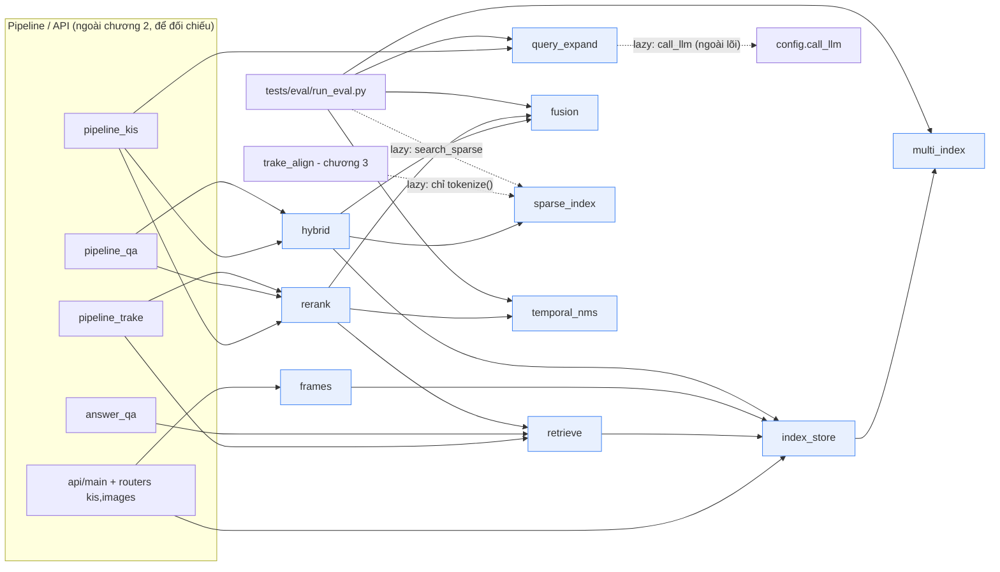
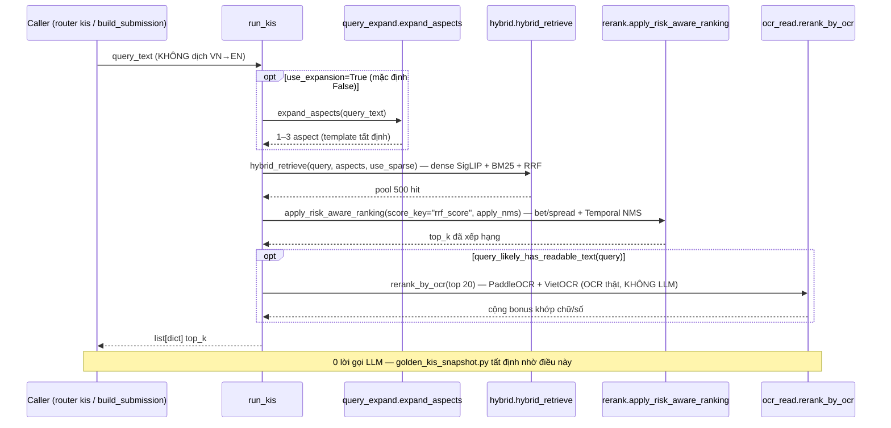
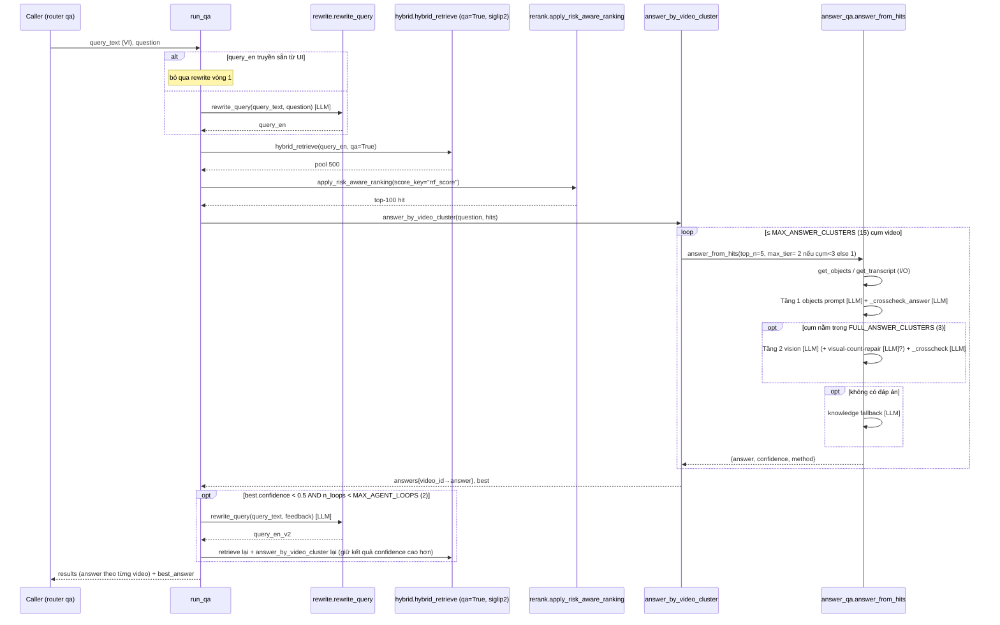
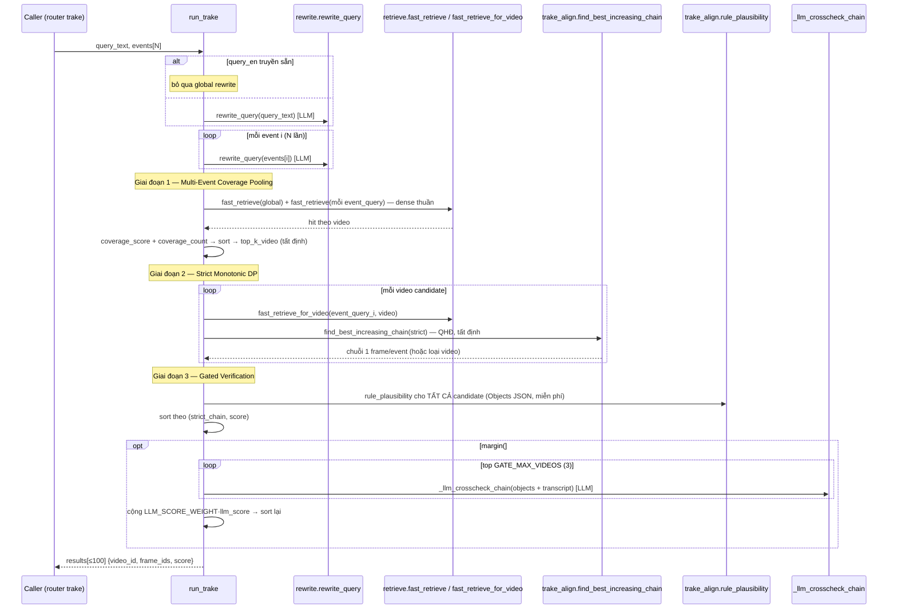
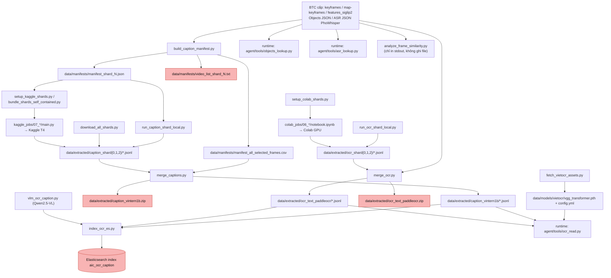

# Báo cáo Rà soát Source Code — Hệ thống AIC2026

### Tóm tắt điều hành

**Hệ thống.** AIC2026 là hệ thống truy hồi frame video bằng ngôn ngữ tự nhiên cho cuộc thi AIC
2026: một retriever dùng chung (ma trận embedding SigLIP / SigLIP 2 trên ~177K keyframe), ba
pipeline riêng KIS / Q&A / TRAKE, một tầng agent LLM cho Q&A + TRAKE, bộ dựng + validate file
nộp CSV/ZIP, và UI React tách khỏi backend FastAPI. Chấm điểm BTC:
`Final Score = (1/5)·Σ R@k` với `k ∈ {1,5,20,50,100}`, trung bình trên mọi truy vấn — chỉ cú
trúng đầu tiên trong top-k có giá trị, và top-20 nặng ký hơn hẳn phần đuôi; Q&A còn cần
`answer` khớp.

**Quy mô (phạm vi đóng băng tại `7d7bcea` — 208 file; báo cáo mang 209 mục `####` do cây `tests/`
đổi giữa đợt, xem [§0.5](#05-giới-hạn-của-chính-đợt-audit)).**

| Tầng | Nhóm file | Số file |
|---|---|---|
| Tài liệu điều hướng + config ở repo root | `CLAUDE.md`, `README.md`, `ARCHITECTURE.md`, `PLAN.md`, `requirements.txt`, … | 11 |
| Lõi truy hồi | `scripts/agent/tools/` (retrieval) | 10 |
| Tool nghiệp vụ Q&A / TRAKE / bằng chứng | `scripts/agent/tools/` | 12 |
| Pipeline + cổng LLM | `scripts/agent/` | 6 |
| API | `scripts/api/` | 13 |
| Nộp bài + tiền xử lý offline | `scripts/submit/` (4) + `scripts/offline/` (25) | 29 |
| Kiểm thử + đo chất lượng | `tests/` | 49 → 50 |
| Frontend | `frontend/` | 39 |
| Job GPU ngoài | `kaggle_jobs/` (35) + `colab_jobs/` (4) | 39 |

**Phát hiện.** 68 finding có nội dung (gồm `FINDING-7.8` và `FINDING-7.11` bổ sung sau, xem
[§0.5](#05-giới-hạn-của-chính-đợt-audit)):

| Mức độ | Số lượng | Số hiệu |
|---|---|---|
| **Cao** | 7 | 2.2 · 6.1 · 6.2 · 7.1 · 7.2 · 7.3 · 8.1 |
| **Trung bình** | 34 | 1.2–1.5 · 2.1 · 2.3–2.5 · 3.2 · 3.3 · 3.6 · 3.7 · 4.1 · 4.3 · 5.1 · 5.3 · 6.3–6.10 · 7.4–7.6 · 8.2 · 8.3 · 8.5 · 8.6 · 9.1–9.3 |
| **Thấp** | 27 | 1.1 · 1.6 · 2.6 · 2.7 · 3.1 · 3.4 · 3.5 · 3.8 · 4.2 · 5.2 · 5.4 · 6.11–6.13 · 7.7–7.11 · 8.4 · 8.7–8.9 · 9.4–9.7 |

Bảng đầy đủ ở [§10.1](#101-bảng-tổng-hợp-toàn-bộ-finding); tám chủ đề xuyên suốt ở
[§10.2](#102-điểm-yếu-hệ-thống-theo-chủ-đề); những gì hệ thống làm **đúng** ở
[§10.4](#104-những-gì-hệ-thống-làm-đúng).

**Ba rủi ro cao nhất cho kết quả thi đấu** (chi tiết + cách kiểm chứng ở
[§10.3](#103-ba-rủi-ro-cao-nhất-cho-kết-quả-thi-đấu)):

1. **Hybrid retrieval âm thầm rơi về dense-only** khi thiếu cache BM25 trên máy thi
   (FINDING-2.2) — tín hiệu object/OCR/caption biến mất khỏi xếp hạng, R@1…R@20 tụt trên mọi
   truy vấn cần khớp chữ/tên riêng/số, **không có cảnh báo** và không harness nào phân biệt được.
2. **`AIC_MODE=contest` mà `OPENROUTER_MODEL_CONTEST` trống → chạy tiếp bằng model rẻ**
   (FINDING-4.1) — Q&A mất nửa điểm `answer` kể cả khi frame đúng; cross-check TRAKE yếu đi.
3. **Bug đóng gói file nộp lọt qua validator** (FINDING-6.1, 6.2) — validator không kiểm tên
   file khớp loại truy vấn hay số dòng TRAKE khớp N; kênh bắt lỗi thủ công (`test_smoke_pipelines.py`)
   thì đang hỏng vì import sai (FINDING-7.5) — một gói "validate PASS" vẫn có thể cho cả một loại
   truy vấn hoặc các dòng TRAKE 0 điểm.

**Đánh giá độ trưởng thành.** Kiến trúc phân tầng rành mạch và kỷ luật tài liệu cao bất thường
cho một dự án thi (4 bucket chia theo *thời điểm code chạy*, module pure tách để eval tái dùng,
`decisions-log.md` ghi cả sai lầm cũ). Nhưng **tầng đo lường và bảo vệ hồi quy yếu hơn hẳn tầng
nó phải bảo vệ**: lõi truy hồi gần như không có unit test, lưới regression tất định duy nhất
đang đỏ vĩnh viễn vì lệch dữ liệu, và nhiều invariant quan trọng (`frame_id+1`, luật on-demand
OCR, nhãn "pure") chỉ sống trong văn bản, không test nào canh. Hệ thống **chạy được**, nhưng
chưa có lưới an toàn để thay đổi nhanh mà an toàn trong tuần cuối trước hạn nộp.

- **Ngày:** 2026-08-31
- **Commit:** `7d7bcea`
- **Nhánh:** `fix/phase2`

Báo cáo này đọc từng file source trong phạm vi (xem §0.2), giải thích vai trò của nó, và ghi lại
mọi điểm bất hợp lý / điểm yếu phát hiện được dưới dạng `FINDING-nn` (đánh số liên tục toàn báo cáo).
Mọi phát biểu về hành vi đều lấy từ việc đọc code hoặc chạy lệnh, không suy từ tên file và không suy
từ tài liệu; khi code mâu thuẫn tài liệu thì chính điều đó là finding.

### Mục lục

- [0. Bối cảnh, phạm vi và phương pháp](#0-bối-cảnh-phạm-vi-và-phương-pháp)
  - [0.5. Giới hạn của chính đợt audit](#05-giới-hạn-của-chính-đợt-audit)
- [1. Tầng gốc: tài liệu điều hướng và cấu hình](#1-tầng-gốc-tài-liệu-điều-hướng-và-cấu-hình)
- [2. Lõi truy hồi (retrieval core)](#2-lõi-truy-hồi-retrieval-core)
- [3. Tool nghiệp vụ: Q&A, TRAKE, bằng chứng](#3-tool-nghiệp-vụ-qa-trake-bằng-chứng)
- [4. Tầng pipeline và cổng gọi LLM](#4-tầng-pipeline-và-cổng-gọi-llm)
- [5. Tầng API (FastAPI backend)](#5-tầng-api-fastapi-backend)
- [6. Tầng nộp bài và tiền xử lý offline](#6-tầng-nộp-bài-và-tiền-xử-lý-offline)
- [7. Tầng kiểm thử và đo chất lượng](#7-tầng-kiểm-thử-và-đo-chất-lượng)
- [8. Frontend (React + Vite)](#8-frontend-react--vite)
- [9. Job GPU ngoài (Kaggle / Colab)](#9-job-gpu-ngoài-kaggle--colab)
- [10. Tổng hợp: bất hợp lý và điểm yếu hệ thống](#10-tổng-hợp-bất-hợp-lý-và-điểm-yếu-hệ-thống)
  - [§10.1. Bảng tổng hợp toàn bộ finding](#101-bảng-tổng-hợp-toàn-bộ-finding)
  - [§10.2. Điểm yếu hệ thống theo chủ đề](#102-điểm-yếu-hệ-thống-theo-chủ-đề)
  - [§10.3. Ba rủi ro cao nhất cho kết quả thi đấu](#103-ba-rủi-ro-cao-nhất-cho-kết-quả-thi-đấu)
  - [§10.4. Những gì hệ thống làm đúng](#104-những-gì-hệ-thống-làm-đúng)
  - [§10.5. Đề xuất kiểm chứng: `tests/unit/test_invariants.py`](#105-đề-xuất-kiểm-chứng-testsunittest_invariantspy)

## 0. Bối cảnh, phạm vi và phương pháp

### 0.1. Hệ thống này là gì

AIC2026 là hệ thống **truy hồi frame video bằng ngôn ngữ tự nhiên** cho Hội thi Thử thách Trí tuệ
Nhân tạo TP.HCM 2026. Đầu vào là một câu mô tả sự kiện (tiếng Việt hoặc tiếng Anh); đầu ra tuỳ theo
ba loại truy vấn: **KIS** (Known-Item Search) trả về danh sách xếp hạng 100 dòng `video_id` +
`frame_id` cho một khoảnh khắc cụ thể; **Q&A** trả về frame mục tiêu kèm một `answer` cho câu hỏi nội
dung; **TRAKE** trả về một chuỗi `frame_id` theo đúng thứ tự thời gian cho N mốc sự kiện. Hệ thống
gồm một retriever dùng chung (ma trận embedding SigLIP / SigLIP 2 trên ~177K keyframe), ba pipeline
riêng cho KIS/Q&A/TRAKE, một tầng agent LLM cho Q&A và TRAKE, và bộ dựng + validate file nộp CSV/ZIP.
Chấm điểm theo công thức BTC: với mỗi truy vấn, `R@k` là chỉ báo có ít nhất một dòng đúng trong k
dòng đầu; **Final Score = (1/5) · Σ R@k** với `k ∈ {1, 5, 20, 50, 100}`, lấy trung bình trên toàn bộ
truy vấn. Vì `R@k` là hàm `max` trên k dòng đầu, chỉ cú trúng đầu tiên có giá trị và việc xếp đúng
20 dòng đầu quan trọng hơn hẳn 80 dòng còn lại.

### 0.2. Phạm vi và loại trừ

**Luật tính phạm vi** (viết một lần, mọi phép đếm dùng đúng nó):

> In-scope = file được `git ls-files` track, **trừ** phần mở rộng media/binary
> (`.jpg .jpeg .png .svg .pdf .pptx .npy .mp4`), **trừ** mọi đường dẫn chứa `_archive`,
> **trừ** `frontend/package-lock.json`, **trừ** các thư mục `.agents/ .superpowers/ .claude/ docs/
> data/ submissions/` — **cộng** đúng hai ngoại lệ tái đưa vào: `package-lock.json` ở root và
> `docs/decisions-log.md`.

Lệnh tái lập (chạy tại commit `7d7bcea`):

```
EX='\.(jpg|jpeg|png|svg|pdf|pptx|npy|mp4)$|_archive|frontend/package-lock\.json'
git ls-files scripts tests frontend kaggle_jobs colab_jobs | grep -Ev "$EX" | wc -l   # 197
# + 11 file tầng gốc của Task 1 = 208
```

**Trong phạm vi — 208 file:**

| Nhóm | Số file | Chương | `####` lũy kế sau chương |
|---|---|---|---|
| Root: docs điều hướng + config | 11 | 1 | 11 |
| `scripts/agent/tools/` — retrieval core | 10 | 2 | 21 |
| `scripts/agent/tools/` — Q&A / TRAKE / evidence | 12 | 3 | 33 |
| `scripts/agent/` — pipeline + LLM config | 6 | 4 | 39 |
| `scripts/api/` | 13 | 5 | 52 |
| `scripts/submit/` (4) + `scripts/offline/` (25) | 29 | 6 | 81 |
| `tests/` | 49 | 7 | 130 |
| `frontend/` | 39 | 8 | 169 |
| `kaggle_jobs/` (35) + `colab_jobs/` (4) | 39 | 9 | 208 |

**Ngoài phạm vi — lý do loại trừ từng nhóm:**

- `.agents/`, `.superpowers/`, `.claude/` — cấu hình agent của công cụ khác (Antigravity) và cache
  plugin / ghi chú SDD cục bộ, không phải hệ thống retrieval. [CLAUDE.md](../../CLAUDE.md#L108) yêu
  cầu không coi `.agents/` là chỉ dẫn cho Claude Code.
- `data/`, `submissions/*.zip` — state ngoài, git-ignored, không có trong repo (xem
  [.gitignore](../../.gitignore#L4) và [.gitignore](../../.gitignore#L12)).
- `docs/` — tài liệu tham khảo, **trừ** `docs/decisions-log.md` được kéo vào chương 1 vì nó ghi lịch
  sử quyết định và sai lầm, là bằng chứng trực tiếp cho chương 10.
- `docs/_archive/`, `kaggle_jobs/_archive_logs_20260819/` — bản bị thay thế, giữ để tra cứu lịch sử.
- `frontend/package-lock.json`, `frontend/public/*.svg`, các file `.jpg` sinh ra dưới
  `scripts/offline/` — lockfile sinh tự động (nằm trong toolchain riêng của `frontend/`) và file
  media/binary.
- `package-lock.json` ở **root** thì **ngược lại — nằm TRONG phạm vi** (chương 1), vì sự tồn tại của
  nó ở root mâu thuẫn với tuyên bố "toolchain Node chỉ sống trong `frontend/`". Nó là đối tượng cần
  giải thích, không phải file cần bỏ qua — xem FINDING-1.1.

**Vì sao báo cáo nằm ở `docs/reports/`:** [CLAUDE.md](../../CLAUDE.md#L110) mô tả `docs/reports/` là
nơi chứa "generated eval numbers". Báo cáo này là tài liệu sinh ra từ phân tích source, gần bucket đó
nhất; không tạo một bucket `docs/` mới cho một file duy nhất. Người đọc lưu ý: đây **không** phải số
liệu eval — mọi con số eval được trích trong báo cáo đều kèm nguồn và không kèm nhận xét chất lượng.

### 0.3. Cách đọc một mục file

Mỗi file trong phạm vi có **đúng một** mục theo schema cố định dưới đây. Mọi chương 1→9 dùng đúng
schema này, không biến tấu, không thêm/bớt trường. (Dòng tiêu đề `####` trong khối ví dụ bên dưới
được thụt lề để phép đếm `grep -c "^#### "` luôn bằng đúng số file đã viết — mục file **thật** đặt
`####` ở đầu dòng.)

```markdown
    #### [`<tên file>`](<đường dẫn tương đối>) — `<n>` dòng · `<nhãn>`

- **Vai trò:** một câu, nói *nó tồn tại để làm gì*, không mô tả lại tên file.
- **Đầu vào:** import nội bộ (dạng `scripts.…`), thư viện ngoài, file dưới `data/`, biến môi trường.
- **Đầu ra:** giá trị trả về / file ghi ra / endpoint expose.
- **Ai gọi nó:** liệt kê file gọi tới, lấy từ `grep`, không đoán. Không ai gọi → ghi thẳng "Không
  file nào import — xem FINDING-nn".
- **Điểm cần biết:** 1–3 gạch đầu dòng: hằng số đã tune, invariant, thuật toán chính, cạm bẫy.
- **⚠️ FINDING-nn (Mức độ):** chỉ xuất hiện khi có phát hiện. Đủ 4 phần: Hiện trạng (file:line) · Vì
  sao bất hợp lý · Hệ quả thực tế · Mức độ.
```

`<nhãn>` chọn từ **tập đóng** (để chương 10 thống kê được), nối nhiều nhãn bằng `+`:

`pure` (không I/O, không model, không LLM) · `stateful` (giữ singleton/cache) · `io` (đọc/ghi
`data/`) · `llm` (gọi `call_llm`) · `http` (endpoint) · `cli` (có `__main__`) · `test` · `config` ·
`doc` · `ui`.

Ba loại nhận xét được phân biệt rạch ròi, không trộn: **(a) Bất hợp lý** — code tự mâu thuẫn hoặc
mâu thuẫn tài liệu; **(b) Điểm yếu hệ thống** — code đúng như thiết kế nhưng thiết kế có rủi ro;
**(c) Ghi chú** — quan sát trung tính. Chỉ (a) và (b) được đánh số `FINDING`.

### 0.4. Bản đồ chương ↔ nhóm file ↔ số file

| Chương | Nội dung | Nhóm file | Số file | `####` lũy kế |
|---|---|---|---|---|
| 1 | Tầng gốc: tài liệu điều hướng + cấu hình | 11 file ở repo root (+ `docs/decisions-log.md`) | 11 | 11 |
| 2 | Lõi truy hồi | `scripts/agent/tools/` — retrieval core | 10 | 21 |
| 3 | Tool nghiệp vụ | `scripts/agent/tools/` — Q&A / TRAKE / evidence | 12 | 33 |
| 4 | Pipeline + cổng LLM | `scripts/agent/` — `config.py`, `pipeline_*.py`, `__init__`, `CLAUDE.md` | 6 | 39 |
| 5 | Tầng API | `scripts/api/` | 13 | 52 |
| 6 | Nộp bài + offline | `scripts/submit/` (4) + `scripts/offline/` (25) | 29 | 81 |
| 7 | Kiểm thử + đo chất lượng | `tests/` | 49 | 130 |
| 8 | Frontend | `frontend/` | 39 | 169 |
| 9 | Job GPU ngoài | `kaggle_jobs/` (35) + `colab_jobs/` (4) | 39 | 208 |

Bảng trên là ảnh chụp phạm vi tại `7d7bcea`. Cây `tests/` đã đổi giữa đợt (xem §0.5): chương 7
thực tế mang **50** file / **131** mục `####` lũy kế, dồn chương 8 → 170, chương 9 → **209**.
Con số 209 là số `#### ` thật trong báo cáo này; 208 là phạm vi đóng băng ban đầu.

### 0.5. Giới hạn của chính đợt audit

Báo cáo này trung thực về điều nó **không** phủ được:

- **Baseline một điểm.** Toàn bộ phép đếm file, trích dòng code, và kết quả `grep`/`pytest` lấy tại
  `7d7bcea` (chương 0–1 ghi mốc này; chương 7 chạy `pytest` tại `b5df442`, hậu duệ trực tiếp).
  Không có lần chạy lại toàn bộ ở HEAD hiện tại.
- **Cây repo đã dịch chuyển giữa đợt.** Trong lúc audit chạy, nhánh `fix/phase2` nhận thêm loạt
  commit `c3eea7f..9ef7f5d` ("split ground truth"): xoá bản hợp nhất
  `tests/eval/eval_ground_truth.json` (`2ee24cf`), thêm `tests/eval/gt_loader.py` +
  `tests/unit/test_gt_loader.py`, repoint mọi harness đo lường sang 3 file con. Chương 7 đã được
  rà lại và cập nhật cho khớp (mục `####` của bản hợp nhất chuyển thành ghi chú văn xuôi ở §7.8;
  hai file mới có mục riêng; các FINDING-7.2/7.3/7.4/7.6/7.9/7.10 được đối chiếu lại — không cái
  nào bị vô hiệu, chi tiết trong §7.8). Các chương 1–6, 8, 9 **chưa** được rà lại ở HEAD mới;
  nếu loạt commit đó chạm file ngoài `tests/eval/` thì báo cáo không phản ánh.
- **Chương 6, 7, 9 mất ghi chú làm việc thô.** Phiên chạy 3 chương này gặp giới hạn tần suất
  (rate limit) và transcript lệnh (output thô của từng `grep`/`diff`/`json.load` đã chạy) **không
  được lưu lại**. Kết luận và số liệu của 3 chương nằm trong báo cáo, nhưng người đọc muốn tái
  lập phải tự chạy lại các lệnh mà mục finding mô tả, không có log gốc để đối chiếu từng bước.
- **`FINDING-7.8` và `FINDING-7.11` được bổ sung sau.** Hai số hiệu này ban đầu chỉ được *nhắc*
  trong chương 7 (7.8 ba lần, 7.11 hai lần) mà chưa có mục — dấu vết của phần ghi chú bị mất ở
  trên. Nay đã được viết đầy đủ ở chương 7 (7.8 đặt cạnh cụm mục `tests/e2e/`, 7.11 cạnh mục
  [`EVAL_GUIDE.md`](../../tests/eval/EVAL_GUIDE.md)) và tính vào tổng **68 finding** của bảng §10.1.
- **Đọc code, không chạy hệ thống.** Trừ `pytest tests/unit` (chương 7), báo cáo không chạy
  `run_kis`/`run_qa`/`run_trake`, không dựng index, không gọi LLM. Mọi phát biểu hành vi suy từ
  đọc code + `grep`, đúng ràng buộc read-only.
- **Không bình luận chất lượng số eval.** Mọi con số eval trích trong báo cáo chép nguyên kèm
  nguồn, không kèm đánh giá "tốt"/"kém".

## 1. Tầng gốc: tài liệu điều hướng và cấu hình

Chương này rà 11 file ở repo root (kèm `docs/decisions-log.md` được kéo vào theo luật phạm vi §0.2).
Đây là "khế ước làm việc" của repo: chúng quy định 4 bucket dưới `scripts/`, các luật single-call-site
(LLM, ghi file nộp bài, quy đổi `frame_id`), quy ước ngôn ngữ, và danh sách DO NOT. Vì không có file
nào ở đây chạy trên đường truy vấn, "hành vi" của chúng là *nội dung tài liệu* và *cấu hình build* —
và mọi phát hiện ở chương này là dạng **tài liệu mâu thuẫn tài liệu** hoặc **tài liệu mâu thuẫn cây
file thật**.

Sáu phát biểu kiểm chứng được mà tài liệu đưa ra (input cho các chương sau), kèm kết quả chạy lại
lệnh xác minh tại commit `7d7bcea`:

| # | Phát biểu | Nguồn | Kết quả chạy lại |
|---|---|---|---|
| 1 | `call_llm()` trong `scripts/agent/config.py` là nơi **duy nhất** gọi litellm | [CLAUDE.md:179](../../CLAUDE.md#L179) | `grep -rn "litellm" scripts tests` (trừ `config.py`) → **rỗng**. Đúng như tài liệu. |
| 2 | `row_to_hit()` trong `index_store.py` là nơi **duy nhất** tính `frame_id = frame_idx + 1` | [CLAUDE.md:155](../../CLAUDE.md#L155) | `grep -rn "frame_idx + 1"` → có **dòng code** ở [hybrid.py:156](../../scripts/agent/tools/hybrid.py#L156) và [multi_index.py:78](../../scripts/agent/tools/multi_index.py#L78) ngoài `index_store.py:150`. **Vi phạm** — bàn giao cho chương 2 (xem cuối FINDING-1.3). |
| 3 | `build_submission.py` là nơi duy nhất ghi CSV/ZIP nộp bài | [CLAUDE.md:180](../../CLAUDE.md#L180) | `grep -rln "build_submission"` khớp **mọi** chuỗi (kể cả comment/docstring) → sai lệnh cho một tuyên bố *import*. Chạy lại đúng bằng `grep -n "^from\|^import\|    from\|    import" <file> \| grep build_submission`: chỉ **`scripts/api/routers/queue.py`** ([L13](../../scripts/api/routers/queue.py#L13)) import thật; `tests/e2e/test_smoke_pipelines.py` ([L30](../../tests/e2e/test_smoke_pipelines.py#L30)) có câu `import` nhưng sai package (`from submit.…`, thiếu prefix `scripts.`) nên chết trước khi chạy (xem FINDING-7.5). `scripts/agent/pipeline_kis.py` (comment [L31](../../scripts/agent/pipeline_kis.py#L31)) và `scripts/agent/tools/rerank.py` (docstring [L90](../../scripts/agent/tools/rerank.py#L90)) **chỉ nhắc tên trong chú thích, không có câu `import`**. Phụ thuộc thật chạy **ngược chiều**: [`build_submission.py:193`](../../scripts/submit/build_submission.py#L193) `from scripts.agent.pipeline_kis import run_kis` (lazy, trong `__main__`) — bàn giao xác minh cho chương 4. |
| 4 | `fusion.py` / `temporal_nms.py` / `query_expand.py` / `trake_align.py` là module **pure** | [CLAUDE.md:100](../../CLAUDE.md#L100), [ARCHITECTURE.md:54](../../ARCHITECTURE.md#L54) | `grep -n "^import\|^from" … | grep -E "torch|transformers|litellm|index_store|pandas|numpy"` → **rỗng**. Không import nặng. Lưu ý: [ARCHITECTURE.md:56](../../ARCHITECTURE.md#L56) tự nhận `query_expand.py` có "nhánh LLM tuỳ chọn" — mâu thuẫn với nhãn "no LLM" của [CLAUDE.md:100](../../CLAUDE.md#L100); bàn giao xác minh cho chương 2/4. |
| 5 | Chỉ repo root nằm trên `sys.path`; không bao giờ đặt `scripts/` lên `sys.path` | [CLAUDE.md:148](../../CLAUDE.md#L148) | `grep -rn "sys.path"` → chỉ có `setup_colab_shards.py` (đẩy `/content/paddle_pkgs_isolated`, không phải `scripts/`) và `tests/e2e/test_phase6_margin_sweep.py` (đẩy repo root + `tests/e2e/`). Đúng như tài liệu. |
| 6 | `scripts/` có **đúng 4** bucket: `agent/`, `api/`, `submit/`, `offline/` | [CLAUDE.md:57](../../CLAUDE.md#L57) | `git ls-files scripts | cut -d/ -f2 | sort -u` → `agent api offline submit`. Đúng như tài liệu. |

#### [`README.md`](../../README.md) — 422 dòng · `doc`

- **Vai trò:** trang giới thiệu hướng ra ngoài (giám khảo / người mới clone) — mô tả bài toán, kiến
  trúc tổng thể, tech stack, cấu trúc thư mục, cách cài đặt & chạy, pipeline từng loại, bảng benchmark
  backbone, và thông tin đội thi.
- **Đầu vào:** không có (file người đọc). Trỏ tới `requirements.txt`, `.env.example`, và ngầm định
  các script dưới `scripts/` và `tests/`.
- **Đầu ra:** không có artifact máy sinh.
- **Ai gọi nó:** không file code nào import; là điểm vào cho người đọc. GitHub render mặc định.
- **Điểm cần biết:**
  - Đối tượng đọc khác [CLAUDE.md](../../CLAUDE.md): README là "brochure" (có mục lục, emoji, bảng
    thành viên, giấy phép); CLAUDE.md là khế ước vận hành cho agent. Nội dung chồng lấn ở phần tech
    stack và cấu trúc thư mục.
  - README §8 trích số benchmark backbone (ví dụ `SigLIP SO400M` Final `0.549`, `SigLIP 2` Final
    `0.551`) — các số này được chép nguyên, không kèm nhận xét chất lượng theo quy ước
    [CLAUDE.md](../../CLAUDE.md#L200) về số liệu eval.
  - README §2 và §5 nhắc "RAM tối thiểu 8GB / khuyên 16GB" và "`torch` (CPU build)" — nhất quán với
    `requirements.txt` nhưng **không** nhất quán với [CLAUDE.md:121](../../CLAUDE.md#L121) (xem
    FINDING-1.5).

- **⚠️ FINDING-1.3 (Trung bình):** [README.md:372](../../README.md#L372) ("chỉ chuyển đổi tại duy
  nhất `retrieve.py`") mâu thuẫn với sơ đồ cây ngay trong chính README ở
  [README.md:138](../../README.md#L138) ("`index_store.py` … ĐIỂM DUY NHẤT quy đổi frame_id"). Nội
  dung đầy đủ của finding này (dùng chung cho README + ARCHITECTURE.md + GEMINI.md, kèm bàn giao
  chương 2) ghi ở mục `ARCHITECTURE.md` bên dưới.

#### [`CLAUDE.md`](../../CLAUDE.md) — 211 dòng · `doc`

- **Vai trò:** khế ước làm việc cho Claude Code — "stable, day-to-day facts": cách chạy, nơi file
  được đặt, quy ước cần theo. Cố ý **không** ghi tiến độ hay lịch sử (đẩy sang PLAN.md /
  decisions-log.md).
- **Đầu vào:** không có. Được nạp tự động mỗi phiên Claude Code (project instructions).
- **Đầu ra:** không có.
- **Ai gọi nó:** không file code nào import; Claude Code nạp như chỉ dẫn.
- **Điểm cần biết:**
  - Định nghĩa **4 bucket** dưới `scripts/` theo *khi code chạy* (`agent` runtime · `api` HTTP ·
    `submit` serialize · `offline` chạy-một-lần), và cấm thêm bucket thứ năm ([CLAUDE.md:57](../../CLAUDE.md#L57)).
  - Ba luật **single-call-site**: litellm chỉ ở `config.py:call_llm()`
    ([CLAUDE.md:179](../../CLAUDE.md#L179)); ghi CSV/ZIP nộp bài chỉ ở `build_submission.py`
    ([CLAUDE.md:180](../../CLAUDE.md#L180)); quy đổi `frame_id = frame_idx + 1` chỉ ở
    `index_store.py:row_to_hit()` ([CLAUDE.md:155](../../CLAUDE.md#L155)).
  - Quy ước ngôn ngữ: comment/UI tiếng Việt **có dấu** toàn `scripts/`; ngoại lệ duy nhất là prompt
    LLM trong `qa_prompts.py` và crosscheck của `pipeline_trake.py` (tiếng Anh — đổi ký tự là đổi
    hành vi) ([CLAUDE.md:142](../../CLAUDE.md#L142)).
  - `sys.path`: chỉ repo root; đặt `scripts/` lên `sys.path` từng cắn 3 lần
    ([CLAUDE.md:148](../../CLAUDE.md#L148)).
  - Mục **DO NOT**: không gọi litellm ngoài `call_llm()`; không ghi file nộp bài ngoài
    `build_submission.py`; không commit `.env` / key thật vào `.env.example`; không vòng LLM vô hạn
    (`MAX_AGENT_LOOPS`); không precompute OCR/VLM cho 177K keyframe trên đường truy vấn; không
    force-push `main`.

- **⚠️ FINDING-1.5 (Trung bình):**
  - **Hiện trạng:** [CLAUDE.md:121](../../CLAUDE.md#L121) ghi `torch` là "CUDA build `2.8.0+cu129`;
    the machine has an RTX 5050 Laptop, sm_120, 8 GB VRAM" như một sự thật hiện hành, trong khi
    [requirements.txt:8](../../requirements.txt#L8) ghim `torch==2.13.0+cpu`. Khác cả số phiên bản
    (2.8.0 vs 2.13.0) lẫn build (`+cu129` vs `+cpu`).
  - **Vì sao bất hợp lý:** [ARCHITECTURE.md:213](../../ARCHITECTURE.md#L213) và
    [PLAN.md:177](../../PLAN.md#L177) đều nói rõ trạng thái **hiện tại** là `torch 2.13.0+cpu`, "GPU
    chưa từng được dùng", và bản CUDA mới chỉ là việc **kế hoạch** (Phase 10.0, checkbox chưa tick).
    CLAUDE.md — tài liệu tự nhận chỉ chứa "stable, day-to-day facts" — lại trình bày bản CUDA như đã
    cài xong.
  - **Hệ quả thực tế:** người đọc CLAUDE.md tin GPU đã sẵn sàng và tinh chỉnh theo giả định đó; số
    `2.8.0+cu129` cũng không khớp dòng `2.13.0` requirements đang ghim nên không dùng được để tái lập
    môi trường; agent theo CLAUDE.md có thể bỏ bước dựng `.venv-gpu/` mà PLAN.md Phase 10.0 bắt buộc.
  - **Mức độ:** Trung bình.

#### [`ARCHITECTURE.md`](../../ARCHITECTURE.md) — 289 dòng · `doc`

- **Vai trò:** mô tả thiết kế hệ thống — sơ đồ luồng dữ liệu, trách nhiệm từng module, **bảng tham số
  đã hiệu chỉnh** (và hiệu chỉnh trên thang đo nào), các quyết định kiến trúc đã chốt, danh sách
  forbidden, điểm giao tiếp interface, và toàn bộ "Kiến trúc v2" (Phase 10) chưa triển khai.
- **Đầu vào:** không có. Trỏ tới [PLAN.md](../../PLAN.md), [CLAUDE.md](../../CLAUDE.md),
  [docs/decisions-log.md](../decisions-log.md).
- **Đầu ra:** không có.
- **Ai gọi nó:** không file code nào import.
- **Điểm cần biết:**
  - Khác CLAUDE.md ở *mức trừu tượng*: CLAUDE.md = quy ước hằng ngày (chạy lệnh gì, đặt file ở đâu);
    ARCHITECTURE.md = *vì sao* thiết kế thế này (chọn 3 pipeline riêng thay vì 1 agent chung; margin
    tương đối thay vì ngưỡng tuyệt đối; DP thay greedy cho TRAKE).
  - §2.1 là bảng tham số tune kèm cảnh báo quan trọng: `rerank.MARGIN_THRESHOLD = 0.012` được hiệu
    chỉnh trên cosine của `clip_vitb32` — **model đã retire 2026-08-28**; `RECALL_HEAD_N = 20`,
    `SPARSE_TOP_K = 50`, `RRF_K = 60`, `MIN_TIME_GAP = 3.0s`, `GATE_MARGIN = 0.02`,
    `MAX_ANSWER_CLUSTERS = 3`. Chương 2 và 4 xác minh các hằng số này trong code.
  - §5 ghi hai phụ thuộc ngoài chưa kiểm soát: `ocr_read.py` tải config VietOCR từ `vocr.vn` (SSL hết
    hạn → OCR thật "hiện KHÔNG hoạt động"), và LLM qua `PROVIDER_CHAIN` trong `config.py`.
  - §6 ("Kiến trúc v2") mô tả 4 module **chưa tồn tại** (`refine_frame.py`, `vlm_rerank.py`,
    `model_registry.py`, `text_index.py`) — chương 2–4 phải phân biệt module thật với module kế hoạch.

- **⚠️ FINDING-1.3 (Trung bình):**
  - **Hiện trạng:** [README.md:372](../../README.md#L372) ("chỉ chuyển đổi tại duy nhất `retrieve.py`"),
    [ARCHITECTURE.md:123](../../ARCHITECTURE.md#L123) ("ngay tại `retrieve.py` (điểm duy nhất)") và
    [GEMINI.md:80](../../GEMINI.md#L80) ("chỉ chuyển đổi tại `retrieve.py`") đều nói phép
    `frame_id = frame_idx + 1` xảy ra ở `retrieve.py`. Dòng code thật (grep toàn `scripts/`) nằm ở
    [index_store.py:150](../../scripts/agent/tools/index_store.py#L150) trong `row_to_hit()`;
    [retrieve.py:6](../../scripts/agent/tools/retrieve.py#L6) chỉ có comment mô tả, không có dòng
    code. Cùng lúc [CLAUDE.md:155](../../CLAUDE.md#L155), [ARCHITECTURE.md:136](../../ARCHITECTURE.md#L136)
    và sơ đồ cây trong [README.md:138](../../README.md#L138) lại nói đúng là `index_store.py:row_to_hit()`.
    README và ARCHITECTURE **tự mâu thuẫn với chính chúng** (§ khác nhau chỉ tên file khác nhau).
  - **Vì sao bất hợp lý:** `retrieve.py` là tên từ trước "Pha chuẩn hoá repo" — [PLAN.md:314](../../PLAN.md#L314)
    ghi `retrieve.py` đã được tách thành `index_store` + `retrieve` + `hybrid` + `frames`; ba tài
    liệu chưa cập nhật sau khi tách. Đây là invariant được canh gác gắt nhất repo mà tài liệu điều
    hướng lại trỏ nhầm file.
  - **Hệ quả thực tế:** người sửa code tin README/ARCHITECTURE §3 sẽ mở nhầm file; tệ hơn, tưởng
    `retrieve.py` "thiếu" phép +1 rồi tự thêm vào ⇒ cộng đôi `frame_id`, sai lệ ra chỉ ở file nộp.
  - **Mức độ:** Trung bình.
  - **Bàn giao chương 2:** vi phạm ở **tầng code** — hai chỗ tự tính `frame_idx + 1` ngoài
    `row_to_hit()`: [hybrid.py:156](../../scripts/agent/tools/hybrid.py#L156) và
    [multi_index.py:78](../../scripts/agent/tools/multi_index.py#L78) — là finding riêng của chương 2,
    không ghi ở chương này.

#### [`PLAN.md`](../../PLAN.md) — 428 dòng · `doc`

- **Vai trò:** theo dõi tiến độ theo từng Phase (cột mốc lớn) — mỗi phiên làm việc đọc Phase đang
  `🔄/⏳` và mục Blockers trước.
- **Đầu vào:** không có. Trỏ tới [ARCHITECTURE.md](../../ARCHITECTURE.md),
  [docs/decisions-log.md](../decisions-log.md), và nhiều plan trong `docs/superpowers/plans/`.
- **Đầu ra:** không có.
- **Ai gọi nó:** không file code nào import.
- **Điểm cần biết:**
  - **Phase hiện tại:** "Pha 2 — Sửa lỗi hành vi" trên nhánh `fix/phase2`, mục "Bàn giao Pha 2
    (Hoàn tất 2026-08-31)" — tức Pha 2 vừa đóng. Kết quả sau Pha 2 được trích nguyên: **KIS Final
    0.652**, **TRAKE Final 0.430**, **Q&A Final 0.360**, golden digest `a67ade7f22d881cf`, 89/89
    unit test pass. Việc tiếp theo (Pha 3) là gán nhãn Ground Truth mở rộng ≥100 câu KIS.
  - "Pha chuẩn hoá repo (2026-08-31) — ✅ XONG" đã đưa `scripts/` về 4 bucket, tách `retrieve.py` /
    `answer_qa.py`, đổi `ocr_lookup.py` → `objects_lookup.py`, chuyển `test_eval/` → `tests/`.
  - Phase 10 ("Kiến trúc v2") là danh sách 10 hạng mục **chưa tick** — chương 10 của báo cáo cần đối
    chiếu "điểm yếu phát hiện" với "đã có kế hoạch xử lý chưa" ở đây.
  - Mục **Blockers / Risks** ghi 6 rủi ro đang mở, gồm: độ dài thật của cửa sổ đáp án `[s,e]` KIS là
    ẩn số; xung đột DLL `paddlepaddle` × `torch-CUDA` chưa kiểm chứng lại; mọi tham số đang chốt trên
    33 câu GT (Regression Guard "là guard giả"); phụ thuộc **một** LLM provider (OpenRouter) — chính
    là nguyên nhân mất điểm đợt 1.
  - "Lịch sử" ghi đợt 1 nộp **5.6/10** với nguyên nhân chính là "cạn quota Gemini free-tier giữa lúc
    thi" (số + nguyên nhân chép nguyên).

#### [`GEMINI.md`](../../GEMINI.md) — 91 dòng · `doc`

- **Vai trò:** chỉ dẫn tự-nạp cho Antigravity (một coding agent khác) — bản song song, rút gọn của
  CLAUDE.md.
- **Đầu vào:** không có. Nạp on-demand các skill dưới `.agents/skills/` (ngoài phạm vi báo cáo).
- **Đầu ra:** không có.
- **Ai gọi nó:** không file code nào import. Bị loại khỏi context của Claude Code bởi
  [.claudeignore:74](../../.claudeignore#L74).
- **Điểm cần biết:**
  - [CLAUDE.md:108](../../CLAUDE.md#L108) mô tả GEMINI.md/`.agents/` là "a parallel setup for a
    different coding agent (Antigravity), not Claude Code's" và yêu cầu không coi nội dung của chúng
    là chỉ dẫn cho Claude Code.
  - Rủi ro cấu trúc: hai bộ chỉ dẫn tự-nạp song song (CLAUDE.md + GEMINI.md), không có cơ chế đồng
    bộ; GEMINI.md tự nhận "chỉ chứa thông tin ổn định" nhưng phần lớn đã lệch sau đợt chuẩn hoá
    2026-08-31.

- **⚠️ FINDING-1.4 (Trung bình):**
  - **Hiện trạng:** [GEMINI.md](../../GEMINI.md) trôi lệch nặng so với cây repo tại `7d7bcea`:
    - [GEMINI.md:57](../../GEMINI.md#L57) mô tả thư mục test là `test_eval/` với nhánh `Test/` và
      `Eval/`; thực tế là `tests/` với `unit/ e2e/ eval/ data/` ([CLAUDE.md:108](../../CLAUDE.md#L108),
      [PLAN.md:318](../../PLAN.md#L318)).
    - [GEMINI.md:55](../../GEMINI.md#L55) liệt kê `tools/ocr_lookup.py`; file đã đổi tên thành
      `objects_lookup.py` ([PLAN.md:317](../../PLAN.md#L317)).
    - [GEMINI.md:69](../../GEMINI.md#L69) nói model là thư viện `sentence-transformers` với
      `siglip-base-patch16-384` / `siglip2-base-patch16-384`; [CLAUDE.md:119](../../CLAUDE.md#L119)
      nói thư viện `transformers` với `google/siglip-so400m-patch14-384` /
      `google/siglip2-so400m-patch14-384` (khác cả thư viện lẫn ID model).
    - [GEMINI.md:71](../../GEMINI.md#L71) mô tả `PROVIDER_CHAIN` cũ "Gemini (`gemini-3.5-flash`) →
      Groq → NVIDIA NIM / OpenRouter" (xem thêm FINDING-1.2).
    - Mục "KHÔNG được làm" của GEMINI.md thiếu hai luật mà CLAUDE.md có: cấm pipeline tự cộng/trừ
      `frame_id`, và cấm precompute OCR/VLM cho toàn bộ 177K keyframe.
  - **Vì sao bất hợp lý:** GEMINI.md được "tự động nạp mỗi phiên" cho Antigravity nhưng mô tả các
    đường dẫn, tên file và ID model không còn tồn tại — nó nói dối về trạng thái repo.
  - **Hệ quả thực tế:** agent Antigravity theo GEMINI.md sẽ tham chiếu đường dẫn không tồn tại
    (`test_eval/Test/`, `tools/ocr_lookup.py`), nạp sai ID model, và không biết hai lệnh cấm quan
    trọng — trong khi cả hai agent cùng sửa một repo.
  - **Mức độ:** Trung bình.

#### [`requirements.txt`](../../requirements.txt) — 36 dòng · `config`

- **Vai trò:** khai báo phụ thuộc Python cho `.venv` (backend + pipeline + eval + job OCR/caption +
  CLI Kaggle).
- **Đầu vào:** không có. Đọc bởi `pip install -r requirements.txt`.
- **Đầu ra:** không có artifact; cài package vào `.venv`.
- **Ai gọi nó:** quy trình cài đặt trong [README.md:216](../../README.md#L216),
  [CLAUDE.md:33](../../CLAUDE.md#L33), [GEMINI.md:28](../../GEMINI.md#L28).
- **Điểm cần biết:**
  - Ghim version tuyệt đối cho hầu hết dependency (`fastapi==0.141.1`, `litellm==1.97.0`,
    `pytest==8.4.2`, `transformers==5.15.0`, `elasticsearch==8.15.0`, `kaggle==2.2.4`, …).
  - `torch==2.13.0+cpu` — **bản CPU**, có suffix build rõ ràng; không có bản CUDA (xem FINDING-1.5 ở
    mục CLAUDE.md).
  - File tự phân nhóm bằng comment: "Backend Core", "Archived UI (Gradio)" (đã comment-out),
    "scripts/eval/", "vlm_ocr_caption + index_ocr_es", "CLI kaggle_jobs". Có ghi chú lịch sử: `kaggle`
    "thiếu từ trước, phát hiện lúc chạy thử … (2026-08-23)".
  - `elasticsearch==8.15.0` được liệt kê cho `vlm_ocr_caption.py` + `index_ocr_es.py` — cho thấy có
    một phụ thuộc hạ tầng Elasticsearch; chương 3 và 6 xác minh nó có nằm trên đường truy vấn không.

- **⚠️ FINDING-1.6 (Thấp):**
  - **Hiện trạng:** [requirements.txt:24](../../requirements.txt#L24)–27 để `einops`, `timm`,
    `accelerate`, `protobuf` **không ghim version**, trong khi mọi dependency khác trong file đều
    ghim `==` chính xác (comment ở [decisions-log.md:309](../decisions-log.md#L309) còn ghim tới
    `paddleocr==2.10.0` / `opencv-*==5.0.0.93`).
  - **Vì sao bất hợp lý:** file tự đặt quy ước ghim tuyệt đối để môi trường tái lập được; 4 dòng này
    phá quy ước đó không có lý do ghi lại.
  - **Hệ quả thực tế:** hai lần `pip install -r requirements.txt` ở hai thời điểm có thể ra hai
    phiên bản `timm` / `accelerate` khác nhau; đường model "jina" (`jinaai/jina-clip-v2`,
    `trust_remote_code=True`) phụ thuộc các gói này nên không tái lập được bit-for-bit.
  - **Mức độ:** Thấp.

#### [`.env.example`](../../.env.example) — 57 dòng · `config`

- **Vai trò:** mẫu file biến môi trường — người dùng copy thành `.env` và điền key thật.
- **Đầu vào:** không có.
- **Đầu ra:** không có; là template cho `.env` (git-ignored bởi [.gitignore:9](../../.gitignore#L9)).
- **Ai gọi nó:** đọc gián tiếp qua `python-dotenv` khi `scripts/agent/config.py` nạp `.env` (chương 4
  xác minh). Được nhắc trong [README.md:229](../../README.md#L229), [CLAUDE.md:33](../../CLAUDE.md#L33),
  [GEMINI.md:46](../../GEMINI.md#L46).
- **Điểm cần biết:**
  - **100% placeholder** — mọi giá trị key là `your_*_api_key_here`; không có key thật. Tuân thủ luật
    "không đặt key thật vào `.env.example`".
  - Khai báo các biến: `GEMINI_API_KEY`, `GROQ_API_KEY`, `NVIDIA_NIM_API_KEY`, `MISTRAL_API_KEY`,
    `CEREBRAS_API_KEY`, `OPENROUTER_API_KEY`, `OPENROUTER_MODEL`, `OPENROUTER_MODEL_CONTEST`,
    `LM_STUDIO_BASE`, `LM_STUDIO_MODEL`, `AIC_MODE`. Comment mô tả một `PROVIDER_CHAIN`: `AIC_MODE=test`
    xoay vòng qua `GEMINI_DIRECT_MODELS` (8 model Flash) × nhiều key, rồi Groq (fallback 2), rồi
    NVIDIA NIM (fallback 3), rồi mới OpenRouter; `AIC_MODE=contest` bỏ qua Gemini, chỉ OpenRouter;
    `AIC_MODE=local` dùng LM Studio, **không** fallback trả phí (cố ý fail loud).
  - `OPENROUTER_MODEL_CONTEST=` để **trống** — comment nói contest mode khi đó "tự rơi về
    `OPENROUTER_MODEL` kèm cảnh báo".
  - Danh sách biến ở đây có xác định *đủ* cho `config.py` hay không — chương 4 kiểm bằng cách đọc
    `config.py`; báo cáo này chỉ ghi nhận danh sách như trên.

- **⚠️ FINDING-1.2 (Trung bình):**
  - **Hiện trạng:** bốn tài liệu điều hướng mô tả bốn kiến trúc provider LLM không tương thích:
    - [CLAUDE.md:125](../../CLAUDE.md#L125) — đúng 3 chế độ: `local` (LM Studio), `test` ("Gemini
      free tier → OpenRouter"), `contest` (chỉ OpenRouter). Không nhắc Groq / NVIDIA / Mistral /
      Cerebras.
    - [PLAN.md:31](../../PLAN.md#L31) và [PLAN.md:420](../../PLAN.md#L420) — round 2 đã "bỏ
      multi-provider fallback (Gemini/Groq/NVIDIA)" và "chuyển sang **1 provider OpenRouter duy
      nhất**"; PLAN.md còn liệt kê "Single LLM provider (OpenRouter)" như một **rủi ro**.
    - [.env.example:4](../../.env.example#L4)–33 — mô tả `PROVIDER_CHAIN` xoay vòng 8 model Gemini
      trực tiếp × nhiều key, rồi Groq ("fallback 2"), rồi NVIDIA NIM ("fallback 3"), rồi OpenRouter —
      tức 4+ provider vẫn hoạt động trong `AIC_MODE=test`.
    - [GEMINI.md:71](../../GEMINI.md#L71) — chuỗi khác nữa: "Gemini (`gemini-3.5-flash`) → Groq →
      NVIDIA NIM / OpenRouter".
    - [docs/decisions-log.md:109](../decisions-log.md#L109) — có ghi chú tồn đọng tự thừa nhận không
      tìm được lý do / thời điểm của việc "đổi sang 1 provider OpenRouter duy nhất".
  - **Vì sao bất hợp lý:** cả bốn tài liệu đều được coi là nguồn chỉ dẫn (README trỏ tới CLAUDE.md;
    GEMINI.md tự nạp cho Antigravity; `.env.example` là thứ người mới copy đầu tiên) nhưng đưa ra bốn
    mô tả xung khắc cho cùng một hệ thống con. Không thể suy ra từ tài liệu tập biến môi trường tối
    thiểu cần điền.
  - **Hệ quả thực tế:** người mới clone không biết cần `GEMINI_API_KEY` + `GROQ_API_KEY` +
    `NVIDIA_NIM_API_KEY` hay chỉ `OPENROUTER_API_KEY`; nếu tin PLAN.md mà chỉ điền OpenRouter thì có
    thể mất lớp fallback mà `.env.example` mô tả (đúng kịch bản mất điểm đợt 1). Chương 4 (đọc
    `config.py`) phải xác định bên nào khớp code — và bên còn lại là tài liệu chết cần sửa.
  - **Mức độ:** Trung bình.

#### [`.gitignore`](../../.gitignore) — 31 dòng · `config`

- **Vai trò:** liệt kê đường dẫn git không track.
- **Đầu vào:** không có. Đọc bởi `git`.
- **Đầu ra:** không có.
- **Ai gọi nó:** `git` mọi lệnh add/status.
- **Điểm cần biết:**
  - Bỏ qua: `.venv`, `.claude`, `data` (+ `data/AIC25.lnk`), `__pycache__/`, `*.pyc`, `.env`,
    `submissions/*.zip`, `kaggle_jobs/*/output/`, `frontend/node_modules/`, `frontend/dist/`,
    `providers_import.csv/json`, `graphify-out/`, `.venv-broken/`, `docs/_archive/manifest_*.csv`.
  - Nhất quán với [CLAUDE.md:207](../../CLAUDE.md#L207): "`.gitignore` covers `.venv`, `data/`,
    `.env`, `submissions/*.zip`, and generated manifests".
  - **Không** bỏ qua `node_modules/` ở repo root — chỉ `frontend/node_modules/`. Kết hợp với
    `package-lock.json` mồ côi ở root, đây là điều kiện đủ để commit nhầm cây `node_modules` root
    (xem FINDING-1.1).
  - Lịch sử: [PLAN.md:35](../../PLAN.md#L35) ghi `docs/decisions-log.md` từng bị `.gitignore` chặn
    "từ đầu" nên chưa từng lên GitHub — đã gỡ.

#### [`.claudeignore`](../../.claudeignore) — 75 dòng · `config`

- **Vai trò:** liệt kê tệp/thư mục loại khỏi context của Claude — tiết kiệm token, tập trung vào code
  cốt lõi.
- **Đầu vào:** không có. Đọc bởi Claude Code.
- **Đầu ra:** không có.
- **Ai gọi nó:** Claude Code khi dựng context.
- **Điểm cần biết:**
  - Loại: `.venv/`, `data/`, `*.npy/.npz/.pkl/.parquet/.pt/.pth/.bin/.onnx`, media
    (`*.mp4/.jpg/.png/.webp/…`), `docs/paper/`, `docs/slide/`, `*.pdf/.pptx/.docx`, `submissions/`,
    `*.zip/.tar.gz/.rar/.7z`, `__pycache__`, `.git/`, `.env`, và — dòng 73–76 — **`GEMINI.md` +
    `.agents/`** ("Antigravity-specific (không liên quan Claude Code)").
  - Khớp mô tả [CLAUDE.md:205](../../CLAUDE.md#L205) về `.claudeignore` (`.claudeignore` liệt kê
    nhiều hơn phần tóm tắt trong CLAUDE.md, không mâu thuẫn).
  - Hệ quả cho báo cáo này: nội dung `GEMINI.md` không tự xuất hiện trong context Claude — phải mở
    bằng đường dẫn tường minh (đã làm ở chương 1).

#### [`package-lock.json`](../../package-lock.json) — 6 dòng · `config`

- **Vai trò:** danh nghĩa là lockfile npm; thực chất là file rỗng mồ côi ở repo root.
- **Đầu vào:** không có.
- **Đầu ra:** không có.
- **Ai gọi nó:** không có — không có `package.json` ở root, không script nào tham chiếu. `frontend/`
  có cặp `package.json` + `package-lock.json` riêng, độc lập hoàn toàn.
- **Điểm cần biết:**
  - Toàn bộ nội dung: `{"name": "AIC_2026", "lockfileVersion": 3, "requires": true, "packages": {}}`
    — `packages` **rỗng**, khai báo 0 dependency.
  - `git ls-files | grep "^frontend/package"` → 2 file (`package.json`, `package-lock.json`); root chỉ
    có `package-lock.json` (không có `package.json`).

- **⚠️ FINDING-1.1 (Thấp):**
  - **Hiện trạng:** [package-lock.json:1](../../package-lock.json#L1) (toàn bộ 6 dòng) ở repo root là
    lockfile npm rỗng, tên package `"AIC_2026"`, `packages: {}`, và **không có** `package.json` tương
    ứng ở root.
  - **Vì sao bất hợp lý:** [CLAUDE.md:118](../../CLAUDE.md#L118) khẳng định phần repo ngoài
    `frontend/` "stays Node/JS-free" và [CLAUDE.md:95](../../CLAUDE.md#L95) nói "the Node/npm
    toolchain lives only [in `frontend/`]". [README.md](../../README.md#L114)–196 (cây thư mục)
    không liệt kê file npm nào ở root. File này là dấu vết một lần chạy `npm` nhầm ở thư mục gốc; nó
    rỗng, vô dụng, nhưng đã được track trong git.
  - **Hệ quả thực tế:** [.gitignore:18](../../.gitignore#L18) chỉ bỏ qua `frontend/node_modules/`,
    **không** bỏ qua `node_modules/` ở root. Người mới clone thấy `package-lock.json` ở gốc, chạy
    `npm install` ở gốc (nhầm lẫn tự nhiên) sẽ sinh `node_modules/` không bị git-ignore ⇒ nguy cơ
    commit nhầm cây phụ thuộc lớn. File cũng khiến công cụ / người đọc tưởng repo gốc là một package
    npm tên `AIC_2026`.
  - **Mức độ:** Thấp.

#### [`docs/decisions-log.md`](../decisions-log.md) — 452 dòng · `doc`

- **Vai trò:** nhật ký quyết định (vì sao đã chọn thế) + bài học lỗi (đã sai thế nào, sửa ra sao) —
  gộp từ `DECISION.md` + `EXPERIMENT.md` vào 2026-08-31. Đọc trước khi đảo ngược một quyết định cũ
  hoặc đi lại một đường debug đã từng đi.
- **Đầu vào:** không có. Trỏ tới [PLAN.md](../../PLAN.md), [CLAUDE.md](../../CLAUDE.md),
  [ARCHITECTURE.md](../../ARCHITECTURE.md).
- **Đầu ra:** không có.
- **Ai gọi nó:** không file code nào import; là nguồn tra cứu lịch sử.
- **Điểm cần biết:**
  - Banner cảnh báo (dòng 18–24, 221–225): **file được dựng lại ngày 2026-08-26** từ dữ liệu gián
    tiếp (trích dẫn còn sót trong `docs/_archive/` và `docs/superpowers/plans/`), **không phải nguyên
    văn bản gốc** — máy chứa bản gốc đã bị reset. Có ít nhất 3 mục việc-còn-treo tự nhận "chưa dựng
    lại được".
  - Ghi các quyết định lớn: model production đổi sang siglip (KIS/TRAKE) + siglip2 (Q&A) 2026-08-28
    kèm bảng benchmark 33 query; OCR chọn PaddleOCR không phải EasyOCR (tradeoff `lang="vi"` thực chất
    nạp bảng "latin"); 2 harness chấm điểm tách rời (`run_eval.py` retrieval-only vs
    `score_pipelines.py` có LLM).
  - **Bug đã tái phát — bằng chứng trực tiếp cho chương 10:**
    - **Nạp index 2 bản** — bug "một quy ước bị vi phạm ở đâu đó": bản sửa 2026-08-27 chuẩn hoá
      import về tiền tố `scripts.` **chỉ phủ `scripts/`**, sót `test_eval/`; sau đó lộ thêm chỗ thứ ba
      (`preprocess/ocr/index_ocr_es.py`). MEMORY của người dùng ghi bug này "cắn" ít nhất qua các mốc
      2026-08-27 → 2026-08-31. Bài học ghi trong file: `grep -rn 'sys.path.insert' … | grep 'scripts"'`
      phải **luôn rỗng**.
    - **`sys.path` đặt `scripts/` lên đường dẫn** — [CLAUDE.md:148](../../CLAUDE.md#L148) nói riêng
      "this bug has now bitten three times".
    - **OCR chết âm thầm** vì chứng chỉ `vocr.vn` hết hạn — "degradation êm ái phải đi kèm một chỗ
      báo cáo trạng thái".
    - **Self-test monkeypatch nhầm module** sau khi tách file — patch biến global thay vì
      `monkeypatch.setattr(module_that_owns_it, …)`.
  - decisions-log.md và MEMORY của người dùng cùng ghi nhận bug "nạp index 2 bản" — MEMORY nói phần
    còn sót ở `test_eval/` kéo dài tới 2026-08-31; chương 5 và 7 phải kiểm đường nào hiện còn kích
    hoạt lại được.

### Bảng tổng hợp chương 1

| File | Vai trò một dòng | Finding |
|---|---|---|
| [`README.md`](../../README.md) | Trang giới thiệu hướng ra ngoài: bài toán, kiến trúc, cài đặt, benchmark, đội thi. | FINDING-1.3 (dùng chung) |
| [`CLAUDE.md`](../../CLAUDE.md) | Khế ước làm việc cho Claude Code: 4 bucket, 3 luật single-call-site, quy ước ngôn ngữ, DO NOT. | FINDING-1.5 |
| [`ARCHITECTURE.md`](../../ARCHITECTURE.md) | Thiết kế hệ thống + bảng tham số đã tune + quyết định kiến trúc + Kiến trúc v2 chưa làm. | FINDING-1.3 |
| [`PLAN.md`](../../PLAN.md) | Tiến độ theo Phase; hiện ở "Bàn giao Pha 2 (Hoàn tất)", tiếp theo là Pha 3 / Phase 10. | — |
| [`GEMINI.md`](../../GEMINI.md) | Chỉ dẫn tự-nạp cho Antigravity — bản song song, rút gọn của CLAUDE.md. | FINDING-1.4 |
| [`requirements.txt`](../../requirements.txt) | Phụ thuộc Python cho `.venv` (backend + pipeline + eval + job OCR + CLI Kaggle). | FINDING-1.6 |
| [`.env.example`](../../.env.example) | Mẫu biến môi trường, 100% placeholder; mô tả PROVIDER_CHAIN + `AIC_MODE`. | FINDING-1.2 |
| [`.gitignore`](../../.gitignore) | Đường dẫn git không track; không phủ `node_modules/` ở root. | — |
| [`.claudeignore`](../../.claudeignore) | Tệp loại khỏi context Claude; loại luôn `GEMINI.md` + `.agents/`. | — |
| [`package-lock.json`](../../package-lock.json) | Lockfile npm rỗng mồ côi ở repo root, không có `package.json` đi kèm. | FINDING-1.1 |
| [`docs/decisions-log.md`](../decisions-log.md) | Nhật ký quyết định + bài học lỗi; dựng lại 2026-08-26 từ dữ liệu gián tiếp. | — |

**Số FINDING cuối cùng của chương 1: `FINDING-1.6`.** Chương 2 tiếp tục dãy số từ đó.

## 2. Lõi truy hồi (retrieval core)

Mười file dưới `scripts/agent/tools/` tạo thành đường đi từ "một câu tiếng Anh" tới "một danh sách
`(video_id, frame_id)` đã xếp hạng": `index_store.py` sở hữu ma trận embedding + text encoder,
`multi_index.py` nạp `.npy` cho từng backbone, `retrieve.py` truy vấn dense thuần, `hybrid.py` lai
ghép Dense + BM25, `sparse_index.py` cấp nhánh BM25, `fusion.py` dung hợp bằng RRF, `temporal_nms.py`
khử keyframe trùng cảnh, `rerank.py` hậu xử lý theo margin, `frames.py` phục vụ tầng UI, và
`query_expand.py` sinh biến thể góc nhìn cho truy vấn.

Cột **Ai gọi nó** trong mọi mục lấy từ lệnh grep chạy lại trong Bước 2 (xem `task-2-report.md` cho
output thô) — do 7 chương khác chạy song song, không có bảng caller sẵn từ Chương 1.

Ba phân biệt cần giữ rõ trong chương này:

- **Comment nhắc quy ước ≠ vi phạm quy ước.** `retrieve.py:6`, `frames.py:9`, `sparse_index.py:11`,
  `index_store.py:13` đều có *chữ* nói "`row_to_hit()` là điểm duy nhất quy đổi `frame_id`". Đó là
  ghi chú, không phải mã. Chỉ **hai** chỗ thật sự *tính* `frame_idx + 1` ngoài `row_to_hit()`:
  `hybrid.py:156` và `multi_index.py:78` (FINDING-2.1). Chương 1 FINDING-1.3 xử lý việc tài liệu điều
  hướng nêu sai *tên file* quy đổi; chương này xử lý việc *mã* tính lại.
- **`pure` theo nhãn ≠ `pure` theo hành vi.** `fusion.py` và `temporal_nms.py` thật sự thuần (grep
  bước (a) rỗng). `query_expand.py` bị gán nhãn `pure` nhưng có nhánh gọi `call_llm` (FINDING-2.7).
- **Suy biến im lặng.** `sparse_index.search_sparse()` trả `[]` khi chưa build cache; hybrid tự động
  chạy dense-only mà không có tín hiệu máy đọc được (FINDING-2.2).

---

#### [`index_store.py`](../../scripts/agent/tools/index_store.py) — `227` dòng · `stateful+io`

- **Vai trò:** Giữ đúng một bản ma trận embedding + metadata + text encoder cho mỗi không gian
  (KIS/TRAKE dùng `siglip`, Q&A dùng `siglip2`) như singleton toàn tiến trình, và cung cấp
  `row_to_hit()` — hàm duy nhất được tài liệu hoá là nơi quy đổi `frame_id = frame_idx + 1`.
- **Đầu vào:** internal `scripts.agent.tools.multi_index` (`get_index`, `get_encoder`,
  `MODEL_REGISTRY`) — import *lazy* trong `_load_model()`; ngoài: `numpy`, `pandas`,
  `functools.lru_cache`. `data/`: dò `data/extracted/keyframes/{batch}/{video_id}/{n:03d}.jpg`
  (nested rồi fallback phẳng) trong `_add_jpg_paths()`; bản thân `.npy` embedding do `multi_index`
  đọc. Biến môi trường: `AIC_RETRIEVE_MODEL` (mặc định `"siglip"`), `AIC_QA_MODEL` (mặc định
  `"siglip2"`) — **đọc một lần lúc import module** (dòng 45, 57).
- **Đầu ra:** `get_index(qa)` → `(matrix: np.ndarray, meta: DataFrame, encode_fn)`; `row_to_hit(meta,
  idx, score)` → dict 7 khoá `video_id, n, frame_idx, frame_id, pts_time, score, jpg_path`;
  `key_index(qa)` → `{(video_id, n): row_pos}`; `encode_mean(texts, qa)` → vector L2-chuẩn hoá;
  `load_model(tag)` (không cache); `model_tags()`; `preload()` nạp sẵn cả hai không gian.
- **Ai gọi nó:** `scripts/agent/tools/retrieve.py`, `scripts/agent/tools/hybrid.py`,
  `scripts/agent/tools/frames.py`, `scripts/api/main.py` (`preload()` lúc khởi động, dòng 37).
  Không pipeline nào import trực tiếp — chúng đi qua `retrieve.py` / `hybrid.py`.
- **Điểm cần biết:**
  - Singleton = biến global module + guard `if _MATRIX is not None: return` trong `_ensure_loaded()`
    / `_ensure_qa_loaded()`. **Nạp lười, không side-effect lúc import** (chỉ đọc 2 env var). Không
    dùng `lru_cache` cho index. Thứ tự: `get_index()` → `_ensure_*_loaded()` → `_load_model(tag)` →
    `multi_index.get_index(tag)` + `_add_jpg_paths()` + bọc encoder trong `lru_cache(maxsize=512)`.
  - `row_to_hit()` đọc `row["frame_idx"]` rồi trả `frame_idx + 1` — comment dòng 150 và docstring
    dòng 209 khẳng định đây là chỗ **duy nhất**. Xem FINDING-2.1 cho hai chỗ vi phạm.
  - Comment dòng 52–56 ghi lại sự cố: `_QA_MODEL_TAG` từng bị lật về `"siglip"` ở commit `ab0ab32`,
    sống 3 ngày không ai thấy vì golden snapshot chỉ phủ KIS còn `run_eval.py` không đi qua pipeline
    Q&A thật — đo lại 2026-08-31: "QA Final tụt 0,200 -> 0,040 đúng vì dòng này" (trích nguyên,
    nguồn: docstring + PLAN.md P2.1).
  - Thiếu `data/`: `index_store` **không** fail ở đây; `multi_index.load_feature_index()` mới là chỗ
    `raise FileNotFoundError` khi không thấy `.npy`.
  - `load_model()` (public, "không cache") chạy lại `_add_jpg_paths()` mỗi lần gọi — quét
    `groupby("video_id")` + `Path.exists()` trên toàn bộ ~177K dòng. Đường duy nhất gọi nó
    (`hybrid.fast_retrieve_multi_model`, dòng 144, trong vòng lặp model) hiện là dead code (xem
    ghi chú cuối mục `hybrid.py`), nên tác động thực tế bằng 0 lúc này.
  - *Ghi chú (không phải finding):* MEMORY của người dùng ghi bug "nạp index 2 bản" còn đuôi ở các
    đường `test_eval/` tới 2026-08-31. Trên cây hiện tại, `index_store` và `run_eval.py` cùng tham
    chiếu **một** object module `multi_index` (chỉ repo-root trên `sys.path` — Chương 1 đã xác nhận),
    dùng chung `_INDEX_CACHE`, nên không tái hiện được double-load qua đường này. Không nâng thành
    finding vì không dựng lại được.

- **⚠️ FINDING-2.6 (Thấp):** tham chiếu nội bộ đã chết trong docstring/comment.
  - **Hiện trạng:** `index_store.py:75` (docstring `_add_jpg_paths`) nói "Tái dùng ĐÚNG logic
    `build_index()` ở `index_store._add_jpg_paths()`" — tự tham chiếu vòng, và `build_index()` không
    tồn tại trong file này. Dòng 75–76 còn dặn "không sửa `index.py` — file baseline production" —
    `scripts/agent/tools/index.py` **không tồn tại** (`ls` thư mục chỉ có `index_store.py`,
    `multi_index.py`, `sparse_index.py`).
  - **Vì sao bất hợp lý:** mã mô tả một cấu trúc file đã bị refactor bỏ (tách `retrieve.py` →
    `index_store.py` ngày 2026-08-31, ghi ở docstring dòng 4). Người đọc theo chỉ dẫn này sẽ đi tìm
    một file không có.
  - **Hệ quả thực tế:** không hỏng lúc chạy; gây lạc hướng khi bảo trì logic dựng `jpg_path` hoặc
    khi tìm "baseline production" mà docstring cảnh báo đừng đụng.
  - **Mức độ:** Thấp.

---

#### [`multi_index.py`](../../scripts/agent/tools/multi_index.py) — `353` dòng · `io+stateful+cli`

- **Vai trò:** Nạp ma trận embedding `.npy` (đã encode sẵn từ `kaggle_jobs/`) và dựng text encoder
  tương ứng cho từng backbone trong `MODEL_REGISTRY` (`clip_vitb32`, `vitl14`, `siglip`, `siglip2`,
  `dfn`, `jina`) — là đường nạp index cho cả `run_eval.py` lẫn production.
- **Đầu vào:** ngoài: `numpy`, `pandas`, `torch`, `transformers` (`SiglipModel` / `AutoModel` /
  `CLIPModel` / `AutoProcessor`), `sentence_transformers`, `open_clip` (mỗi encoder import lazy trong
  hàm build của nó). `data/`: `data/extracted/<features_dir_name>/*.npy` (`features_siglip`,
  `features_siglip2`, `features_vitl14`, `clip-features-32`, `features_dfn`, `features_jina`),
  `data/extracted/map-keyframes/{video_id}.csv`. Không biến môi trường. Repo-root = `parents[3]`
  (comment dòng 32–34 ghi rõ bài học từng lệch `parents[2]` khi file còn ở `tests/eval/`).
- **Đầu ra:** `get_index(tag)` → `(matrix float32 đã L2-chuẩn hoá theo hàng, meta: DataFrame có cột
  `frame_id`)`; `get_encoder(tag)` → `encode(texts) -> np.ndarray`; `retrieve(tag, query, top_k)` →
  DataFrame top-k; `load_feature_index(features_dir)`; `MODEL_REGISTRY`. `__main__`: smoke-test in
  top-3 cho các tag truyền vào.
- **Ai gọi nó:** `scripts/agent/tools/index_store.py` (`_load_model`, lazy), `tests/eval/run_eval.py`.
- **Điểm cần biết:**
  - **Upcast float32 + re-chuẩn hoá L2 theo hàng ngay lúc nạp** (`load_feature_index` dòng 57,
    64–68) — thoả yêu cầu [CLAUDE.md](../../CLAUDE.md). Đây là **đường nạp `.npy` duy nhất** hiện
    tại; `index_store` không có mã đọc `.npy` riêng, nên không có chuyện "hai đường load tiền xử lý
    lệch nhau" mà brief lo — cả production lẫn eval đi chung hàm này.
  - Fail loud khi vector chứa `NaN` (dòng 91–97) — chặn sự cố `features_jina` 2026-08-20 (873/873
    file NaN 100%); cosine với NaN chạy không lỗi nhưng ra `score=nan` cho mọi kết quả.
  - `_INDEX_CACHE` / `_ENCODER_CACHE` là dict module-level, cache 1 lần/tag/tiến trình.
  - `siglip2` `model_id` (`google/siglip2-so400m-patch14-384`) là **phỏng đoán** — docstring dòng
    180–187 tự ghi "KHÔNG rõ chắc chắn model_id/độ phân giải gốc ... tự kiểm chứng bằng R@k".
  - `frame_id = frame_idx + 1` được tính ở dòng 78 khi dựng `meta` — cột này được `run_eval.py` và
    `multi_index.retrieve()` đọc trực tiếp (`row["frame_id"]`), còn đường production thì bỏ qua và
    `row_to_hit()` tính lại. Xem FINDING-2.1.

- **⚠️ FINDING-2.5 (Trung bình):** docstring mô tả sai vai trò hiện tại của module.
  - **Hiện trạng:** docstring dòng 1–7 nói module "phục vụ `tests/eval/run_eval.py` (Phase 6)" và
    "Cố ý KHÔNG import/sửa `scripts/agent/tools/index_store.py` ... chấp nhận trùng ~20 dòng logic
    build-index để đổi lấy **rủi ro bằng 0 cho pipeline sản xuất**". Thực tế `index_store.py:96` làm
    `from scripts.agent.tools.multi_index import get_index, get_encoder, MODEL_REGISTRY`, và đây là
    đường nạp index **duy nhất** cho KIS/Q&A/TRAKE production.
  - **Vì sao bất hợp lý:** [CLAUDE.md](../../CLAUDE.md) mục Folder Structure nói ngược lại —
    `multi_index.py` "lives here, not under `tests/`, because production loads it". Docstring của
    chính file mâu thuẫn với CLAUDE.md và với `index_store.py:96`.
  - **Hệ quả thực tế:** lập luận "trùng ~20 dòng nhưng rủi ro bằng 0 vì production không dùng" đã
    không còn đúng: mọi bug trong `load_feature_index()` (chuẩn hoá, cắt `n_rows` khi
    `csv != npy`, xử lý NaN) rơi thẳng vào production. Ai đọc docstring để quyết định có được sửa
    file hay không sẽ đánh giá sai mức độ ảnh hưởng.
  - **Mức độ:** Trung bình.

---

#### [`retrieve.py`](../../scripts/agent/tools/retrieve.py) — `108` dòng · `io+cli`

- **Vai trò:** Tầng truy vấn dense thuần (cosine similarity trên ma trận embedding), dùng chung cho
  KIS/TRAKE/Q&A; không giữ state — mọi state ở `index_store.py`.
- **Đầu vào:** internal `scripts.agent.tools.index_store`; ngoài: `numpy`. Không đọc `data/` trực
  tiếp, không env riêng (chỉ kế thừa `AIC_RETRIEVE_MODEL` / `AIC_QA_MODEL` qua `index_store`). Có
  khối `sys.path.insert(repo_root)` (dòng 36–38) vì file chạy được trực tiếp từ CLI.
- **Đầu ra:** `fast_retrieve(query, top_k=100)`, `fast_retrieve_for_video(query, video_id, top_k=20)`,
  `fast_retrieve_qa(query, top_k=100)`, `fast_retrieve_multi(texts, top_k, qa)` → `list[dict]` hit
  chuẩn (tất cả qua `index_store.row_to_hit()`). `__main__`: demo in top-5.
- **Ai gọi nó:** `scripts/agent/pipeline_trake.py`, `scripts/agent/tools/answer_qa.py` (lazy, dòng
  365), `scripts/agent/tools/rerank.py` (lazy, `fast_retrieve_for_video` dòng 247),
  `tests/conftest.py`, `tests/e2e/test_phase3_rerank.py`, `tests/e2e/test_smoke_pipelines.py`,
  `tests/e2e/test_smoke_tools.py`, `tests/eval/sweep_rerank.py`, `tests/unit/test_rerank.py`.
  **`pipeline_kis.py` KHÔNG gọi** — nó đi qua `hybrid.hybrid_retrieve()`.
- **Điểm cần biết:**
  - `top_k = min(top_k, 1000)` là **trần an toàn**, không phải mặc định — comment dòng 57 trỏ tới
    `rerank.RETRIEVAL_POOL_SIZE` (500) là giá trị pool thực tế.
  - Bốn hàm đều đi qua `index_store.row_to_hit()` — **không** tự cộng `frame_id`. Comment dòng 6 và
    docstring dòng 51 chỉ *nhắc* quy ước, không tính (khác `hybrid.py:156` / `multi_index.py:78`).
  - Giữ khối `sys.path` boilerplate vì có `__main__` — đúng quy ước [CLAUDE.md](../../CLAUDE.md), và
    chỉ chèn repo-root (`parent`×4), không chèn `scripts/`.
  - `fast_retrieve_for_video()` lọc theo `meta["video_id"] == video_id` rồi `reset_index(drop=True)`
    — trả về meta cục bộ, `row_to_hit` chạy trên chỉ số cục bộ đó.
- Không có finding.

---

#### [`hybrid.py`](../../scripts/agent/tools/hybrid.py) — `165` dòng · `io`

- **Vai trò:** Truy xuất lai ghép Dense (SigLIP cosine) + Sparse (BM25 từ `sparse_index`), dung hợp
  bằng Reciprocal Rank Fusion; trả pool ứng viên cho `pipeline_kis` / `pipeline_qa`.
- **Đầu vào:** internal `scripts.agent.tools.index_store`; lazy `scripts.agent.tools.fusion`
  (`reciprocal_rank_fusion`, `RRF_K`, `W_DENSE`, `W_SPARSE`; và `rrf_fuse_hits` trong hàm thứ hai),
  lazy `scripts.agent.tools.sparse_index` (`search_sparse`). Ngoài: `numpy`. Không env, không
  `data/` trực tiếp.
- **Đầu ra:** `hybrid_retrieve(query, top_k=500, aspects=None, use_sparse=True, qa=False,
  sparse_top_k=None)` → `list[dict]` hit + `rrf_score` / `rank_dense` / `rank_sparse`, sắp giảm dần
  theo `rrf_score`; `fast_retrieve_multi_model(query, model_tags, top_k, rrf_k)` → `list[dict]` fused
  đa backbone.
- **Ai gọi nó:** `scripts/agent/pipeline_kis.py` (dòng 43), `scripts/agent/pipeline_qa.py` (dòng 35),
  `tests/eval/sweep_rerank.py`. **`fast_retrieve_multi_model` — không file nào gọi** (grep rỗng).
- **Điểm cần biết:**
  - `SPARSE_TOP_K = 50` — cố ý nhỏ hơn nhiều pool dense (500). Comment dòng 21–25: BM25 chạy trên
    tập từ khoá rất thô (~5,5K term, doc ~10 token) nên chỉ đáng tin ở đỉnh; đo thật 18 câu KIS
    (2026-08-28): đưa cả 500 ứng viên BM25 vào làm Final "tụt 0.667 -> 0.656" (trích nguyên).
  - Nhánh dense được **cài lại trong file** (dòng 62–63: `matrix @ index_store.encode_mean(texts)` +
    `argsort`) — không gọi `retrieve.fast_retrieve*`. Hai bản `argsort` song song tồn tại
    (`retrieve.py` và `hybrid.py`).
  - `hybrid_retrieve()` (hàm chính) đi qua `index_store.row_to_hit()` **đúng**;
    `fast_retrieve_multi_model()` thì dựng dict tay (dòng 152–160).
  - Khi `sparse_keys` rỗng (chưa build cache hoặc query hết token) → nhánh dòng 86–93 trả dense-only,
    giữ nguyên thứ tự cosine, **không in log gì** — xem FINDING-2.2.
  - *Ghi chú (không phải finding):* `fast_retrieve_multi_model` là dead code — docstring dòng 125
    trỏ tới "nút `use_model_fusion` trong `pipeline_kis.run_kis()`", nhưng grep `use_model_fusion`
    trong `scripts/` + `tests/` không có kết quả. Nó cũng ghi đè `hit["score"]` bằng điểm RRF
    (qua `fusion.rrf_fuse_hits`) trong khi docstring hứa "cùng định dạng `fast_retrieve()`" (nơi
    `score` = cosine).

- **⚠️ FINDING-2.1 (Trung bình):** `frame_idx + 1` được tính lại ngoài `row_to_hit()`.
  - **Hiện trạng:** `hybrid.py:156` (`"frame_id": frame_idx + 1,` trong `fast_retrieve_multi_model`)
    và `multi_index.py:78` (`"frame_id": frame_idx + 1,` trong `load_feature_index`) đều tự tính
    phép quy đổi. `grep -rn "frame_idx + 1" scripts --include=*.py` trả về đúng ba dòng *mã*:
    `index_store.py:150` (hợp lệ), `hybrid.py:156`, `multi_index.py:78`.
  - **Vì sao bất hợp lý:** [CLAUDE.md](../../CLAUDE.md) ("This conversion happens in exactly one
    function — `index_store.py:row_to_hit()`. Don't re-derive it.") và docstring của chính
    `index_store.py` (dòng 13: "row_to_hit() là ĐIỂM DUY NHẤT trong toàn repo quy đổi
    `frame_id = frame_idx + 1`", nhắc lại ở dòng 209). Hai chỗ trên vi phạm trực tiếp.
  - **Hệ quả thực tế:** hiện tại vô hại về số vì phép cộng giống hệt nhau. Nhưng: (a) `multi_index.py:78`
    tạo cột `frame_id` mà `run_eval.py` đọc thẳng để chấm R@k — nếu quy ước BTC đổi (ví dụ về 0-based)
    và ai đó chỉ sửa `row_to_hit()`, số eval sẽ lệch 1 frame một cách âm thầm so với số production;
    (b) `hybrid.py:156` nằm trong dead code nên lỗi ở đó sẽ không bị test nào bắt cho tới khi hàm
    được nối lại. Đây là vi phạm invariant có tài liệu, không phải lỗi runtime hiện hành.
  - **Mức độ:** Trung bình.

---

#### [`fusion.py`](../../scripts/agent/tools/fusion.py) — `95` dòng · `pure`

- **Vai trò:** Reciprocal Rank Fusion thuần — dung hợp nhiều danh sách đã xếp hạng bằng *thứ hạng*,
  không dùng giá trị điểm (cosine và BM25 khác thang đo hoàn toàn).
- **Đầu vào:** không có. Không import nội bộ, không thư viện ngoài (chỉ `from __future__`).
- **Đầu ra:** `reciprocal_rank_fusion(ranked_lists, k=RRF_K, top_k=None)` → `list[(key, rrf_score)]`
  giảm dần; `rrf_fuse_hits(model_hits, top_k=500, rrf_k=60)` → `list[dict]` gộp theo frame (ghi đè
  `score` bằng điểm RRF, thêm `rrf_ranks`); hằng số `RRF_K = 60`, `W_DENSE = 0.75`, `W_SPARSE = 0.25`.
- **Ai gọi nó:** `scripts/agent/tools/hybrid.py`, `scripts/agent/tools/rerank.py` (lazy, dòng 259),
  `tests/eval/run_eval.py` (dòng 63), `tests/unit/test_fusion.py`, `tests/unit/test_rrf_fusion.py`.
- **Điểm cần biết:**
  - Thật sự `pure` — grep bước (a) (`open(` / `np.load` / `call_llm` / `torch` / `transformers` …)
    trên file này rỗng. Cố ý để `hybrid.py` (production) và `run_eval.py` (eval) dùng **chung một**
    thuật toán RRF, không kéo theo việc nạp SigLIP.
  - `RRF_K` / `W_DENSE` / `W_SPARSE` sống ở đây và `run_eval.py:63` import trực tiếp `W_DENSE` /
    `W_SPARSE` → nhánh eval và production dùng **cùng** trọng số dung hợp. (Tương phản với các hằng
    số của `rerank.py` mà `run_eval.py` không với tới — xem FINDING-2.3.)
  - `reciprocal_rank_fusion` giữ cả key chỉ xuất hiện ở một hệ thống (không đòi giao nhau);
    `rank` bắt đầu từ 1; `weight == 0` hoặc `keys` rỗng bị bỏ qua.
  - `rrf_fuse_hits` ghi đè khoá `score` — hit trả ra không còn cosine gốc (chỉ ảnh hưởng dead code
    `hybrid.fast_retrieve_multi_model`).
- Không có finding.

---

#### [`sparse_index.py`](../../scripts/agent/tools/sparse_index.py) — `372` dòng · `io+stateful+cli`

- **Vai trò:** BM25 offline trên Objects JSON (Faster R-CNN/OpenImages) + caption offline (+ OCR
  offline nếu có) để bù khoảng trống chữ/số/tên-object của SigLIP; cấp nhánh Sparse cho `hybrid.py`.
- **Đầu vào:** ngoài: `numpy`, `scipy.sparse` (lazy), `argparse` / `json` / `re`. `data/`:
  `data/extracted/objects/{video_id}/*.json` (hoặc `.../objects-aic25-b1/objects/`),
  `data/extracted/caption_vintern1b/caption_vintern1b/{video_id}.jsonl`,
  `data/extracted/ocr_text_paddleocr/{video_id}.jsonl`; **cache**
  `data/extracted/bm25_index/{tf_matrix.npz, docs.npz, vocab.json, stats.json}`. Không biến môi
  trường. Có `sys.path.insert(repo_root)` (dòng 45–47) vì có `__main__`.
- **Đầu ra:** `search_sparse(query, top_k=500)` → `list[{video_id, n, score}]` giảm dần theo BM25,
  hoặc `[]` nếu chưa build cache / query hết token; `build_index(workers=0, force=False)` ghi cache;
  `is_available()` → `bool`; `tokenize(text)` → `list[str]`. `__main__`: `--build` / `--force` /
  `--workers` / `--query`.
- **Ai gọi nó:** `scripts/agent/tools/hybrid.py` (`search_sparse`, lazy, dòng 75),
  `scripts/agent/tools/trake_align.py` (chỉ `tokenize`, lazy, dòng 89), `tests/eval/run_eval.py`
  (`search_sparse`, lazy, dòng 188), `tests/unit/test_sparse_index.py`. **`is_available()` — không
  file nào gọi** (grep chỉ thấy định nghĩa + docstring).
- **Điểm cần biết:**
  - Cache **bắt buộc build offline** (`--build`, ~262K file JSON); tài liệu ~3,5 phút; không build
    lazy lúc chạy app. Build đa tiến trình (`ProcessPoolExecutor`, `workers = CPU - 1`).
  - Tham số BM25 mặc định Robertson/Sparck Jones: `BM25_K1 = 1.5`, `BM25_B = 0.75`.
    `OBJECT_SCORE_THRESHOLD = 0.3` **cố ý** đặt bằng `objects_lookup.DEFAULT_SCORE_THRESHOLD` để hai
    đường đọc objects không "thấy" hai tập object khác nhau cho cùng một frame.
  - `_STOPWORDS` là danh sách ngắn tự viết (không thêm dependency), có cả từ "photo/image/video/
    frame/scene/shows/shot"; `tokenize()` bỏ token 1 ký tự.
  - State module-level (`_MATRIX_CSC`, `_DOC_LEN`, `_AVG_DL`, `_IDF`, `_DOC_VIDEO`, `_DOC_N`,
    `_VOCAB`) + cờ `_LOAD_FAILED`. **Cờ này chốt cứng:** một khi `_ensure_loaded()` thất bại (thiếu
    cache hoặc `scipy` lỗi), mọi lần gọi sau trả `False` ngay mà không thử nạp lại — build cache
    xong phải khởi động lại tiến trình đang chạy (ví dụ backend API) mới nhận.
  - `build_index()` *có* fail loud đúng chỗ: `raise FileNotFoundError` khi thiếu `objects/` (dòng
    189) hoặc không đọc được document nào (dòng 218). Vấn đề nằm ở đường **đọc**, không phải build.
  - Không tự tính `frame_id` — chỉ giữ `(video_id, n)`; nơi gọi tự map sang dòng meta dense.

- **⚠️ FINDING-2.2 (Cao):** thiếu BM25 cache → hybrid im lặng suy biến về dense-only.
  - **Hiện trạng:** `_ensure_loaded()` (`sparse_index.py:275`–`286`) khi không thấy
    `bm25_index/tf_matrix.npz` chỉ `print` một dòng `[sparse_index] CẢNH BÁO: chưa có BM25 cache
    ... chạy dense-only`, đặt `_LOAD_FAILED = True`, `return False`. `search_sparse()` (dòng
    320–321) do đó trả `[]`. `hybrid.hybrid_retrieve()` khi `sparse_keys` rỗng (`hybrid.py:86`–`93`)
    trả danh sách dense-only và **không in gì thêm** (dòng log `"hybrid: N dense + M sparse"` chỉ
    chạy ở nhánh có sparse). `tests/eval/run_eval.py:188`–`191` gọi `search_sparse` y hệt. Hàm
    `is_available()` để kiểm trước lại **không có nơi nào gọi**.
  - **Vì sao bất hợp lý:** docstring module (dòng 18–20) và `hybrid.py` docstring (dòng 8–9) tự
    tuyên bố đây là "ngoại lệ có ý của quy ước fail-loud". Nhưng [CLAUDE.md](../../CLAUDE.md) Quick
    Start + mục "Đo chất lượng" liệt kê chạy `pipeline_kis`, `sweep_rerank.py`, `run_eval.py`,
    `score_pipelines.py` mà **không** có bước xác nhận cache tồn tại, và không có tín hiệu máy đọc
    được (exit code khác 0, trường trong kết quả, cột trong báo cáo) cho biết nhánh Sparse đã bị bỏ.
    Một dòng `print` ra stdout lẫn trong log nạp model không đủ để phân biệt "hybrid" thật với
    "hybrid rỗng".
  - **Hệ quả thực tế:** nếu quên `--build`, hoặc `data/extracted/objects/` chưa giải nén, hoặc thư
    mục `bm25_index/` bị xoá, thì mọi lần chạy nhánh hybrid (`pipeline_kis` mặc định `use_hybrid=
    True`, `pipeline_qa`, `run_eval.py --hybrid`, `sweep_rerank.py`, `score_pipelines.py`) chạy
    dense-only. Mọi con số ghi "hybrid" đo trong tình trạng đó **thực chất là dense-only** và không
    thể phân biệt khi đọc lại báo cáo. `golden_kis_snapshot.py` chỉ chốt *một* trạng thái cache tại
    thời điểm chụp digest — nếu chụp lúc chưa có cache, snapshot sẽ khoá dense-only mãi mãi và việc
    build cache sau đó lại làm snapshot "sai".
  - **Mức độ:** Cao.

---

#### [`temporal_nms.py`](../../scripts/agent/tools/temporal_nms.py) — `75` dòng · `pure`

- **Vai trò:** Khử trùng lặp thời gian (Temporal Non-Maximum Suppression) — duyệt hits theo điểm
  giảm dần, giữ "đỉnh cục bộ", loại mọi keyframe **cùng video** cách đỉnh dưới `min_gap` giây.
- **Đầu vào:** không có. Không import nội bộ, không thư viện ngoài.
- **Đầu ra:** `temporal_nms(hits, min_gap=MIN_TIME_GAP, max_per_video=None, score_key="score")` →
  `list[dict]` đã lọc, sắp giảm dần theo `score_key`, không sửa dict đầu vào. Hằng số
  `MIN_TIME_GAP = 3.0`, `MAX_PEAKS_PER_VIDEO = 3`.
- **Ai gọi nó:** `scripts/agent/tools/rerank.py` (dòng 27), `tests/eval/run_eval.py` (dòng 64),
  `tests/eval/sweep_rerank.py`, `tests/unit/test_temporal_nms.py`.
- **Điểm cần biết:**
  - `pure` — dùng chung production (`rerank`) và eval (`run_eval`) một thuật toán, không nạp SigLIP.
  - `MIN_TIME_GAP = 3.0` bám bước lấy keyframe của BTC (comment dòng 22–24: `pts_time` cách nhau
    ~2,5–3s ở phần lớn video) nên thực chất loại "keyframe kế bên", không loại cảnh khác.
  - Hit thiếu `pts_time` (None) được **giữ**, không lọc (không đủ thông tin so sánh).
  - *Ghi chú (không phải finding):* `MAX_PEAKS_PER_VIDEO = 3` được định nghĩa nhưng grep cho thấy
    **không nơi nào tham chiếu** — kể cả làm mặc định của tham số (`max_per_video` mặc định `None`).
    Hằng số chết. Comment dòng 27–29 nói nó "trùng với `rerank.SPREAD_MAX_PER_VIDEO`" (cũng = 3)
    nhưng là hai literal module-level độc lập, không có nguồn chung, không test nào ràng chúng bằng
    nhau. Giá trị thấp nên không nâng thành finding.

---

#### [`frames.py`](../../scripts/agent/tools/frames.py) — `82` dòng · `io`

- **Vai trò:** Tra cứu keyframe theo video cho **tầng UI** (dải frame lân cận, toàn bộ frame của
  video, đường dẫn ảnh) — không tính score, không nhận query.
- **Đầu vào:** internal `scripts.agent.tools.index_store` (`get_index()` để lấy `_META`); ngoài:
  `pathlib.Path`. `data/`: gián tiếp kiểm tra tồn tại `jpg_path` (đã tính sẵn lúc nạp index).
- **Đầu ra:** `get_neighbor_frames(video_id, frame_idx, window=5)` → tối đa `2*window+1` dict;
  `get_all_frames(video_id)` → toàn bộ keyframe của video (sắp theo `frame_idx` tăng dần);
  `get_keyframe_path(video_id, frame_idx)` → `str | None`. Mỗi dict: `video_id, frame_idx, frame_id,
  pts_time` (không có `score`).
- **Ai gọi nó:** `scripts/api/routers/images.py`, `scripts/api/routers/kis.py`.
- **Điểm cần biết:**
  - Ba hàm **không** đi qua `index_store.row_to_hit()` (không phải kết quả truy vấn, không có score)
    — docstring dòng 8–9 và comment dòng 44/66 nói rõ nhưng vẫn giữ đúng phép `frame_id =
    frame_idx + 1`. Đây là **comment nhắc quy ước**, và phần cộng `+1` viết inline (dòng 44, 66) —
    khác bản chất với `hybrid.py:156` / `multi_index.py:78` ở chỗ: hai chỗ kia dựng *hit truy hồi*
    (đúng phạm vi mà `row_to_hit()` sở hữu), còn `frames.py` dựng "tham chiếu frame" cho UI. Ranh
    giới này do docstring `index_store.py` và `frames.py` tự vạch; ghi lại để chương tổng hợp cân
    nhắc có gộp cả `frames.py` vào FINDING-2.1 hay không. Chương này xếp `frames.py` là *ghi chú*,
    không phải vi phạm, vì nó nằm ngoài đường truy hồi và tài liệu đã tách bạch trường hợp này.
  - `get_keyframe_path()` kiểm `Path(jpg_path).exists()` mỗi lần gọi → trả `None` nếu ảnh chưa giải
    nén.
  - `get_neighbor_frames()` / `get_all_frames()` `sort_values("frame_idx")` trên meta cục bộ trước
    khi cắt cửa sổ.
- Không có finding.

---

#### [`query_expand.py`](../../scripts/agent/tools/query_expand.py) — `110` dòng · `pure+llm`

- **Vai trò:** Multi-Aspect Prompt Expansion cho KIS — chiếu một mô tả cảnh thành 2–3 câu caption
  tiếng Anh ("góc nhìn") bằng template **tất định** (mặc định), có nhánh LLM tuỳ chọn.
- **Đầu vào:** ngoài: `re`. Internal **lazy** `scripts.agent.config.call_llm` — chỉ trong
  `expand_aspects_llm()` (dòng 95). Không `data/`, không biến môi trường.
- **Đầu ra:** `expand_aspects(query, max_aspects=3)` → `list[str]` (phần tử `[0]` **luôn** là query
  gốc); `expand_aspects_llm(query, max_aspects=3)` → `list[str]` (fallback về `expand_aspects()` khi
  LLM lỗi hoặc parse thất bại, không bao giờ crash). Hằng số `ASPECT_TEMPLATES` (3 template),
  `LONG_QUERY_WORDS = 25`, `EXPAND_ASPECTS_PROMPT`.
- **Ai gọi nó:** `scripts/agent/pipeline_kis.py`, `tests/eval/run_eval.py` (chỉ `expand_aspects`,
  dòng 65/181), `tests/unit/test_query_expand.py`.
- **Điểm cần biết:**
  - `pipeline_kis` và `run_eval.py` chỉ dùng `expand_aspects` (tất định, không tốn API, không biến
    thiên giữa các lần chạy). `expand_aspects_llm` phải bật tường minh; docstring dòng 17–21 khẳng
    định "KIS KHÔNG gọi LLM trong runtime ... pipeline_kis không bao giờ tự bật".
  - Query > `LONG_QUERY_WORDS` (25) từ: bỏ template v2 ("close-up view..."), chỉ giữ v1 + v3.
  - `expand_aspects_llm` gọi qua `config.call_llm` (đúng single-call-site) với `model="text",
    temperature=0.2, max_tokens=200`; lọc dòng có ≥ 3 từ, bỏ số thứ tự.

- **⚠️ FINDING-2.7 (Thấp):** module gán nhãn `pure` nhưng có nhánh gọi LLM; tài liệu mâu thuẫn nhau.
  - **Hiện trạng:** `expand_aspects_llm()` (`query_expand.py:84`–`108`) làm `from scripts.agent.config
    import call_llm` và gọi `call_llm(...)`. Trong khi [CLAUDE.md](../../CLAUDE.md) liệt kê
    `query_expand.py` vào nhóm module "**pure** ... no index, no model, no LLM, no I/O" (cùng nhóm
    với `fusion.py`, `temporal_nms.py`), và docstring dòng 22 nói "Module thuần text (không đọc
    index/model)".
  - **Vì sao bất hợp lý:** [ARCHITECTURE.md](../../ARCHITECTURE.md) §3 lại thừa nhận `query_expand`
    có "nhánh LLM tuỳ chọn" — hai tài liệu mô tả khác nhau, và cả hai đều lệch với nhãn `pure`.
    (Chương 1 báo cáo đã chuyển việc này cho chương 2/4 xác nhận.)
  - **Hệ quả thực tế:** nhãn `pure` là căn cứ để `run_eval.py` tái dùng module mà không lo phi tất
    định hay tốn API. Hiện đúng — vì eval chỉ gọi `expand_aspects`. Nhưng không có gì trong code
    hoặc test chặn một lần gọi `expand_aspects_llm` từ nhánh eval; nếu xảy ra, một lần chạy
    `run_eval.py` sẽ ngầm tốn API và mất tính tái lập mà không có cảnh báo.
  - **Mức độ:** Thấp.

---

#### [`rerank.py`](../../scripts/agent/tools/rerank.py) — `329` dòng · `io`

- **Vai trò:** Hậu xử lý "risk-aware re-ranking" chạy sau `fast_retrieve` / `hybrid_retrieve`: quan
  sát *margin* giữa video ứng viên mạnh nhất và mạnh nhì, rồi chọn chế độ "đặt cược" (dồn dòng cho
  một video) hoặc "trải rủi ro" (giới hạn dòng/video, trải rộng); kèm cơ chế giữ đuôi danh sách theo
  thứ tự retrieval gốc.
- **Đầu vào:** internal `scripts.agent.tools.temporal_nms` (`temporal_nms`, `MIN_TIME_GAP`); lazy
  `scripts.agent.tools.retrieve` (`fast_retrieve_for_video`, dòng 247), lazy
  `scripts.agent.tools.fusion` (`RRF_K`, `W_DENSE`, dòng 259), lazy `scripts.submit.build_submission`
  (xác nhận ở báo cáo Chương 1 — layer inversion, giao cho Chương 4). Ngoài: `os`. Biến môi trường:
  `AIC_RERANK_TAIL` (mặc định `"1"`), `AIC_RERANK_HEAD_N` (mặc định `RECALL_HEAD_N` = 20).
- **Đầu ra:** `apply_risk_aware_ranking(hits, top_k=100, query_text=None, *, score_key, margin_key,
  margin_threshold, apply_nms, nms_min_gap, preserve_recall_tail, head_n)` → `list[dict]` cùng định
  dạng đầu vào, độ dài ≤ `top_k`. Hằng số module-level: `MARGIN_THRESHOLD = 0.012`,
  `MARGIN_RATIO_RRF = 0.05`, `BET_VIDEO_SHARE = 0.5`, `SPREAD_MAX_PER_VIDEO = 3`,
  `RETRIEVAL_POOL_SIZE = 500`, `RECALL_HEAD_N = 20`.
- **Ai gọi nó:** `scripts/agent/pipeline_kis.py`, `scripts/agent/pipeline_qa.py`,
  `scripts/agent/pipeline_trake.py` (chỉ import `RETRIEVAL_POOL_SIZE`), `tests/e2e/test_phase3_rerank.py`,
  `tests/eval/sweep_rerank.py`, `tests/unit/test_rerank.py`.
- **Điểm cần biết — thuật toán:**
  - *Margin* = `best_score` của video hạng 1 trừ `best_score` của video hạng 2 (so trên
    `margin_key`, mặc định `"score"` = cosine, **kể cả khi** xếp hạng bằng `rrf_score`). Nếu chỉ có
    một video → `margin = inf`.
  - `margin >= threshold` → **`_bet_mode`**: *thêm* ứng viên đào sâu từ video thắng (gọi
    `fast_retrieve_for_video` nếu `query_text` có và chưa đủ `top_k * BET_VIDEO_SHARE` dòng), cho
    chúng cạnh tranh theo score thật, rồi áp **trần** `BET_VIDEO_SHARE` (50% số dòng) cho chính
    video đó. Docstring dòng 234–241 nhấn: **không** ép chúng lên đầu bất kể score (từng gây
    regression R@20/R@50).
  - `margin < threshold` → **`_spread_mode`**: xử lý video theo thứ tự `best_score` giảm dần, mỗi
    video lấy tối đa `SPREAD_MAX_PER_VIDEO` (3) hit *của chính nó* rồi `break` sang video kế — **không**
    round-robin (đã thử, hỏng khi pool rộng 250+ video: vòng 0 chiếm hết `top_k`).
  - *Recall-tail preservation* (`_preserve_recall_tail`, mặc định **BẬT** qua `AIC_RERANK_TAIL`):
    giữ `head_n` (20) dòng đầu do rerank quyết định, phần còn lại **lặp lại theo thứ tự retrieval
    gốc** của `pool`, ưu tiên: (1) đỉnh cục bộ sau NMS chưa có ở đầu, (2) frame bị NMS nén xuống,
    (3) phần còn lại của `ranked` (ví dụ frame đào sâu ngoài pool). Khoá chống trùng là
    `(video_id, frame_idx)` — `frame_idx` chỉ duy nhất *trong một* video.
  - `RETRIEVAL_POOL_SIZE = 500`: comment dòng 47–52 — chẩn đoán trên `eval_ground_truth.json` cho
    thấy GT frame nằm trong top-100 ở 12/23 câu nhưng trong top-500 ở 20/23 câu.
  - Không gọi LLM (PLAN.md Phase 3).

- **⚠️ FINDING-2.3 (Trung bình):** harness `run_eval.py` không với tới bất kỳ hằng số nào của
  `rerank.py`.
  - **Hiện trạng:** `grep -rn "MARGIN_THRESHOLD\|RECALL_HEAD_N\|SPREAD_MAX_PER_VIDEO\|
    MARGIN_RATIO_RRF" tests/eval/run_eval.py` rỗng; `run_eval.py` chỉ import `fusion`,
    `temporal_nms`, `query_expand` từ lõi (dòng 63–65) và tự định nghĩa bản sao `_POOL_SIZE = 500
    # ~ rerank.RETRIEVAL_POOL_SIZE` (dòng 146), `_TRAKE_POOL = 500` (dòng 233). Không import
    `rerank`. Các harness *có* chạm `rerank`: `tests/e2e/test_phase3_rerank.py`,
    `tests/eval/sweep_rerank.py`, và `tests/e2e/score_pipelines.py` (chạy `run_kis()` thật).
  - **Vì sao bất hợp lý:** [CLAUDE.md](../../CLAUDE.md) mục DO NOT cảnh báo đúng điều này —
    "`MARGIN_THRESHOLD`, `RECALL_HEAD_N`, `SPREAD_MAX_PER_VIDEO` live in `rerank.py`, which
    `run_eval.py` **never imports**". Chương này xác nhận cảnh báo đó bằng output lệnh.
  - **Hệ quả thực tế:** `run_eval.py` là lệnh "so backbone embedding (retrieval-only)" trong Quick
    Start — nó *không thể* phát hiện regression do đổi bất kỳ tham số rerank nào; nó đo một đường
    truy hồi song song (dense/RRF + `temporal_nms`) khác đường production. Bất kỳ thay đổi
    `MARGIN_THRESHOLD` / `head_n` / bet/spread nào chỉ đo được qua `score_pipelines.py --types kis`
    hoặc `sweep_rerank.py`. Đây là **điểm yếu hệ thống** (loại b), không phải bug: người quen chạy
    `run_eval.py` để "đo chất lượng" có thể tin nhầm là đã phủ.
  - **Mức độ:** Trung bình.

- **⚠️ FINDING-2.4 (Trung bình):** `MARGIN_THRESHOLD` căn chỉnh trên thang đo của model đã retire; và
  chính module tự ghi nhận thiết kế bet/spread "bị trội hoàn toàn".
  - **Hiện trạng:** `rerank.py:29`–`33` — `MARGIN_THRESHOLD = 0.012`, kèm comment: "Căn chỉnh trên
    thang cosine của `clip_vitb32` (~0.28–0.31) — model **ĐÃ RETIRE 2026-08-28**. Cosine SigLIP hẹp
    hơn 2–3 lần (~0.05–0.15) ... đo thật 2026-08-31 cho thấy margin điển hình 0.0039–0.0528".
    `rerank.py:56`–`70` — comment ở `RECALL_HEAD_N` chép lại số đo: `retrieval thuần (run_eval.py):
    R@1 0.389 R@5 0.611 R@20 0.833 R@50 0.889 R@100 1.000` so với `pipeline thật (score_pipelines):
    R@1 0.389 R@5 0.611 R@20 0.722 R@50 0.778 R@100 0.833`, và kết luận nguyên văn: hậu xử lý
    "**KHÔNG hơn** retrieval thuần ở bất kỳ mốc nào, và **THUA rõ** từ hạng 20 trở đi", gọi lựa chọn
    bet/spread là "một lựa chọn thiết kế **BỊ TRỘI HOÀN TOÀN** (strictly dominated)".
  - **Vì sao bất hợp lý:** ngưỡng được tài liệu (docstring dòng 15–18) mô tả là "giá trị khởi điểm,
    đã căn chỉnh sơ bộ bằng dữ liệu thật" — nhưng dữ liệu đó thuộc model không còn dùng, và với
    thang cosine hiện hành `margin` điển hình (tối đa ~0.0528) hiếm khi vượt 0.012 một cách ổn định,
    nên nhánh `_bet_mode` bật/tắt theo thang đo sai. Các số R@k trên do chính comment trong repo ghi
    lại (không phải nhận định của báo cáo này).
  - **Hệ quả thực tế:** trong mọi lần chạy hiện tại, quyết định bet/spread dựa trên một ngưỡng chưa
    hiệu chỉnh lại; giá trị dương của rerank ở đầu danh sách bị đánh đổi bằng thiệt hại từ hạng 20
    trở đi, và chỉ được cứu lại nhờ `_preserve_recall_tail` (mặc định bật) — tức phần lõi
    bet/spread, theo số đo trong repo, không đóng góp dương. Cần re-đo trên `score_pipelines.py
    --types kis` trước khi tin bất kỳ giá trị `MARGIN_THRESHOLD` nào.
  - **Mức độ:** Trung bình.

---

### Sơ đồ phụ thuộc lõi truy hồi

Chỉ vẽ cạnh **đã xác nhận bằng grep** ở Bước 2 (mũi tên `A --> B` nghĩa là *A import/gọi B*). Không
vẽ các cạnh "hợp lý về mặt khái niệm" nhưng không có trong mã — cụ thể **không** có
`retrieve --> hybrid`, **không** có `hybrid --> retrieve` ở hàm chính (`hybrid.py` cài lại nhánh
dense inline), **không** có `rerank --> hybrid`. (Đối chiếu: docstring `tests/e2e/golden_kis_snapshot.py`
dòng 10 vẽ một *chuỗi dữ liệu* `index_store -> retrieve -> hybrid -> sparse_index -> fusion -> rerank
-> temporal_nms -> ocr_read`; đó là tường thuật luồng, không phải đồ thị import — một số mũi tên
trong đó không tồn tại dưới dạng import.)



**Đọc sơ đồ:** `index_store` là điểm hội tụ của mọi đường production (không phải "gốc" theo nghĩa
không phụ thuộc gì — nó import `multi_index`). `fusion` và `temporal_nms` là hai lá thuần, được cả
production (`hybrid` / `rerank`) lẫn `run_eval.py` dùng chung. `run_eval.py` cắm vào lõi ở
`multi_index` + ba module thuần + `sparse_index`, **không** đi qua `retrieve` / `hybrid` / `rerank`
(nền của FINDING-2.3).

### Bảng tổng kết chương 2

| File | Vai trò một dòng | Finding |
|---|---|---|
| [`index_store.py`](../../scripts/agent/tools/index_store.py) | Singleton ma trận embedding + encoder + `row_to_hit()` | FINDING-2.6 (Thấp) |
| [`multi_index.py`](../../scripts/agent/tools/multi_index.py) | Nạp `.npy` + encoder cho từng backbone; đường nạp index duy nhất | FINDING-2.5 (Trung bình) |
| [`retrieve.py`](../../scripts/agent/tools/retrieve.py) | Truy vấn dense (cosine) thuần | — |
| [`hybrid.py`](../../scripts/agent/tools/hybrid.py) | Dense + BM25 → RRF | FINDING-2.1 (Trung bình) |
| [`fusion.py`](../../scripts/agent/tools/fusion.py) | RRF thuần | — |
| [`sparse_index.py`](../../scripts/agent/tools/sparse_index.py) | BM25 offline trên objects/caption/OCR | FINDING-2.2 (Cao) |
| [`temporal_nms.py`](../../scripts/agent/tools/temporal_nms.py) | Khử keyframe trùng cảnh theo thời gian | — |
| [`frames.py`](../../scripts/agent/tools/frames.py) | Tra cứu keyframe cho UI | — |
| [`query_expand.py`](../../scripts/agent/tools/query_expand.py) | Multi-Aspect Prompt Expansion | FINDING-2.7 (Thấp) |
| [`rerank.py`](../../scripts/agent/tools/rerank.py) | Hậu xử lý risk-aware theo margin | FINDING-2.3 (Trung bình), FINDING-2.4 (Trung bình) |

**Số hiệu FINDING chương 2:** FINDING-2.1 … FINDING-2.7 (7 finding: 1 Cao, 4 Trung bình, 2 Thấp).

## 3. Tool nghiệp vụ: Q&A, TRAKE, bằng chứng

Chương này rà soát 12 file dưới `scripts/agent/tools/` hợp thành ba nhóm: nhánh trả lời Q&A
(`qa_classify` → `qa_normalize` → `qa_prompts` → `answer_qa`), thuật toán căn chỉnh TRAKE
(`trake_align`), và các reader bằng chứng / chuẩn bị query (`objects_lookup`, `asr_lookup`,
`ocr_read`, `rewrite`, `translate_raw`). Toàn bộ nhóm này **tiêu thụ** `hits` do lõi retrieval
(`hybrid_retrieve` / `fast_retrieve` + `apply_risk_aware_ranking`, xem chương 2) trả về — không
module nào trong chương này tự nạp index hay tự truy hồi; chúng chỉ đọc thêm tín hiệu phụ
(Objects JSON, OCR, ASR, caption) theo `video_id` + `n` + `pts_time` đã có sẵn trên mỗi hit.

Ghi chú ngôn ngữ: toàn bộ prompt trong [`qa_prompts.py`](../../scripts/agent/tools/qa_prompts.py)
và các prompt trong [`rewrite.py`](../../scripts/agent/tools/rewrite.py) cố ý viết bằng tiếng Anh
("mô hình bám tốt hơn"); đây là ngoại lệ có chủ đích với quy ước tiếng Việt của repo, **không phải
finding**.

Ghi chú Elasticsearch: đường truy vấn (runtime) trong chương này **không** phụ thuộc
Elasticsearch. `grep -rn "elasticsearch\|Elasticsearch\|9200" scripts/agent scripts/api` không có
kết quả. `ocr_read.py` chỉ đọc file `.jsonl` phẳng dưới `data/extracted/` và chạy PaddleOCR +
VietOCR cục bộ. `elasticsearch==8.15.0` ở `requirements.txt:32` được chính comment ngay trên nó
giới hạn phạm vi cho `scripts/offline/ocr/vlm_ocr_caption.py` + `scripts/offline/ocr/index_ocr_es.py`
(nhánh Qwen2.5-VL, "KHÔNG phải baseline production KIS/QA/TRAKE") — tức phía offline, thuộc phạm vi
chương 6. Ở phía runtime không có dependency ES ẩn.

---

#### [`qa_classify.py`](../../scripts/agent/tools/qa_classify.py) — `50` dòng · `pure`

- **Vai trò:** Phân loại câu hỏi Q&A bằng regex thành ba nhóm định tuyến (đếm vật thể / cần đọc
  chữ-số / hỏi số hiển thị), để `answer_from_hits()` chọn prompt và quyết định có bỏ qua Tầng 1
  Objects JSON hay không.
- **Đầu vào:** chỉ `re` (thư viện chuẩn). Không import nội bộ, không đọc `data/`, không biến môi trường.
- **Đầu ra:** ba hàm bool thuần — `is_visual_count_question()`, `asks_displayed_number()`,
  `needs_text_reading()`.
- **Ai gọi nó:** [`answer_qa.py`](../../scripts/agent/tools/answer_qa.py#L35) (cả ba hàm);
  [`tests/unit/test_qa_answer_contract.py`](../../tests/unit/test_qa_answer_contract.py) và
  [`tests/unit/test_answer_qa.py`](../../tests/unit/test_answer_qa.py) (`is_visual_count_question`).
- **Điểm cần biết:**
  - Ranh giới có chủ đích: "đếm số lượng" (`_VISUAL_COUNT_HINTS`) **không** thuộc "số hiển thị"
    (`_DISPLAYED_NUMBER_RE`) — OCR đọc được chữ nhưng không đếm được vật, nên nhóm đếm không được
    phép để OCR ghi đè kết quả VLM.
  - `_VISUAL_COUNT_HINTS` và `_TEXT_READING_HINTS` chồng lấn nhau ở các cụm "bao nhiêu / how many"
    — một câu đếm vừa bật `visual_count` vừa bật `skip_objects_tier`; đây là hành vi mong muốn
    (đếm thì bỏ Tầng 1, đi thẳng Vision).
  - Thuần regex, tất định, không phụ thuộc `data/` — nằm gọn trong `tests/unit/`.

#### [`qa_normalize.py`](../../scripts/agent/tools/qa_normalize.py) — `106` dòng · `llm`

- **Vai trò:** Làm sạch / rút gọn chuỗi answer trước khi nộp (cắt văn phong giao tiếp, ép 1 dòng,
  giới hạn ký tự BTC) và cung cấp cổng chống ảo giác `is_non_answer()`.
- **Đầu vào:** `re`; import nội bộ `scripts.agent.config.call_llm`,
  `scripts.agent.tools.qa_prompts.CANONICAL_PROMPT`. Không đọc `data/`.
- **Đầu ra:** `canonicalize_answer()`, `normalize_answer()`, `is_non_answer()`,
  `extract_visual_count()`.
- **Ai gọi nó:** [`answer_qa.py`](../../scripts/agent/tools/answer_qa.py#L38) (cả bốn hàm);
  [`tests/unit/test_answer_qa.py`](../../tests/unit/test_answer_qa.py),
  [`tests/unit/test_qa_answer_contract.py`](../../tests/unit/test_qa_answer_contract.py).
- **Điểm cần biết:**
  - Hằng số đã tune: `MAX_ANSWER_CHARS = 100` (giới hạn BTC), `CANONICAL_MAX_WORDS = 5` (ngưỡng
    mới gọi LLM rút gọn — answer ≤ 5 từ chỉ xử lý bằng rule, tiết kiệm 1 lượt API).
  - `canonicalize_answer()` fail-soft đúng: lỗi `call_llm` → giữ kết quả rule-based, không bao giờ
    trả rỗng, không crash; bản LLM rút gọn chỉ được nhận nếu **thực sự ngắn hơn** (chặn LLM trả về
    lời giải thích).
  - `extract_visual_count()` chỉ nhận **đúng một** số nguyên độc lập — nhiều số (vd dải "4.0-4.5"
    trên chú giải) → trả `None`.

#### [`qa_prompts.py`](../../scripts/agent/tools/qa_prompts.py) — `121` dòng · `config`

- **Vai trò:** Tập trung toàn bộ prompt template của nhánh Q&A vào một chỗ, tách khỏi logic 3 tầng
  ở `answer_qa.py` (phần này bị sửa nhiều khi tinh chỉnh chất lượng, phần logic gần như không đổi).
- **Đầu vào:** không có (chỉ hằng chuỗi). Không import, không I/O, không biến môi trường.
- **Đầu ra:** 10 hằng chuỗi: `ANSWER_FROM_OBJECTS_PROMPT`, `ANSWER_FROM_IMAGES_PROMPT`,
  `VISUAL_COUNT_PROMPT`, `VISUAL_COUNT_REPAIR_PROMPT`, `OCR_HINT_TEMPLATE`,
  `TRANSCRIPT_HINT_TEMPLATE`, `CROSSCHECK_PROMPT`, `KNOWLEDGE_FALLBACK_PROMPT`, `CANONICAL_PROMPT`.
- **Ai gọi nó:** [`answer_qa.py`](../../scripts/agent/tools/answer_qa.py#L30) (8 prompt);
  [`qa_normalize.py`](../../scripts/agent/tools/qa_normalize.py#L15) (`CANONICAL_PROMPT`).
- **Điểm cần biết:**
  - Prompt viết bằng tiếng Anh có chủ đích; phần trả lời được yêu cầu "same language as the
    question". Sửa một ký tự ở đây **là** đổi hành vi hệ thống — docstring yêu cầu đo lại bằng
    `tests/e2e/score_pipelines.py`.
  - Sentinel do prompt quy định mà code hạ nguồn kiểm bằng chuỗi literal:
    `CANNOT_ANSWER_FROM_OBJECTS` (Tầng 1) và `CANNOT_ANSWER` (fallback kiến thức). Đổi câu chữ
    sentinel trong prompt mà quên đổi ở `answer_qa.py` sẽ làm cổng thoát mất tác dụng.
  - `KNOWLEDGE_FALLBACK_PROMPT` chỉ dẫn mô hình "answer using general knowledge only" — xem
    FINDING-3.2 ở mục `answer_qa.py`.

#### [`answer_qa.py`](../../scripts/agent/tools/answer_qa.py) — `375` dòng · `llm + io`

- **Vai trò:** Trích một chuỗi `answer` cho câu hỏi Q&A từ danh sách hit đã retrieve, qua chuỗi
  tầng bằng chứng rẻ→đắt cùng cross-check, vì "sai answer = R-Score về 0 dù đúng frame/video".
- **Đầu vào:** `json`, `re`, `pathlib`; import nội bộ `config.call_llm`, `objects_lookup`,
  `ocr_read` (`read_text_from_hits`, `format_ocr_hint`), `qa_prompts`, `qa_classify`,
  `qa_normalize`, `asr_lookup.get_transcript`. Đọc `data/extracted/caption_vintern1b/{video_id}.jsonl`
  qua `_load_captions()` (cache trong tiến trình). Nhận `hits` (mỗi hit cần `video_id`, `n`,
  `pts_time`, `jpg_path`).
- **Đầu ra:** `answer_from_hits(question, hits, top_n=5, max_tier=2)` → `dict{answer, best_hit,
  confidence, method}`; `ocr_direct_answer()` (helper). `method` thực tế trả về: `"objects"`,
  `"vision"`, `"ocr_direct"`, `"knowledge_fallback"`, `"fallback"`.
- **Ai gọi nó:** [`pipeline_qa.py`](../../scripts/agent/pipeline_qa.py#L86)
  (`answer_from_hits` trong `answer_by_video_cluster`);
  [`tests/e2e/test_phase5_ocr.py`](../../tests/e2e/test_phase5_ocr.py),
  [`tests/unit/test_answer_qa.py`](../../tests/unit/test_answer_qa.py),
  [`tests/unit/test_qa_answer_contract.py`](../../tests/unit/test_qa_answer_contract.py).
- **Điểm cần biết — chuỗi 3 tầng + cross-check (mô tả bằng lời):**
  - **Tầng 1 — Objects JSON (rẻ, 1 lượt text LLM).** Chạy trước, TRỪ KHI `needs_text_reading()`
    bật (câu hỏi cần đọc chữ/số → bỏ thẳng Tầng 1 vì Objects JSON chỉ có tên object chung chung).
    Gom object unique của top candidate (cap 30) + hint transcript của candidate[0], nhồi vào
    `ANSWER_FROM_OBJECTS_PROMPT`, gọi `call_llm(model="text")`. **Điều kiện xuống tầng sau:** LLM
    trả về chứa `CANNOT_ANSWER_FROM_OBJECTS`, hoặc `is_non_answer()` True, hoặc lỗi LLM. Nếu qua:
    chạy cross-check → `confidence = 0.75` (qua) / `0.45` (trượt), trả về `method="objects"`.
  - **`max_tier == 1`:** dừng ngay sau Tầng 1; nếu Tầng 1 không cho answer → trả
    `{answer: "", confidence: 0.0, method: "fallback"}` (xem FINDING-3.4).
  - **Tầng 2 — Vision + evidence bundle.** Chỉ chạy nếu có ít nhất 1 candidate có `jpg_path` tồn
    tại (cap `QA_EVIDENCE_TOP_N = 10`). `_build_evidence_bundle()` gom OCR + Objects + Vintern
    caption + ASR cho từng candidate. Nếu `skip_objects_tier`: chạy OCR thật top-3
    (`read_text_from_hits`), và nếu `ocr_direct_answer()` thấy câu hỏi thuộc nhóm "số hiển thị" +
    OCR đọc **duy nhất một** chuỗi số qua mọi candidate → trả thẳng chuỗi đó
    (`method="ocr_direct"`, conf 0.8), không cho VLM đoán. Ngược lại gọi `call_llm(model="vision",
    image_paths=...)` với `VISUAL_COUNT_PROMPT` (câu đếm, có vòng "repair" trích số nếu output
    không phải số nguyên → cuối cùng `"N/A"`) hoặc `ANSWER_FROM_IMAGES_PROMPT`. `confidence` = 0.7
    (đếm) / 0.85 (qua cross-check) / 0.6 (trượt); nếu `is_non_answer(ans2)` → hạ `conf ≤ 0.3`.
    **Điều kiện xuống fallback:** `call_llm` Tầng 2 ném exception.
  - **Tầng 3 — Fallback kiến thức nền.** `KNOWLEDGE_FALLBACK_PROMPT` (không có ảnh, không bằng
    chứng video), `method="knowledge_fallback"`, `confidence = 0.1`. Cổng thoát an toàn DUY NHẤT:
    nếu mô hình trả về đúng chữ `CANNOT_ANSWER` → đổi thành `"N/A"`. Nếu `call_llm` ném exception
    → `"N/A"`.
  - **Cross-check (`_crosscheck_answer`)** so answer đề xuất với danh sách **object detect được**
    (+ transcript gần frame) qua `CROSSCHECK_PROMPT`, chỉ trả `True`/`False` (bắt đầu bằng "YES").
    Không object và không transcript → trả `False`. Kết quả cross-check **chỉ điều chỉnh
    `confidence`**, không bao giờ loại bỏ answer hay ép xuống tầng sau.
  - Hằng số: `QA_EVIDENCE_TOP_N = 10`; cap 30 object ở Tầng 1, 15 object khi cross-check.

- **⚠️ FINDING-3.1 (Thấp):**
  - **Hiện trạng:** Docstring đầu file (`answer_qa.py:4-8`) ghi "Workflow 3 tầng:" nhưng chỉ liệt
    kê "Tầng 1" và "Tầng 2"; tầng fallback kiến thức nền (`answer_qa.py:324-341`,
    `method="knowledge_fallback"`) không được nhắc. Docstring hàm (`answer_qa.py:166`) liệt kê
    `method` là `"objects" | "vision" | "fallback"`, nhưng code thực tế còn trả `"ocr_direct"`
    (`:254`) và `"knowledge_fallback"` (`:340`).
  - **Vì sao bất hợp lý:** Code tự mâu thuẫn tài liệu ngay trong cùng file — người đọc dựa vào
    docstring sẽ không biết có đường "trả lời bằng kiến thức nền" và không biết hai giá trị
    `method` kia tồn tại.
  - **Hệ quả thực tế:** Người viết code hạ nguồn (ví dụ lọc theo `method`) hoặc người debug một
    dòng submission bị nghi "bịa" sẽ bỏ sót nhánh knowledge_fallback vì tài liệu không kể tới nó.
  - **Mức độ:** Thấp.

- **⚠️ FINDING-3.2 (Trung bình):**
  - **Hiện trạng:** Khi cả Tầng 1 và Tầng 2 không cho answer, `answer_from_hits()` gọi
    `KNOWLEDGE_FALLBACK_PROMPT` (`answer_qa.py:325-329`), prompt này chỉ dẫn mô hình "Answer this
    question using general knowledge only because no usable video evidence was found". Chuỗi mô
    hình trả về được nộp như answer (`confidence = 0.1`, `method="knowledge_fallback"`). Đường
    thoát an toàn duy nhất là mô hình **tự nguyện** trả về đúng chữ `CANNOT_ANSWER`
    (`answer_qa.py:330-331`); mọi câu đoán khác đều đi tiếp. Ở
    [`pipeline_qa.py:173,182`](../../scripts/agent/pipeline_qa.py#L173) chuỗi này trở thành
    `best_answer` và được dùng làm answer **mặc định cho mọi video ngoài top cụm**
    (`answers.get(h["video_id"], best_answer)`).
  - **Vì sao bất hợp lý:** Mâu thuẫn với chính docstring file ("sai answer = R-Score về 0 dù đúng
    frame/video", `answer_qa.py:9`) và với tinh thần "fail loud / không bịa" của
    [CLAUDE.md](../../CLAUDE.md). `confidence = 0.1` được ghi ra nhưng không chỗ nào ở hạ nguồn
    dùng nó để bỏ trống answer.
  - **Hệ quả thực tế:** Một câu trả lời **không hề dựa trên frame video nào** được ghi vào file
    submission CSV, và còn lan sang tất cả dòng thuộc video ngoài 15 cụm đã trích xuất riêng. Xảy
    ra mỗi khi retrieval yếu / bằng chứng nghèo — đúng những query khó nhất.
  - **Mức độ:** Trung bình (answer sai chấm 0 điểm ngang answer rỗng, nên không làm *tụt* điểm so
    với bỏ trống; nhưng không có đường thoát an toàn tường minh và việc lan ngầm sang dòng mặc
    định là rủi ro thật, khó phát hiện khi review submission).

- **⚠️ FINDING-3.3 (Trung bình):**
  - **Hiện trạng:** `_crosscheck_answer()` (`answer_qa.py:344-359`) chỉ trả bool và chỉ được dùng
    để chọn giá trị `confidence` (0.75↔0.45 ở Tầng 1, 0.85↔0.6 ở Tầng 2). Một kết quả cross-check
    "NO" **không** loại answer, không ép xuống tầng sau. Thêm nữa, ba tình huống khác hẳn nhau —
    (a) không có object và không có transcript để đối chiếu (`:346` trả `False`), (b) LLM
    cross-check ném lỗi (`:357-359` trả `False`), (c) cross-check thực sự nói "NO" — đều quy về
    cùng một `confidence` hạ thấp.
  - **Vì sao bất hợp lý:** Docstring file (`answer_qa.py:8`) khẳng định "Cross-check: answer
    **phải** nhất quán với objects detect được"; code chỉ *chấm điểm* độ nhất quán chứ không bắt
    buộc. Frame thiếu file Objects JSON / ASR (chuyện thường xuyên) bị hạ confidence y như frame
    có bằng chứng mâu thuẫn.
  - **Hệ quả thực tế:** `confidence` — tín hiệu điều khiển vòng 2 của `pipeline_qa` và việc chọn
    "cụm tốt nhất" — bị nhiễu: answer đúng nhưng frame không có Objects JSON tụt xuống 0.45/0.6 và
    có thể bị vòng 2 (query khác) ghi đè bằng kết quả tệ hơn; answer mâu thuẫn rõ với bằng chứng
    vẫn được nộp.
  - **Mức độ:** Trung bình.

- **⚠️ FINDING-3.4 (Thấp):**
  - **Hiện trạng:** Với `max_tier == 1` và Tầng 1 không cho answer, `answer_from_hits()` trả
    `{"answer": "", ...}` (`answer_qa.py:222-229`). Trong
    [`pipeline_qa.py`](../../scripts/agent/pipeline_qa.py#L84), 12 cụm "rẻ"
    (`CHEAP_ANSWER_CLUSTERS`) chạy `tier=1`; kết quả `answers[vid] = ""` được lưu (`:87`). Khi
    build submission, `answers.get(h["video_id"], best_answer)` (`:182`) thấy key **có tồn tại**
    với giá trị `""` nên trả `""`, không trả `best_answer`.
  - **Vì sao bất hợp lý:** Video *nằm trong* một cụm rẻ mà Tầng 1 trượt lại nhận answer rỗng,
    trong khi video *ngoài mọi cụm* được thừa hưởng `best_answer` (thường là một câu hợp lý). Ở
    trong cụm hoá ra tệ hơn ở ngoài cụm — trái với ý đồ "trích xuất riêng để chính xác hơn" của
    §4.1.
  - **Hệ quả thực tế:** Tối đa 12 video mỗi query Q&A có thể mang answer rỗng trong submission dù
    frame/video của chúng được retrieve đúng — mất điểm R@k cho các dòng đó ở đúng những query mà
    Objects JSON không đủ trả lời.
  - **Mức độ:** Thấp.

- **⚠️ FINDING-3.5 (Thấp):**
  - **Hiện trạng:** `_trace_evidence()` (`answer_qa.py:60`) luôn in cứng
    `[qa] Evidence (...): caption: not used`, trong khi `_build_evidence_bundle()`
    (`answer_qa.py:100-108`) **có** nạp Vintern caption và đưa vào evidence bundle gửi cho Vision.
  - **Vì sao bất hợp lý:** Log truy vết mâu thuẫn với hành vi thật của cùng file — nói caption
    không dùng trong khi nó đang được đưa vào prompt.
  - **Hệ quả thực tế:** Khi debug một câu trả lời Q&A đáng ngờ, dòng trace khiến người đọc loại
    trừ nhầm caption khỏi danh sách nguồn có thể gây lỗi.
  - **Mức độ:** Thấp.

Ghi chú (không đánh số): `answer_qa._load_captions` + `_CAPTION_JSONL_DIR` lặp lại gần như nguyên
xi `ocr_read._load_offline_text_map` + `_CAPTION_JSONL_DIR` cho cùng thư mục
`data/extracted/caption_vintern1b/`, mỗi bên giữ cache riêng trong tiến trình — hai reader song
song cho một nguồn dữ liệu.

#### [`trake_align.py`](../../scripts/agent/tools/trake_align.py) — `102` dòng · `io`

- **Vai trò:** Hai hàm thuật toán cho TRAKE, tách khỏi `pipeline_trake.py` để kiểm thử độc lập:
  chọn chuỗi 1 frame/event có `frame_idx` tăng dần và tổng score lớn nhất, và chấm độ khớp
  rule-based giữa từ khoá event với Objects JSON của từng frame.
- **Đầu vào:** `typing.Optional`; import nội bộ `scripts.agent.tools.objects_lookup.get_objects`
  (top-level) và `scripts.agent.tools.sparse_index.tokenize` (import trễ trong hàm). Qua
  `get_objects`, `rule_plausibility()` đọc `data/extracted/objects/{video_id}/{n:03d}.json`.
- **Đầu ra:** `find_best_increasing_chain(event_hits, strict=True)` → `list[dict]` dài
  `len(event_hits)` hoặc `None`; `rule_plausibility(event_queries_en, chain)` → `float` trong
  `[0.0, 1.0]`.
- **Ai gọi nó:** [`pipeline_trake.py`](../../scripts/agent/pipeline_trake.py#L200) (cả hai hàm);
  [`tests/unit/test_trake_align.py`](../../tests/unit/test_trake_align.py).
  [`tests/eval/run_eval.py:242`](../../tests/eval/run_eval.py#L242) **sao lại** thuật toán DP,
  không import.
- **Điểm cần biết:**
  - `find_best_increasing_chain` là quy hoạch động cổ điển: `dp[i][j]` = tổng score lớn nhất của
    chuỗi kết thúc tại ứng viên `j` của event `i`; `dp[i][j] = hit.score + max_k dp[i-1][k]` với
    `k` thoả điều kiện tăng (`strict`: `prev.frame_idx < hit.frame_idx`; `strict=False`: chỉ cấm
    `prev.frame_idx > hit.frame_idx`), rồi truy vết `back[][]` để dựng chuỗi. Độ phức tạp
    `O(N · C²)` với `N` = số event, `C` = số ứng viên/event; bộ nhớ `O(N · C)`. Trả `None` nếu
    `N == 0`, hoặc **bất kỳ event nào có 0 ứng viên**, hoặc không tồn tại chuỗi tăng hợp lệ nào
    (video bị loại). Đây là thuật toán thay cho greedy cũ (chọn điểm cao nhất cho event đầu rồi
    khoá cứng).
  - `rule_plausibility` = trung bình trên các event của `|tokens(event) ∩ tokens(objects_frame)|
    / |tokens(event)|`; frame không có Objects JSON tính 0 cho event đó nhưng không loại cả chuỗi.
    Không gọi API — chạy được cho cả 20 video candidate.
  - Test phủ: `test_dp_thang_greedy`, `test_strict_monotonic`, `test_mot_event_chon_frame_diem_cao_nhat`,
    `test_khong_co_chuoi_hop_le_tra_none` (chuỗi không tăng được → `None`),
    `test_rule_plausibility_*` (khớp/không khớp, chuỗi rỗng → 0.0, không crash). **Không phủ**
    nhánh "một event có danh sách ứng viên rỗng" (`trake_align.py:39` `any(not candidates ...)`) —
    nhánh này `pipeline_trake` dựa vào để loại video.
- **⚠️ FINDING-3.6 (Trung bình):**
  - **Hiện trạng:** [`scripts/agent/tools/CLAUDE.md:22-24`](../../scripts/agent/tools/CLAUDE.md#L22)
    và [CLAUDE.md](../../CLAUDE.md) liệt kê `trake_align.py` là module **pure** — "không
    index/model/LLM/I/O" / "no index, no model, no LLM, no I/O". Nhưng `trake_align.py:15` import
    `get_objects` ở top-level và `rule_plausibility()` (`:99`) gọi `get_objects`, hàm này
    `json_path.read_text(...)` đọc file dưới `data/extracted/objects/`
    ([`objects_lookup.py:52-57`](../../scripts/agent/tools/objects_lookup.py#L52)). Ngoài ra
    `rule_plausibility` import trễ `sparse_index.tokenize`.
  - **Vì sao bất hợp lý:** Code làm I/O đĩa trong khi cả hai file CLAUDE.md khẳng định module này
    không có I/O. Đây cùng loại với phát hiện của chương 2 về các tuyên bố "pure module" của tài
    liệu. `find_best_increasing_chain` thì đúng là thuần; `rule_plausibility` thì không.
  - **Hệ quả thực tế:** Ai tin nhãn "pure" mà tái dùng `rule_plausibility` trong `tests/eval/` hay
    ngữ cảnh không có `data/` sẽ nhận `[]` từ `get_objects` một cách im lặng (score toàn 0) thay
    vì lỗi rõ ràng — kết quả sai mà không có tín hiệu. `run_eval.py` đã né bằng cách chép lại DP
    thay vì import.
  - **Mức độ:** Trung bình.

#### [`objects_lookup.py`](../../scripts/agent/tools/objects_lookup.py) — `125` dòng · `io`

- **Vai trò:** Đọc **Objects JSON** của BTC (Faster R-CNN / OpenImages V4) cho một keyframe — trả
  về danh sách tên object chung chung, dùng để cross-check answer Q&A và rerank KIS/TRAKE. **Không
  phải OCR** (tên cũ `ocr_lookup.py` đã bỏ vì gây hiểu nhầm đúng điều này).
- **Đầu vào:** `json`, `pathlib`. Đọc `data/extracted/objects/{video_id}/{n:03d}.json`, hoặc
  fallback `data/extracted/objects-aic25-b1/objects/...` nếu thư mục `objects/` không tồn tại.
  Không gọi API, không LLM.
- **Đầu ra:** `get_objects(video_id, keyframe_n, score_threshold=0.3)` → `list[str]`;
  `get_objects_for_hits()` → `dict[int, list[str]]`; `objects_contain_keywords()` → `bool`.
- **Ai gọi nó:** [`answer_qa.py`](../../scripts/agent/tools/answer_qa.py#L28),
  [`trake_align.py`](../../scripts/agent/tools/trake_align.py#L15),
  [`pipeline_qa.py`](../../scripts/agent/pipeline_qa.py#L202),
  [`pipeline_trake.py`](../../scripts/agent/pipeline_trake.py#L45);
  [`sparse_index.py`](../../scripts/agent/tools/sparse_index.py#L59) tham chiếu hằng
  `DEFAULT_SCORE_THRESHOLD`; các test smoke/unit.
- **Điểm cần biết:**
  - Kiểm chứng "không phải OCR": `grep -n "paddle\|easyocr\|vietocr\|Image.open\|cv2"
    objects_lookup.py` **không có kết quả** — đúng như [CLAUDE.md](../../CLAUDE.md) khẳng định.
  - Hằng số: `DEFAULT_SCORE_THRESHOLD = 0.3` (chỉ giữ object có confidence ≥ ngưỡng), chia sẻ
    giá trị với `sparse_index.py` để hai đường đọc object nhất quán.
  - Invariant: `keyframe_n` là cột `n` trong map-keyframes, **đếm từ 1**; format tên file
    `{n:03d}.json` (zero-pad 3). File thiếu / JSON hỏng → trả `[]` (không crash, không đoán).
  - Fallback `objects-aic25-b1` trỏ tới bộ dữ liệu AIC 2025 batch 1 — ghi chú trung tính, phụ
    thuộc `data/` được giải nén cục bộ.

#### [`asr_lookup.py`](../../scripts/agent/tools/asr_lookup.py) — `85` dòng · `io`

- **Vai trò:** Tra đoạn transcript ASR (PhoWhisper base) trong cửa sổ thời gian quanh một
  `pts_time`, để bổ sung ngữ cảnh lời nói cho LLM khi trả lời Q&A / cross-check TRAKE.
- **Đầu vào:** `json`, `pathlib`. Đọc `data/extracted/ASR_json_PhoWhisper_base/{video_id}.json`
  (format `{"segments": [{"start", "end", "text"}, ...]}`). Không API, không LLM.
- **Đầu ra:** `get_transcript(video_id, pts_time, window=7.5)` → `str` (nối text các segment
  giao với `[pts_time - window, pts_time + window]`); `get_transcript_for_hits()` → `dict[int, str]`.
- **Ai gọi nó:** [`answer_qa.py`](../../scripts/agent/tools/answer_qa.py#L41) (4 chỗ),
  [`pipeline_trake.py`](../../scripts/agent/pipeline_trake.py#L47);
  [`tests/unit/test_asr_lookup.py`](../../tests/unit/test_asr_lookup.py),
  [`tests/unit/test_answer_qa.py`](../../tests/unit/test_answer_qa.py) (monkeypatch),
  [`tests/unit/test_qa_answer_contract.py`](../../tests/unit/test_qa_answer_contract.py).
- **Điểm cần biết:**
  - Hằng số: `DEFAULT_WINDOW_SECONDS = 7.5` (biên độ mỗi phía, phòng lời nói lệch nhịp so với
    hình).
  - Điều kiện giao khoảng: `seg.end >= lo and seg.start <= hi` — đúng chuẩn overlap (không đòi
    segment nằm trọn trong cửa sổ).
  - File thiếu / JSON hỏng / không segment nào giao → trả `""`. Chất lượng: PhoWhisper có thể
    phiên âm sai/thiếu dấu — mọi prompt dùng nó dưới dạng "hint", không phải sự thật.

#### [`ocr_read.py`](../../scripts/agent/tools/ocr_read.py) — `573` dòng · `io + cli`

- **Vai trò:** OCR thật (PaddleOCR TextDetection + VietOCR Recognition) chạy **on-demand** trên
  các keyframe candidate đã được retrieve, cộng lớp tra OCR/caption offline dạng `.jsonl` và một
  bước rerank cộng-bonus theo mức khớp chữ/số cụ thể trong query.
- **Đầu vào:** `json`, `re`, `sys`, `pathlib`; nạp trễ `torch`, `paddleocr.TextDetection`,
  `vietocr` (`Predictor`, `Cfg`), `cv2`, `numpy`, `PIL.Image`, `rapidfuzz.fuzz`. Đọc file ảnh
  `data/extracted/keyframes/.../*.jpg` (qua `hit["jpg_path"]`), `data/extracted/ocr_text_paddleocr/
  {video_id}.jsonl`, `data/extracted/caption_vintern1b/{video_id}.jsonl`, và weights VietOCR
  offline (`data/models/vietocr/vgg_transformer.pth` hoặc `data/extracted/` hoặc `~/.cache/vietocr/`).
- **Đầu ra:** `read_text_from_hits(hits, top_n=3)` → `dict[int, list[str]]`; `format_ocr_hint()` →
  `str`; `query_likely_has_readable_text()` → `bool`; `rerank_by_ocr(hits, query_text,
  top_n_ocr=20, ...)` → `list[dict]` (cùng độ dài, chỉ đổi thứ tự, gắn `ocr_bonus` /
  `ocr_match_source`); `ocr_health()` → `(bool, str)`.
- **Ai gọi nó:** [`answer_qa.py`](../../scripts/agent/tools/answer_qa.py#L29) (`read_text_from_hits`
  top_n=3 và top_n=`len(candidates)` với candidates ≤ 10; `format_ocr_hint`);
  [`pipeline_kis.py`](../../scripts/agent/pipeline_kis.py#L94) (`query_likely_has_readable_text`,
  `rerank_by_ocr` top_n_ocr=20); [`tests/e2e/golden_kis_snapshot.py`](../../tests/e2e/golden_kis_snapshot.py),
  [`tests/e2e/test_phase5_ocr.py`](../../tests/e2e/test_phase5_ocr.py),
  [`tests/unit/test_ocr_read.py`](../../tests/unit/test_ocr_read.py),
  [`tests/unit/test_ocr_health.py`](../../tests/unit/test_ocr_health.py).
- **Điểm cần biết:**
  - Một backend OCR duy nhất, dạng hybrid: PaddleOCR chỉ làm **detection** (luôn `device="cpu"`,
    `enable_mkldnn=False` — xung đột DLL với torch/CUDA trên Windows và lỗi oneDNN của
    PP-OCRv6_medium_det, cả hai đã xác nhận, xem [docs/decisions-log.md](../decisions-log.md)),
    VietOCR làm **recognition** (được chạy GPU nếu có). `_get_engine()` là singleton tiến trình,
    load hỏng thì đặt cờ `_ENGINE_LOAD_FAILED` và **không retry** trong cùng process.
  - Fail-soft toàn diện: thiếu package / thiếu weights / OCR lỗi trên 1 ảnh / thiếu `rapidfuzz` →
    trả rỗng hoặc giữ nguyên thứ tự gốc + in cảnh báo, không crash pipeline.
  - `rerank_by_ocr` cộng bonus theo **tỷ lệ %** điểm cao nhất trong hits (`OCR_BONUS_FRACTION =
    0.15`, `CAPTION_BONUS_FRACTION = 0.07`), không phải hằng tuyệt đối, vì thang điểm CLIP vs
    SigLIP vs RRF rất khác nhau. Trường `score` gốc **không bị ghi đè**, chỉ thứ tự đổi.
    `match_threshold = 85.0` (rapidfuzz `partial_ratio`). Nguồn text ưu tiên: OCR jsonl offline →
    OCR realtime (nếu video chưa có jsonl) → caption jsonl offline; docstring ghi "hiện 0/873 đã
    merge (2026-08-28)" nghĩa là hiện thời mọi candidate trong top-20 đều đi qua OCR realtime.
  - Ảnh hỏng: `cv2.imread` trả `None` → bỏ qua ảnh đó; `detector.predict` rỗng / không box →
    trả `[]`.
  - Test phủ: `read_text_from_hits` với input rỗng / `jpg_path` None / file không tồn tại;
    regex `query_likely_has_readable_text`, `_extract_literal_tokens`; `rerank_by_ocr` không có
    token → giữ nguyên thứ tự, và không ghi đè `score` gốc; `_load_offline_text_map` video không
    tồn tại → `None`; `ocr_health` thiếu weights. **Không phủ:** `_get_rotate_crop_image`,
    `_sort_boxes_reading_order`, `_ocr_single_image`, và nhánh chọn nguồn offline-vs-realtime bên
    trong `rerank_by_ocr` (cần ảnh thật + engine — nằm ở khối `__main__` CLI demo, cố ý không assert).

- **⚠️ FINDING-3.7 (Trung bình):**
  - **Hiện trạng:** Luật "không precompute OCR/VLM cho toàn bộ 177K keyframe; chỉ chạy on-demand
    trên candidate đã retrieve" (DO NOT trong [CLAUDE.md](../../CLAUDE.md)) **không được thực thi
    bên trong `ocr_read.py`**. `read_text_from_hits` chỉ làm `for i, hit in enumerate(hits[:top_n])`
    (`ocr_read.py:324`) và `rerank_by_ocr` làm `candidates = hits[:top_n_ocr]` (`:482`) — `top_n` /
    `top_n_ocr` là tham số do người gọi truyền, không có `min(top_n, HẰNG_SỐ_CỨNG)` hay `assert`
    nào chặn giá trị lớn. Giới hạn hiện tại (3 ở `answer_qa`, ≤ 10 ở evidence bundle, 20 ở
    `pipeline_kis`) hoàn toàn nằm ở phía lời gọi.
  - **Vì sao bất hợp lý:** Một quy tắc DO NOT tường minh của repo lại chỉ được giữ bằng kỷ luật
    của người gọi, không được rào trong chính module chịu trách nhiệm.
  - **Hệ quả thực tế:** Một call site mới (hoặc sửa một tham số hiện có) truyền `top_n =
    len(hits)` với `hits` là cả pool 500 sẽ chạy 500 lượt PaddleOCR CPU + VietOCR **inline trên
    đường truy vấn** — vi phạm luật, làm treo request, mà không bị test nào bắt (các test chỉ
    dùng input nhỏ).
  - **Mức độ:** Trung bình.

- **⚠️ FINDING-3.8 (Thấp):**
  - **Hiện trạng:** 573 dòng — file lớn nhất repo — gánh ít nhất 8 trách nhiệm tách bạch:
    (1) quản lý singleton engine + xử lý thứ tự import DLL Windows (`_get_engine`), (2) hình học
    perspective-crop (`_get_rotate_crop_image`), (3) heuristic thứ tự đọc (`_sort_boxes_reading_order`),
    (4) lọc box theo `SCORE_THRESH` + gọi detection/recognition (`_ocr_single_image`), (5) đọc &
    cache jsonl OCR/caption offline (`_load_offline_text_map`), (6) trích token literal từ query
    + regex nhận dạng (`_extract_literal_tokens`, `query_likely_has_readable_text`), (7) chấm
    bonus + sắp xếp lại rerank (`rerank_by_ocr`), (8) health-check (`ocr_health`).
  - **Vì sao bất hợp lý:** (Điểm yếu — code đúng như thiết kế.) Một file đơn nhiệm theo quy ước
    "New files go under `scripts/agent/tools/` if they're a single-purpose capability"
    ([CLAUDE.md](../../CLAUDE.md)) đã phình thành đa nhiệm; phần lớn logic (hình học, chọn nguồn,
    OCR 1 ảnh) chỉ chạy khi có ảnh thật + engine nên khó đưa vào `tests/unit/`.
  - **Hệ quả thực tế:** [`tests/unit/test_ocr_read.py`](../../tests/unit/test_ocr_read.py) +
    [`test_ocr_health.py`](../../tests/unit/test_ocr_health.py) chỉ phủ được các hàm regex thuần,
    xử lý input rỗng, bảo toàn `score`, và `ocr_health` thiếu weights — phần lõi OCR (crop, thứ tự
    đọc, chọn offline vs realtime) không có hard-assert, dễ hồi quy âm thầm khi refactor.
  - **Mức độ:** Thấp.

#### [`rewrite.py`](../../scripts/agent/tools/rewrite.py) — `227` dòng · `llm + cli`

- **Vai trò:** Dịch query tiếng Việt → tiếng Anh và viết lại theo hướng "visual-centric" cho
  CLIP/SigLIP (CLIP-family hiểu tiếng Anh tốt hơn nhiều), gồm cả chế độ sinh nhiều phương án cho UI.
- **Đầu vào:** `re`, `sys`, `pathlib`; import nội bộ `scripts.agent.config.call_llm`. Không đọc
  `data/`. `sys.path` boilerplate hợp lệ (file có `__main__`).
- **Đầu ra:** `rewrite_query(query, feedback=None, question=None)` → `str`;
  `rewrite_query_candidates(query, max_n=3, ...)` → `list[str]` độ dài `[1, max_n]`.
- **Ai gọi nó:** [`pipeline_qa.py`](../../scripts/agent/pipeline_qa.py#L138) (`rewrite_query` vòng
  1 + vòng 2 với feedback), [`pipeline_trake.py`](../../scripts/agent/pipeline_trake.py#L154)
  (`rewrite_query` cho query gốc + từng event), [`scripts/api/routers/kis.py`](../../scripts/api/routers/kis.py#L32)
  (`rewrite_query_candidates` cho endpoint `/api/rewrite`);
  [`tests/e2e/score_pipelines.py`](../../tests/e2e/score_pipelines.py) + nhiều test e2e monkeypatch
  nó thành identity để khử nhiễu benchmark.
- **Điểm cần biết:**
  - `REWRITE_INTRO` (phần "rules") dùng chung cho cả hai chế độ, tách riêng để hai prompt không
    lệch nhau. Prompt tiếng Anh có chủ đích (như `qa_prompts.py`).
  - Quy tắc đáng chú ý trong prompt: giữ nguyên đếm/màu; **không** giữ phủ định ("không có" /
    "without") vì CLIP không hiểu phủ định logic — phải viết lại thành mô tả cái đang hiện diện;
    đưa "anchor object" đặc trưng nhất lên đầu câu; với query nhiều mốc, chọn mốc có vật thể hiếm
    nhất chứ không mặc định mốc đầu/cuối.
  - Fail-soft: `call_llm` lỗi → `rewrite_query` trả `query.strip()` gốc; `rewrite_query_candidates`
    parse được 0 dòng → fallback về `[rewrite_query(...)]`. `temperature`: 0.2 (1 câu) / 0.4
    (nhiều phương án); `max_tokens`: 60 / 200.
  - `_CANDIDATE_LINE_RE` chỉ nhận dòng dạng `N. ...` / `N) ...`; dòng không khớp bị bỏ qua thay vì
    crash.

#### [`translate_raw.py`](../../scripts/agent/tools/translate_raw.py) — `35` dòng · `http`

- **Vai trò:** Dịch máy thô VN→EN **không qua LLM** (deep-translator bọc Google Translate miễn
  phí), để người dùng đối chiếu bản dịch sát nghĩa với bản `rewrite.py` đã qua LLM tối ưu, phát
  hiện khi rewrite làm lệch ý.
- **Đầu vào:** `deep_translator.GoogleTranslator` (gọi HTTP ra Google Translate, không cần API
  key). Không import nội bộ, không `data/`, không `call_llm`.
- **Đầu ra:** `translate_raw(text, source="vi", target="en")` → `str` (rỗng nếu input rỗng).
- **Ai gọi nó:** [`scripts/api/routers/kis.py`](../../scripts/api/routers/kis.py#L11) (endpoint
  `POST /api/translate_raw`); [`tests/eval/normalize_gt.py`](../../tests/eval/normalize_gt.py#L107)
  (dịch ground truth); [`tests/unit/test_normalize_gt.py`](../../tests/unit/test_normalize_gt.py)
  (monkeypatch).
- **Điểm cần biết:**
  - **Fail loud có chủ đích** (khác với hầu hết module trong chương này): dịch lỗi (mất mạng, API
    đổi format) → ném exception, người gọi (API endpoint) chịu trách nhiệm bắt và trả lỗi rõ
    ràng. Docstring nêu rõ điều này.
  - `grep -n "call_llm" translate_raw.py` không có kết quả — đúng như
    [scripts/agent/tools/CLAUDE.md](../../scripts/agent/tools/CLAUDE.md) khẳng định ("dịch máy,
    không LLM").
  - Phụ thuộc mạng ngoài (Google Translate không hợp đồng) là một dependency ngầm nhưng chỉ nằm
    trên đường phụ trợ đối chiếu, không trên pipeline retrieval chính — ghi chú trung tính.

#### [`__init__.py`](../../scripts/agent/tools/__init__.py) — `0` dòng · `pure`

- **Vai trò:** Đánh dấu `scripts/agent/tools/` là package Python để `from scripts.agent.tools.… import …`
  hoạt động.
- **Đầu vào:** không có.
- **Đầu ra:** không có.
- **Ai gọi nó:** không file nào `import` trực tiếp; Python nạp ngầm khi import bất kỳ submodule nào
  của package.
- **Điểm cần biết:**
  - File **rỗng hoàn toàn** (0 byte). Điều này **đúng và mong muốn**: quy ước repo là "chỉ để repo
    root trên `sys.path`, luôn `from scripts.agent.tools...`", và các module tự lo `sys.path`
    boilerplate trong file có `__main__`. Không có lý do đặt code khởi tạo package ở đây.

#### [`CLAUDE.md`](../../scripts/agent/tools/CLAUDE.md) — `37` dòng · `doc`

- **Vai trò:** Quy tắc riêng cho thư mục `scripts/agent/tools/`, bổ sung cho root
  [CLAUDE.md](../../CLAUDE.md) khi sửa code trong thư mục này.
- **Đầu vào:** không (tài liệu Markdown).
- **Đầu ra:** không (tài liệu).
- **Ai gọi nó:** không file mã nào import; Claude Code tự nạp khi làm việc trong thư mục này.
- **Điểm cần biết:**
  - Nhắc lại bốn điểm: `frame_id = frame_idx + 1` chỉ ở `index_store.row_to_hit()`; `index_store`
    là singleton tiến trình (upcast float32 + re-normalize khi load); phân loại pure vs impure;
    `sparse_index --build` một lần trước khi `hybrid` có tác dụng.
  - Mục "Pure vs impure" liệt kê `trake_align.py` là **pure** — mâu thuẫn với hành vi thực tế của
    `rule_plausibility` (đọc Objects JSON), xem **FINDING-3.6**.
  - Mục "Evidence" tóm tắt đúng ranh giới: `objects_lookup` = Objects JSON (không OCR),
    `ocr_read` = OCR thật on-demand, `asr_lookup` = transcript, `translate_raw` = dịch máy không
    LLM, `rewrite` = VN→EN qua LLM. Đã kiểm chứng từng dòng ở các mục trên và đều khớp — trừ
    tuyên bố "pure" của `trake_align`.

---

### Bảng tín hiệu bằng chứng

Cột "Sinh ra bởi" điền từ `grep` phía runtime; ô đánh `?` để chương 6 (phía sinh dữ liệu) đóng lại.

| Tín hiệu | Module đọc | Nguồn dữ liệu (đường dẫn `data/`) | Sinh ra bởi (script offline) | On-demand hay precomputed |
|---|---|---|---|---|
| OCR text (bản offline) | [`ocr_read.py`](../../scripts/agent/tools/ocr_read.py) `_load_offline_text_map` / `rerank_by_ocr`; cũng được [`sparse_index.py`](../../scripts/agent/tools/sparse_index.py) dùng cho BM25 | `data/extracted/ocr_text_paddleocr/{video_id}.jsonl` (trường `ocr_text`) | `scripts/offline/ocr/merge_ocr.py` gộp shard từ `scripts/offline/ocr/run_ocr_shard_local.py` + `colab_jobs/06_paddleocr_vietocr_shard*` (chi tiết: chương 6) | **precomputed** (docstring `ocr_read.py`: 0/873 video đã merge tại 2026-08-28) |
| OCR text (fallback realtime) | [`ocr_read.py`](../../scripts/agent/tools/ocr_read.py) `_ocr_single_image` (PaddleOCR TextDetection CPU + VietOCR `vgg_transformer`) | đọc trực tiếp file ảnh `data/extracted/keyframes/{batch}/{video_id}/{n}.jpg` qua `hit["jpg_path"]`; weights `data/models/vietocr/vgg_transformer.pth` | chính `ocr_read.py` (không có script offline); weights tải bằng `scripts/offline/ocr/fetch_vietocr_assets.py` | **on-demand**, chỉ trên `hits[:top_n]` (`read_text_from_hits`, mặc định 3) / `hits[:top_n_ocr]` (`rerank_by_ocr`, mặc định 20) — không có giới hạn cứng trong module, xem FINDING-3.7 |
| Objects | [`objects_lookup.py`](../../scripts/agent/tools/objects_lookup.py) `get_objects` (dùng bởi `answer_qa`, `trake_align`, `pipeline_qa`, `pipeline_trake`, `sparse_index`) | `data/extracted/objects/{video_id}/{n:03d}.json` (fallback `data/extracted/objects-aic25-b1/objects/...`); trường `detection_class_entities` + `detection_scores` | BTC cung cấp sẵn (Faster R-CNN / OpenImages V4) — không sinh trong repo | **precomputed** (đọc theo `video_id` + `n`, lọc `score ≥ 0.3`) |
| ASR | [`asr_lookup.py`](../../scripts/agent/tools/asr_lookup.py) `get_transcript` (dùng bởi `answer_qa`, `pipeline_trake`) | `data/extracted/ASR_json_PhoWhisper_base/{video_id}.json`; mảng `segments[].{start,end,text}` | `?` — docstring ghi "của BTC / tự trích xuất" bằng PhoWhisper base; script sinh chưa xác định ở phía runtime (chương 6) | **precomputed** (tra segment giao cửa sổ `pts_time ± 7.5s`) |
| Caption (Vintern-1B) | [`answer_qa.py`](../../scripts/agent/tools/answer_qa.py) `_load_captions` **và** [`ocr_read.py`](../../scripts/agent/tools/ocr_read.py) `_load_offline_text_map` (hai reader tách biệt, cache riêng); cũng dùng bởi `sparse_index.py` | `data/extracted/caption_vintern1b/{video_id}.jsonl` (trường `caption`) | `scripts/offline/captions/merge_captions.py` gộp shard Vintern-1B (`caption_vintern1b_shard{0,1,2}`) (chi tiết: chương 6) | **precomputed** (đọc theo `video_id` + `n`) |

## 4. Tầng pipeline và cổng gọi LLM

Chương này rà soát sáu file: cổng gọi LLM tập trung ([`config.py`](../../scripts/agent/config.py))
và ba pipeline theo loại truy vấn ([`pipeline_kis.py`](../../scripts/agent/pipeline_kis.py),
[`pipeline_qa.py`](../../scripts/agent/pipeline_qa.py),
[`pipeline_trake.py`](../../scripts/agent/pipeline_trake.py)), cộng
[`__init__.py`](../../scripts/agent/__init__.py) và
[`scripts/agent/CLAUDE.md`](../../scripts/agent/CLAUDE.md).

Ba kết luận đã xác minh trực tiếp trên code:

- **Ba route `AIC_MODE` khớp tài liệu.** `local` chỉ dựng một provider LM Studio và **không** có
  bất kỳ nhánh trả phí nào; khi provider đó hỏng, `call_llm()` ném `RuntimeError` với thông điệp
  riêng cho `local` — fail loud, không âm thầm tiêu tiền. `test` xoay vòng 8 model Gemini free tier
  trực tiếp rồi mới fallback OpenRouter. `contest` chọn `OPENROUTER_MODEL_CONTEST`. Xem
  [`config.py#L106`](../../scripts/agent/config.py#L106) và
  [`config.py#L249`](../../scripts/agent/config.py#L249).
- **Không có vòng lặp LLM không giới hạn.** Mọi call site của `call_llm` đều gọi một phát; vòng
  retry duy nhất (Q&A vòng 2) bị chặn bởi `MAX_AGENT_LOOPS = 2`; cổng LLM của TRAKE lặp tối đa
  `GATE_MAX_VIDEOS = 3` và chỉ mở khi margin ≤ `GATE_MARGIN`.
- **KIS cố ý không dịch VN→EN**, khác Q&A/TRAKE (cả hai gọi `rewrite.py`). Hệ quả người dùng phụ
  thuộc việc UI có bù hay không — xem FINDING-4.3.

### 4.1. Danh sách đầy đủ mọi call site của `call_llm` (cho Task 10)

Lấy từ `grep -rn "call_llm" scripts --include=*.py`. Loại trừ định nghĩa hàm và comment. Cột
"Chặn vòng lặp" ghi cơ chế giới hạn số lần gọi.

| Call site | Vị trí | `model` | `max_tokens` yêu cầu | Chặn vòng lặp |
|---|---|---|---|---|
| `_llm_crosscheck_chain` | [`pipeline_trake.py#L104`](../../scripts/agent/pipeline_trake.py#L104) | `text` | 20 | Lặp `video_results[:GATE_MAX_VIDEOS]` (3), chỉ khi `margin ≤ GATE_MARGIN` (0.02) |
| `answer_from_hits` Tầng 1 Objects | [`answer_qa.py#L205`](../../scripts/agent/tools/answer_qa.py#L205) | `text` | 80 | 1 lần/cụm; số cụm ≤ `MAX_ANSWER_CLUSTERS` (15) đặt ở `pipeline_qa.py` |
| `answer_from_hits` Tầng 2 Vision | [`answer_qa.py#L272`](../../scripts/agent/tools/answer_qa.py#L272) | `vision` | 80 | 1 lần/cụm, chỉ 3 cụm đầu (`FULL_ANSWER_CLUSTERS`) |
| `answer_from_hits` visual-count-repair | [`answer_qa.py#L287`](../../scripts/agent/tools/answer_qa.py#L287) | `text` | 10 | 1 lần, chỉ khi `extract_visual_count` fail |
| `answer_from_hits` knowledge fallback | [`answer_qa.py#L328`](../../scripts/agent/tools/answer_qa.py#L328) | `text` | 80 | 1 lần, chỉ khi Tầng 1+2 đều không có đáp án |
| `_crosscheck_answer` | [`answer_qa.py#L355`](../../scripts/agent/tools/answer_qa.py#L355) | `text` | 20 | 1 lần/đáp án ứng viên |
| `canonicalize_answer` | [`qa_normalize.py#L79`](../../scripts/agent/tools/qa_normalize.py#L79) | `text` | (mặc định) | 1 lần/đáp án |
| `expand_aspects_llm` | [`query_expand.py#L96`](../../scripts/agent/tools/query_expand.py#L96) | `text` | 200 | 1 lần; **không call site production nào** (chỉ `tests/unit/test_query_expand.py`) |
| `rewrite_query` | [`rewrite.py#L125`](../../scripts/agent/tools/rewrite.py#L125) | `text` | 60 | 1 lần/lời gọi; Q&A gọi ≤ 2 lần (vòng 1 + vòng 2), TRAKE gọi 1 + N (mỗi event) |
| `rewrite_query_candidates` | [`rewrite.py#L160`](../../scripts/agent/tools/rewrite.py#L160) | `text` | 200 | 1 lần; chỉ dùng qua `/api/rewrite` (UI), không trong pipeline |

Ghi chú: [`scripts/offline/ocr/vlm_ocr_caption.py`](../../scripts/offline/ocr/vlm_ocr_caption.py)
xuất hiện trong grep chỉ vì **comment** ở dòng 12 nói rõ nó chạy VLM local qua `transformers`,
**không** đi qua `call_llm()` và **không** `import litellm`. Đây là ngoại lệ đã ghi tài liệu của
quy tắc "chỉ `config.py` gọi LLM", không phải vi phạm.
[`translate_raw.py`](../../scripts/agent/tools/translate_raw.py) cũng không gọi `call_llm` (dịch
thô bằng `deep-translator`).

Ngân sách LLM mỗi truy vấn: **KIS = 0** (tất định hoàn toàn). **Q&A** ≈ `1` (rewrite v1) +
`3×(1–3)` (3 cụm full: vision + repair? + crosscheck) + `12×(1–2)` (12 cụm cheap: objects +
crosscheck), nhân tối đa `MAX_AGENT_LOOPS = 2` vòng, cộng 1 fallback — chặn trên bởi
`MAX_ANSWER_CLUSTERS` và `MAX_AGENT_LOOPS`. **TRAKE** = `1` (global rewrite) + `N` (event rewrite) +
`≤ 3` (crosscheck, chỉ khi cổng mở).

### 4.2. Ba sơ đồ tuần tự

Chú thích: `[LLM]` = bước tốn một lời gọi `call_llm`; các bước còn lại tất định (không LLM).

### 4.2.1. Sơ đồ KIS — `run_kis()`



### 4.2.2. Sơ đồ Q&A — `run_qa()`



### 4.2.3. Sơ đồ TRAKE — `run_trake()`



### 4.3. Bảng bất đối xứng giữa ba pipeline

| Bước | KIS | Q&A | TRAKE |
|---|---|---|---|
| Dịch/rewrite VN→EN (LLM) | ✘ *(cố ý — xem FINDING-4.3)* | `rewrite_query` (vòng 1 + vòng 2) | `rewrite_query` (global + mỗi event) |
| Prompt expansion | `expand_aspects` (template, mặc định **TẮT**) | ✘ | ✘ |
| Dense retrieval | `hybrid_retrieve` (`siglip`) | `hybrid_retrieve` (`siglip2`, `qa=True`) | `fast_retrieve` (`siglip`) |
| Sparse BM25 + RRF | ✔ `use_hybrid` | ✔ `use_hybrid` | ✘ (dense thuần) |
| Risk-aware ranking + Temporal NMS | `apply_risk_aware_ranking` | `apply_risk_aware_ranking` | ✘ (thay bằng coverage pooling) |
| Monotonic DP alignment | ✘ | ✘ | `find_best_increasing_chain` |
| Cổng rule/keyword | `rerank_by_ocr` (OCR thật, có điều kiện) | ✘ | `rule_plausibility` (Objects JSON, mọi candidate) |
| Bằng chứng qua LLM | ✘ | `answer_from_hits` (objects / vision / crosscheck / fallback) | `_llm_crosscheck_chain` (gated `margin ≤ 0.02`) |
| Vòng retry | ✘ | ✔ `n_loops < MAX_AGENT_LOOPS` (2) | ✘ |
| Lời gọi LLM / truy vấn | **0** | `~1 + (≤15 cụm × 1–3)`, `×≤2` vòng | `1 + N + (≤3 nếu cổng mở)` |
| Số dòng file | 122 | 230 | 305 |

**Chênh lệch số dòng (122 vs 305).** KIS là workflow tuyến tính một lượt: expand → retrieve →
rank → (OCR) → cắt top_k, không LLM, không giai đoạn. TRAKE có ba giai đoạn (coverage pooling,
DP alignment tăng nghiêm ngặt, xác minh hai cổng), một prompt hằng, hàm parse điểm LLM và logic
nới lỏng `strict=False` để cứu video keyframe thưa. Chênh lệch phản ánh độ phức tạp bài toán
(task đóng vs căn chuỗi N mốc theo thời gian), không phải code thừa.

**`pipeline_kis.py` KHÔNG tự dịch VN→EN.** [`pipeline_kis.py#L80`](../../scripts/agent/pipeline_kis.py#L80)
đưa thẳng `query_text` vào `expand_aspects` và `hybrid_retrieve`; file không `import rewrite`.
Trong khi đó [`pipeline_qa.py#L138`](../../scripts/agent/pipeline_qa.py#L138) và
[`pipeline_trake.py#L154`](../../scripts/agent/pipeline_trake.py#L154) đều gọi `rewrite_query`.
[ARCHITECTURE.md](../../ARCHITECTURE.md) §3 nói đây là chủ ý ("KIS = workflow tuyến tính, không
LLM"). Hệ quả và mức độ: xem FINDING-4.3.

**Ghi chú — `rerank.py` KHÔNG import `build_submission`.** Brief lập kế hoạch nói `rerank.py`
import `build_submission` (đảo ngược tầng: module *ranking* phụ thuộc module *serialize file nộp*).
Kiểm bằng `grep -rn "build_submission" scripts --include=*.py`: trong
[`rerank.py`](../../scripts/agent/tools/rerank.py) chỉ có **một comment** ở dòng 90
("`xem build_submission.py`") — **không có câu `import` nào**. Hướng phụ thuộc thực tế **đúng
chiều**: [`build_submission.py#L193`](../../scripts/submit/build_submission.py#L193) import
`run_kis` từ pipeline, không phải ngược lại. Không có finding ở đây; đây là điểm brief sai mà
controller cần đối chiếu.

### 4.4. Mục từng file

#### [`config.py`](../../scripts/agent/config.py) — `263` dòng · `config + llm`

- **Vai trò:** nơi **duy nhất** trong repo gọi LiteLLM; dựng `PROVIDER_CHAIN` theo `AIC_MODE` và
  phơi ra hàm `call_llm()` mà mọi module khác phải đi qua.
- **Đầu vào:** thư viện ngoài `litellm`, `python-dotenv`, `base64`; biến môi trường
  `AIC_MODE`, `OPENROUTER_API_KEY`, `OPENROUTER_MODEL`, `OPENROUTER_MODEL_CONTEST`,
  `GEMINI_API_KEY`, `LM_STUDIO_BASE`, `LM_STUDIO_MODEL` (đọc từ `.env` ở repo root qua
  `load_dotenv(..., override=False)`). Không import nội bộ `scripts.*`.
- **Đầu ra:** hằng số module (`MODEL_TEXT`, `MODEL_VISION`, `MAX_AGENT_LOOPS`,
  `MIN_OUTPUT_TOKENS`, `PROVIDER_CHAIN`, `AIC_MODE`) và hàm `call_llm(prompt, image_paths, model,
  temperature, max_tokens) -> str`. `__main__` gọi thử một prompt.
- **Ai gọi nó:** `grep -rn "from scripts.agent.config import"` — `pipeline_qa.py` (`MAX_AGENT_LOOPS`),
  `pipeline_trake.py` (`call_llm`), `tools/answer_qa.py`, `tools/qa_normalize.py`,
  `tools/query_expand.py`, `tools/rewrite.py` (đều `call_llm`). Ngoài ra `config.MODEL_*` được
  vài tool khác đọc để log.
- **Điểm cần biết:**
  - `MAX_AGENT_LOOPS = 2` ([L112](../../scripts/agent/config.py#L112)); `MIN_OUTPUT_TOKENS = 2048`
    ([L111](../../scripts/agent/config.py#L111)) — `call_llm` ép `actual_max = max(max_tokens,
    MIN_OUTPUT_TOKENS)` ([L229](../../scripts/agent/config.py#L229)), nên call site xin
    `max_tokens=20` vẫn cho phép sinh tới 2048 token.
  - Route `local`: `PROVIDER_CHAIN` chỉ có một phần tử LM Studio, `api_keys=["lm-studio"]` (chuỗi
    giả để không bị bỏ qua). Khi hỏng → `RuntimeError` với thông điệp riêng, **không** fallback
    trả phí ([L120‑L131](../../scripts/agent/config.py#L120),
    [L249‑L254](../../scripts/agent/config.py#L249)). Route `test` (mặc định): xoay vòng
    `GEMINI_DIRECT_MODELS` (8 model) × `GEMINI_API_KEYS`, rồi OpenRouter làm lưới an toàn. Route
    `contest`: chỉ OpenRouter với `OPENROUTER_MODEL_CONTEST`.
  - `_call_one` timeout cứng `request_timeout=30.0`, `stream=False`; nếu `content is None` thì
    thử lại **một lần** với `max_tokens*2`, lần hai vẫn `None` → `ValueError`
    ([L188‑L216](../../scripts/agent/config.py#L188)). Retry cấp provider/key là vòng `for`
    tường minh trong `call_llm`, không dùng `num_retries` của LiteLLM.
  - `_call_counter` xoay điểm bắt đầu danh sách key mỗi lần gọi (rải RPM), biến in‑process.
  - `AIC_MODE` không hợp lệ → cảnh báo rồi ép `"test"` ([L60‑L62](../../scripts/agent/config.py#L60)).
- **⚠️ FINDING-4.1 (Trung bình):**
  - **Hiện trạng:** [`config.py#L106‑L109`](../../scripts/agent/config.py#L106): khi
    `AIC_MODE == "contest"` nhưng `OPENROUTER_MODEL_CONTEST` trong `.env` trống, code chỉ `print`
    một dòng `WARNING` rồi gán `_SELECTED_MODEL = OPENROUTER_MODEL` (mặc định
    `"google/gemini-2.5-flash"`) và chạy tiếp bình thường.
  - **Vì sao bất hợp lý:** [CLAUDE.md](../../CLAUDE.md) bảng `AIC_MODE` mô tả `contest` là "the
    real submission" với chi phí "expensive" và provider `OPENROUTER_MODEL_CONTEST`. Route
    `local` được thiết kế fail loud để "không bao giờ âm thầm" chạy sai kỳ vọng; route `contest`
    lại degrade âm thầm theo hướng ngược lại (dùng model rẻ hơn thay vì model thi).
  - **Hệ quả thực tế:** một lần chạy nộp bài thật với `.env` thiếu `OPENROUTER_MODEL_CONTEST` sẽ
    sinh toàn bộ đáp án Q&A/TRAKE bằng model mặc định yếu hơn, và tín hiệu duy nhất là một dòng
    stdout dễ bị trôi trong log. Không có exit code khác thường, không có exception.
  - **Mức độ:** Trung bình.

#### [`pipeline_kis.py`](../../scripts/agent/pipeline_kis.py) — `122` dòng · `io + cli`

- **Vai trò:** pipeline KIS tuyến tính, không LLM — biến một câu mô tả cảnh thành danh sách
  `(video_id, frame_id)` đã xếp hạng, dùng thẳng cho `build_submission.py`.
- **Đầu vào:** import nội bộ `scripts.agent.tools.hybrid.hybrid_retrieve`,
  `scripts.agent.tools.rerank.{apply_risk_aware_ranking, RETRIEVAL_POOL_SIZE}`,
  `scripts.agent.tools.query_expand.expand_aspects`,
  `scripts.agent.tools.ocr_read.{query_likely_has_readable_text, rerank_by_ocr}`. Qua các module
  đó: embedding matrix SigLIP + metadata trong `data/`, cache BM25, OCR/caption offline. Không
  biến môi trường riêng.
- **Đầu ra:** `run_kis(query_text, top_k=100, use_ocr_rerank, use_hybrid, use_expansion=False,
  use_nms) -> list[dict]` (`video_id`, `frame_id`, `frame_idx`, `pts_time`, `score`, `rrf_score`,
  `jpg_path`). `__main__` in demo top‑10.
- **Ai gọi nó:** `grep -rn "run_kis\|pipeline_kis"` — `scripts/api/routers/kis.py:52`,
  `scripts/submit/build_submission.py:203`, `tests/e2e/golden_kis_snapshot.py:74`,
  `tests/e2e/score_pipelines.py:89`, `tests/e2e/test_smoke_pipelines.py:41`.
- **Điểm cần biết:**
  - `use_expansion` **mặc định `False`** ([L53](../../scripts/agent/pipeline_kis.py#L53)):
    docstring ghi đo thật 2026‑08‑28 trên 18 câu KIS cho Final 0.667 → 0.644 khi bật, nên tắt.
  - `pool_size = max(top_k, RETRIEVAL_POOL_SIZE)` (RETRIEVAL_POOL_SIZE = 500), rerank cắt về
    `top_k`.
  - Bước `rerank_by_ocr` chỉ chạy khi `query_likely_has_readable_text(query)` True; là OCR thật
    (PaddleOCR + VietOCR) hoặc tra offline, **không** LLM; không match gì thì trả nguyên thứ tự.
  - `run_kis()` không gọi `call_llm` ở bất kỳ nhánh nào → `golden_kis_snapshot.py` tất định.
- **⚠️ FINDING-4.3 (Trung bình, phụ thuộc Chương 8):**
  - **Hiện trạng:** [`pipeline_kis.py#L80`](../../scripts/agent/pipeline_kis.py#L80),
    [`#L84`](../../scripts/agent/pipeline_kis.py#L84) — `run_kis` đưa thẳng `query_text` (chưa
    dịch) vào `expand_aspects` và `hybrid_retrieve`. File không import `rewrite.py`. Q&A
    ([`pipeline_qa.py#L138`](../../scripts/agent/pipeline_qa.py#L138)) và TRAKE
    ([`pipeline_trake.py#L154`](../../scripts/agent/pipeline_trake.py#L154)) đều gọi `rewrite_query`.
  - **Vì sao bất hợp lý:** [CLAUDE.md](../../CLAUDE.md) ("SigLIP is strongest on English — query
    text should be English for best retrieval") và docstring
    [`pipeline_kis.py#L12`](../../scripts/agent/pipeline_kis.py#L12) ("Câu hỏi tiếng Việt: kết
    quả sẽ thấp hơn"). Việc bỏ dịch là chủ ý kiến trúc, nhưng nó đẩy trách nhiệm dịch sang tầng
    UI — pipeline không tự bảo vệ.
  - **Hệ quả thực tế:** người dùng gõ tiếng Việt thẳng vào ô KIS rồi bấm tìm (không dùng chip
    gợi ý) sẽ encode câu tiếng Việt qua text encoder SigLIP và nhận kết quả kém hẳn. UI có
    `frontend/src/components/RewriteChips.tsx` gắn ở `KisScreen.tsx:121`, nhưng theo comment
    `RewriteChips.tsx:4` đây là bước **thủ công** (bấm "Gợi ý", chọn chip mới thay query) —
    không tự áp dụng. Chương 8 xác nhận mức độ bù của UI.
  - **Mức độ:** Trung bình nếu UI không tự dịch trước khi gửi (chỉ có chip thủ công); hạ xuống
    Thấp nếu Chương 8 xác nhận UI ép dịch mọi truy vấn KIS.

#### [`pipeline_qa.py`](../../scripts/agent/pipeline_qa.py) — `230` dòng · `llm + cli`

- **Vai trò:** pipeline Q&A — retrieve rồi trích xuất **một đáp án riêng cho từng video** trong
  top cụm, có tối đa hai vòng verify‑rewrite khi confidence thấp.
- **Đầu vào:** import nội bộ `scripts.agent.config.MAX_AGENT_LOOPS`,
  `scripts.agent.tools.hybrid.hybrid_retrieve`, `scripts.agent.tools.rewrite.rewrite_query`,
  `scripts.agent.tools.answer_qa.answer_from_hits`, `scripts.agent.tools.rerank.*`, và (lazy)
  `scripts.agent.tools.objects_lookup.get_objects`. Model embedding `siglip2` (ghi đè bằng env
  `AIC_QA_MODEL`). Cần API key qua `call_llm`.
- **Đầu ra:** `run_qa(query_text, question, top_k=100, query_en=None, use_hybrid=True) -> dict`
  (`results` list đáp‑án‑theo‑video, `answer`, `answers_by_video`, `best_hit`, `n_loops`,
  `confidence`). `__main__` in demo.
- **Ai gọi nó:** `grep -rn "run_qa\|pipeline_qa"` — `scripts/api/routers/qa.py:20`,
  `tests/e2e/score_pipelines.py:100`, `tests/e2e/test_smoke_pipelines.py:51`,
  `tests/unit/test_pipeline_qa.py:8` (import `_cluster_by_video`, `answer_by_video_cluster`).
- **Điểm cần biết:**
  - `CONFIDENCE_THRESHOLD = 0.5`; vòng 2 chỉ chạy khi
    `qa_result["confidence"] < CONFIDENCE_THRESHOLD and n_loops < MAX_AGENT_LOOPS`
    ([L152](../../scripts/agent/pipeline_qa.py#L152)) — đây là vòng retry LLM **duy nhất** trong
    ba pipeline và **có** chặn cứng.
  - `FULL_ANSWER_CLUSTERS = 3` (chạy đủ Tầng 1 + Tầng 2 Vision) + `CHEAP_ANSWER_CLUSTERS = 12`
    (chỉ Tầng 1 Objects) = `MAX_ANSWER_CLUSTERS = 15`; `CLUSTER_TOP_FRAMES = 5`.
  - Nếu `query_en` được truyền (người dùng đã sửa rewrite trong UI) thì bỏ qua rewrite vòng 1;
    vòng 2 vẫn tự rewrite từ `query_text` gốc.
  - Docstring [L20‑L21](../../scripts/agent/pipeline_qa.py#L20) ghi mặc định `siglip2` từng bị
    lật nhầm về `siglip` ở commit `ab0ab32`, đã sửa lại ở Pha 2.
- Không có FINDING riêng cho file này.

#### [`pipeline_trake.py`](../../scripts/agent/pipeline_trake.py) — `305` dòng · `llm + cli`

- **Vai trò:** pipeline TRAKE — tìm video phủ đủ N mốc sự kiện rồi căn một chuỗi frame tăng
  nghiêm ngặt (1 frame/mốc), có cổng xác minh LLM chỉ mở khi hai video dẫn đầu sát điểm.
- **Đầu vào:** import nội bộ `scripts.agent.config.call_llm`,
  `scripts.agent.tools.retrieve.{fast_retrieve, fast_retrieve_for_video}`,
  `scripts.agent.tools.rewrite.rewrite_query`, `scripts.agent.tools.rerank.RETRIEVAL_POOL_SIZE`,
  `scripts.agent.tools.objects_lookup.get_objects`,
  `scripts.agent.tools.trake_align.{find_best_increasing_chain, rule_plausibility}`,
  `scripts.agent.tools.asr_lookup.get_transcript`. Cần API key. Model embedding `siglip`.
- **Đầu ra:** `run_trake(query_text, events, top_k_video=100, top_k_frame=20, query_en=None,
  strict_monotonic=True) -> dict` (`results` list `{video_id, frame_ids, score}`, `best`,
  `n_events`). `__main__` in demo.
- **Ai gọi nó:** `grep -rn "run_trake\|pipeline_trake"` — `scripts/api/routers/trake.py:20`,
  `tests/e2e/score_pipelines.py:116`, `tests/e2e/test_phase4_trake.py:59`,
  `tests/e2e/test_phase6_margin_sweep.py` (fake), `tests/e2e/test_smoke_pipelines.py:67`,
  `tests/unit/test_pipeline_trake.py:10` (import `DEFAULT_LLM_CROSSCHECK_SCORE`,
  `_llm_crosscheck_chain`, `run_trake`).
- **Điểm cần biết:**
  - Hằng đã tune: `LLM_SCORE_WEIGHT = 0.05`, `RULE_GATE_WEIGHT = 0.03`,
    `DEFAULT_LLM_CROSSCHECK_SCORE = 0.5` (điểm trung lập khi LLM lỗi/parse fail),
    `GATE_MARGIN = 0.02`, `GATE_MAX_VIDEOS = 3`. Docstring ghi các trọng số là "điểm khởi đầu,
    sẽ tinh chỉnh khi có benchmark rộng hơn".
  - Cổng LLM ([L240‑L254](../../scripts/agent/pipeline_trake.py#L240)) chỉ mở khi
    `video_results[0]["score"] - video_results[1]["score"] <= GATE_MARGIN`, lặp tối đa
    `GATE_MAX_VIDEOS` — bản trước gọi LLM cho mọi candidate (tối đa 20 lượt/lần chạy), nay chặn
    theo hằng số. `_llm_crosscheck_chain` bắt mọi exception, trả `DEFAULT_LLM_CROSSCHECK_SCORE`.
  - `TRAKE_CROSSCHECK_PROMPT` viết bằng **tiếng Anh** — ngoại lệ đã ghi trong
    [`scripts/agent/CLAUDE.md`](../../scripts/agent/CLAUDE.md) và root
    [CLAUDE.md](../../CLAUDE.md): "đổi một ký tự ở đó là đổi hành vi hệ thống".
  - Rewrite: 1 lần cho global query + 1 lần cho **mỗi** event ([L154‑L163](../../scripts/agent/pipeline_trake.py#L154)),
    tất cả trước Giai đoạn 1; `query_en` truyền sẵn chỉ bỏ qua global rewrite, event rewrite
    vẫn chạy.
  - `strict_monotonic=True` mặc định; nếu DP không tìm được chuỗi thì thử lại `strict=False` để
    cứu video keyframe thưa, đánh dấu `strict_chain=False` và bị xếp sau trong `sort`.
- Không có FINDING riêng cho file này.

#### [`__init__.py`](../../scripts/agent/__init__.py) — `0` dòng · `pure`

- **Vai trò:** đánh dấu `scripts/agent/` là package Python để `import scripts.agent.*` hoạt động.
- **Đầu vào:** không có.
- **Đầu ra:** không có — file rỗng hoàn toàn (đã xác nhận: Read trả về "the file exists but the
  contents are empty").
- **Ai gọi nó:** không file nào `import` nó tường minh; Python nạp ngầm khi bất kỳ
  `scripts.agent.*` nào được import.
- **Điểm cần biết:** file rỗng là **đúng** với quy ước repo — [CLAUDE.md](../../CLAUDE.md) yêu cầu
  chỉ repo root nằm trên `sys.path` và mọi import nội bộ dùng tiền tố `scripts.`; một `__init__.py`
  rỗng là cách chuẩn để làm điều đó mà không chạy side effect lúc import. So với
  `scripts/agent/tools/` cũng cần kiểm tương tự (ngoài phạm vi chương này).
- Không có FINDING.

#### [`scripts/agent/CLAUDE.md`](../../scripts/agent/CLAUDE.md) — `31` dòng · `doc`

- **Vai trò:** quy tắc bổ sung cho code trong `scripts/agent/` (chồng lên root
  [CLAUDE.md](../../CLAUDE.md)) — nhấn mạnh `config.py` là điểm gọi LLM duy nhất, một pipeline
  mỗi loại truy vấn, danh sách module "pure", và trần vòng lặp LLM.
- **Đầu vào:** không (tài liệu).
- **Đầu ra:** không (tài liệu); được nạp tự động vào ngữ cảnh của coding agent khi sửa file
  trong thư mục này.
- **Ai gọi nó:** không code nào import; là chỉ dẫn cho người/agent.
- **Điểm cần biết:**
  - Khẳng định đúng: `config.py` là nơi duy nhất `import litellm` (đã xác minh ở SHARED-CONSTRAINTS
    §9); `MAX_AGENT_LOOPS = 2` trong `config.py` và mọi vòng retry đều bị chặn (xem §4.1).
  - Khẳng định đúng: `pipeline_kis.py` không tự dịch VN→EN; qa/trake dùng `tools/rewrite.py`.
- **⚠️ FINDING-4.2 (Thấp):**
  - **Hiện trạng:** [`scripts/agent/CLAUDE.md#L16‑L20`](../../scripts/agent/CLAUDE.md#L16) liệt kê
    `query_expand.py` vào nhóm **pure** — "không đụng index, không load model, **không gọi LLM**,
    không I/O" — và root [CLAUDE.md](../../CLAUDE.md) lặp lại y hệt. Nhưng
    [`query_expand.py#L84‑L98`](../../scripts/agent/tools/query_expand.py#L84) có hàm
    `expand_aspects_llm()` `import` và gọi `call_llm`.
  - **Vì sao bất hợp lý:** nhãn "pure / no LLM" ở cấp **module** không đúng — module chứa một
    đường gọi LLM. Chương 1 đã đánh dấu đây là mâu thuẫn tài liệu ↔ code.
  - **Hệ quả thực tế:** hạn chế. Đã kiểm: nhánh LLM là **hàm tách riêng**, `expand_aspects()`
    không bao giờ gọi nó; docstring module và docstring hàm đều ghi rõ "PHẢI bật tường minh,
    pipeline_kis không bao giờ tự bật". `grep -rn "expand_aspects_llm"` cho thấy call site duy
    nhất là `tests/unit/test_query_expand.py`. `pipeline_kis.py:45` và `tests/eval/run_eval.py:65`
    + `:181` chỉ import/dùng `expand_aspects` (bản template tất định). Tức là **eval harness
    không** tái dùng hàm tốn tiền / không tất định — rủi ro thực tế gần bằng 0, chỉ còn là nhãn
    tài liệu sai ở mức module.
  - **Mức độ:** Thấp.

## 5. Tầng API (FastAPI backend)

Tầng này là lớp HTTP mỏng bọc ba pipeline retrieval. 13 file, tất cả dưới `scripts/api/`.
Nguyên tắc tự tuyên bố trong [scripts/api/CLAUDE.md](../../scripts/api/CLAUDE.md): backend không
chứa logic retrieval/agent, gọi LLM chỉ qua `scripts/agent/config.py:call_llm()`, ghi file nộp chỉ
qua `scripts/submit/build_submission.py`, và mọi endpoint phải bắt lỗi trả HTTP status rõ ràng.

### Bảng endpoint đầy đủ

Dựng từ `grep -rn "@router\.(get|post|put|delete)|@app\." scripts/api` và
`grep -n "include_router|prefix=" scripts/api/main.py` — không từ trí nhớ. Mọi router đặt
`prefix="/api"` ngay trong `APIRouter(...)`; `app.include_router()` gọi trần không thêm prefix.
Cột "Có tốn LLM" tính cả LLM gọi gián tiếp bên trong pipeline ở tầng `scripts/agent/`.

| Method | Path | Router | Pipeline gọi tới | Có tốn LLM |
|---|---|---|---|---|
| GET | `/api/health` | `main.py` (`@app`) | — (trả `{"status":"ok"}`) | Không |
| POST | `/api/rewrite` | `kis` | `rewrite.rewrite_query_candidates` → `config.call_llm` | Có |
| POST | `/api/translate_raw` | `kis` | `translate_raw.translate_raw` (deep_translator / GoogleTranslator) | Không |
| POST | `/api/kis/search` | `kis` | `pipeline_kis.run_kis` | Không |
| GET | `/api/keyframes/{video_id}/neighbors` | `kis` | `frames.get_neighbor_frames` | Không |
| GET | `/api/keyframes/{video_id}/all` | `kis` | `frames.get_all_frames` | Không |
| POST | `/api/qa/run` | `qa` | `pipeline_qa.run_qa` | Có |
| POST | `/api/trake/run` | `trake` | `pipeline_trake.run_trake` | Có |
| GET | `/api/images/{video_id}/{frame_idx}` | `images` | `frames.get_keyframe_path` → `FileResponse` .jpg | Không |
| GET | `/api/videos/{video_id}` | `videos` | `videos.get_video_path` → `FileResponse` .mp4 (Range → 206) | Không |
| GET | `/api/videos/{video_id}/meta` | `videos` | đọc `data/extracted/map-keyframes/{video_id}.csv` + `media-info/{video_id}.json` | Không |
| GET | `/api/queue/{session_id}` | `queue` | `state.get_queue` | Không |
| POST | `/api/queue/{session_id}/add` | `queue` | `state.add_to_queue` | Không |
| DELETE | `/api/queue/{session_id}/{query_id}` | `queue` | `state.remove_from_queue` | Không |
| DELETE | `/api/queue/{session_id}` | `queue` | `state.clear_queue` | Không |
| POST | `/api/export/{session_id}` | `queue` | `build_submission.build_{kis,qa,trake}_csv` + `build_zip_submission` + `validate_submission.validate_file` | Không |

17 endpoint (1 ở `main.py`, 16 ở 6 router). Không có `@app.put`/`@app.delete`/`PUT` nào; không có
endpoint nào ngoài prefix `/api`.

### Hai luật một-call-site: KHÔNG bị bypass

`grep -rn "litellm|to_csv|ZipFile" scripts/api --include=*.py` chỉ ra hai kết quả, cả hai đều là
văn bản trong docstring hoặc biến `csv_path` của `videos.py` dùng để *đọc* `map-keyframes/*.csv`
(không phải file nộp). Không `import litellm` nào trong `scripts/api/`. `routers/queue.py` export
bằng cách gọi `build_kis_csv` / `build_qa_csv` / `build_trake_csv` / `build_zip_submission` /
`validate_file` từ `scripts/submit/` — không tự mở file CSV/ZIP để ghi. LLM chỉ tới qua các pipeline
`run_qa` / `run_trake` và `rewrite_query_candidates`, tất cả đều đi xuống
`scripts/agent/config.py:call_llm()`. Đây là **ghi chú tích cực**, không phải finding.

### Index nạp lúc nào: đúng cách — startup event, không phải import-time

[main.py:34-38](../../scripts/api/main.py#L34) gọi `preload()` bên trong `@app.on_event("startup")`;
dòng [main.py:22](../../scripts/api/main.py#L22) chỉ *import* hàm, không chạy. Các router import ở
cuối file kéo theo `scripts.agent.pipeline_*`, nhưng những module đó chỉ import hàm, không gọi
`get_index()` ở scope module, nên **không có lần nạp index nào xảy ra ở import-time**.
`index_store.preload()` lại có chốt idempotent (`if _MATRIX is not None: return`), nên gọi nhiều lần
vô hại. [main.py:15-17](../../scripts/api/main.py#L15) chỉ đẩy **repo root** (`_ROOT`) lên `sys.path`,
đúng quy ước.

Đối chiếu với bug lịch sử "nạp index 2 bản" ở
[decisions-log.md](../decisions-log.md) (mục *Bug nạp index 2 bản — phần còn sót ở smoke test,
2026-08-31*): phần còn sót đó nằm ở các harness `test_eval/` đẩy `scripts/` (không phải root) lên
`sys.path` rồi `from agent.tools.retrieve import ...`, cộng chỗ thứ ba `preprocess/ocr/index_ocr_es.py`.
Tầng `scripts/api/` **không** dính lỗi này — cả `main.py` lẫn `_smoke_test.py` đều `sys.path.insert`
đúng repo root. Không có finding cho hạng mục này.

### Smoke test bỏ sót 4 endpoint

`_smoke_test.py` hiện vẫn khớp bảng endpoint (mọi path/method nó gọi đều còn tồn tại — chưa mục nát).
Nhưng nó **không chạm** tới 4 endpoint sau, nên khi các endpoint này hỏng sẽ không có gì báo:

- `POST /api/rewrite` — nhánh rewrite qua LLM không được smoke test.
- `POST /api/translate_raw` — nhánh dịch thô không qua LLM.
- `GET /api/keyframes/{video_id}/neighbors` — chỉ `/all` được test, `/neighbors` thì không.
- `DELETE /api/queue/{session_id}/{query_id}` — chỉ xoá-sạch-session được test, xoá-một-query thì không.

---

#### [`scripts/api/main.py`](../../scripts/api/main.py) — `68` dòng · `http` + `config`

- **Vai trò:** entrypoint FastAPI — dựng `app`, cấu hình CORS, nạp sẵn index + SigLIP lúc khởi động,
  và ráp 6 router.
- **Đầu vào:** `fastapi`, `fastapi.middleware.cors`; nội bộ `scripts.agent.tools.index_store.preload`
  và `scripts.api.routers.{kis,images,qa,trake,videos,queue}`. Không biến môi trường trực tiếp (các
  pipeline tự đọc `.env`).
- **Đầu ra:** đối tượng ASGI `app` (uvicorn chạy `scripts.api.main:app`); endpoint `GET /api/health`.
- **Ai gọi nó:** `grep -rn "scripts.api.main|api.main"` — `scripts/api/_smoke_test.py:20`
  (`from scripts.api.main import app`) và lệnh uvicorn trong [CLAUDE.md](../../CLAUDE.md) / README.
  Không module production nào khác import.
- **Điểm cần biết:**
  - `preload()` chạy trong `@app.on_event("startup")` — nạp cả `siglip` (KIS/TRAKE) lẫn `siglip2`
    (Q&A) một lần; request search đầu tiên không phải chờ load model.
  - CORS `allow_origins` hard-code `localhost:5173` + `127.0.0.1:5173` — chỉ khớp frontend Vite dev.
  - Router import theo kiểu lặp `from ... import X; app.include_router(X.router)` với `# noqa: E402`
    (import không ở đầu file, cố ý — phải sau khi `app` tồn tại).
  - `@app.on_event("startup")` là API đã bị deprecate ở Starlette/FastAPI bản mới (khuyến nghị
    `lifespan=`); hiện vẫn chạy, chỉ phát `DeprecationWarning`. Ghi chú, chưa tới mức finding.

#### [`scripts/api/state.py`](../../scripts/api/state.py) — `39` dòng · `stateful`

- **Vai trò:** giữ hàng đợi submission theo `session_id` trong một dict toàn cục của tiến trình
  backend — không DB, không persist.
- **Đầu vào:** chỉ `typing.Any`. Không I/O, không import nội bộ.
- **Đầu ra:** 4 hàm thao tác hàng đợi (`get_queue`, `add_to_queue`, `remove_from_queue`,
  `clear_queue`) trên `_QUEUES: dict[str, list[dict]]`.
- **Ai gọi nó:** `grep -rn "scripts.api import state|from scripts.api.state"` — chỉ
  `scripts/api/routers/queue.py:11` (`from scripts.api import state`).
- **Điểm cần biết:**
  - `add_to_queue` dùng ngữ nghĩa upsert: trùng `query_id` thì thay thế (`queue[:] = [...]` rồi
    `append`).
  - `get_queue` dùng `setdefault` — đọc một session chưa có sẽ *tạo* entry rỗng (rò rỉ nhẹ:
    session_id tuỳ ý từ client làm dict phình mãi, không bao giờ được dọn).
  - Docstring tự lập luận "route FastAPI đồng bộ, không await xen giữa → không race" — lập luận này
    sai: endpoint khai báo `def` (đồng bộ) được FastAPI chạy trong **threadpool**, nên hai request
    song song vào cùng `session_id` chạy trên hai thread và cùng làm read-modify-write trên `list`
    không có khoá. Xem FINDING-5.1.

- **⚠️ FINDING-5.1 (Trung bình):** State hàng đợi/session giữ nguyên trong RAM, không khoá, không
  persist.
  - **Hiện trạng:** [state.py:17](../../scripts/api/state.py#L17) `_QUEUES` là dict toàn cục;
    [state.py:24-39](../../scripts/api/state.py#L24) sửa list bằng `queue[:] = [...]` / `append` /
    gán lại, không có `threading.Lock` nào (`grep -n "Lock" scripts/api/state.py` rỗng). Không có
    bất kỳ đường ghi ra đĩa nào.
  - **Vì sao bất hợp lý:** [scripts/api/CLAUDE.md](../../scripts/api/CLAUDE.md) và
    [CLAUDE.md](../../CLAUDE.md) mô tả đây là thiết kế có chủ đích ("giữ trong RAM… Restart là mất"),
    nên là **điểm yếu loại (b)**, không phải bug. Nhưng docstring của chính file lại biện minh sự an
    toàn concurrency bằng "route đồng bộ không await" — sai, vì endpoint `def` chạy trong threadpool
    của Starlette (`run_in_threadpool`), hai request đồng thời thực sự chạy song song.
  - **Hệ quả thực tế:** ba hệ quả, xảy ra ngay khi thao tác thi thật:
    1. **Restart mất sạch** hàng đợi đang dựng — nếu backend crash/reload (`--reload` bật sẵn trong
       lệnh dev) giữa lúc ghép bài, toàn bộ query đã "Thêm vào hàng đợi" biến mất, phải làm lại.
    2. **Không chạy được nhiều worker uvicorn** (`--workers >1` hoặc nhiều process) — mỗi process có
       `_QUEUES` riêng, request thứ hai có thể rơi vào worker không thấy hàng đợi của request thứ nhất.
    3. **Hai tab trình duyệt cùng `session_id` đua nhau** — thiếu khoá, `add` + `delete` xen kẽ trên
       cùng list có thể mất mục hoặc dựng lại list đã bị cắt; hai tab là kịch bản bình thường khi
       một người vừa soát KIS vừa soát Q&A.
  - **Mức độ:** Trung bình.

#### [`scripts/api/schemas.py`](../../scripts/api/schemas.py) — `113` dòng · `pure`

- **Vai trò:** khai báo Pydantic request/response model cho toàn bộ router — chỉ mô tả shape JSON,
  không business logic.
- **Đầu vào:** chỉ `pydantic.BaseModel`.
- **Đầu ra:** ~17 lớp model (`RewriteRequest`, `Hit`, `KisSearchResponse`, `QaRunResponse`,
  `TrakeRunResponse`, `QueueRowIn/Out`, `ExportResponse`, …).
- **Ai gọi nó:** `grep -rn "from scripts.api.schemas"` — `routers/kis.py`, `routers/qa.py`,
  `routers/trake.py`, `routers/queue.py`, `routers/videos.py`. `routers/images.py` và `_smoke_test.py`
  không import.
- **Điểm cần biết:**
  - `Hit` cố tình **không** có `jpg_path` — docstring nêu quy ước "không lộ đường dẫn file ra JSON";
    frontend lấy ảnh qua `GET /api/images/{video_id}/{frame_idx}`.
  - `QueueRowIn.rows: list[dict]` để trần, không kiểu con — shape thật phụ thuộc `query_type`, chỉ
    được kiểm khi export (bắt `KeyError` trong vòng lặp `export_zip`).
  - `QaHit(Hit)` thêm `answer`; `NeighborFrame` giống `Hit` nhưng bỏ `score`.

- **⚠️ FINDING-5.2 (Thấp):** `ExportResponse.zip_path` trả nguyên đường dẫn file phía server, mâu
  thuẫn quy ước "không lộ đường dẫn file ra JSON" mà chính file này đặt ra.
  - **Hiện trạng:** [schemas.py:109-113](../../scripts/api/schemas.py#L109) khai báo
    `zip_path: str`; [routers/queue.py:75](../../scripts/api/routers/queue.py#L75) trả
    `zip_path=str(zip_path)` — đường dẫn tuyệt đối tới file ZIP dưới `submissions/`.
  - **Vì sao bất hợp lý:** docstring [schemas.py:6-8](../../scripts/api/schemas.py#L6) tuyên bố lý do
    bỏ `jpg_path` là "KHÔNG lộ đường dẫn file ra JSON"; `zip_path` vi phạm chính quy ước đó.
  - **Hệ quả thực tế:** rò rỉ nhẹ bố cục thư mục server (đường dẫn tuyệt đối tới repo). Backend chỉ
    chạy localhost và frontend hiện dùng chuỗi này để hiển thị, nên tác hại nhỏ; nhưng là mặt phẳng
    thông tin không cần thiết.
  - **Mức độ:** Thấp.

#### [`scripts/api/routers/__init__.py`](../../scripts/api/routers/__init__.py) — `0` dòng · `config`

- **Vai trò:** đánh dấu `scripts/api/routers/` là package để `from scripts.api.routers import kis`
  hoạt động.
- **Đầu vào:** không.
- **Đầu ra:** không.
- **Ai gọi nó:** import ngầm khi `main.py` chạy `from scripts.api.routers import kis` (v.v.).
- **Điểm cần biết:** File rỗng — **đúng**. Không có gì cần khởi tạo ở cấp package; giữ rỗng tránh
  side-effect lúc import.

#### [`scripts/api/routers/kis.py`](../../scripts/api/routers/kis.py) — `68` dòng · `http`

- **Vai trò:** cầu HTTP cho rewrite, dịch thô, KIS search, và tra keyframe lân cận/toàn bộ (màn chi
  tiết keyframe).
- **Đầu vào:** `fastapi`; nội bộ `scripts.agent.pipeline_kis.run_kis`,
  `scripts.agent.tools.rewrite.rewrite_query_candidates`,
  `scripts.agent.tools.translate_raw.translate_raw`,
  `scripts.agent.tools.frames.{get_neighbor_frames,get_all_frames}`, `scripts.api.schemas`.
- **Đầu ra:** 5 endpoint — `POST /api/rewrite`, `POST /api/translate_raw`, `POST /api/kis/search`,
  `GET /api/keyframes/{video_id}/neighbors`, `GET /api/keyframes/{video_id}/all`.
- **Ai gọi nó:** `main.py:46-48` (`from scripts.api.routers import kis; app.include_router(kis.router)`).
- **Điểm cần biết:**
  - `_strip_extra()` lọc key lạ (vd `jpg_path`, `n`) khỏi dict hit trước khi ép `Hit(**h)` — pipeline
    trả nhiều field hơn schema.
  - Cả 5 endpoint check `query.strip()` rỗng → `HTTPException(400)`. `translate_raw_endpoint` **có**
    bọc `try/except` → `HTTPException(502)`.
  - `POST /api/rewrite` là một trong ba đường tốn LLM (`rewrite_query_candidates` → `call_llm`,
    `model="text"`); các endpoint còn lại của router này không tốn LLM.
  - `keyframe_all` trả `404` nếu video không có keyframe; `keyframe_neighbors` trả list rỗng (không
    404) khi không khớp.

- **⚠️ FINDING-5.3 (Trung bình):** Lời gọi pipeline `run_kis` / `run_qa` / `run_trake` không được
  bọc `try/except` — exception từ pipeline hoặc LLM thoát ra thành HTTP 500 trần.
  - **Hiện trạng:** [routers/kis.py:52](../../scripts/api/routers/kis.py#L52) `run_kis(...)`,
    [routers/qa.py:20](../../scripts/api/routers/qa.py#L20) `run_qa(...)`,
    [routers/trake.py:20](../../scripts/api/routers/trake.py#L20) `run_trake(...)` gọi trực tiếp,
    không `try`. Chỉ `translate_raw_endpoint` ([kis.py:41-44](../../scripts/api/routers/kis.py#L41))
    có xử lý. `grep -rL "HTTPException" scripts/api/routers/*.py` chỉ ra mỗi `routers/__init__.py`
    (rỗng) là không có — nhưng các router *có* `HTTPException` chỉ dùng nó cho validate 400/404, không
    cho lỗi pipeline.
  - **Vì sao bất hợp lý:** [scripts/api/CLAUDE.md](../../scripts/api/CLAUDE.md) mục "Lỗi và state":
    "Endpoint phải **bắt lỗi và trả HTTP status rõ ràng**, không để exception làm sập server. (Khác
    với script setup/offline: ở đó fail loud là đúng.)" `translate_raw_endpoint` cho thấy mẫu đúng đã
    tồn tại nhưng không được áp dụng cho các endpoint nặng.
  - **Hệ quả thực tế:** khi nhà cung cấp LLM lỗi/timeout (OpenRouter, Gemini free tier) hoặc pipeline
    ném lỗi giữa vòng thi, frontend nhận `500 Internal Server Error` không kèm thông tin hành động
    được; log chỉ có traceback ở console backend. Với Q&A/TRAKE — vốn phụ thuộc LLM — đây là đường
    hỏng có thật, không phải giả định.
  - **Mức độ:** Trung bình.

#### [`scripts/api/routers/qa.py`](../../scripts/api/routers/qa.py) — `24` dòng · `http` + `llm`

- **Vai trò:** cầu HTTP một-endpoint cho pipeline Q&A.
- **Đầu vào:** `fastapi`; nội bộ `scripts.agent.pipeline_qa.run_qa`, `scripts.api.schemas`.
- **Đầu ra:** `POST /api/qa/run` → `QaRunResponse{hits, answer, confidence, n_loops}`.
- **Ai gọi nó:** `main.py:54-56`.
- **Điểm cần biết:**
  - Lọc hit theo `_QA_HIT_KEYS` (thêm `answer` so với KIS).
  - Chỉ validate `query.strip()` rỗng → 400; `run_qa` không bọc `try` (xem FINDING-5.3).
  - Tốn LLM: `run_qa` chạy vòng agent + crosscheck bên trong `scripts/agent/`.
  - Nhận `query_en` tuỳ chọn từ client (bản dịch sẵn) để bỏ qua bước rewrite trong pipeline.

#### [`scripts/api/routers/trake.py`](../../scripts/api/routers/trake.py) — `22` dòng · `http` + `llm`

- **Vai trò:** cầu HTTP một-endpoint cho pipeline TRAKE (chuỗi sự kiện → chuỗi frame_id).
- **Đầu vào:** `fastapi`; nội bộ `scripts.agent.pipeline_trake.run_trake`, `scripts.api.schemas`.
- **Đầu ra:** `POST /api/trake/run` → `TrakeRunResponse{candidates, n_events}`.
- **Ai gọi nó:** `main.py:58-60`.
- **Điểm cần biết:**
  - Validate hai lần: `query.strip()` rỗng → 400, `events` rỗng → 400.
  - Map `out["results"]` → `TrakeCandidate` (không lọc key — dựa vào pipeline trả đúng shape
    `{video_id, frame_ids, score}`; nếu thiếu key sẽ là `ValidationError` → 500).
  - Tốn LLM qua `run_trake` (căn chỉnh sự kiện + crosscheck). Nhận `query_en` tuỳ chọn.

#### [`scripts/api/routers/queue.py`](../../scripts/api/routers/queue.py) — `75` dòng · `http` + `stateful`

- **Vai trò:** CRUD hàng đợi submission trong RAM + export ZIP qua `scripts/submit/`.
- **Đầu vào:** `fastapi`; nội bộ `scripts.api.state`, `scripts.api.schemas`,
  `scripts.submit.build_submission.{build_kis_csv,build_qa_csv,build_trake_csv,build_zip_submission}`,
  `scripts.submit.validate_submission.validate_file`.
- **Đầu ra:** 5 endpoint — `GET /api/queue/{session_id}`, `POST /api/queue/{session_id}/add`,
  `DELETE /api/queue/{session_id}/{query_id}`, `DELETE /api/queue/{session_id}`,
  `POST /api/export/{session_id}`.
- **Ai gọi nó:** `main.py:66-68`.
- **Điểm cần biết:**
  - Tôn trọng luật một-call-site file nộp: export **chỉ** gọi hàm trong `scripts/submit/`, không tự
    ghi CSV/ZIP (docstring nhắc rõ).
  - `export_zip`: lặp từng item, bọc `try/except Exception` cho *từng* query → gom vào `errors[]`;
    chỉ ném `HTTPException(500)` khi **không** dựng được CSV nào; `HTTPException(400)` khi hàng đợi
    rỗng.
  - `build_zip_submission(csv_files, tag="frontend")` → tên file có hậu tố `frontend`.
  - `remove_from_queue` → 404 nếu `query_id` không có; `clear_queue` luôn trả `[]`.
  - Trả `zip_path` là đường dẫn server (xem FINDING-5.2).

#### [`scripts/api/routers/images.py`](../../scripts/api/routers/images.py) — `26` dòng · `http` + `io`

- **Vai trò:** serve file .jpg keyframe thật cho frontend theo `(video_id, frame_idx)`.
- **Đầu vào:** `fastapi`, `fastapi.responses.FileResponse`; nội bộ
  `scripts.agent.tools.frames.get_keyframe_path`.
- **Đầu ra:** `GET /api/images/{video_id}/{frame_idx}` → `FileResponse` (`image/jpeg`,
  `Cache-Control: public, max-age=86400`) hoặc `HTTPException(404)`.
- **Ai gọi nó:** `main.py:50-52`.
- **Điểm cần biết:**
  - `frame_idx` khai kiểu `int` — path param không phải số sẽ bị FastAPI từ chối 422 trước khi vào
    hàm.
  - **Không dựng đường dẫn từ tham số người dùng.** `get_keyframe_path` tra `video_id`+`frame_idx`
    trong metadata index, lấy `jpg_path` **đã tính sẵn lúc nạp index**, và còn kiểm `Path(jpg_path).exists()`.
    `video_id` như `../../.env` đơn giản không khớp dòng nào → `None` → 404. Đây là lớp chống path
    traversal gián tiếp — ghi chú, không finding.
  - Không giới hạn kích thước riêng, nhưng keyframe .jpg vốn nhỏ; `FileResponse` tự stream.

#### [`scripts/api/routers/videos.py`](../../scripts/api/routers/videos.py) — `82` dòng · `http` + `io`

- **Vai trò:** serve file .mp4 gốc + metadata (fps, duration) cho màn kiểm chứng keyframe
  (VideoVerifier) ở frontend.
- **Đầu vào:** `json`, `pathlib`, `fastapi`, `FileResponse`; nội bộ `scripts.api.schemas.VideoMeta`.
  Đọc `data/extracted/video/Videos_{batch}_*/{video_id}.mp4`, `data/extracted/map-keyframes/{video_id}.csv`,
  `data/extracted/media-info/{video_id}.json`.
- **Đầu ra:** `GET /api/videos/{video_id}` → `FileResponse` .mp4 (Starlette tự xử lý `Range` → 206);
  `GET /api/videos/{video_id}/meta` → `VideoMeta{fps, duration}`.
- **Ai gọi nó:** `main.py:62-64`.
- **Điểm cần biết:**
  - `get_video_path` cache kết quả glob theo `video_id`; thử `Videos_{batch}_*/{video_id}.mp4` rồi
    fallback `**/{video_id}.mp4`.
  - `video_meta` đọc `fps` từ cột `fps` dòng đầu CSV, mặc định `25.0` khi thiếu/parse lỗi; `duration`
    từ khoá `"length"` trong media-info JSON, `None` nếu không có.
  - Cả hai endpoint trả `404` khi không tìm thấy file. Không có `try` quanh việc đọc `.mp4`
    (FileResponse với path hợp lệ hiếm khi ném, nhưng vẫn là 500 trần nếu xảy ra).
  - Không giới hạn kích thước/stream cho .mp4 — file video có thể lớn; đây là bản chất của việc serve
    video, `FileResponse` stream theo chunk + hỗ trợ Range.

- **⚠️ FINDING-5.4 (Thấp):** `video_meta` dựng đường dẫn file trực tiếp từ path param không kiểm giới
  hạn thư mục.
  - **Hiện trạng:** [videos.py:57](../../scripts/api/routers/videos.py#L57)
    `csv_path = _MAPKF_DIR / f"{video_id}.csv"` và [videos.py:73](../../scripts/api/routers/videos.py#L73)
    `info_path = _MEDIAINFO_DIR / f"{video_id}.json"` — không `.resolve()` rồi kiểm nằm trong
    `_MAPKF_DIR` / `_MEDIAINFO_DIR`. Toán tử `/` của `pathlib` cho phép `../` leo ra ngoài thư mục
    gốc (vd `video_id = "../../../../etc/hosts"` → đọc `.../map-keyframes/../../../../etc/hosts.csv`).
    `video_file` thì an toàn tình cờ: `glob` không khớp `..` và bắt buộc hậu tố `.mp4` của file có
    thật.
  - **Vì sao bất hợp lý:** trái tinh thần [scripts/api/CLAUDE.md](../../scripts/api/CLAUDE.md)
    (endpoint phải xử lý input an toàn) và khác hẳn cách `images.py` chống traversal bằng cách chỉ
    trả path đã có trong metadata index. FastAPI path param `{video_id}` mặc định không khớp `/`,
    nhưng `%2F` / ký tự lạ tuỳ phiên bản Starlette vẫn có thể lọt.
  - **Hệ quả thực tế:** thấp — backend chỉ chạy localhost; `video_meta` **không trả nội dung file**,
    chỉ parse một số `fps` (float) từ 2 dòng đầu và bỏ qua nếu không đúng định dạng, nên lượng thông
    tin rò rỉ gần như bằng 0. Vẫn phải ghi vì đây là code serve file theo tham số người dùng, không
    có lớp kiểm đường dẫn.
  - **Mức độ:** Thấp.

#### [`scripts/api/_smoke_test.py`](../../scripts/api/_smoke_test.py) — `138` dòng · `test` + `cli` + `llm`

- **Vai trò:** chạy toàn bộ backend một lượt (health → KIS → images → videos → keyframes → queue add
  → QA → TRAKE → queue GET → export → validate → clear) để xác nhận đường end-to-end còn sống.
- **Đầu vào:** `fastapi.testclient.TestClient`; nội bộ `scripts.api.main.app`. Cần
  `OPENROUTER_API_KEY` thật (gọi LLM qua QA/TRAKE) và `data/` đã giải nén.
- **Đầu ra:** in `[smoke] ... OK` từng bước; `assert` sập nếu bước nào hỏng; cuối cùng
  `[smoke] TẤT CẢ BƯỚC PASS`. Ghi một file ZIP thật vào `submissions/` (qua endpoint export).
- **Ai gọi nó:** `grep -rn "_smoke_test"` — chỉ được nhắc trong [CLAUDE.md](../../CLAUDE.md) và
  [scripts/api/CLAUDE.md](../../scripts/api/CLAUDE.md) như lệnh chạy tay; không file nào import.
- **Điểm cần biết:**
  - **Vì sao nằm ở `scripts/api/` chứ không phải `tests/`:** nó cần `OPENROUTER_API_KEY` thật và một
    `app` đã nạp index (`TestClient(app)` như context manager để kích hoạt `startup` event) — không
    tất định, không chạy được offline. [CLAUDE.md](../../CLAUDE.md) "Testing Convention" quy định
    `tests/unit/` phải tất định, không cần `data/`/API key; smoke test vi phạm cả hai nên không thể
    là pytest. Nó cũng gọi LLM thật (tốn tiền) và phụ thuộc trạng thái `data/`.
  - **Cái giá:** nó **không bao giờ** chạy trong `pytest tests/unit`, cũng không trong
    `golden_kis_snapshot.py --check`. Không có CI hay lệnh mặc định nào chạm tới nó, nên khi nó mục
    nát (endpoint đổi path, schema đổi field) sẽ không ai biết cho tới lần một người nhớ chạy tay.
  - **Độ khớp hiện tại:** vẫn khớp bảng endpoint — 12 lời gọi HTTP của nó đều trỏ tới path/method
    còn tồn tại. Nhưng nó **bỏ sót 4 endpoint**: `POST /api/rewrite`, `POST /api/translate_raw`,
    `GET /api/keyframes/{video_id}/neighbors`, `DELETE /api/queue/{session_id}/{query_id}` (chỉ test
    xoá-sạch, không test xoá-một). Các endpoint này hỏng sẽ không bị smoke test phát hiện.
  - `sys.path.insert` trỏ đúng **repo root** (`_ROOT`), không phải `scripts/` — không dính bug
    "nạp index 2 bản" ở [decisions-log.md](../decisions-log.md).

#### [`scripts/api/__init__.py`](../../scripts/api/__init__.py) — `0` dòng · `config`

- **Vai trò:** đánh dấu `scripts/api/` là package con để `from scripts.api.main import app` /
  `from scripts.api import state` hoạt động.
- **Đầu vào:** không.
- **Đầu ra:** không.
- **Ai gọi nó:** import ngầm bởi mọi `from scripts.api...` (main, routers, _smoke_test).
- **Điểm cần biết:** File rỗng — **đúng**. Không cần export lại gì ở cấp package; giữ rỗng để import
  `scripts.api.*` không có side-effect (khớp quy ước "bỏ `sys.path` boilerplate khỏi module chỉ để
  import" trong [CLAUDE.md](../../CLAUDE.md)).

#### [`scripts/api/CLAUDE.md`](../../scripts/api/CLAUDE.md) — `34` dòng · `doc`

- **Vai trò:** quy tắc riêng cho `scripts/api/` — bổ sung cho root [CLAUDE.md](../../CLAUDE.md) khi
  sửa code backend.
- **Đầu vào:** không (tài liệu).
- **Đầu ra:** không (tài liệu).
- **Ai gọi nó:** Claude Code tự nạp khi làm việc trong `scripts/api/`; không code nào đọc.
- **Điểm cần biết:**
  - Khẳng định 4 điều được kiểm trong chương này: (1) backend là lớp mỏng, không nhồi logic
    retrieval; (2) LLM chỉ qua `call_llm()`, không `import litellm`; (3) file nộp chỉ qua
    `build_submission.py`; (4) endpoint phải bắt lỗi trả status rõ ràng — điều (4) **bị vi phạm một
    phần**, xem FINDING-5.3.
  - Liệt kê đúng 6 router (`kis`, `qa`, `trake`, `queue`, `images`, `videos`) — khớp
    `app.include_router` trong `main.py`.
  - Nhắc lại "state trong RAM, restart là mất" như thiết kế có chủ đích — nền cho FINDING-5.1.

## 6. Tầng nộp bài và tiền xử lý offline

Chương này rà 29 file: 4 file `scripts/submit/` (ranh giới đúng–sai của cuộc thi — sai định
dạng là mất điểm cả gói, chỉ lộ ra sau khi đã nộp) và 25 file `scripts/offline/` (tiền xử lý
chạy một lần, ghi vào `data/`, không nằm trên query path).

Tài liệu đối chiếu chính: [Thong tin vong So tuyen AIC2026.md](../rules/Thong%20tin%20vong%20So%20tuyen%20AIC2026.md)
§4 (định dạng file nộp) và [CLAUDE.md](../../CLAUDE.md) (bất biến "No database, no ORM, no
message queue — everything is files").

### 6.1. Câu hỏi quyết định: validator có kiểm đủ mọi ràng buộc builder có thể vi phạm không?

Đối chiếu từng ràng buộc §4 với [build_submission.py](../../scripts/submit/build_submission.py)
(builder có thể vi phạm không) và [validate_submission.py](../../scripts/submit/validate_submission.py)
(validator có bắt không):

| Ràng buộc BTC (§) | Builder có thể vi phạm | Validator kiểm |
|---|---|---|
| Tên file = tên truy vấn gốc, chỉ đổi đuôi `.csv` (§4.1) | **Có** — `_resolve_csv_filename()` chỉ cắt đuôi rồi ghép `.csv`, không đối chiếu mẫu `query-N-{kis\|qa\|trake}`; caller truyền tên gì cũng nhận | **KHÔNG** — chỉ đoán loại, không đoán được thì âm thầm mặc định `kis` |
| Không có header row (§4.3) | Không (không bao giờ ghi header) | **KHÔNG** (chỉ bắt gián tiếp khi `int()` cột frame_id thất bại) |
| ≤ 100 dòng/file (§4.2) | Không — `results[:100]` hard cap | Có (`len(rows) > 100`) |
| `video_id` không `.mp4` (§4.3) | Không — `.replace(".mp4", "")` | Có (`.endswith(".mp4")`) |
| `frame_id` số nguyên ≥ 1 (§4.2) | **Có** — `int(r["frame_id"])` không có guard `>= 1` | Có (`fid < 1`) |
| Q&A answer ≤ 100 ký tự (§4.2) | **Có** — không cắt, không kiểm | Có (`len(answer) > 100`) |
| Q&A answer có dấu phẩy/ngoặc kép/xuống dòng phải escape (§4.2) | Không — `csv.writer` tự bọc | **Sai** — `csv.reader(content.splitlines())` không ghép được field nhiều dòng |
| TRAKE: số frame_id/dòng = đúng N event, đúng thứ tự thời gian (§4.2) | **Có** — ghi `[vid] + frame_ids` với độ dài tuỳ `r["frame_ids"]` | **KHÔNG** — chỉ kiểm mỗi ô là int ≥ 1, không kiểm số lượng hay nhất quán giữa các dòng |
| ZIP có thư mục con `submission/` (§4.4) | Không — `arcname` hardcode | Có (`normalized.startswith("submission/")`) |
| Encoding UTF-8 (§4.3) | Không | Có (bắt `UnicodeDecodeError`) |
| File là `.csv` thật, không phải `.xlsx` đổi đuôi (§4.3, §4.6) | N/A (builder ghi text thuần) | **KHÔNG** (chỉ bắt gián tiếp qua lỗi decode UTF-8) |
| Đủ CSV cho **mọi** truy vấn trong gói (§4.6) | **Có** — chỉ build đúng những gì được giao | **KHÔNG** — thiếu 1 CSV = truy vấn đó 0 điểm, không phát hiện |

Bốn khoảng trống dẫn tới FINDING mức Cao/Trung bình: tên file (§4.1) — FINDING-6.1; số
frame_id TRAKE (§4.2) — FINDING-6.2; header row + `.xlsx` đội lốt (§4.3) — FINDING-6.3;
answer nhiều dòng bị parse sai + thiếu CSV không phát hiện — FINDING-6.4, FINDING-6.5.

### 6.2. Luật single-writer của file nộp bài — ĐẠT

`grep` `to_csv|csv.writer|ZipFile|.zip` toàn bộ `scripts/` + `tests/` (trừ `build_submission.py`):
**không nơi nào khác ghi file nộp bài**. Các chỗ có ghi CSV/ZIP đều hợp lệ, cần nêu rõ để
người đọc sau không báo động nhầm:

- [generate_sotuyen1_csv.py](../../scripts/offline/shards/generate_sotuyen1_csv.py) /
  [generate_sotuyen2_csv.py](../../scripts/offline/shards/generate_sotuyen2_csv.py) ghi CSV
  **bộ đề thi** (`tests/sotuyen1_bo_de_thi.csv`, `tests/data/sotuyen2_bo_de_thi.csv`) — là
  bảng liệt kê câu hỏi, **không phải** file nộp bài.
- [merge_captions.py](../../scripts/offline/captions/merge_captions.py),
  [merge_ocr.py](../../scripts/offline/ocr/merge_ocr.py),
  [bundle_shards_self_contained.py](../../scripts/offline/shards/bundle_shards_self_contained.py),
  [setup_kaggle_shards.py](../../scripts/offline/shards/setup_kaggle_shards.py) tạo `.zip` để
  **lưu trữ artifact caption/OCR** hoặc gói job Kaggle — không phải submission.
- `tests/e2e/test_smoke_pipelines.py` gọi `build_kis_csv`/`build_zip_submission` **qua đúng
  module** `build_submission` (hợp lệ). (Ghi chú: file test đó `import` bằng `from submit.…`
  — tiền tố trần `submit.` thay vì `scripts.submit.…`; đây là vấn đề của tầng test, ngoài
  phạm vi chương này.)

### 6.3. Elasticsearch — nhánh thử nghiệm bỏ dở, không nằm trên query path

`requirements.txt:32` khai `elasticsearch==8.15.0`; tồn tại
[es_index.py](../../scripts/offline/ocr/es_index.py) +
[index_ocr_es.py](../../scripts/offline/ocr/index_ocr_es.py). Nhưng:

- `grep "elasticsearch\|es_index\|search_ocr\|aic_ocr_caption"` trong `scripts/agent/` và
  `scripts/api/`: **không kết quả**. Không module runtime nào import ES.
- Module runtime thật đọc OCR/caption là
  [ocr_read.py](../../scripts/agent/tools/ocr_read.py): nó đọc **thẳng** file JSONL
  `data/extracted/ocr_text_paddleocr/{video_id}.jsonl` và
  `data/extracted/caption_vintern1b/{video_id}.jsonl` (xem `_OCR_JSONL_DIR`,
  `_CAPTION_JSONL_DIR` tại `ocr_read.py:384-385`) — bỏ qua ES hoàn toàn.
- `requirements.txt:30` tự ghi chú ES "KHÔNG phải baseline production KIS/QA/TRAKE".

Kết luận: đường truy vấn production **không** cần Elasticsearch. ES là nhánh thử nghiệm đã bị
thay bằng kiến trúc đọc JSONL trực tiếp, nhưng code + docstring vẫn gọi nó là "đường dùng
thật hiện tại". → FINDING-6.6 (Trung bình), tham chiếu từ 3 mục file.

### 6.4. Nhóm `shards/` — một mẻ code, không phải tích tụ; nhưng có cặp generator song sinh

`git log --diff-filter=A -- scripts/offline/shards/`: 7/9 file được thêm **cùng một commit**
`d805c6f`, `generate_sotuyen2_csv.py` thêm sau ở `2664f7d`, `__init__.py` ở `da79434` (commit
đổi tên `scripts/preprocess/` → `scripts/offline/`). Vậy `shards/` **là một mẻ code mạch lạc**,
không phải nhiều lần thử tích tụ. (Ghi chú: message của `d805c6f` là "Please provide the code
changes you would like summarized." — message rác do sinh tự động, không phải phát hiện code.)

`diff` danh sách hàm `setup_kaggle_shards.py` (406 dòng) vs `setup_colab_shards.py` (474 dòng):
**gần như rời nhau hoàn toàn** — Kaggle sinh *script* cho **caption** Vintern-1B, Colab sinh
*notebook* cho **OCR** PaddleOCR+VietOCR. Đây là hai nửa của Phase 1 (OCR)/Phase 2 (caption),
KHÔNG trùng lặp nhau. Giả thuyết "880 dòng song sinh" trong brief **không đúng cho cặp này**.

Trùng lặp thật nằm ở chỗ khác: `setup_kaggle_shards.py` và
[bundle_shards_self_contained.py](../../scripts/offline/shards/bundle_shards_self_contained.py)
(392 dòng) **cùng sinh** `kaggle_jobs/07_vintern_caption_shard{N}/main.py`, mỗi file nhúng một
bản ~250 dòng pipeline caption gần như y hệt (`build_transform`, `dynamic_preprocess`,
`load_image`, `load_model`, `caption_frame`, `process_video`, `main`) — chỉ khác cách nạp
manifest (file rời vs nhúng dict). Cộng bản thứ ba trong
[run_caption_shard_local.py](../../scripts/offline/captions/run_caption_shard_local.py). →
FINDING-6.9 (Trung bình). Tương tự cho pipeline OCR: FINDING-6.12 (Thấp).

### 6.5. Đóng dấu `?` bảng tín hiệu bằng chứng (§3) — cột "Sinh ra bởi"

Tự dẫn xuất bằng `grep` (chương 3 chạy song song, không có sẵn bảng đó):

| Tín hiệu | Module runtime đọc | File dưới `data/` | Sinh ra bởi (phía offline) |
|---|---|---|---|
| OCR | [ocr_read.py](../../scripts/agent/tools/ocr_read.py) | `data/extracted/ocr_text_paddleocr/{video_id}.jsonl` | [merge_ocr.py](../../scripts/offline/ocr/merge_ocr.py) ← `colab_jobs/06_*` (sinh bởi [setup_colab_shards.py](../../scripts/offline/shards/setup_colab_shards.py)) hoặc [run_ocr_shard_local.py](../../scripts/offline/ocr/run_ocr_shard_local.py) |
| Caption | [ocr_read.py](../../scripts/agent/tools/ocr_read.py) | `data/extracted/caption_vintern1b/{video_id}.jsonl` | [merge_captions.py](../../scripts/offline/captions/merge_captions.py) ← `kaggle_jobs/07_*` (sinh bởi [setup_kaggle_shards.py](../../scripts/offline/shards/setup_kaggle_shards.py) / [bundle_shards_self_contained.py](../../scripts/offline/shards/bundle_shards_self_contained.py)) hoặc [run_caption_shard_local.py](../../scripts/offline/captions/run_caption_shard_local.py) |
| Objects | [objects_lookup.py](../../scripts/agent/tools/objects_lookup.py) | `data/extracted/objects/{video_id}/{n:03d}.json` | **BTC cấp** (Faster R-CNN / OpenImages V4). Không script `scripts/offline/` nào sinh — chỉ đọc lại. |
| ASR | [asr_lookup.py](../../scripts/agent/tools/asr_lookup.py) | `data/extracted/ASR_json_PhoWhisper_base/{video_id}.json` | **`?` không đóng được** — `grep "PhoWhisper\|ASR_json\|whisper"` toàn `scripts/` chỉ ra đúng `asr_lookup.py` (bên đọc). Không có script sinh trong repo (offline hay GPU job trong tầm chương này). → FINDING-6.13 (Thấp). |
| VietOCR weights | [ocr_read.py](../../scripts/agent/tools/ocr_read.py) (đường OCR live) | `data/models/vietocr/vgg_transformer.pth` + `config.yml` | [fetch_vietocr_assets.py](../../scripts/offline/ocr/fetch_vietocr_assets.py) (copy từ `data/extracted/`) |

---

### 6.6. Mục từng file

#### [`build_submission.py`](../../scripts/submit/build_submission.py) — `214` dòng · `io+cli`

- **Vai trò:** nơi DUY NHẤT trong repo serialize file nộp bài — 3 hàm `build_{kis,qa,trake}_csv()` ghi CSV theo format §4.2 và `build_zip_submission()` gói vào ZIP có thư mục con `submission/`.
- **Đầu vào:** `csv`, `zipfile`, `datetime` (stdlib); `results: list[dict]` từ `run_kis()`/`run_qa()`/`run_trake()`; `__main__` import `scripts.agent.pipeline_kis.run_kis`. Ghi ra `submissions/` (tạo sẵn ở import-time, `SUBMISSIONS_DIR.mkdir`).
- **Đầu ra:** `Path` tới CSV (`submissions/{tên gốc}.csv`) hoặc ZIP (`submissions/submission{_tag}_{timestamp}.zip`). CSV **không header**, delimiter phẩy, `newline=""` → `csv.writer` phát CRLF.
- **Ai gọi nó:** [scripts/api/routers/queue.py](../../scripts/api/routers/queue.py) (`build_kis_csv`/`build_qa_csv`/`build_trake_csv`/`build_zip_submission`, dòng 13-14, 58-73); `tests/e2e/test_smoke_pipelines.py:30-31`; `__main__` của chính nó.
- **Điểm cần biết:**
  - `_resolve_csv_filename()` cắt đúng 1 đuôi `.txt`/`.csv` rồi ghép `.csv` — không đối chiếu mẫu tên BTC.
  - `results[:100]` là hard cap **im lặng**: truyền 150 dòng thì 50 dòng cuối bị bỏ, chỉ in `(len rows)`.
  - `r["video_id"].replace(".mp4", "")` thay ở MỌI vị trí chuỗi, không chỉ đuôi (dùng `str.replace`, không phải `removesuffix`).
  - Không guard `frame_id >= 1`, không cắt `answer` về 100 ký tự — phó thác hoàn toàn cho validator (chạy tách rời, người dùng phải nhớ chạy).
  - Docstring dòng 4 trỏ tài liệu sai đường: `docs/Thong tin vong So tuyen AIC2026.md` (đường thật: `docs/rules/…`).

#### [`validate_submission.py`](../../scripts/submit/validate_submission.py) — `255` dòng · `io+cli`

- **Vai trò:** kiểm file CSV/ZIP trước khi nộp; docstring tự nhận "Kiểm tra **tất cả** rules từ tài liệu BTC AIC2026 §4".
- **Đầu vào:** `csv`, `zipfile` (stdlib); path CSV hoặc ZIP (argv, hoặc file mới nhất trong `submissions/`).
- **Đầu ra:** `validate_file()` → `bool`; in danh sách lỗi/cảnh báo; exit code 0/1.
- **Ai gọi nó:** [scripts/api/routers/queue.py:16,74](../../scripts/api/routers/queue.py) (`validate_file`); `tests/e2e/test_smoke_pipelines.py:33`; `__main__`.
- **Điểm cần biết:**
  - `_detect_query_type()` đoán loại từ hậu tố `-kis`/`-qa`/`-trake` (hoặc `_`); không nhận ra thì trả `"kis"`. Ở `validate_zip` gọi thẳng, **không phát cảnh báo** "không đoán được".
  - `_validate_rows()` kiểm: > 100 dòng, `video_id` đuôi `.mp4`, số cột tối thiểu (2/3/2), `frame_id` là int ≥ 1, `answer` ≤ 100 ký tự.
  - `validate_csv_file()` trả về chỉ `errors` (in warning ra ngoài); `validate_zip()` trả `(errors, warnings)` — API hai hàm không đối xứng.
  - Parse bằng `csv.reader(content.splitlines())` — không đọc trực tiếp file-object.
- **⚠️ FINDING-6.1 (Cao):**
  - **Hiện trạng:** `validate_submission.py:32-46` (`_detect_query_type`) trả `"kis"` khi không khớp hậu tố; `validate_zip:196-198` dùng luôn kết quả này, không cảnh báo. Không nơi nào đối chiếu tên file với mẫu `query-N-{kis|qa|trake}.csv`.
  - **Vì sao bất hợp lý:** §4.1 nói rõ "file CSV nộp lại phải **giữ nguyên tên gốc** … sai tên file gần như chắc chắn nghĩa là truy vấn đó không được chấm". Validator claim "kiểm tất cả rules" nhưng bỏ hẳn ràng buộc này.
  - **Hệ quả thực tế:** file `query-3-qa.csv` bị đặt nhầm thành `query3qa.csv` (hoặc `query-3-q&a.csv`) sẽ được kiểm theo luật **KIS** (2 cột), bỏ qua kiểm `answer`, và **PASS**. Nộp lên → BTC không khớp được với truy vấn → cả câu 0 điểm, chỉ lộ ra sau khi hết lượt nộp.
  - **Mức độ:** Cao.
- **⚠️ FINDING-6.2 (Cao):**
  - **Hiện trạng:** `validate_submission.py:101-111` — nhánh `trake` chỉ lặp `row[1:]` kiểm mỗi ô là int ≥ 1. Không kiểm số lượng frame_id/dòng, không kiểm các dòng có cùng số cột.
  - **Vì sao bất hợp lý:** §4.2 TRAKE: "Số lượng frame_id trên mỗi dòng phải khớp đúng số event N của truy vấn". `build_trake_csv()` ghi `[vid] + frame_ids` với độ dài bằng `len(r["frame_ids"])` — nếu `trake_align` trả thiếu/thừa mốc thì builder ghi thẳng.
  - **Hệ quả thực tế:** một dòng TRAKE có 3 frame_id trong khi truy vấn cần 4 → theo công thức R-Score TRAKE, khớp tối đa 3/4 (hoặc lệch cột → 0). Validator không chặn. Mất điểm âm thầm.
  - **Mức độ:** Cao.
- **⚠️ FINDING-6.3 (Trung bình):**
  - **Hiện trạng:** không có kiểm "không header row" (§4.3) và không có kiểm "file `.csv` thật, không phải `.xlsx` đổi đuôi" (§4.3, checklist §4.6). `validate_submission.py:127-131` chỉ đọc `read_text(encoding="utf-8")`.
  - **Vì sao bất hợp lý:** cả hai là ràng buộc §4 tường minh; BTC nhấn "đây là lỗi rất phổ biến khi xuất từ Excel/Google Sheets". Docstring validator hứa kiểm hết.
  - **Hệ quả thực tế:** `build_submission.py` không tự phát header nên đường production an toàn, nhưng CSV do người sửa tay / xuất từ Sheets (kịch bản BTC cảnh báo) lọt qua validator: header row `video_id,frame_id` chỉ bị bắt tình cờ khi `int("frame_id")` ném lỗi ở dòng 1; file `.xlsx` đổi đuôi thường bị bắt tình cờ qua lỗi decode UTF-8 — cả hai không phải kiểm có chủ đích, dễ cho thông báo sai lệch.
  - **Mức độ:** Trung bình.
- **⚠️ FINDING-6.4 (Trung bình):**
  - **Hiện trạng:** `validate_submission.py:141` và `:191` — `list(csv.reader(content.splitlines()))`. Tài liệu Python cảnh báo không đưa chuỗi đã tách dòng vào `csv.reader` khi field có thể chứa `\n`.
  - **Vì sao bất hợp lý:** §4.2 ví dụ 4 cho phép `answer` chứa xuống dòng (bọc ngoặc kép). `build_qa_csv()` dùng `csv.writer` sẽ ghi đúng (field bọc kép, xuống dòng thật bên trong). Khi validate lại, `splitlines()` cắt field đó làm 2, `csv.reader` mất ngữ cảnh ngoặc kép.
  - **Hệ quả thực tế:** một answer Q&A hợp lệ nhiều dòng bị validator báo lỗi giả ("thiếu cột", "frame_id không phải số") → đội thi tưởng file hỏng, sửa tay thành file thật sự sai. Ngược chiều (che lỗi thật) cũng có thể xảy ra.
  - **Mức độ:** Trung bình.
- **⚠️ FINDING-6.5 (Trung bình):**
  - **Hiện trạng:** `validate_zip()` (`:154-205`) chỉ duyệt các CSV **có trong** ZIP. Không có tham số "danh sách truy vấn kỳ vọng", không kiểm số lượng, không kiểm trùng tên.
  - **Vì sao bất hợp lý:** checklist §4.6 ngầm yêu cầu đủ file cho mọi truy vấn; §4.5 "Nộp sai định dạng vẫn tính là 1 lần nộp — không hoàn lượt".
  - **Hệ quả thực tế:** quên 1 CSV trong ZIP (pipeline lỗi ở đúng truy vấn đó, hoặc kéo-thả thiếu) → validator vẫn báo "✅ Hợp lệ". Truy vấn thiếu = 0 điểm, mất 1 lượt nộp.
  - **Mức độ:** Trung bình.

#### [`__init__.py`](../../scripts/submit/__init__.py) (scripts/submit/) — `0` dòng · `config`

- **Vai trò:** đánh dấu `scripts/submit/` là package để import theo tiền tố `scripts.submit.…`.
- **Đầu vào:** không.
- **Đầu ra:** không.
- **Ai gọi nó:** ngầm định khi Python import `scripts.submit.build_submission` / `scripts.submit.validate_submission`.
- **Điểm cần biết:** file rỗng — đúng, khớp quy ước các package khác trong repo.

#### [`CLAUDE.md`](../../scripts/submit/CLAUDE.md) (scripts/submit/) — `24` dòng · `doc`

- **Vai trò:** quy ước riêng thư mục — nhắc lại "nơi DUY NHẤT serialize file nộp" và format bắt buộc (`video_id` không `.mp4`, `frame_id` đếm từ 1, KIS/Q&A/TRAKE khác cột).
- **Đầu vào:** không (tài liệu).
- **Đầu ra:** không.
- **Ai gọi nó:** không file nào import; Claude Code tự nạp khi sửa trong `scripts/submit/`.
- **Điểm cần biết:** khẳng định "Nếu một chỗ khác cần xuất submission → nó phải gọi `build_submission.py`" — §6.2 xác nhận điều này đang được tôn trọng.

#### [`CLAUDE.md`](../../scripts/offline/CLAUDE.md) (scripts/offline/) — `20` dòng · `doc`

- **Vai trò:** nêu bất biến bucket `offline/` — "chạy một lần, ghi vào `data/`, không bao giờ nằm trên query path"; cấm precompute OCR/VLM cho toàn 177K keyframe; dependency nặng không có trong `requirements.txt`.
- **Đầu vào:** không.
- **Đầu ra:** không.
- **Ai gọi nó:** không import; tự nạp khi sửa trong `scripts/offline/`.
- **Điểm cần biết:** câu "Nếu một hàm ở đây bị pipeline realtime import → nó đã đặt sai chỗ" — đã kiểm: không module `scripts/agent/` hay `scripts/api/` nào import `scripts.offline.*` (chỉ có vài chuỗi hướng dẫn nhắc tên script). Bất biến này đang giữ.

#### [`README.md`](../../scripts/offline/README.md) (scripts/offline/) — `94` dòng · `doc`

- **Vai trò:** mô tả 3 nhóm con (`captions/`, `ocr/`, `shards/`), bảng file + thứ tự chạy.
- **Đầu vào:** không.
- **Đầu ra:** không.
- **Ai gọi nó:** không import; [scripts/offline/CLAUDE.md](../../scripts/offline/CLAUDE.md) trỏ tới đây để biết chi tiết từng thư mục con.
- **Điểm cần biết:** mọi lệnh ví dụ ghi `scripts\preprocess\…` và `scripts/preprocess/`.
- **⚠️ FINDING-6.7 (Trung bình):**
  - **Hiện trạng:** `README.md` xuyên suốt dùng đường dẫn `scripts/preprocess/…` (vd dòng "thứ tự chạy" của cả 3 nhóm); sơ đồ cây "Cấu trúc" chỉ liệt kê 3 thư mục con và câu "Chia thành 3 nhóm con", trong khi thực tế có 4 (`analysis/` bị bỏ); bảng `shards/` liệt kê 7 file, thiếu `generate_sotuyen2_csv.py` và `__init__.py`.
  - **Vì sao bất hợp lý:** commit `da79434` đã đổi `scripts/preprocess/` → `scripts/offline/` và `scripts/experiments/` → `scripts/offline/analysis/`; README không được cập nhật theo. [scripts/offline/CLAUDE.md](../../scripts/offline/CLAUDE.md) tự nói "chi tiết từng thư mục con (`…`, `analysis/`) nằm trong README" — nhưng README không có `analysis/`.
  - **Hệ quả thực tế:** người mới copy-paste lệnh trong README sẽ chạy `python scripts\preprocess\captions\build_caption_manifest.py` → `FileNotFoundError`, phải tự dò đường thật. Nhóm `analysis/` không được tài liệu nào mô tả.
  - **Mức độ:** Trung bình.

#### [`__init__.py`](../../scripts/offline/__init__.py) (scripts/offline/) — `0` dòng · `config`

- **Vai trò:** đánh dấu `scripts/offline/` là package.
- **Đầu vào:** không.
- **Đầu ra:** không.
- **Ai gọi nó:** ngầm định khi import `scripts.offline.*`.
- **Điểm cần biết:** rỗng — đúng.

#### [`__init__.py`](../../scripts/offline/analysis/__init__.py) (scripts/offline/analysis/) — `0` dòng · `config`

- **Vai trò:** đánh dấu `scripts/offline/analysis/` là package.
- **Đầu vào:** không.
- **Đầu ra:** không.
- **Ai gọi nó:** ngầm định khi import `scripts.offline.analysis.*` (thực tế chưa ai import).
- **Điểm cần biết:** rỗng — đúng.

#### [`analyze_frame_similarity.py`](../../scripts/offline/analysis/analyze_frame_similarity.py) — `147` dòng · `io+cli`

- **Vai trò:** đo phân phối cosine-similarity giữa keyframe liên tiếp (embedding SigLIP2) + lập ma trận ƯỚC giờ GPU theo `(τ, MAX_GAP_SEC)` để chọn ngưỡng lọc frame có căn cứ trước khi viết script sinh manifest thật.
- **Đầu vào:** `numpy`, `pandas`; `data/extracted/features_siglip2/features_siglip2/*.npy`, `data/extracted/map-keyframes/*.csv`. Không import nội bộ.
- **Đầu ra:** **chỉ in ra stdout** (percentile similarity + bảng ước giờ GPU). Không ghi file.
- **Ai gọi nó:** Không file nào import. CLI thủ công.
- **Điểm cần biết:**
  - Hằng số: `SEC_PER_FRAME_CAPTION = 2.64` (đo Vintern-1B trên T4), `TOTAL_FRAMES_FULL_CORPUS = 177_321`, `SAMPLE_VIDEOS_PER_BATCH = 3` (mẫu tất định).
  - Docstring nhắc `scripts/build_ocr_frame_manifest.py` "CHƯA viết" — script thật cuối cùng là [build_caption_manifest.py](../../scripts/offline/captions/build_caption_manifest.py) với `TAU = 0.72`, `MAX_GAP_SEC = 25.0` (khác các ngưỡng ứng viên liệt kê ở đây).
- **⚠️ FINDING-6.8 (Trung bình):**
  - **Hiện trạng:** `analyze_frame_similarity.py:40` — `_ROOT = Path(__file__).resolve().parent.parent.parent`. File nằm ở `scripts/offline/analysis/analyze_frame_similarity.py` (sâu 3 cấp dưới repo root), nên 3 lần `.parent` chỉ tới `…/AIC2026/scripts`, không phải repo root. `DATA_DIR = _ROOT / "data" / "extracted"` → `scripts/data/extracted` (không tồn tại).
  - **Vì sao bất hợp lý:** các file `scripts/offline/*/` khác (vd [build_caption_manifest.py:33](../../scripts/offline/captions/build_caption_manifest.py), [merge_ocr.py:39](../../scripts/offline/ocr/merge_ocr.py)) đều dùng `parent.parent.parent.parent` (4 cấp); [scripts/offline/README.md](../../scripts/offline/README.md) ghi chú "dùng `ROOT = Path(__file__).resolve().parent.parent.parent.parent`". File này bị chuyển từ `scripts/experiments/` (sâu 2 cấp — nơi 3 cấp là đúng) sang `scripts/offline/analysis/` ở commit `da79434` mà không sửa lại số cấp.
  - **Hệ quả thực tế:** chạy `python scripts/offline/analysis/analyze_frame_similarity.py` → `FileNotFoundError` ngay ở `_sample_video_ids()` (`FEATURES_DIR.glob("*.npy")` rỗng) hoặc ở `find_dir`. Script chết cho tới khi sửa tay.
  - **Mức độ:** Trung bình.

#### [`__init__.py`](../../scripts/offline/captions/__init__.py) (scripts/offline/captions/) — `0` dòng · `config`

- **Vai trò:** đánh dấu `scripts/offline/captions/` là package.
- **Đầu vào:** không.
- **Đầu ra:** không.
- **Ai gọi nó:** ngầm định khi import `scripts.offline.captions.*` (chưa ai import).
- **Điểm cần biết:** rỗng — đúng.

#### [`build_caption_manifest.py`](../../scripts/offline/captions/build_caption_manifest.py) — `184` dòng · `io+cli`

- **Vai trò:** lọc keyframe theo Semantic Similarity (`TAU=0.72`, `MAX_GAP_SEC=25.0`) rồi chia 873 video thành 3 shard bằng greedy bin-packing để cân bằng giờ GPU giữa 3 tài khoản Kaggle.
- **Đầu vào:** `numpy`, `pandas`; auto-dò `data/**/features_siglip2/…/*.npy` và `data/**/map-keyframes/*.csv`.
- **Đầu ra:** vào `data/manifests/`: `manifest_shard_{0,1,2}.json` (`{video_id: [n, …]}`), `manifest_all_selected_frames.csv` (`video_id,n,pts_time,shard`), `video_list_shard_{0,1,2}.txt`.
- **Ai gọi nó:** Không file nào import. Là bước 1 của pipeline caption; output được [setup_kaggle_shards.py](../../scripts/offline/shards/setup_kaggle_shards.py), [bundle_shards_self_contained.py](../../scripts/offline/shards/bundle_shards_self_contained.py), [run_caption_shard_local.py](../../scripts/offline/captions/run_caption_shard_local.py) và [merge_captions.py](../../scripts/offline/captions/merge_captions.py) đọc.
- **Điểm cần biết:**
  - `find_dir()` fallback bằng `DATA_DIR.rglob("*.npy")` rồi lấy `.parent` — rất rộng, dễ trỏ nhầm nếu `data/` có `.npy` lạ.
  - Thuật toán lọc (so với `last_kept`, không phải frame liền trước) giống hệt [analyze_frame_similarity.py](../../scripts/offline/analysis/analyze_frame_similarity.py) `_select_frames()` nhưng viết lại độc lập.
  - `video_list_shard_{N}.txt`: `grep` toàn `scripts/` + `tests/` → **không file nào đọc** (chỉ `manifest_shard_{N}.json` và `manifest_all_selected_frames.csv` có bên tiêu thụ). Artifact thừa (Ghi chú, đã gộp vào sơ đồ §6.7 đánh dấu đỏ).

#### [`merge_captions.py`](../../scripts/offline/captions/merge_captions.py) — `173` dòng · `io+cli`

- **Vai trò:** gộp output caption từ 3 shard Kaggle về `data/extracted/caption_vintern1b/`, sanity-check (đủ 873 video? schema `{"n","caption"}`? caption rỗng?), rồi đóng gói `.zip` lưu trữ.
- **Đầu vào:** `json`, `zipfile`, `shutil`, `pandas`; quét `data/**/*caption*shard*.zip` và `data/**/*.jsonl`; đối chiếu `data/manifests/manifest_all_selected_frames.csv`.
- **Đầu ra:** `data/extracted/caption_vintern1b/{video_id}.jsonl` (bên runtime đọc); `data/extracted/caption_vintern1b.zip` (chỉ lưu trữ / "sẵn sàng nạp vào Elasticsearch").
- **Ai gọi nó:** Không file nào import. Bước cuối pipeline caption; output `caption_vintern1b/` được [ocr_read.py](../../scripts/agent/tools/ocr_read.py) đọc.
- **Điểm cần biết:**
  - `DATA_DIR.rglob("*.jsonl")` gom **mọi** `.jsonl` dưới `data/` trừ thư mục đích — nếu có `.jsonl` không phải caption (vd shard OCR nằm chung `data/extracted/`) sẽ bị gom nhầm; cảnh báo trùng `video_id` chứ không chặn.
  - Lấy `src_paths[0]` khi 1 `video_id` xuất hiện nhiều shard — "file đầu tiên tìm thấy", thứ tự phụ thuộc OS.
  - `.zip` cuối cùng là ngõ cụt — không runtime nào đọc (xem FINDING-6.6, sơ đồ §6.7).

#### [`run_caption_shard_local.py`](../../scripts/offline/captions/run_caption_shard_local.py) — `295` dòng · `io+cli`

- **Vai trò:** chạy 1 shard caption Vintern-1B-v3.5 ngay trên GPU máy local (thay cho Kaggle), có resume theo `"n"` đã ghi.
- **Đầu vào:** `torch`, `torchvision`, `transformers`, `PIL` (KHÔNG trong `requirements.txt`); `data/extracted/keyframes/{batch}/{video_id}/{n:03d}.jpg`; `data/manifests/manifest_shard_{N}.json`. Args: `--shard {0,1,2}`, `--smoke-test`.
- **Đầu ra:** `data/extracted/caption_shard{N}/{video_id}.jsonl` (1 dòng/frame `{"n","caption"}`) — đúng tên thư mục `merge_captions.py` quét.
- **Ai gọi nó:** Không file nào import. CLI thủ công (đường backup của Kaggle).
- **Điểm cần biết:**
  - `MODEL_ID = "5CD-AI/Vintern-1B-v3_5"`, `MAX_NEW_TOKENS = 30`, `DYNAMIC_TILE_MAX_NUM = 6` — trùng hằng số với template trong [setup_kaggle_shards.py](../../scripts/offline/shards/setup_kaggle_shards.py) và [bundle_shards_self_contained.py](../../scripts/offline/shards/bundle_shards_self_contained.py).
  - `build_transform`/`find_closest_aspect_ratio`/`dynamic_preprocess`/`load_image`/`load_model`/`caption_frame`/`process_video` sao gần như nguyên văn từ template Kaggle (xem FINDING-6.9).
  - `_ROOT` dùng 4 cấp `.parent` — đúng (khác FINDING-6.8).

#### [`__init__.py`](../../scripts/offline/ocr/__init__.py) (scripts/offline/ocr/) — `0` dòng · `config`

- **Vai trò:** đánh dấu `scripts/offline/ocr/` là package.
- **Đầu vào:** không.
- **Đầu ra:** không.
- **Ai gọi nó:** `run_live()`/`run_from_jsonl()`/`run_from_split_jsonl()` trong [index_ocr_es.py](../../scripts/offline/ocr/index_ocr_es.py) import `scripts.offline.ocr.es_index` / `scripts.offline.ocr.vlm_ocr_caption` qua package này.
- **Điểm cần biết:** rỗng — đúng.

#### [`es_index.py`](../../scripts/offline/ocr/es_index.py) — `188` dòng · `io+stateful`

- **Vai trò:** client Elasticsearch (singleton/process) + mapping + `ensure_index()`/`index_frame()`/`frame_exists()`/`search_ocr()` cho dữ liệu OCR+caption.
- **Đầu vào:** `elasticsearch` (từ `requirements.txt:32`), `python-dotenv`; env `ES_URL` (mặc định `http://localhost:9200`), `ES_INDEX` (`aic_ocr_caption`), `ES_API_KEY`/`ES_USER`/`ES_PASSWORD`; `.env`.
- **Đầu ra:** ghi document vào cluster Elasticsearch; `search_ocr()` → `list[dict]` (không có `frame_id`, chỉ `n`+`frame_idx`).
- **Ai gọi nó:** chỉ [index_ocr_es.py](../../scripts/offline/ocr/index_ocr_es.py) (`run_live`/`run_from_jsonl`/`run_from_split_jsonl` import `ensure_index, index_frame, frame_exists`). `grep "es_index\|search_ocr"` trong `scripts/agent/` + `scripts/api/` + `tests/`: **không kết quả**.
- **Điểm cần biết:**
  - Docstring tự nhận đây là "thành phần HẠ TẦNG MỚI … trước giờ 'No database, no ORM, no message queue, everything is files'".
  - Ghi chú `frame_id`: nói phép `frame_id = frame_idx + 1` "chỉ làm ở `agent/tools/retrieve.py`" — [CLAUDE.md](../../CLAUDE.md) nói là `index_store.py:row_to_hit()` (doc drift nhỏ, thuộc chương 2).
- **⚠️ FINDING-6.6 (Trung bình):**
  - **Hiện trạng:** `es_index.py` + [index_ocr_es.py](../../scripts/offline/ocr/index_ocr_es.py) + [vlm_ocr_caption.py](../../scripts/offline/ocr/vlm_ocr_caption.py) tạo thành nhánh "OCR+caption → Elasticsearch". Nhưng module runtime đọc OCR/caption là [ocr_read.py](../../scripts/agent/tools/ocr_read.py), nó đọc **thẳng** JSONL `data/extracted/ocr_text_paddleocr/` + `data/extracted/caption_vintern1b/` (`ocr_read.py:384-385`), không import ES. `grep "elasticsearch\|es_index\|aic_ocr_caption"` trong `scripts/agent/` + `scripts/api/`: rỗng. `requirements.txt:30` tự ghi ES "KHÔNG phải baseline production KIS/QA/TRAKE".
  - **Vì sao bất hợp lý:** [CLAUDE.md](../../CLAUDE.md) khẳng định "No database, no ORM, no message queue — everything is files under `data/`". [scripts/offline/README.md](../../scripts/offline/README.md) và docstring `index_ocr_es.py` gọi chế độ index-vào-ES là "đường dùng THẬT hiện tại" — mâu thuẫn với thực tế runtime.
  - **Hệ quả thực tế:** đường truy vấn production KHÔNG cần Elasticsearch (tài liệu đúng ở điểm này). Nhưng ~600 dòng code ES + 1 dependency (`elasticsearch==8.15.0`) + docstring "đường dùng thật" nằm trong bucket `offline/` production, khiến người mới tưởng phải dựng cluster ES (Docker) mới chạy được hệ thống — trong khi Quick Start không nhắc gì. Mã chết gây hiểu nhầm.
  - **Mức độ:** Trung bình.

#### [`fetch_vietocr_assets.py`](../../scripts/offline/ocr/fetch_vietocr_assets.py) — `114` dòng · `io+cli`

- **Vai trò:** đảm bảo weights + `config.yml` của VietOCR có sẵn offline trong `data/models/vietocr/` để runtime không phải tải mạng (tránh SSL hết hạn của vocr.vn).
- **Đầu vào:** `shutil`, `yaml`; copy từ `data/extracted/vgg_transformer.pth` nếu có.
- **Đầu ra:** `data/models/vietocr/vgg_transformer.pth` + `data/models/vietocr/config.yml`; trả `Path` tới weights.
- **Ai gọi nó:** Không file nào import. [ocr_read.py:152,188](../../scripts/agent/tools/ocr_read.py) in hướng dẫn "chạy `python scripts/offline/ocr/fetch_vietocr_assets.py`" khi thiếu weights — runtime đọc `data/models/vietocr/` do script này tạo.
- **Điểm cần biết:**
  - `_DEFAULT_CONFIG` nhúng cứng cấu hình VietOCR `vgg_transformer` (vocab tiếng Việt, `backbone: vgg19_bn`, `device: cpu`). Nếu VietOCR đổi schema config, bản nhúng này lệch.
  - Chỉ cảnh báo (không fail) khi không tìm thấy `.pth` — vẫn ghi `config.yml` trỏ tới path weights không tồn tại.

#### [`index_ocr_es.py`](../../scripts/offline/ocr/index_ocr_es.py) — `408` dòng · `io+cli`

- **Vai trò:** batch job đẩy OCR+caption vào Elasticsearch, 3 chế độ: LIVE (tự gọi Qwen2.5-VL từng frame), `--from-jsonl-dir` (đọc `.jsonl` đã ghép sẵn), `--ocr-jsonl-dir`/`--caption-jsonl-dir` (ghép 2 nguồn OCR+caption theo union `"n"` rồi index — "đường dùng thật").
- **Đầu vào:** `pandas`; import `scripts.offline.ocr.vlm_ocr_caption.describe_frame` (chế độ LIVE) và `scripts.offline.ocr.es_index`; quét `data/extracted/map-keyframes/*.csv` + `data/extracted/keyframes/`; đọc `.jsonl` OCR/caption.
- **Đầu ra:** document trong cluster Elasticsearch (index `aic_ocr_caption`).
- **Ai gọi nó:** Không file nào import. CLI thủ công. `_merge_ocr_caption()` được tách riêng "để test được độc lập" nhưng `grep` không thấy test nào gọi.
- **Điểm cần biết:**
  - Tự đẩy `_ROOT` lên `sys.path` (có `__main__`) — đúng quy ước (chỉ repo root, không `scripts/`).
  - Docstring có `Usage` ghi `scripts\index_ocr_es.py` (đường cũ, giờ là `scripts\offline\ocr\index_ocr_es.py`).
  - Toàn bộ script chỉ có nghĩa nếu Elasticsearch đang chạy — thuộc nhánh chết ở FINDING-6.6.

#### [`merge_ocr.py`](../../scripts/offline/ocr/merge_ocr.py) — `166` dòng · `io+cli`

- **Vai trò:** gộp output OCR từ 3 shard Colab về `data/extracted/ocr_text_paddleocr/`, sanity-check (đủ 873 video đối chiếu `map-keyframes/`, schema `{"n","ocr_text"}`, `ocr_text` rỗng là bình thường), đóng gói `.zip` lưu trữ.
- **Đầu vào:** `json`, `zipfile`, `shutil`; quét thư mục có tên chứa cả `"ocr"` và `"shard"`; đối chiếu `data/extracted/map-keyframes/*.csv`.
- **Đầu ra:** `data/extracted/ocr_text_paddleocr/{video_id}.jsonl` (runtime đọc); `data/extracted/ocr_text_paddleocr.zip` (chỉ lưu trữ / "sẵn sàng nạp vào Elasticsearch").
- **Ai gọi nó:** Không file nào import. Bước cuối pipeline OCR; output `ocr_text_paddleocr/` được [ocr_read.py](../../scripts/agent/tools/ocr_read.py) đọc.
- **Điểm cần biết:**
  - Quét hẹp hơn `merge_captions.py` (chỉ thư mục có `"ocr"`+`"shard"` trong tên) — cố ý tránh gom nhầm `caption_shard*/`.
  - Đối chiếu `map-keyframes/` toàn bộ 873 video (OCR chạy hết mọi frame, khác caption chỉ tập con đã lọc).
  - Usage ghi `scripts\preprocess\ocr\merge_ocr.py` (đường cũ) — cùng lỗi doc với FINDING-6.7.

#### [`run_ocr_shard_local.py`](../../scripts/offline/ocr/run_ocr_shard_local.py) — `304` dòng · `io+cli`

- **Vai trò:** biện pháp backup — chạy tiếp 1 shard OCR (PaddleOCR detection + VietOCR recognition) trên GPU local khi tài khoản Colab hết giờ; chia shard tất định `videos[SHARD_IDX::3]`, resume theo `"n"`.
- **Đầu vào:** `cv2`, `numpy`, `PIL`, `paddleocr`, `vietocr`, `torch` (KHÔNG trong `requirements.txt`); `data/extracted/keyframes/…`. Args `--shard {0,1,2}`, `--smoke-test`.
- **Đầu ra:** `data/extracted/ocr_shard{N}/{video_id}.jsonl` (`{"n","ocr_text"}`) — đúng tên `merge_ocr.py` quét.
- **Ai gọi nó:** Không file nào import. CLI thủ công.
- **Điểm cần biết:**
  - `SCORE_THRESH = 0.5` (lọc box tin cậy thấp) — "CHƯA kiểm chứng ngưỡng tối ưu".
  - `get_rotate_crop_image`/`sort_boxes_reading_order`/`ocr_frame` được [ocr_read.py](../../scripts/agent/tools/ocr_read.py) tự nhận là "Giống hệt `scripts/offline/ocr/run_ocr_shard_local.py`" — xem FINDING-6.12.
  - Khác `ocr_read.py`: ở đây Detection thử `device="gpu:0"` trước; runtime buộc CPU (xung đột DLL với torch/SigLIP cùng process).

#### [`vlm_ocr_caption.py`](../../scripts/offline/ocr/vlm_ocr_caption.py) — `169` dòng · `io+stateful`

- **Vai trò:** OCR + caption cho 1 keyframe bằng 1 model Qwen2.5-VL-3B-Instruct (transformers, chạy local), trả `{"ocr_text","caption"}` trong 1 lần gọi.
- **Đầu vào:** `transformers` (`Qwen2_5_VLForConditionalGeneration`, `AutoProcessor`), `torch`, tuỳ chọn `qwen_vl_utils`; đường ảnh keyframe. `DEFAULT_MODEL_ID = "Qwen/Qwen2.5-VL-3B-Instruct"`, `DEFAULT_MAX_NEW_TOKENS = 256`.
- **Đầu ra:** `dict {"ocr_text","caption"}`; `_parse_model_output()` fail loud nếu không tách được JSON.
- **Ai gọi nó:** chỉ [index_ocr_es.py](../../scripts/offline/ocr/index_ocr_es.py) `run_live()` (`from scripts.offline.ocr.vlm_ocr_caption import describe_frame`). Không runtime/test nào gọi.
- **Điểm cần biết:**
  - Singleton `_MODEL`/`_PROCESSOR` — giống pattern `retrieve.py`; docstring biện luận không vi phạm "chỉ gọi LLM qua `config.py`" vì là model local, không qua LiteLLM.
  - Docstring: "**CHƯA KIỂM CHỨNG**: model chưa được chạy thử thật … chỉ mới compile-check cú pháp".
  - Chỉ được nhánh Elasticsearch chế độ LIVE gọi → thuộc mã chết ở FINDING-6.6 (kiến trúc thật đã thay Qwen2.5-VL bằng cặp PaddleOCR+VietOCR / Vintern-1B tách 2 phase).

#### [`__init__.py`](../../scripts/offline/shards/__init__.py) (scripts/offline/shards/) — `0` dòng · `config`

- **Vai trò:** đánh dấu `scripts/offline/shards/` là package.
- **Đầu vào:** không.
- **Đầu ra:** không.
- **Ai gọi nó:** ngầm định khi import `scripts.offline.shards.*` (chưa ai import — các file trong nhóm đều là CLI độc lập).
- **Điểm cần biết:** rỗng — đúng.

#### [`bundle_shards_self_contained.py`](../../scripts/offline/shards/bundle_shards_self_contained.py) — `392` dòng · `io+cli`

- **Vai trò:** sinh `kaggle_jobs/07_vintern_caption_shard{N}/main.py` **tự chứa** — nhúng thẳng dict manifest vào `main.py` (thay vì file `manifest_shard.json` rời) để mỗi folder chỉ có `main.py` + `kernel-metadata.json`, tránh lỗi 409 Kaggle API.
- **Đầu vào:** `json`; `data/manifests/manifest_shard_{0,1,2}.json`. `SHARD_ACCOUNTS` hardcode 3 user `thanhnghiphan`/`coduckzz`/`sonasuzz`.
- **Đầu ra:** ghi đè `kaggle_jobs/07_vintern_caption_shard{N}/main.py` và `kernel-metadata.json`; xoá `manifest_shard.json` thừa nếu có.
- **Ai gọi nó:** Không file nào import. CLI thủ công; [scripts/offline/README.md](../../scripts/offline/README.md) xếp nó là bước 2 sau `setup_kaggle_shards.py`.
- **Điểm cần biết:** `MAIN_TEMPLATE_HEAD` + `MAIN_TEMPLATE_TAIL` chứa toàn bộ pipeline caption dưới dạng chuỗi.
- **⚠️ FINDING-6.9 (Trung bình):**
  - **Hiện trạng:** `bundle_shards_self_contained.py` (392 dòng) và [setup_kaggle_shards.py](../../scripts/offline/shards/setup_kaggle_shards.py) (406 dòng) **cùng ghi ra** `kaggle_jobs/07_vintern_caption_shard{N}/main.py`. Cả hai nhúng gần như nguyên văn cùng một pipeline caption Vintern-1B: `build_transform`, `find_closest_aspect_ratio`, `dynamic_preprocess`, `load_image`, `resolve_keyframes_root`, `restore_resume_cache`, `list_videos_for_shard`, `load_model`, `caption_frame`, `process_video`, `main` (`diff` danh sách hàm chỉ khác đúng `load_manifest` — bản `setup_` giữ, bản `bundle_` bỏ vì nhúng dict). Bản thứ ba của cùng logic nằm trong [run_caption_shard_local.py](../../scripts/offline/captions/run_caption_shard_local.py).
  - **Vì sao bất hợp lý:** hằng số tune (`MAX_NEW_TOKENS = 30`, `DYNAMIC_TILE_MAX_NUM = 6`, `QUESTION`, `IMAGENET_MEAN/STD`) và logic tile-hoá ảnh bị chép 3 nơi; không có nguồn sự thật chung. `kernel-metadata.json` cũng khác: `setup_` hardcode id `thanhnghiphan/…` cho cả 3 shard, `bundle_` dùng `{user}/…` theo `SHARD_ACCOUNTS`.
  - **Hệ quả thực tế:** sửa prompt/tham số caption ở 1 bản (vd đổi `MAX_NEW_TOKENS`) mà quên 2 bản kia → shard chạy trên Kaggle dùng tham số khác bản local, kết quả caption không đồng nhất giữa các shard; chạy nhầm generator này rồi generator kia ghi đè `main.py` với metadata id khác nhau.
  - **Mức độ:** Trung bình.

#### [`check_shards_status.py`](../../scripts/offline/shards/check_shards_status.py) — `64` dòng · `io+cli`

- **Vai trò:** gọi `kaggle kernels status` cho 3 shard caption, in trạng thái ("KernelWorkerStatus" / "chưa tạo").
- **Đầu vào:** `subprocess`, `python-dotenv`; `.venv/Scripts/kaggle.exe` (fallback `kaggle` trên PATH); env `KAGGLE_ACC0_USERNAME` (mặc định `thanhnghiphan`), `KAGGLE_ACC0_KEY`.
- **Đầu ra:** chỉ in stdout.
- **Ai gọi nó:** Không file nào import. [push_all_shards.py](../../scripts/offline/shards/push_all_shards.py) in nhắc chạy script này sau khi push.
- **Điểm cần biết:** `SHARDS` liệt kê slug shard 0/1/2, nhưng chỉ dùng **một** cặp credential `KAGGLE_ACC0_*` cho cả ba.
- **⚠️ FINDING-6.10 (Trung bình):**
  - **Hiện trạng:** `check_shards_status.py:36-37` và [download_all_shards.py:37-38](../../scripts/offline/shards/download_all_shards.py) chỉ đọc `KAGGLE_ACC0_USERNAME`/`KAGGLE_ACC0_KEY` (user `thanhnghiphan`) rồi dùng cho cả 3 shard: `kernel_id = f"{user}/{s['slug']}"`. Nhưng [push_all_shards.py:28-53](../../scripts/offline/shards/push_all_shards.py) đẩy shard 0 → `KAGGLE_ACC0` (`thanhnghiphan`), shard 1 → `KAGGLE_ACC1` (`coduckzz`), shard 2 → `KAGGLE_ACC2` (`sonasuzz`).
  - **Vì sao bất hợp lý:** [bundle_shards_self_contained.py](../../scripts/offline/shards/bundle_shards_self_contained.py) `SHARD_ACCOUNTS` và `push_all_shards.py` `SHARD_CONFIGS` đều khẳng định kiến trúc "3 shard trên 3 tài khoản". `check`/`download` không theo kiến trúc đó.
  - **Hệ quả thực tế:** sau khi push đủ 3 tài khoản, `check_shards_status.py` và `download_all_shards.py` truy `thanhnghiphan/aic2026-caption-07-vintern1b-shard1` và `…-shard2` — hai kernel này thuộc `coduckzz`/`sonasuzz`, nên luôn báo "Chưa được tạo / chưa push" và không tải được output. Người vận hành phải tự sửa env hoặc tải tay 2/3 shard.
  - **Mức độ:** Trung bình.

#### [`download_all_shards.py`](../../scripts/offline/shards/download_all_shards.py) — `69` dòng · `io+cli`

- **Vai trò:** gọi `kaggle kernels output` tải kết quả 3 shard caption về `data/extracted/caption_shard{0,1,2}/`.
- **Đầu vào:** `subprocess`, `python-dotenv`; `kaggle.exe`; env `KAGGLE_ACC0_USERNAME`/`KAGGLE_ACC0_KEY`.
- **Đầu ra:** file output shard trong `data/extracted/caption_shard{N}/`; in nhắc chạy `merge_captions.py`.
- **Ai gọi nó:** Không file nào import. CLI thủ công, bước áp chót pipeline caption.
- **Điểm cần biết:** cùng lỗi single-account với `check_shards_status.py` — xem FINDING-6.10. Thư mục đích `caption_shard{N}` khớp `SHARD_SEARCH_PATHS` của [merge_captions.py](../../scripts/offline/captions/merge_captions.py).

#### [`generate_sotuyen1_csv.py`](../../scripts/offline/shards/generate_sotuyen1_csv.py) — `68` dòng · `io+cli`

- **Vai trò:** đọc `data/raw/SOTUYEN1-bo-de-thi/*.txt` (bộ đề thi đợt thử nghiệm), parse tên file `query-(p\d+)-(\d+)-(kis|qa|trake)`, ghi bảng liệt kê câu hỏi ra CSV, đọc lại và `assert` từng trường khớp file gốc.
- **Đầu vào:** `re`, `csv`; `data/raw/SOTUYEN1-bo-de-thi/*.txt`. (`import os, glob` khai nhưng không dùng.)
- **Đầu ra:** `tests/sotuyen1_bo_de_thi.csv` (cột `stt,query_id,cau_so,loai,file_name,noi_dung`) — **CSV đề thi, KHÔNG phải file nộp bài**.
- **Ai gọi nó:** Không file nào import. CLI thủ công.
- **Điểm cần biết:**
  - Không ghi header submission — nhưng file này viết CSV có header (hợp lệ vì là bảng nội bộ, không phải submission).
  - Thông báo cuối hardcode "All 25 questions" trong khi vòng lặp dùng `len(records)`.
- **⚠️ FINDING-6.11 (Thấp):**
  - **Hiện trạng:** `generate_sotuyen1_csv.py` và [generate_sotuyen2_csv.py](../../scripts/offline/shards/generate_sotuyen2_csv.py) gần như trùng lặp hoàn toàn (khác đúng `raw_dir`, `out_csv`, và câu "All 25" vs "All {len}"). Cả hai nằm trong `scripts/offline/shards/` — thư mục [README.md](../../scripts/offline/README.md) mô tả là "Quản lý hạ tầng shard (Kaggle / Colab)". Cả hai ghi ra `tests/…`, không phải `data/`.
  - **Vì sao bất hợp lý:** [scripts/offline/CLAUDE.md](../../scripts/offline/CLAUDE.md) nêu bất biến "Code ở đây chạy một lần, **ghi vào `data/`**". Xử lý bộ đề thi không liên quan gì tới shard Kaggle/Colab. [CLAUDE.md](../../CLAUDE.md) gốc: "**Don't add a fifth bucket** … nếu không hợp thì boundary sai" — nhưng 2 file này đã bị nhét vào bucket sai sẵn có.
  - **Hệ quả thực tế:** logic parse đề thi bị nhân đôi (sửa regex 1 bên quên bên kia); người tìm script xử lý đề thi không nghĩ tới thư mục `shards/`; output rơi vào `tests/` (đợt 1) và `tests/data/` (đợt 2) — hai vị trí khác nhau cho cùng loại artifact.
  - **Mức độ:** Thấp.

#### [`generate_sotuyen2_csv.py`](../../scripts/offline/shards/generate_sotuyen2_csv.py) — `72` dòng · `io+cli`

- **Vai trò:** như `generate_sotuyen1_csv.py` nhưng cho bộ đề thi đợt 2 — nguồn `data/extracted/Bo_De_Thi_Dot2/` (fallback `data/raw/Bo_De_Thi_Dot2/`).
- **Đầu vào:** `re`, `csv`; `*.txt` bộ đề đợt 2. (`import os, glob` thừa.)
- **Đầu ra:** `tests/data/sotuyen2_bo_de_thi.csv` — CSV đề thi, không phải file nộp bài.
- **Ai gọi nó:** Không file nào import. CLI thủ công. Thêm ở commit `2664f7d` (mới nhất trong nhóm `shards/`).
- **Điểm cần biết:** dùng `len(records)` nhất quán hơn bản đợt 1; còn lại giống hệt — xem FINDING-6.11.

#### [`push_all_shards.py`](../../scripts/offline/shards/push_all_shards.py) — `102` dòng · `io+cli`

- **Vai trò:** `kaggle kernels push` 3 folder `kaggle_jobs/07_vintern_caption_shard{N}/` lên 3 tài khoản Kaggle riêng, đọc credential theo `KAGGLE_ACC{0,1,2}_{USERNAME,KEY}` từ `.env`.
- **Đầu vào:** `subprocess`, `python-dotenv`; `.env`; `kaggle.exe`; `SHARD_CONFIGS` (3 folder + 3 cặp env key + default user + slug).
- **Đầu ra:** đẩy kernel lên Kaggle; in link theo dõi; skip shard nếu thiếu key.
- **Ai gọi nó:** Không file nào import. CLI thủ công (bước 3 pipeline caption Kaggle).
- **Điểm cần biết:**
  - Đây là file **duy nhất** trong nhóm dùng đúng 3 tài khoản; `check_shards_status.py`/`download_all_shards.py` không theo (FINDING-6.10).
  - `check=True` + bắt `CalledProcessError` từng shard — 1 shard lỗi không chặn 2 shard còn lại.

#### [`setup_colab_shards.py`](../../scripts/offline/shards/setup_colab_shards.py) — `474` dòng · `io+cli`

- **Vai trò:** sinh 3 notebook `colab_jobs/06_paddleocr_vietocr_shard{0,1,2}/notebook.ipynb` cho Phase 1 OCR full corpus (PaddleOCR detection + VietOCR recognition) — chạy 3 tài khoản Google Colab song song.
- **Đầu vào:** `json`; không đọc `data/` (notebook tự tải dataset keyframes từ Kaggle khi chạy trên Colab).
- **Đầu ra:** ghi đè `colab_jobs/06_paddleocr_vietocr_shard{N}/notebook.ipynb` (9 cell: intro MD + 8 code cell).
- **Ai gọi nó:** Không file nào import. CLI thủ công.
- **Điểm cần biết:**
  - `diff` danh sách hàm với [setup_kaggle_shards.py](../../scripts/offline/shards/setup_kaggle_shards.py): gần như rời nhau — file này sinh *notebook OCR*, file kia sinh *script caption*. **Không** phải cặp song sinh (bác giả thuyết brief).
  - Chia shard `videos[SHARD_IDX::3]` trên 873 video đã sort — cùng **thuật toán** (không cùng code) với `kaggle_jobs/06_*` và [run_ocr_shard_local.py](../../scripts/offline/ocr/run_ocr_shard_local.py).
  - `SMOKE_TEST = True` trong cell CONFIG mặc định — người dùng phải tự đổi `False` sau smoke-test.
  - `SCORE_THRESH`/`get_rotate_crop_image`/`sort_boxes_reading_order`/`ocr_frame` trong `CELL_PIPELINE_CORE` là bản chép của cùng logic OCR (FINDING-6.12).

#### [`setup_kaggle_shards.py`](../../scripts/offline/shards/setup_kaggle_shards.py) — `406` dòng · `io+cli`

- **Vai trò:** sinh 3 folder `kaggle_jobs/07_vintern_caption_shard{N}/` (mỗi folder: `main.py` từ template + `manifest_shard.json` copy từ `data/manifests/` + `kernel-metadata.json`) cho Phase 2 caption Vintern-1B trên Kaggle T4.
- **Đầu vào:** `shutil`, `json`; `data/manifests/manifest_shard_{0,1,2}.json`.
- **Đầu ra:** ghi `kaggle_jobs/07_vintern_caption_shard{N}/{main.py, manifest_shard.json, kernel-metadata.json}`.
- **Ai gọi nó:** Không file nào import. CLI thủ công (bước 1 pipeline caption Kaggle theo README).
- **Điểm cần biết:**
  - `MAIN_PY_TEMPLATE` (~330 dòng chuỗi) = pipeline caption đầy đủ; `kernel-metadata.json` hardcode `id: "thanhnghiphan/…"` cho **cả 3** shard (khác `bundle_shards_self_contained.py` dùng `{user}` theo tài khoản).
  - Trùng lặp nặng với [bundle_shards_self_contained.py](../../scripts/offline/shards/bundle_shards_self_contained.py) — cả hai sinh cùng target `07_vintern_caption_shard{N}/main.py` (FINDING-6.9). `bundle_` là phiên bản "tự chứa" ra đời sau để né lỗi 409, nhưng `setup_` không bị xoá/đánh dấu deprecated.
  - `MANIFEST_DIR` dùng 4 cấp `.parent` — đúng.

### 6.7. Sơ đồ dòng dữ liệu offline

`flowchart TD`: script offline → artifact dưới `data/` → module runtime tiêu thụ. **Nút đỏ =
artifact KHÔNG module runtime nào đọc** (tiền xử lý sinh ra dữ liệu không ai dùng — xem
FINDING-6.6, FINDING-6.8, và ghi chú `video_list_shard`).



Nút đỏ và finding tương ứng:

- **`Elasticsearch index aic_ocr_caption`** — `es_index.py`/`index_ocr_es.py`/`vlm_ocr_caption.py` sinh ra, không runtime nào đọc (runtime `ocr_read.py` đọc thẳng JSONL). → **FINDING-6.6 (Trung bình)**.
- **`caption_vintern1b.zip`, `ocr_text_paddleocr.zip`** — `merge_captions.py`/`merge_ocr.py` đóng gói "để lưu trữ & sẵn sàng nạp vào Elasticsearch"; runtime chỉ đọc thư mục JSONL đã giải nén, không đọc `.zip`; nhánh ES lại đã chết. → phụ theo **FINDING-6.6**.
- **`video_list_shard_N.txt`** — `build_caption_manifest.py` ghi, `grep` toàn repo không có bên đọc. → Ghi chú tại mục [build_caption_manifest.py](../../scripts/offline/captions/build_caption_manifest.py) (đã nêu).

Ngoài ra, tín hiệu **ASR** (`data/extracted/ASR_json_PhoWhisper_base/`) được `asr_lookup.py`
runtime đọc nhưng **không script `scripts/offline/` nào sinh** — nguồn sinh nằm ngoài tầm 29
file chương này (BTC cấp, hoặc GPU job ngoài repo). → **FINDING-6.13 (Thấp)**:

- **Hiện trạng:** `grep "PhoWhisper\|ASR_json\|whisper"` toàn `scripts/` chỉ ra
  [asr_lookup.py](../../scripts/agent/tools/asr_lookup.py) (bên đọc). Docstring file đó ghi
  "PhoWhisper của BTC/tự trích xuất" — mập mờ.
- **Vì sao bất hợp lý:** OCR/caption đều truy được script sinh trong `scripts/offline/`; ASR thì không, dù cùng nằm dưới `data/extracted/` và được xử lý như tín hiệu evidence ngang hàng.
- **Hệ quả thực tế:** không tái tạo được `data/extracted/ASR_json_PhoWhisper_base/` từ repo nếu mất; người mới không biết file này từ đâu ra để cập nhật khi có batch video mới.
- **Mức độ:** Thấp.

### 6.8. Tổng kết FINDING chương 6

| # | Mức | Tóm tắt |
|---|---|---|
| FINDING-6.1 | Cao | `validate_submission` không kiểm tên file khớp `query-N-{type}`; `_detect_query_type` âm thầm mặc định `kis` → file qa/trake sai tên PASS nhầm luật KIS |
| FINDING-6.2 | Cao | `validate_submission` không kiểm số frame_id/dòng TRAKE khớp N hay nhất quán giữa các dòng |
| FINDING-6.3 | Trung bình | Validator không kiểm "không header row" và "`.csv` thật không phải `.xlsx`" (§4.3) — trái với claim "kiểm tất cả rules" |
| FINDING-6.4 | Trung bình | `csv.reader(content.splitlines())` không ghép được answer Q&A nhiều dòng (§4.2) → validate sai |
| FINDING-6.5 | Trung bình | Validator không phát hiện thiếu CSV cho truy vấn nào trong gói ZIP |
| FINDING-6.6 | Trung bình | Elasticsearch (`es_index.py`/`index_ocr_es.py`/`vlm_ocr_caption.py` + dep `elasticsearch`) là nhánh chết — runtime đọc JSONL trực tiếp; README/docstring gọi nhầm là "đường dùng thật" |
| FINDING-6.7 | Trung bình | `scripts/offline/README.md` dùng đường dẫn cũ `scripts/preprocess/…`, thiếu `analysis/`, thiếu `generate_sotuyen2_csv.py` |
| FINDING-6.8 | Trung bình | `analyze_frame_similarity.py` `_ROOT` sai 1 cấp `.parent` sau khi bị chuyển thư mục → trỏ vào `scripts/` thay vì repo root, script chết |
| FINDING-6.9 | Trung bình | `setup_kaggle_shards.py` và `bundle_shards_self_contained.py` (~800 dòng) cùng sinh `kaggle_jobs/07_*/main.py`, nhúng pipeline caption gần như y hệt; bản thứ 3 ở `run_caption_shard_local.py` |
| FINDING-6.10 | Trung bình | `check_shards_status.py` + `download_all_shards.py` chỉ dùng `KAGGLE_ACC0` cho cả 3 shard, trong khi `push_all_shards.py` đẩy lên 3 tài khoản khác nhau |
| FINDING-6.11 | Thấp | `generate_sotuyen1_csv.py`/`generate_sotuyen2_csv.py` trùng lặp, đặt sai bucket (`shards/`), ghi ra `tests/` thay vì `data/` |
| FINDING-6.12 | Thấp | Logic OCR (`get_rotate_crop_image`/`sort_boxes_reading_order`/`ocr_frame`/`SCORE_THRESH=0.5`) chép ≥3 nơi: `run_ocr_shard_local.py`, template `setup_colab_shards.py`, và runtime `agent/tools/ocr_read.py` |
| FINDING-6.13 | Thấp | Tín hiệu ASR runtime (`ASR_json_PhoWhisper_base/`) không truy được script sinh trong repo |

Ghi chú trung tính (không đánh số): docstring `build_submission.py` trỏ tài liệu sai đường
(`docs/…` thay vì `docs/rules/…`); `build_submission` cap 100 dòng im lặng; `validate_csv_file`
và `validate_zip` không đối xứng về trả `warnings`; commit `d805c6f` (thêm 7 file `shards/`) có
message rác "Please provide the code changes…"; 5 file `.jpg` dưới `scripts/offline/analysis/output/`
là tàn dư từ `scripts/experiments/output/` (commit `3211cb0`), không script nào còn ghi vào đó.

## 7. Tầng kiểm thử và đo chất lượng

Chương này rà soát toàn bộ `tests/` — **49 file** lấy từ `git ls-files tests` tại thời điểm
chạy (HEAD `b5df442`): 3 ở gốc, 3 trong `data/`, 11 trong `e2e/`, 14 trong `eval/`, 18 trong
`unit/`. Danh sách khớp đúng "shape" mà brief nêu; một khác biệt so với brief: file
[`eval_ground_truth_thunghiem_draft.json`](../../tests/eval/eval_ground_truth_thunghiem_draft.json)
**đã bị xoá khỏi cây làm việc** (`git status` báo ` D`) nhưng vẫn còn trong index nên vẫn tính
là 1 trong 49 — vẫn có mục riêng bên dưới.

> **Cây `tests/eval/` đã đổi GIỮA đợt audit.** Sau baseline, loạt commit `c3eea7f..9ef7f5d`
> ("split ground truth") đã: xoá bản hợp nhất `eval_ground_truth.json` (`2ee24cf`); thêm
> [`tests/eval/gt_loader.py`](../../tests/eval/gt_loader.py) và
> [`tests/unit/test_gt_loader.py`](../../tests/unit/test_gt_loader.py); repoint mọi harness sang
> 3 file con qua `gt_loader`. Chương 7 đã được cập nhật cho khớp: mục `####` của bản hợp nhất
> chuyển thành ghi chú văn xuôi ở §7.8, hai file mới có mục riêng. Net **+1** mục file so với
> phạm vi 208-file đóng băng tại `7d7bcea` — báo cáo do đó mang **209** mục `#### `; chi tiết ở
> §0.5 ("Giới hạn của chính đợt audit"). Không finding chương 7 nào bị vô hiệu; bản chất
> FINDING-7.2/7.3/7.4/7.6/7.9/7.10 giữ nguyên (§7.8 giải thích từng cái).

Những chỗ tôi phải tự dẫn xuất (không nhận từ chương khác đang chạy song song): bản đồ module
production dưới `scripts/agent/` (tự chạy `git ls-files 'scripts/agent/**/*.py'` + `grep`), danh
sách hằng số tune của `rerank.py` / `pipeline_trake.py` (tự đọc code), quan hệ import của các
harness (tự `grep "^import\|^from"`).

### 7.1. Kết quả chạy bộ unit test

Lệnh `.venv\Scripts\python.exe -m pytest tests\unit -q` chạy thật, dòng tổng kết nguyên văn:

```
93 passed, 3 warnings in 12.52s
```

Không có test nào `skip` trong lần chạy này (mọi file `skipif`/`skip` — `test_asr_lookup.py`,
`test_normalize_gt.py::test_tag_chuan_phu_het_tag_dang_dung_trong_bo_eval`,
`test_eval_ground_truth.py`, `test_split_eval_gt.py` — đều tìm thấy dữ liệu cần thiết:
`eval_ground_truth*.json` nằm trong git nên có sẵn, và `data/extracted/ASR_json_PhoWhisper_base`
tồn tại trên máy chạy). 3 `warning` đều là `DeprecationWarning`/`UserWarning` từ
`setuptools` / `paddle` / `torch` khi `test_qa_answer_contract.py` nạp engine OCR, không phải
cảnh báo từ code repo.

### 7.2. Ma trận độ phủ kiểm thử theo module production

Bảng dưới đối chiếu **từng module** dưới `scripts/agent/` với test chạm tới nó. Cột "Unit test"
= có file `tests/unit/test_*.py` kiểm thử hàm của module đó (không tính việc chỉ nhắc tên trong
comment). Dữ liệu lấy từ `grep -rl` + đọc từng file test.

| Module production | Unit test | E2E / harness chạm tới | Harness nào chạm hằng số tune của nó |
|---|---|---|---|
| `tools/index_store.py` | **không** | `golden_kis_snapshot.py` (gián tiếp qua `run_kis`) | không có (invariant `frame_id=frame_idx+1` chỉ kiểm gián tiếp) |
| `tools/retrieve.py` | **không** (chỉ bị stub trong `test_rerank.py`) | `golden_kis_snapshot.py`, `score_pipelines.py`, `sweep_rerank.py`, `test_phase3/4/5/6`, `test_smoke_*` | `sweep_rerank.py`, `score_pipelines.py` (qua `run_kis`) |
| `tools/hybrid.py` | **không** | `golden_kis_snapshot.py`, `sweep_rerank.py` | `sweep_rerank.py` (`RETRIEVAL_POOL_SIZE`) |
| `tools/multi_index.py` | **không** | `run_eval.py`, `golden_kis_snapshot.py`, `test_phase3_rerank.py` | `run_eval.py` (`MODEL_REGISTRY`, chọn backbone) |
| `tools/objects_lookup.py` | **không** | `test_smoke_tools.py` | — |
| `tools/frames.py` | **không** | — (chỉ `lookup_frame.py`/`widen_gt_windows.py` dùng logic map-keyframes tương đương, không import) | — |
| `tools/fusion.py` | `test_fusion.py`, `test_rrf_fusion.py` | `run_eval.py`, `golden_kis_snapshot.py` | `run_eval.py` (`W_DENSE`, `W_SPARSE`, `RRF_K`) |
| `tools/temporal_nms.py` | `test_temporal_nms.py` | `run_eval.py`, `sweep_rerank.py`, `golden_kis_snapshot.py` | `run_eval.py` (`MIN_TIME_GAP`, `--nms-max-per-video`), `sweep_rerank.py` |
| `tools/query_expand.py` | `test_query_expand.py` | `run_eval.py` (`expand_aspects`) | `run_eval.py` (`--expand`) |
| `tools/rerank.py` | `test_rerank.py` (8 test) | `test_phase3_rerank.py`, `sweep_rerank.py`, `score_pipelines.py` | **`sweep_rerank.py`, `score_pipelines.py` — KHÔNG phải `run_eval.py`** |
| `tools/sparse_index.py` | `test_sparse_index.py` | `run_eval.py` (`--hybrid`), `golden_kis_snapshot.py` | `run_eval.py`, `sweep_rerank.py` |
| `tools/rewrite.py` | — (bị patch identity trong `score_pipelines.py`, `test_phase4`) | `test_smoke_tools.py` | — |
| `tools/answer_qa.py` | `test_answer_qa.py`, `test_qa_answer_contract.py` | `test_phase5_ocr.py`, `score_pipelines.py` | `test_phase5_ocr.py` (before/after OCR) |
| `tools/qa_normalize.py` | `test_answer_qa.py`, `test_qa_answer_contract.py` | `score_pipelines.py` | — |
| `tools/qa_classify.py` | `test_qa_answer_contract.py` | — | — |
| `tools/qa_prompts.py` | **không** (0 file test nhắc tên) | — | — |
| `tools/ocr_read.py` | `test_ocr_read.py`, `test_ocr_health.py` | `test_phase5_ocr.py` | — |
| `tools/asr_lookup.py` | `test_asr_lookup.py` (cần `data/`) | `test_smoke_tools.py` (gián tiếp) | — |
| `tools/objects_lookup.py` | **không** | `test_smoke_tools.py` | — |
| `tools/trake_align.py` | `test_trake_align.py` | `run_eval.py` (thuật toán được **sao chép**, không import) | `run_eval.py` (`--strict-dp`) |
| `tools/translate_raw.py` | `test_normalize_gt.py` (bị monkeypatch) | — | — |
| `pipeline_kis.py` | **không** | `golden_kis_snapshot.py`, `score_pipelines.py`, `test_smoke_pipelines.py` | `score_pipelines.py`, `golden_kis_snapshot.py` (qua `rerank`) |
| `pipeline_qa.py` | `test_pipeline_qa.py` (hàm phụ `_cluster_by_video`, `answer_by_video_cluster`) | `score_pipelines.py`, `test_smoke_pipelines.py` | `score_pipelines.py` |
| `pipeline_trake.py` | `test_pipeline_trake.py` (hàm phụ `_llm_crosscheck_chain`) | `score_pipelines.py`, `test_phase4/6`, `run_eval.py` (mirror), `test_smoke_pipelines.py` | `test_phase4/6` (`TRAKE_CROSSCHECK_MARGIN`), `score_pipelines.py` |
| `config.py` | `test_ocr_health.py`, `test_query_expand.py`, `test_sweep_rerank.py` (gián tiếp) | `score_pipelines.py`, `test_smoke_tools.py` | — |

### ⚠️ FINDING-7.1 (Cao) — Lõi truy hồi gần như không có unit test

- **Hiện trạng:** 6 module lõi — [`tools/index_store.py`](../../scripts/agent/tools/index_store.py),
  [`tools/retrieve.py`](../../scripts/agent/tools/retrieve.py),
  [`tools/hybrid.py`](../../scripts/agent/tools/hybrid.py),
  [`tools/multi_index.py`](../../scripts/agent/tools/multi_index.py),
  [`tools/objects_lookup.py`](../../scripts/agent/tools/objects_lookup.py),
  [`tools/frames.py`](../../scripts/agent/tools/frames.py) — **không có file `tests/unit/test_*.py`
  nào kiểm thử hàm của chúng**. `retrieve.py` chỉ xuất hiện ở
  [`tests/unit/test_rerank.py:64`](../../tests/unit/test_rerank.py#L64) dưới dạng bị
  `monkeypatch` (stub) để test `rerank`, tức là bị *tắt đi* chứ không bị *kiểm thử*. Ngược lại,
  3 module pure nhỏ (`fusion`, `temporal_nms`, `trake_align`) đều có file test riêng, và
  `rerank.py` có 8 test. Xác nhận bằng `grep -rl` chạy thật (xem báo cáo task).
- **Vì sao bất hợp lý:** [tests/README.md](../../tests/README.md) tuyên bố `unit/` là "chỗ mặc
  định cho test mới" và phải "tất định, KHÔNG cần `data/`". Lõi truy hồi lại là phần **nhiều
  invariant nhất** (`frame_id = frame_idx + 1` — [CLAUDE.md](../../CLAUDE.md) gọi là "the only
  place" — float16→float32 re-normalize, nested-batch keyframe path). Không có test tất định nào
  khoá các invariant này.
- **Hệ quả thực tế:** Nguyên nhân cấu trúc: `index_store`/`retrieve`/`hybrid` cần ma trận
  embedding + metadata trong `data/extracted/` để khởi tạo, và repo **chưa có fixture index
  giả** (không có ma trận nhỏ dựng trong bộ nhớ như `test_sparse_index.py` đã làm cho BM25). Vì
  vậy mọi kiểm thử lõi bị đẩy sang `golden_kis_snapshot.py` (cần `data/`, và hiện đang lệch —
  xem FINDING-7.4) hoặc `score_pipelines.py` (cần API key). Trên máy chỉ có source, một refactor
  làm hỏng `row_to_hit()` hay phép chuẩn hoá embedding sẽ **không bị bất kỳ test nào bắt** cho
  tới khi có người chạy harness nặng.
- **Mức độ:** Cao.

### 7.3. Năm harness đo lường — chạm tới cái gì, bỏ sót cái gì

Bảng lập từ việc đọc `import` đầu mỗi file và thân hàm:

| Harness | Chạm tới code nào | Cần `data/` | Cần API key | Tất định | Đo được hằng số nào |
|---|---|---|---|---|---|
| `pytest tests/unit` | Module pure + hàm phụ pipeline + `rerank` (qua fake hit) + `sparse_index` (index giả). **Không** nạp index/model thật. | Không¹ | Không | **Có** | `RRF_K`, `W_DENSE`, `W_SPARSE`, `MIN_TIME_GAP`, `SPREAD_MAX_PER_VIDEO`, `BET_VIDEO_SHARE`, `DEFAULT_LLM_CROSSCHECK_SCORE`, `TAG_CHUAN` — tất cả ở mức "hàm cho ra đúng dạng", không phải "điểm R@k thay đổi ra sao" |
| `golden_kis_snapshot.py --check` | **Toàn đường KIS production**: `index_store → retrieve → hybrid → sparse_index → fusion → rerank → temporal_nms → ocr_read` qua `run_kis()` | **Có** | Không (KIS không gọi LLM) | **Có** | Không đo *giá trị* hằng số — chỉ phát hiện *đổi hành vi* (digest lệch). Bao phủ `MARGIN_THRESHOLD` / `RECALL_HEAD_N` / `SPREAD_MAX_PER_VIDEO` theo nghĩa "nếu đổi thì digest lệch" |
| `score_pipelines.py` | **Trọn 3 pipeline production** + LLM answer/crosscheck + OCR + `build_submission` | **Có** | **Có** (`OPENROUTER` hoặc `GEMINI`) | Không (QA/TRAKE dao động LLM) | `MARGIN_THRESHOLD`, `RECALL_HEAD_N`, `SPREAD_MAX_PER_VIDEO`, `TRAKE_CROSSCHECK_MARGIN`, `BET_VIDEO_SHARE` — đo *Final Score BTC thật* |
| `run_eval.py` | `multi_index` (index + encoder **riêng**), `fusion`, `temporal_nms`, `query_expand`, `sparse_index`. **KHÔNG** import `retrieve.py` / `hybrid.py` / `rerank.py` / `index_store.py` / pipeline nào. TRAKE-DP và RRF-hybrid được **sao chép** (mirror) vào file. | **Có** | Không | **Có** | Backbone (`MODEL_REGISTRY`), `W_DENSE`/`W_SPARSE`, `MIN_TIME_GAP`; **KHÔNG** đo được `MARGIN_THRESHOLD` / `RECALL_HEAD_N` / `SPREAD_MAX_PER_VIDEO` (`rerank.py` không hề chạy) |
| `sweep_rerank.py` | `retrieve.fast_retrieve` / `hybrid.hybrid_retrieve` / `rerank.apply_risk_aware_ranking` / `temporal_nms` thật; `_final` mượn từ `score_pipelines.py` | **Có** | Không | **Có** | `margin_threshold`, `head_n`, `preserve_recall_tail` (truyền làm tham số grid, **không đọc** hằng số module) — kết quả phải chép tay vào `rerank.py`. `SPREAD_MAX_PER_VIDEO` không nằm trong grid |

¹ `test_asr_lookup.py` cần `data/extracted/ASR_json_PhoWhisper_base` — tự `skipif` khi thiếu.

### ⚠️ FINDING-7.2 (Cao) — Hai harness trông giống nhau; cái phổ biến hơn không chạm hằng số hay bị chỉnh nhất

- **Hiện trạng:** [`tests/eval/run_eval.py`](../../tests/eval/run_eval.py) — harness "so backbone"
  được nhắc trong [CLAUDE.md](../../CLAUDE.md) daily commands — import (đọc thật ở
  [run_eval.py:55-65](../../tests/eval/run_eval.py#L55)) chỉ `multi_index`, `fusion`,
  `temporal_nms`, `query_expand`, `sparse_index`. Nó **không import `rerank.py`**; chỗ duy nhất
  nhắc `rerank` là comment [run_eval.py:151](../../tests/eval/run_eval.py#L151)
  (`_POOL_SIZE = 500  # ~ rerank.RETRIEVAL_POOL_SIZE`). Trong khi đó `MARGIN_THRESHOLD`,
  `RECALL_HEAD_N`, `SPREAD_MAX_PER_VIDEO` sống ở
  [`scripts/agent/tools/rerank.py`](../../scripts/agent/tools/rerank.py).
- **Vì sao bất hợp lý:** [CLAUDE.md](../../CLAUDE.md) mục "DO NOT" phải viết **hẳn một khối cảnh
  báo** ("`run_eval.py` **never imports** [`rerank.py`]... Use `tests/e2e/score_pipelines.py
  --types kis`"). Việc tài liệu cần một cảnh báo nguyên đoạn về đúng cái bẫy này là bằng chứng
  nó đã cắn người rồi. `docs/decisions-log.md` (theo MEMORY) cũng ghi bug "nạp index 2 bản" xuất
  phát từ chính ranh giới `tests/` ↔ `scripts/` mờ nhoè này.
- **Hệ quả thực tế:** Ai chỉnh `MARGIN_THRESHOLD` rồi chạy `run_eval.py` để "xem có tốt lên
  không" sẽ thấy **số không đổi** (vì `rerank` không chạy) và kết luận sai rằng thay đổi vô hại
  — trong khi đường production (`run_kis` → `rerank`) đã đổi hành vi. Chỉ `score_pipelines.py`
  (cần API key, chậm) hoặc `sweep_rerank.py` (cần `data/`) mới đo đúng.
- **Mức độ:** Cao.

### 7.4. Các file ground truth — nguồn sự thật, dẫn xuất, và độ phủ theo loại

Chạy thật `python -c "json.load..."` trên từng file (số entry bên dưới là con số tại thời điểm
audit; xem ghi chú §7.8 về việc `2ee24cf` xoá bản hợp nhất giữa đợt):

| File | Kiểu | Số entry | Vai trò |
|---|---|---|---|
| `eval_ground_truth.json` *(đã xoá bởi `2ee24cf` giữa đợt audit)* | list | **91** (KIS 59 · QA 17 · TRAKE 15) | Nguồn sự thật **tại thời điểm audit**; nay thay bằng 3 file con nạp qua `gt_loader.py` |
| [`eval_ground_truth_kis.json`](../../tests/eval/eval_ground_truth_kis.json) | list | 59 | Trước `2ee24cf`: dẫn xuất qua `split_eval_gt.py`. Sau: **nguồn sự thật** cho câu KIS |
| [`eval_ground_truth_qa.json`](../../tests/eval/eval_ground_truth_qa.json) | list | 17 | Nguồn sự thật cho câu QA (trước là dẫn xuất) |
| [`eval_ground_truth_trake.json`](../../tests/eval/eval_ground_truth_trake.json) | list | 15 | Nguồn sự thật cho câu TRAKE (trước là dẫn xuất) |
| [`eval_ground_truth_v2_template.json`](../../tests/eval/eval_ground_truth_v2_template.json) | dict (`entries`) | 6 mẫu | Ví dụ format "người ghi" (v2) cho `normalize_gt.py --check` |
| [`eval_ground_truth_thunghiem_draft.json`](../../tests/eval/eval_ground_truth_thunghiem_draft.json) | list | 24 (đã xoá khỏi cây làm việc) | Bản nháp vòng thử nghiệm |

**Chiều dẫn xuất (sau `2ee24cf`):** không còn bản hợp nhất; 3 file con
`eval_ground_truth_{kis,qa,trake}.json` **là nguồn sự thật**, không phải dẫn xuất — mọi harness
nạp chúng qua [`gt_loader.py`](../../tests/eval/gt_loader.py). `split_eval_gt.py` giờ bắt buộc
`--source` và chỉ còn là công cụ tách một lần (khi nhập một mảng v1 mới); `normalize_gt.py
--merge <thư mục>` nối câu mới thẳng vào đúng file con.

**Có chống lệch (đã yếu đi):** trước `2ee24cf`,
`test_split_files_on_disk_match_master_eval_ground_truth`
([`tests/unit/test_split_eval_gt.py`](../../tests/unit/test_split_eval_gt.py)) so từng byte 3
file tách với master. `2ee24cf` đổi test này thành
`test_split_files_on_disk_match_expected_counts_and_types` và **bỏ phần so nội dung** — chỉ còn
assert `len == 59/17/15` (tổng 91) + mọi entry đúng `type`. Test **pass** trong lần chạy §7.1.
Vì không còn master để đối chiếu, việc "3 file con không lệch/không thất thoát nội dung"
**không còn test nào phủ**; số 59/17/15 vẫn nằm cứng trong test (sửa tay mỗi lần thêm câu).

**Độ phủ theo loại (bản hợp nhất, 91 câu):** KIS 59 (65%), QA 17 (19%), TRAKE 15 (16%). Lệch
nặng về KIS. [`EVAL_GUIDE.md`](../../tests/eval/EVAL_GUIDE.md) §"Cỡ mẫu" tự ghi sai số chuẩn
R@k ở n=15 là **±11–13 điểm %** — nghĩa là một cải tiến QA hoặc TRAKE phải nhấc điểm hơn ~12
điểm % mới phân biệt được với nhiễu. Hai loại này gần như chỉ đo được xu hướng thô. (Không bình
luận chất lượng số — chỉ nêu cỡ mẫu.)

**File mồ côi:** `grep -rn "eval_ground_truth" scripts tests --include=*.py` cho thấy
`_thunghiem_draft` **không được script/test nào tham chiếu**; chỗ duy nhất nhắc tên nó là
[tests/README.md:67](../../tests/README.md#L67) (một hàng bảng vẫn liệt kê nó là "file dữ liệu").
`_v2_template` thì còn sống — [`normalize_gt.py:23`](../../tests/eval/normalize_gt.py#L23) dùng
làm ví dụ `--check`. Xem FINDING-7.9.

### ⚠️ FINDING-7.3 (Cao) — Thước đo có thể bị nới mà không để lại dấu vết

- **Hiện trạng:** [`tests/eval/widen_gt_windows.py`](../../tests/eval/widen_gt_windows.py) ghi đè
  trực tiếp các file ground truth con ([`_kis`](../../tests/eval/eval_ground_truth_kis.json) /
  [`_qa`](../../tests/eval/eval_ground_truth_qa.json) /
  [`_trake`](../../tests/eval/eval_ground_truth_trake.json) — trước `2ee24cf` là ghi đè bản hợp
  nhất `eval_ground_truth.json`), qua `widen_file()`
  ([widen_gt_windows.py:69-113](../../tests/eval/widen_gt_windows.py#L69)), nới mọi entry
  `gt_frame_start == gt_frame_end` ra keyframe lân cận. Bảng before→after **chỉ in ra stdout**,
  không lưu vào file. File ground truth **không có** trường version/hash/changelog. Output của
  `run_eval.py` (`docs/reports/eval_baseline_comparison.md`) và `score_pipelines.py`
  (`docs/reports/eval_e2e_scores.md`) chỉ ghi *số câu mỗi loại*, không ghi *bản ground truth
  nào* đã sinh ra con số đó. `grep -rn "widen" docs/reports/` → rỗng.
- **Vì sao bất hợp lý:** Chính docstring `widen_gt_windows.py` và `normalize_gt.py` cảnh báo
  "Nới rộng làm điểm dễ ăn ⇒ mọi model đều trông giỏi ⇒ mất khả năng phân biệt".
  [`EVAL_GUIDE.md`](../../tests/eval/EVAL_GUIDE.md) §"Không tự nới khoảng" nói thẳng
  `widen_gt_windows.py` "không nằm trong quy trình chuẩn nữa". Nhưng đó là rào cản **xã hội**
  (tài liệu bảo đừng), không phải kỹ thuật.
- **Hệ quả thực tế:** Có hai lằn ranh kỹ thuật *một phần*: script chỉ nới entry `start == end`
  (chạy lần hai sẽ bỏ qua vì `start != end`), và biên độ cố định ±1 keyframe (hardcode `idx-1`/
  `idx+1`, không phải tham số CLI). Nhưng không gì ngăn người ta sửa tay các khoảng, hoặc hạ
  `normalize_gt.py` để nhận `gt_frame_end` rộng hơn. Khi khoảng ground truth thay đổi, **mọi số
  trong `docs/reports/` trước đó mất neo so sánh** — không có cách nào biết `eval_baseline_comparison.md`
  cũ được đo trên bản ground truth hẹp hay đã nới. Digest của `golden_kis_snapshot` có được ghi
  trong `docs/reports/phase2_measurement_log.md`, nhưng đó chỉ neo cho KIS-retrieval, không neo
  cho `run_eval` / `score_pipelines`, và bản thân digest đó cũng đang lệch (FINDING-7.4).
- **Mức độ:** Cao.

### 7.5. Mục từng file — gốc `tests/`

#### [`tests/CLAUDE.md`](../../tests/CLAUDE.md) — `26` dòng · `doc`

- **Vai trò:** Quy tắc bổ sung riêng cho thư mục `tests/` (ba tầng unit/eval/e2e, luật viết
  test, luật monkeypatch), trỏ về root [CLAUDE.md](../../CLAUDE.md) cho phần chung.
- **Đầu vào:** Không (văn bản). Tham chiếu [README.md](../../tests/README.md),
  [docs/decisions-log.md](../decisions-log.md).
- **Đầu ra:** Không.
- **Ai gọi nó:** Không file nào import; Claude Code tự nạp khi làm việc trong `tests/`.
- **Điểm cần biết:** Chốt 2 luật hay bị vi phạm: (1) block có `assert` phải thành hàm pytest
  trong `unit/`, không nhét `__main__`; (2) monkeypatch **module sở hữu hàm được gọi**. Cả hai
  luật này đều có file vi phạm trong chính `tests/e2e/` — xem FINDING-7.8.

#### [`tests/README.md`](../../tests/README.md) — `77` dòng · `doc`

- **Vai trò:** Mô tả ba tầng test, bảng "chạy cái nào khi nào", bảng từng harness `e2e/` và
  `eval/`, giải thích công thức chấm R-Score/R@k của BTC.
- **Đầu vào:** Không.
- **Đầu ra:** Không.
- **Ai gọi nó:** Không file nào import; [CLAUDE.md:94](../../CLAUDE.md) trỏ tới ("See `tests/README.md`").
- **Điểm cần biết:** Giải thích rõ vì sao cần `golden_kis_snapshot.py` bên cạnh `run_eval.py`
  (đúng nội dung FINDING-7.2). Bảng "File dữ liệu dùng chung" liệt kê `sotuyen2_bo_de_thi.csv`
  (không có trong `git ls-files`, đang untracked/ignored) và bảng `eval/` liệt kê
  `eval/multi_index.py` — file này **đã chuyển** sang `scripts/agent/tools/multi_index.py`. Xem
  FINDING-7.11.

#### [`tests/conftest.py`](../../tests/conftest.py) — `18` dòng · `config`

- **Vai trò:** Điểm **duy nhất** đặt repo root lên `sys.path` cho cả bộ pytest, để các module
  import-only dưới `scripts/` không phải lặp khối `sys.path.insert`.
- **Đầu vào:** `__file__` (suy repo root = `parent.parent`). Thư viện: `sys`, `pathlib`.
- **Đầu ra:** Chèn `str(_REPO_ROOT)` vào đầu `sys.path` nếu chưa có.
- **Ai gọi nó:** pytest tự nạp mọi `conftest.py`; không code nào import trực tiếp.
- **Điểm cần biết:** Docstring nêu đúng cạm bẫy repo đã bị 3 lần: **không bao giờ** đặt
  `scripts/` (chỉ repo root) — đặt `scripts/` khiến Python nạp `agent.tools.retrieve` và
  `scripts.agent.tools.retrieve` thành hai module ⇒ nạp index + SigLIP hai bản. Chỉ chèn root,
  đúng invariant.

### 7.6. Mục từng file — `tests/data/`

#### [`tests/data/sample_queries.json`](../../tests/data/sample_queries.json) — `32` dòng · `test`

- **Vai trò:** 4 query mẫu (q001–q004, đủ 3 loại KIS/QA/TRAKE) để test thủ công / demo — **không
  có ground truth**, không phải đề chính thức.
- **Đầu vào:** Không.
- **Đầu ra:** Mảng JSON 4 phần tử, mỗi phần tử có `text_vi`/`text_en` (+ `question` hoặc `events`).
- **Ai gọi nó:** `grep` không thấy file `.py` nào đọc `sample_queries.json` — không file nào
  tham chiếu. Dùng bằng cách copy-paste vào CLI.
- **Điểm cần biết:** Không có `gt_video_id`/`gt_frame*` nên không chấm điểm được — chỉ để xem
  pipeline chạy trơn.

#### [`tests/data/sotuyen1_bo_de_thi.csv`](../../tests/data/sotuyen1_bo_de_thi.csv) — `45` dòng · `test`

- **Vai trò:** Gói đề BTC sơ tuyển đợt 1 (25 câu: 20 KIS · 4 QA · 1 TRAKE theo EVAL_GUIDE.md),
  nguồn câu hỏi cho quy trình ghi ground truth "có câu hỏi trước, đi tìm video".
- **Đầu vào:** Sinh từ `scripts/offline/shards/generate_sotuyen1_csv.py` (theo header README).
- **Đầu ra:** CSV cột `stt,query_id,cau_so,loai,file_name,noi_dung`.
- **Ai gọi nó:** `grep` không thấy file `.py` nào trong `tests/`/`scripts/` đọc trực tiếp file
  này — không file nào tham chiếu. Con người đọc khi ghi ground truth.
- **Điểm cần biết:** `noi_dung` là tiếng Việt có dấu; `query_id` dạng `p1-1-kis` khớp `query_id`
  trong bộ ground truth. Là "phân phối thật của BTC" — EVAL_GUIDE.md cấm bịa thêm câu.

#### [`tests/data/thunghiem_bo_de_thi.csv`](../../tests/data/thunghiem_bo_de_thi.csv) — `42` dòng · `test`

- **Vai trò:** Gói đề BTC vòng thử nghiệm (24 câu: 18 KIS · 3 QA · 3 TRAKE).
- **Đầu vào:** Từ BTC (không có script sinh trong repo; có BOM UTF-8 ở đầu file).
- **Đầu ra:** Cùng schema CSV như `sotuyen1`.
- **Ai gọi nó:** Không file `.py` nào tham chiếu; là nguồn của `eval_ground_truth_thunghiem_draft.json`
  (bản nháp — nay đã mồ côi, FINDING-7.9).
- **Điểm cần biết:** File bắt đầu bằng ký tự BOM (``) — code đọc bằng `pandas.read_csv`
  mặc định xử lý được, nhưng đọc thô `split(",")` thì cột đầu sẽ dính BOM.

### 7.7. Mục từng file — `tests/e2e/`

#### [`tests/e2e/e2e_baseline.json`](../../tests/e2e/e2e_baseline.json) — `14` dòng · `test`

- **Vai trò:** Mốc so sánh chống suy thoái điểm (BẢN ĐẶC TẢ §6, Tầng 2) cho `score_pipelines.py`
  — lưu Final Score mỗi nhóm ALL/KIS/QA/TRAKE của lần chạy "đã hài lòng".
- **Đầu vào:** Ghi bởi `score_pipelines.py --save-baseline`.
- **Đầu ra:** Đọc bởi `score_pipelines.check_regression()`.
- **Ai gọi nó:** [`tests/e2e/score_pipelines.py:45`](../../tests/e2e/score_pipelines.py#L45)
  (`_DEFAULT_BASELINE`). Không test unit nào đọc file này (chúng dựng baseline tạm trong `tmp_path`).
- **Điểm cần biết:** `saved_at: 2026-08-31 14:29:24`, `n_by_type: {KIS:23, QA:5, TRAKE:10}` — tổng
  **38 câu**, trong khi bộ ground truth hiện là 91. Xem FINDING-7.6.

### ⚠️ FINDING-7.6 (Trung bình) — Baseline chống suy thoái được lưu trên bộ ground truth cũ 38 câu

- **Hiện trạng:** [`e2e_baseline.json`](../../tests/e2e/e2e_baseline.json) ghi `n_by_type`
  KIS 23 / QA 5 / TRAKE 10 (tổng 38) và `finals` tương ứng (KIS 0.652, QA 0.0, TRAKE 0.43). Bộ
  ground truth hiện tại là 59 / 17 / 15 (tổng 91).
  [`score_pipelines.check_regression()`](../../tests/e2e/score_pipelines.py#L175) chỉ so *tập
  loại truy vấn* (`types_now != types_base`) rồi so Final từng nhóm; **không** đối chiếu
  `n_by_type` dù đã lưu sẵn.
- **Vì sao bất hợp lý:** Chính comment [score_pipelines.py:197-198](../../tests/e2e/score_pipelines.py#L197)
  thừa nhận "ALL của lần chạy này chỉ so sánh được với ALL của baseline khi CÙNG một tập loại
  truy vấn" và ghi rõ đã xảy ra báo động giả ở P2.1. Nhưng cùng lý lẽ đó áp cho *số lượng câu
  mỗi loại*: KIS Final trên 59 câu không cùng đơn vị với KIS Final trên 23 câu.
- **Hệ quả thực tế:** Lần chạy `score_pipelines.py` kế tiếp (không `--save-baseline`) sẽ so KIS
  Final mới với `0.652` cũ và có thể `raise SystemExit(1)` "CÓ SUY THOÁI ĐIỂM" hoặc báo "tốt hơn
  baseline" hoàn toàn do đổi mẫu, không do đổi code — làm Regression Guard mất tác dụng cho tới
  khi ai đó `--save-baseline` lại.
- **Mức độ:** Trung bình.

#### [`tests/e2e/eval_before_snapshot.md`](../../tests/e2e/eval_before_snapshot.md) — `36` dòng · `doc`

- **Vai trò:** Ảnh chụp tĩnh một lần chạy `run_eval.py --all-features` trên model `siglip` — lưu
  lại số R@k "trước" để đối chiếu bằng mắt.
- **Đầu vào:** Không (dán từ stdout `run_eval.py`).
- **Đầu ra:** Không.
- **Ai gọi nó:** Không file nào import; là tài liệu tham khảo.
- **Điểm cần biết:** Ghi "Bộ eval: 33 query (KIS=18, QA=5, TRAKE=10)" — **cũ hơn cả**
  `e2e_baseline.json` (38 câu) và ground truth hiện tại (91). Đường dẫn trong file còn dùng tên
  thư mục tiền-refactor `test_eval/Test/…`, `test_eval/Eval/…`. Là bằng chứng số trong
  `docs/reports/` không có neo phiên bản ground truth (FINDING-7.3).

#### [`tests/e2e/golden_kis_snapshot.json`](../../tests/e2e/golden_kis_snapshot.json) — `2351` dòng · `test`

- **Vai trò:** Ảnh chụp vàng — với mỗi câu KIS lưu danh sách 100 `video_id:frame_id` mà
  `run_kis()` trả về, cùng `digest` SHA-256 rút gọn.
- **Đầu vào:** Ghi bởi `golden_kis_snapshot.py --save`.
- **Đầu ra:** Đọc bởi `golden_kis_snapshot.py --check`.
- **Ai gọi nó:** [`tests/e2e/golden_kis_snapshot.py:39`](../../tests/e2e/golden_kis_snapshot.py#L39)
  (`_SNAPSHOT`). Không file khác.
- **Điểm cần biết:** `top_k: 100`, `digest: a67ade7f22d881cf`, **`results` chỉ có 23 câu** (id
  `e-kis-ai-001..`), trong khi `eval_ground_truth_kis.json` hiện có **59 câu**. Xem FINDING-7.4.

### ⚠️ FINDING-7.4 (Trung bình) — Ảnh chụp vàng KIS đã lệch khỏi bộ ground truth nó dựa vào

- **Hiện trạng:** [`golden_kis_snapshot.json`](../../tests/e2e/golden_kis_snapshot.json) chứa 23
  entry. [`golden_kis_snapshot.py:53`](../../tests/e2e/golden_kis_snapshot.py#L53) đọc
  `eval_ground_truth_kis.json` (hiện 59 câu; trước `2ee24cf` là lọc KIS từ bản hợp nhất) và
  `_report_diff()`
  ([:86](../../tests/e2e/golden_kis_snapshot.py#L86)) so hai tập theo `query_id`; 36 câu KIS mới
  sẽ rơi vào nhánh "CHỈ có ở lần chạy mới" ⇒ `n_bad = 36` ⇒ hàm `main()` trả về `1` ("LỆCH").
- **Vì sao bất hợp lý:** [CLAUDE.md](../../CLAUDE.md) và [tests/README.md](../../tests/README.md)
  đều tuyên bố harness này "tất định, nên mọi khác biệt là thay đổi hành vi thật, không phải
  nhiễu" và yêu cầu chạy `--check` sau **mọi** refactor. Nhưng hiện tại `--check` sẽ **luôn báo
  LỆCH** vì lý do dữ liệu (câu mới chưa snapshot), không phải hành vi.
- **Hệ quả thực tế:** Lưới regression tất định duy nhất chạm tới lõi truy hồi (xem FINDING-7.1)
  đang ở trạng thái đỏ vĩnh viễn cho tới khi có người chạy `--save` lại. Ai chạy `--check` sau
  refactor sẽ thấy "LỆCH ở 36/59 câu" và dễ bỏ qua toàn bộ, kể cả khi trong 36 câu đó có một
  regression thật ở 23 câu cũ. `--save` lại thì cần `data/` — không làm được trong chương này.
- **Mức độ:** Trung bình.

#### [`tests/e2e/golden_kis_snapshot.py`](../../tests/e2e/golden_kis_snapshot.py) — `144` dòng · `cli+test`

- **Vai trò:** Chạy `run_kis()` cho mọi câu KIS của bộ eval, so kết quả 100-hit từng câu với ảnh
  chụp vàng; thoát code 1 nếu lệch. Lưới regression tất định cho toàn đường KIS production.
- **Đầu vào:** `tests/eval/eval_ground_truth_kis.json` (sau `2ee24cf`; trước là câu KIS lọc từ
  `eval_ground_truth.json`), `golden_kis_snapshot.json` (mốc), `data/extracted/` (index +
  keyframe). Import `scripts.agent.pipeline_kis.run_kis`. `argparse`, `hashlib`.
- **Đầu ra:** `--save` ghi `golden_kis_snapshot.json`; `--check` in diff + exit 0/1/2.
- **Ai gọi nó:** Không file nào import; [CLAUDE.md:42,174](../../CLAUDE.md) và
  [tests/README.md](../../tests/README.md) chỉ dẫn chạy tay. `pytest` **không** thu được test nào
  từ file (không có hàm `test_*`).
- **Điểm cần biết:** `_load_kis_queries()` [fail loud khi `query_id` trùng](../../tests/e2e/golden_kis_snapshot.py#L44)
  — comment ghi rõ sự cố 2026-08-31 (5 câu mới dùng lại 4 id cũ, `e-kis-ai-008` xuất hiện 3
  lần) khiến snapshot lặng lẽ bỏ câu. KIS không gọi LLM nên tất định thật (`expand_aspects` là
  template, `rerank_by_ocr` là PaddleOCR cục bộ).

#### [`tests/e2e/score_pipelines.py`](../../tests/e2e/score_pipelines.py) — `350` dòng · `cli+llm+test`

- **Vai trò:** Final Score BTC **thật** end-to-end: chạy trọn `run_kis`/`run_qa`/`run_trake` trên
  bộ eval rồi chấm đúng §2.1–2.2 (KIS: video∧frame; QA: thêm `answer_matches`; TRAKE:
  `(1/N)Σ`), kèm Regression Guard so với `e2e_baseline.json`.
- **Đầu vào:** bộ ground truth con nạp qua `tests.eval.gt_loader.load_ground_truth` (sau
  `2ee24cf`; `--eval-set` nhận file hoặc thư mục), `e2e_baseline.json`; import
  `scripts.agent.config`, `scripts.agent.pipeline_{kis,qa,trake}`. Cần `OPENROUTER_API_KEY` hoặc
  `GEMINI_API_KEY`. `re`, `argparse`.
- **Đầu ra:** `docs/reports/eval_e2e_scores.md`; `--save-baseline` ghi `e2e_baseline.json`;
  `raise SystemExit(1)` khi phát hiện suy thoái.
- **Ai gọi nó:** [`tests/eval/sweep_rerank.py:29`](../../tests/eval/sweep_rerank.py#L29) import
  `_final`; [`tests/unit/test_eval_ground_truth.py:95,112`](../../tests/unit/test_eval_ground_truth.py#L95)
  import `check_regression`. [CLAUDE.md:48](../../CLAUDE.md) chỉ dẫn chạy tay.
- **Điểm cần biết:** `answer_matches` khớp 2 chiều (produced trùng/chứa/là con của `gt_answers`);
  `--no-rewrite` thay `rewrite_query` bằng identity **trong tiến trình** (mutate
  `_qa_mod.rewrite_query`). `_run_self_tests()` có `assert` nhưng chỉ chạy qua `--self-test`,
  không phải hàm pytest. Xem FINDING-7.7 về ghi chú `top_k_video`.

### ⚠️ FINDING-7.7 (Thấp) — Ghi chú trong header báo cáo `score_pipelines.py` sai về mặc định TRAKE

- **Hiện trạng:** [`score_pipelines.py:144-145`](../../tests/e2e/score_pipelines.py#L144) viết
  vào đầu `eval_e2e_scores.md`: "`run_trake` mặc định `top_k_video=20` nên `results` ≤ 20 hàng →
  R@50 = R@100 = R@20 cho TRAKE". Nhưng [`pipeline_trake.py:120`](../../scripts/agent/pipeline_trake.py#L120)
  khai báo `top_k_video: int = 100`, và [`score_trake()`](../../tests/e2e/score_pipelines.py#L114)
  gọi `run_trake(q["text_en"], [...])` **không truyền** `top_k_video` ⇒ dùng mặc định 100.
  [`tests/unit/test_pipeline_trake.py:14`](../../tests/unit/test_pipeline_trake.py#L14) còn có
  test khẳng định mặc định là 100.
- **Vì sao bất hợp lý:** Code (`pipeline_trake.py`) và test đơn vị nói 100; ghi chú trong harness
  nói 20. Mâu thuẫn nội bộ.
- **Hệ quả thực tế:** Người đọc `eval_e2e_scores.md` sẽ tưởng R@50/R@100 của TRAKE bằng R@20 (bị
  "trần" ở 20 hàng) và diễn giải sai bảng — thực tế `results` có tới 100 ứng viên nên 3 mốc R@k
  đó có thể khác nhau.
- **Mức độ:** Thấp.

#### [`tests/e2e/test_phase3_rerank.py`](../../tests/e2e/test_phase3_rerank.py) — `67` dòng · `cli`

- **Vai trò:** So R@k KIS/QA **trước/sau** `apply_risk_aware_ranking` (Phase 3), qua đúng đường
  `retrieve.py` production — khác `run_eval.py` (chỉ đo backbone qua `multi_index`).
- **Đầu vào:** câu KIS/QA nạp qua `tests.eval.gt_loader.load_ground_truth(["KIS","QA"])` (sau
  `2ee24cf`; trước đọc thẳng `eval_ground_truth.json`); import
  `scripts.agent.tools.retrieve.fast_retrieve`,
  `scripts.agent.tools.rerank.{apply_risk_aware_ranking, RETRIEVAL_POOL_SIZE}`. Cần `data/`.
- **Đầu ra:** In bảng R@k trước/sau ra stdout.
- **Ai gọi nó:** Không file nào import. `pytest` **không thu được test** (không có hàm `test_*`,
  chỉ `main()` + `__main__`).
- **Điểm cần biết:** Gọi `fast_retrieve(text_en)` trực tiếp, **không** qua pipeline có
  `rewrite_query`, cố tình để kết quả tất định (comment nêu rõ). Tên file `test_*` nhưng là CLI
  benchmark — xem FINDING-7.8.

#### [`tests/e2e/test_phase4_trake.py`](../../tests/e2e/test_phase4_trake.py) — `116` dòng · `cli+llm`

- **Vai trò:** Benchmark 2-pass cho `pipeline_trake` (Phase 4): Pass 1 tắt cross-check
  (`TRAKE_CROSSCHECK_MARGIN=-1.0`), Pass 2 bật (margin thật) — trên cùng một lần retrieval tất
  định để quy chênh lệch cho cross-check.
- **Đầu vào:** `tests/eval/eval_ground_truth_trake.json` (sau `2ee24cf`; trước là
  `eval_ground_truth.json` lọc TRAKE); import `scripts.agent.pipeline_trake.run_trake`.
  Cần `data/` + LLM key (`run_trake` gọi `rewrite_query` từng event — đã bị patch identity).
- **Đầu ra:** In bảng video_rank / events_matched trước/sau.
- **Ai gọi nó:** [`tests/e2e/test_phase6_margin_sweep.py:39`](../../tests/e2e/test_phase6_margin_sweep.py#L39)
  `import test_phase4_trake as t4` (mượn `_run_pass`, `EVAL_SET_PATH`, `_trake_module`).
- **Điểm cần biết:** **Mutate production module ngay ở tầng module**:
  [`test_phase4_trake.py:39`](../../tests/e2e/test_phase4_trake.py#L39)
  `_trake_module.rewrite_query = lambda text: text` chạy khi *import*, không phải trong hàm test.
  Đây là gốc FINDING-7.8.

#### [`tests/e2e/test_phase5_ocr.py`](../../tests/e2e/test_phase5_ocr.py) — `107` dòng · `cli`

- **Vai trò:** Benchmark trước/sau OCR on-demand (Phase 5, `answer_qa.py` Tier 2). 3 câu hỏi tự
  tạo trỏ thẳng vào 3 frame GT có chữ/số rõ, không gọi `fast_retrieve` để cô lập biến "có/không
  OCR hint".
- **Đầu vào:** `data/extracted/keyframes/` (ảnh jpg thật); import
  `scripts.agent.tools.answer_qa.{answer_from_hits}` + module `answer_qa`.
- **Đầu ra:** In answer/confidence/method trước/sau — **không hard-assert** đúng/sai (người tự đọc).
- **Ai gọi nó:** Không file nào import. `pytest` không thu được test.
- **Điểm cần biết:** Monkeypatch **đúng module**: `_answer_qa_module.read_text_from_hits` (module
  sở hữu) — comment giải thích kỹ thuật giống `test_phase4`. Comment "Fix round 1" ghi lại việc 3
  câu hỏi ban đầu không khớp `_TEXT_READING_HINTS` nên OCR không được gọi ở cả 2 pass — bằng
  chứng fixture từng sai so với cổng code (đúng bài học MEMORY "verify test fixtures against gates").

#### [`tests/e2e/test_phase6_margin_sweep.py`](../../tests/e2e/test_phase6_margin_sweep.py) — `126` dòng · `cli`

- **Vai trò:** Quét `TRAKE_CROSSCHECK_MARGIN` ở nhiều giá trị trên cùng một lần retrieval, in
  bảng để người tự chọn — **không tự kết luận** ngưỡng "tốt nhất".
- **Đầu vào:** Import `test_phase4_trake` (sibling, qua `sys.path` hack thêm `_TEST_DIR`). Cần
  `data/` + LLM key. `--self-test` dùng dữ liệu giả, không cần gì.
- **Đầu ra:** In bảng margin × (video_top1, video_any_rank, events_matched).
- **Ai gọi nó:** Không file nào import.
- **Điểm cần biết:** `_self_test()` **có `assert`** ([:102-105](../../tests/e2e/test_phase6_margin_sweep.py#L102))
  nhưng nằm ngoài hàm `test_*`, chỉ chạy qua `--self-test` — vi phạm luật "block có assert →
  hàm pytest" của [tests/CLAUDE.md](../../tests/CLAUDE.md). Ghi/xoá file tạm
  `_fake_eval_for_selftest.json` ngay trong thư mục tracked `tests/e2e/`.

#### [`tests/e2e/test_smoke_pipelines.py`](../../tests/e2e/test_smoke_pipelines.py) — `95` dòng · `cli`

- **Vai trò:** Smoke test end-to-end 3 pipeline + đường xuất submission: xác nhận
  `run_kis/qa/trake` chạy trơn, `build_submission` ghi CSV/ZIP đúng định dạng, `validate` PASS.
- **Đầu vào:** Import `submit.build_submission`, `submit.validate_submission` (⚠️ thiếu prefix
  `scripts.`), `scripts.agent.pipeline_{kis,qa,trake}`. Cần `data/` + `OPENROUTER_API_KEY`.
- **Đầu ra:** Ghi CSV/ZIP tiền tố `smoke_`/`smoke-001-` vào `submissions/`; in DONE/FAILED.
- **Ai gọi nó:** Không file nào import; [tests/README.md](../../tests/README.md) liệt kê chạy tay.
- **Điểm cần biết:** Xem FINDING-7.5 — import ở dòng 30/33 sẽ `ModuleNotFoundError`.

### ⚠️ FINDING-7.5 (Trung bình) — `test_smoke_pipelines.py` import sai package, `main()` crash ngay dòng đầu

- **Hiện trạng:** [`test_smoke_pipelines.py:30,33`](../../tests/e2e/test_smoke_pipelines.py#L30):
  `from submit.build_submission import (...)` và `from submit.validate_submission import validate_file`.
  File chỉ đặt **repo root** lên `sys.path` ([:22-24](../../tests/e2e/test_smoke_pipelines.py#L22))
  nên không có package top-level tên `submit` (module thật là `scripts.submit`). Kiểm chứng:
  `python -c "import submit.build_submission"` → `ModuleNotFoundError: No module named 'submit'`.
  Cùng file dùng đúng prefix `scripts.agent.…` ở dòng 40/50/66.
- **Vì sao bất hợp lý:** [CLAUDE.md](../../CLAUDE.md) "Code Rules": "Internal imports use the
  `scripts.` prefix" và "Never put `scripts/` on `sys.path`". Hai dòng import này chỉ chạy được
  nếu ai đó thêm `scripts/` vào path — đúng cái bị cấm.
- **Hệ quả thực tế:** `main()` ném exception ngay lệnh import đầu tiên; smoke test **không chạy
  được lần nào**. Kênh kiểm tra thủ công "3 pipeline + build + validate" mà README quảng cáo
  đang hỏng. (`test_smoke_tools.py` không bị — nó dùng `scripts.` đầy đủ.)
- **Mức độ:** Trung bình.

#### [`tests/e2e/test_smoke_tools.py`](../../tests/e2e/test_smoke_tools.py) — `66` dòng · `cli+llm`

- **Vai trò:** Smoke test 4 tool nền tảng gọi trực tiếp: `retrieve.fast_retrieve`,
  `objects_lookup.get_objects`, `config.call_llm`, `rewrite.rewrite_query` — xác nhận đọc được
  dữ liệu / gọi được API sau khi đổi dependency.
- **Đầu vào:** Import `scripts.agent.tools.{retrieve, objects_lookup, rewrite}`,
  `scripts.agent.config`. Cần `data/extracted/` (test 1–2), `OPENROUTER_API_KEY` (test 3–4).
- **Đầu ra:** In kết quả từng tool; không assert.
- **Ai gọi nó:** Không file nào import; README liệt kê chạy tay.
- **Điểm cần biết:** Import dùng đúng prefix `scripts.` toàn bộ (đối lập với
  `test_smoke_pipelines.py`). Là file `e2e/` duy nhất chạm `objects_lookup` — coverage `objects_lookup`
  hoàn toàn nằm ở đây, không có unit test.

### ⚠️ FINDING-7.8 (Thấp) — Sáu file `tests/e2e/test_*.py` không phải test pytest; khối `assert` giấu sau `--self-test` thay vì nằm trong `tests/unit/`

- **Hiện trạng:** Cả sáu file mang tiền tố `test_` dưới `tests/e2e/` —
  [`test_phase3_rerank.py`](../../tests/e2e/test_phase3_rerank.py),
  [`test_phase4_trake.py`](../../tests/e2e/test_phase4_trake.py),
  [`test_phase5_ocr.py`](../../tests/e2e/test_phase5_ocr.py),
  [`test_phase6_margin_sweep.py`](../../tests/e2e/test_phase6_margin_sweep.py),
  [`test_smoke_pipelines.py`](../../tests/e2e/test_smoke_pipelines.py),
  [`test_smoke_tools.py`](../../tests/e2e/test_smoke_tools.py) — **không có một hàm `def test_` nào**
  (`grep -rn "def test_" tests/e2e/` → rỗng), nên `pytest tests/e2e/` thu về **0 test**. Chúng là
  benchmark/CLI: `main()` + `if __name__ == "__main__"`. Hai file lại chứa khối `assert` thật nhưng
  giấu sau cờ `--self-test`: [`score_pipelines.py:247-267`](../../tests/e2e/score_pipelines.py#L247)
  (`_run_self_tests()` — một chuỗi `assert` cho `answer_matches` / `_r_at_k` / `_final` /
  `check_regression` / `summarize_finals`, toàn logic thuần tất định) và
  [`test_phase6_margin_sweep.py:68-105`](../../tests/e2e/test_phase6_margin_sweep.py#L68)
  (`_self_test()` — `assert` trên dữ liệu giả). Ngoài ra
  [`test_phase4_trake.py:40`](../../tests/e2e/test_phase4_trake.py#L40) gán đè
  `_trake_module.rewrite_query = lambda text: text` **ngay ở tầng module** (chạy lúc `import`),
  mutate `scripts.agent.pipeline_trake`.
- **Vì sao bất hợp lý:** [tests/CLAUDE.md](../../tests/CLAUDE.md) chốt hai luật mà cụm file này vi
  phạm: (1) "block có `assert` phải thành hàm pytest trong `unit/`, không nhét `__main__`"; (2)
  monkeypatch phải qua fixture `monkeypatch` nhắm **module sở hữu hàm được gọi**, không gán đè
  global. Tên `test_*` khiến mọi bộ gom test theo mẫu `test_*.py` (kể cả pytest mặc định) nhặt các
  file này lên rồi báo "PASS" trong khi không chạy dòng kiểm tra nào. Các `assert` trong
  `_run_self_tests` đúng ra là unit test thuần — không cần `data/` hay API key — nên thuộc
  `tests/unit/`.
- **Hệ quả thực tế:** `pytest tests/` cho "xanh" giả: sáu file không đóng góp test nào, và phần
  logic thuần trong `score_pipelines._run_self_tests` chỉ chạy khi có người nhớ gõ `--self-test`
  bằng tay. Gán đè `rewrite_query` lúc `import` là mìn chờ: nếu sau này có ai thêm một `def test_`
  vào `test_phase4_trake.py`, bản vá identity sẽ rò sang mọi test gom sau nó trong cùng tiến trình
  — đúng loại lỗi "patch nhầm phạm vi" mà repo đã dính (xem [docs/decisions-log.md](../decisions-log.md)).
  Chưa có hành vi sai *hiện tại* vì pytest đang bỏ qua toàn bộ nhóm.
- **Mức độ:** Thấp.

### 7.8. Mục từng file — `tests/eval/`

#### [`tests/eval/AUDIT_REPORT.md`](../../tests/eval/AUDIT_REPORT.md) — `84` dòng · `doc`

- **Vai trò:** Báo cáo kiểm toán **bộ dữ liệu ground truth** đã có sẵn trong repo (ngày
  2026-08-31) — rà nhãn type, chất lượng dịch `text_vi`↔`text_en`, tính nhất quán QA/TRAKE, lỗi
  cấu trúc.
- **Đầu vào:** Không (phân tích tay 91 câu ground truth). `2ee24cf` cập nhật header file trỏ
  sang 3 file con thay cho bản hợp nhất.
- **Đầu ra:** Không.
- **Ai gọi nó:** Không file nào import; là tài liệu.
- **Điểm cần biết:** Phạm vi **chỉ** ground truth, không đụng code harness. Xem tiểu mục 7.10.

#### [`tests/eval/EVAL_GUIDE.md`](../../tests/eval/EVAL_GUIDE.md) — `245` dòng · `doc`

- **Vai trò:** Quy trình + schema ghi ground truth: hai format (v2 người ghi / v1 harness),
  "cảnh báo vòng tròn" (không lấy output hệ thống làm đáp án), quy trình A/B, luật "đánh dấu
  keyframe không đánh dấu giây", luật "không tự nới khoảng", bảng cỡ mẫu, danh sách tag.
- **Đầu vào:** Không.
- **Đầu ra:** Không.
- **Ai gọi nó:** Nhiều docstring trỏ tới (`normalize_gt.py`, `run_eval.py`, `widen_gt_windows.py`).
- **Điểm cần biết:** Ghi "38 câu tính đến 2026-08-31" và bảng "Hiện có KIS 23 / QA 5 / TRAKE 10"
  — số **đã cũ** so với 91 (FINDING-7.11). Nêu thẳng hạn chế: `score_pipelines.py` chấm KIS
  **luôn** trên `text_en` dịch sẵn ⇒ đang đo một bài **dễ hơn** bài thi thật (một *giả định* đã
  ghi nhận, không phải bug). Xác nhận `widen_gt_windows.py` "không nằm trong quy trình chuẩn nữa".

> **Ghi chú — file hợp nhất `eval_ground_truth.json` đã bị xoá GIỮA đợt audit.** Tại thời điểm
> chương này rà soát (HEAD `b5df442`), `tests/eval/eval_ground_truth.json` là một mảng 1388 dòng,
> 91 câu (KIS 59 · QA 17 · TRAKE 15), ghi tay + `normalize_gt.py --merge`, và là **nguồn sự
> thật** mà mọi harness đo lường đọc trực tiếp (`run_eval.py`, `score_pipelines.py`,
> `golden_kis_snapshot.py`, `test_phase3/4/6`, `sweep_rerank.py`, `split_eval_gt.py`,
> `widen_gt_windows.py`, `test_eval_ground_truth.py`, `test_normalize_gt.py`,
> `test_split_eval_gt.py`). Commit `2ee24cf` ("chore(eval): delete monolithic
> eval_ground_truth.json…" — nằm trong loạt `c3eea7f..9ef7f5d` được đẩy lên nhánh này *sau*
> baseline audit) đã **xoá** file đó và chuyển vai trò nguồn sự thật sang 3 file tách
> `eval_ground_truth_{kis,qa,trake}.json` (cùng nội dung, cùng schema), nạp qua module mới
> [`gt_loader.py`](../../tests/eval/gt_loader.py). Mọi chỗ trong chương 7 còn viết
> `eval_ground_truth.json` — phần **Đầu vào** của các mục file harness dưới đây, các
> FINDING-7.2 / 7.3 / 7.4 / 7.10 — đọc là "bộ ground truth, nay là 3 file tách". Bản chất các
> finding **không đổi**: 3 file tách thừa hưởng nguyên nội dung cũ và **vẫn không có** trường
> version/hash/ngày, nên FINDING-7.3 (nới khoảng không để lại dấu vết) và FINDING-7.10 (harness
> giữ bản sao thuật toán + hằng số) vẫn đúng nguyên văn; FINDING-7.4 (ảnh chụp vàng lệch 23 vs
> 59 câu KIS) và FINDING-7.6 (baseline 38 câu) không bị ảnh hưởng vì `golden_kis_snapshot.py` và
> `e2e_baseline.json` không đổi số câu. Một điểm **yếu đi** sau migration: không còn bản master
> để `split_eval_gt.py` tách ra, nên test `test_split_files_on_disk_match_master_eval_ground_truth`
> (so từng byte 3 file tách với master) đã đổi tên thành
> `test_split_files_on_disk_match_expected_counts_and_types` và **bỏ phần so nội dung** — chỉ còn
> assert đủ 59/17/15 câu + đúng `type`; việc "3 file con không lệch nội dung" nay **không test nào
> phủ**. Bất biến `test_eval_ground_truth.py` khoá (nay nạp qua `gt_loader.load_ground_truth()`):
> `query_id` không trùng, mọi câu có `query_id`, `type` hợp lệ, `difficulty_tags ⊆ TAG_CHUAN`.

#### [`tests/eval/eval_ground_truth_kis.json`](../../tests/eval/eval_ground_truth_kis.json) — `639` dòng · `test`

- **Vai trò:** 59 câu KIS. Trước `2ee24cf`: dẫn xuất từ bản hợp nhất. Sau: **nguồn sự thật** cho
  câu KIS.
- **Đầu vào:** Ban đầu sinh bởi `split_eval_gt.py`; nay ghi/nối trực tiếp qua `normalize_gt.py
  --merge <thư mục>` / `gt_loader.save_ground_truth` (`json.dumps(..., indent=2) + "\n"`).
- **Đầu ra:** Không (là dữ liệu).
- **Ai gọi nó:** [`tests/unit/test_split_eval_gt.py`](../../tests/unit/test_split_eval_gt.py),
  [`tests/unit/test_eval_ground_truth.py:20`](../../tests/unit/test_eval_ground_truth.py#L20), và
  (sau `2ee24cf`) **mọi harness đo lường** qua `gt_loader.load_ground_truth` —
  `run_eval.py`, `score_pipelines.py`, `test_phase3_rerank.py`; `golden_kis_snapshot.py` /
  `sweep_rerank.py` đọc thẳng file này.
- **Điểm cần biết:** Trước là dẫn xuất được commit (rủi ro lệch khỏi master); sau `2ee24cf`
  **không còn master** — test byte-compare đã đổi thành
  `test_split_files_on_disk_match_expected_counts_and_types` (chỉ assert `len == 59` + `type`),
  nên "3 file con có đồng bộ nội dung với nhau không" **không còn test nào phủ**. Pass §7.1 chỉ
  xác nhận đủ số câu, không xác nhận nội dung.

#### [`tests/eval/eval_ground_truth_qa.json`](../../tests/eval/eval_ground_truth_qa.json) — `277` dòng · `test`

- **Vai trò:** 17 câu QA. Sau `2ee24cf`: nguồn sự thật cho câu QA (trước là dẫn xuất).
- **Đầu vào:** Ban đầu `split_eval_gt.py`; nay nối qua `normalize_gt.py --merge <thư mục>`.
- **Đầu ra:** Không.
- **Ai gọi nó:** `test_split_eval_gt.py`, `test_eval_ground_truth.py`, và (sau `2ee24cf`) mọi
  harness đo lường qua `gt_loader` (`run_eval.py`, `score_pipelines.py`).
- **Điểm cần biết:** `AUDIT_REPORT.md` §2 báo 9/17 câu QA thiếu `question`/`gt_answers` — lỗi này
  vẫn còn trong file hiện tại (xác nhận bằng đọc file); `split_eval_gt.py` phi huỷ diệt nên
  không tự sửa.

#### [`tests/eval/eval_ground_truth_trake.json`](../../tests/eval/eval_ground_truth_trake.json) — `473` dòng · `test`

- **Vai trò:** 15 câu TRAKE. Sau `2ee24cf`: nguồn sự thật cho câu TRAKE (trước là dẫn xuất).
- **Đầu vào:** Ban đầu `split_eval_gt.py`; nay nối qua `normalize_gt.py --merge <thư mục>`.
- **Đầu ra:** Không.
- **Ai gọi nó:** `test_split_eval_gt.py`, `test_eval_ground_truth.py`; `test_phase4_trake.py` đọc
  thẳng file này; `run_eval.py`/`score_pipelines.py` qua `gt_loader`.
- **Điểm cần biết:** `AUDIT_REPORT.md` §2 báo 3/15 câu có `gt_video_id` rỗng hoặc khoảng frame
  ngược (`e-trake-thunghiem-001/003`, `query-p2-8-trake`) — `run_eval._validate_query()` và
  `normalize_gt.check_entries()` sẽ bắt các lỗi này (`SystemExit`), nhưng `split_eval_gt.py`
  không kiểm nên file vẫn chứa entry hỏng. (`widen_gt_windows.py` sau `2ee24cf` thêm điều kiện
  `and vid` — bỏ qua đúng các entry thiếu `gt_video_id` này.)

#### [`tests/eval/eval_ground_truth_thunghiem_draft.json`](../../tests/eval/eval_ground_truth_thunghiem_draft.json) — `404` dòng (theo `git show HEAD`) · `test`

- **Vai trò:** Bản nháp ground truth cho vòng thử nghiệm — 24 entry, schema v1 kèm
  `status: "needs_labeling"` và `source_file`.
- **Đầu vào:** (đã ghi tay từ `thunghiem_bo_de_thi.csv`).
- **Đầu ra:** Không.
- **Ai gọi nó:** **Không file `.py` nào tham chiếu** (grep `eval_ground_truth` trong `scripts tests`
  không có kết quả cho `_thunghiem_draft`). Chỉ [tests/README.md:67](../../tests/README.md#L67) còn
  liệt kê. File hiện **đã bị xoá khỏi cây làm việc** (`git status: D`) nhưng còn trong index.
- **Điểm cần biết:** Xem FINDING-7.9.

### ⚠️ FINDING-7.9 (Thấp) — Ground truth mồ côi: `_thunghiem_draft` không script nào dùng nhưng README vẫn liệt kê

- **Hiện trạng:** `_thunghiem_draft.json` không được `scripts/`/`tests/` `.py` nào tham chiếu;
  đã xoá khỏi disk nhưng vẫn tracked ở HEAD; [tests/README.md:67](../../tests/README.md#L67) vẫn
  có hàng bảng "File dữ liệu" cho nó. `status: "needs_labeling"` trong file cũng không khớp giá
  trị `"unresolved"` mà [`normalize_gt.check_entries()`](../../tests/eval/normalize_gt.py#L172) và
  [`main()`](../../tests/eval/normalize_gt.py#L277) biết bỏ qua.
- **Vì sao bất hợp lý:** Một file ground truth "chết" nằm ngay trong thư mục ground truth, còn
  được tài liệu chỉ tên, là mồi cho việc sửa nhầm: người sau mở README, thấy file, tưởng nó
  sống, sửa vào đó thay vì các file ground truth con đang dùng. (Loạt migration `2ee24cf` cập
  nhật README/EVAL_GUIDE nhưng **không** đụng hàng bảng liệt kê `_thunghiem_draft` — finding này
  vẫn đúng nguyên; README nay ở [dòng 68](../../tests/README.md#L68).)
- **Hệ quả thực tế:** Công sức ghi nhãn có thể đổ vào file không harness nào đọc; hoặc nếu ai
  `--merge` nó vào bản hợp nhất, 24 entry `needs_labeling` (không phải `unresolved`) sẽ **lọt
  vào** mẫu đo vì bộ lọc chỉ nhận đúng chuỗi `"unresolved"`.
- **Mức độ:** Thấp.

#### [`tests/eval/eval_ground_truth_v2_template.json`](../../tests/eval/eval_ground_truth_v2_template.json) — `75` dòng · `test`

- **Vai trò:** Mẫu minh hoạ **format người ghi (v2)** — bọc `{"entries": [...]}`, dùng `query_text`
  + `gt_frame` (một số), 6 entry ví dụ đủ 3 loại — để test `normalize_gt.py --check`.
- **Đầu vào:** Không.
- **Đầu ra:** Không.
- **Ai gọi nó:** [`tests/eval/normalize_gt.py:23`](../../tests/eval/normalize_gt.py#L23) (docstring
  ví dụ). Không `.py` nào import; là mẫu.
- **Điểm cần biết:** Còn "sống" (khác `_thunghiem_draft`). `qa-001`/`qa-002`/`qa-003` dùng tag
  tự do (`"counting"` hợp lệ nhưng `"graph interpretation"`, `"too many similar candidates..."`
  **ngoài** `TAG_CHUAN`) — cố ý, vì đây là file *mẫu* để `--check` báo lỗi, không phải ground
  truth thật; `test_eval_ground_truth.py` không quét file này.

#### [`tests/eval/gt_loader.py`](../../tests/eval/gt_loader.py) — `73` dòng · `io`

- **Vai trò:** Module nạp ground truth tập trung — thêm bởi commit `c3eea7f` khi tách bộ hợp
  nhất thành 3 file con; chỗ **duy nhất** biết tên `eval_ground_truth_{kis,qa,trake}.json` và
  ánh xạ `type → file`.
- **Đầu vào:** `json`, `pathlib`. Đọc `tests/eval/eval_ground_truth_{kis,qa,trake}.json` (mặc
  định `_EVAL_DIR = tests/eval/`; nhận `eval_dir` để test trỏ `tmp_path`). Không import
  `scripts.`, không `data/`, không mạng.
- **Đầu ra:** `load_ground_truth(types=None|str|iterable, eval_dir=None)` → list entry gộp theo
  thứ tự KIS → QA → TRAKE (file thiếu thì bỏ qua, không lỗi); `get_gt_path(type)` → `Path`;
  `save_ground_truth(entries, type)` ghi `json.dumps(..., ensure_ascii=False, indent=2) + "\n"`.
- **Ai gọi nó:** `grep -rn "gt_loader"` → [`run_eval.py:66`](../../tests/eval/run_eval.py#L66),
  [`score_pipelines.py:43`](../../tests/e2e/score_pipelines.py#L43),
  [`test_phase3_rerank.py:23`](../../tests/e2e/test_phase3_rerank.py#L23),
  [`normalize_gt.py:45`](../../tests/eval/normalize_gt.py#L45),
  [`test_eval_ground_truth.py:20`](../../tests/unit/test_eval_ground_truth.py#L20),
  [`test_normalize_gt.py:161`](../../tests/unit/test_normalize_gt.py#L161),
  [`test_gt_loader.py`](../../tests/unit/test_gt_loader.py). `golden_kis_snapshot.py`,
  `test_phase4_trake.py`, `sweep_rerank.py` đọc thẳng file con, **không** qua module này.
- **Điểm cần biết:** `_EVAL_DIR` là biến "private" nhưng bị `normalize_gt.py:45` import lại
  (`from tests.eval.gt_loader import ... _EVAL_DIR`) — dùng xuyên module. `load_ground_truth`
  **không** validate `type` lạ (chỉ `get_gt_path` mới `raise ValueError`); file con thiếu bị bỏ
  qua âm thầm (`if not path.exists(): continue`) nên nạp thiếu một loại không báo lỗi. Bốn hàm
  test ở `test_gt_loader.py` chỉ chạy trên dữ liệu giả `tmp_path`.

#### [`tests/eval/lookup_frame.py`](../../tests/eval/lookup_frame.py) — `123` dòng · `cli+io`

- **Vai trò:** CLI tra `frame_id` của keyframe gần nhất từ `(video_id, giây)` khi ghi ground
  truth; in cả keyframe lân cận + gợi ý khoảng `[s,e]`.
- **Đầu vào:** `data/extracted/map-keyframes/{video_id}.csv`, `data/extracted/keyframes/…`. Thư
  viện: `pandas`, `argparse`. **Không** import `scripts.` gì cả (độc lập hoàn toàn với
  `index_store.py`).
- **Đầu ra:** In bảng keyframe ra stdout.
- **Ai gọi nó:** Không file nào import (`grep`). Chạy tay theo EVAL_GUIDE.md quy trình A/B.
- **Điểm cần biết:** Tự tính `frame_id = frame_idx + 1` ([:44](../../tests/eval/lookup_frame.py#L44))
  — lặp lại invariant của `index_store.row_to_hit()` một cách **có chủ đích** (comment nói rõ
  "Không đụng gì tới `index_store.py`"), là bản sao được chấp nhận vì công cụ hỗ trợ con người,
  không nằm trên query path. Comment [:50-53](../../tests/eval/lookup_frame.py#L50) ghi lại lần
  sửa path keyframe lồng batch.

#### [`tests/eval/normalize_gt.py`](../../tests/eval/normalize_gt.py) — `303` dòng · `cli+io`

- **Vai trò:** Chuyển ground truth từ format người ghi (v2 `{"entries":[…]}`, `query_text`,
  `gt_frame`) sang format harness (v1 mảng, `text_vi`+`text_en`, `[gt_frame_start, gt_frame_end]`);
  kiểm tra toàn vẹn; `--merge` nối câu mới vào bộ ground truth (báo lỗi trùng `query_id`) — sau
  `2ee24cf`, `--merge <thư mục>` phân loại theo `type` rồi nối vào đúng file con.
- **Đầu vào:** File v2/v1; `data/extracted/map-keyframes/` (kiểm `gt_frame` có trùng keyframe
  không). Import `scripts.agent.tools.translate_raw.translate_raw` (dịch máy, **không LLM**) và
  (sau `2ee24cf`) `tests.eval.gt_loader.{get_gt_path, save_ground_truth, _EVAL_DIR}`.
  `pandas` (lazy).
- **Đầu ra:** `--out` ghi v1; `--merge <thư mục>` tự phân loại rồi nối vào đúng file con
  KIS/QA/TRAKE (`--merge <file>` vẫn nối vào một file như cũ); `--check` exit 0/1.
- **Ai gọi nó:** [`tests/unit/test_normalize_gt.py`](../../tests/unit/test_normalize_gt.py),
  [`tests/unit/test_eval_ground_truth.py:24`](../../tests/unit/test_eval_ground_truth.py#L24)
  (import `TAG_CHUAN`). EVAL_GUIDE.md chỉ dẫn chạy tay.
- **Điểm cần biết:** **`TAG_CHUAN` là nguồn sự thật duy nhất** cho tag độ khó (16 tag) — 2 file
  test import lại, không chép. **KHÔNG tự nới khoảng**: mặc định `[gt_frame, gt_frame]`, chỉ rộng
  khi người ghi tự nhập `gt_frame_end` ([_window()](../../tests/eval/normalize_gt.py#L111)). Dịch
  máy cố ý không dùng LLM ("nếu không thì thước đo tự co giãn"). Đây là nhánh nới khoảng "an
  toàn" — đối lập với `widen_gt_windows.py` (FINDING-7.3).

#### [`tests/eval/run_eval.py`](../../tests/eval/run_eval.py) — `492` dòng · `cli+io`

- **Vai trò:** Bake-off backbone embedding (clip_vitb32 vs siglip/siglip2/dfn…) bằng R@{1,5,20,50,100}
  + `Final`, retrieval-only, **không LLM**, tất định. Kèm cờ bật/tắt từng bước thuật toán mới
  (hybrid/expand/nms/strict_dp/coverage_pool) để đo đóng góp riêng.
- **Đầu vào:** bộ ground truth nạp qua `tests.eval.gt_loader.load_ground_truth` (sau `2ee24cf`;
  `--eval-set` nhận file hoặc thư mục), features `.npy` từ `kaggle_jobs/` (qua `multi_index`).
  Import `scripts.agent.tools.{multi_index, fusion, temporal_nms, query_expand}`,
  `tests.eval.gt_loader`, lazy `sparse_index`. `numpy`, `pandas`.
- **Đầu ra:** `docs/reports/eval_baseline_comparison.md` + in bảng markdown.
- **Ai gọi nó:** **Không file nào import** (`grep`). [CLAUDE.md:47](../../CLAUDE.md),
  EVAL_GUIDE.md, ARCHITECTURE.md chỉ dẫn chạy tay.
- **Điểm cần biết:** **KHÔNG import `retrieve.py`/`hybrid.py`/`rerank.py`/`index_store.py`/pipeline**
  — `multi_index` tự nạp index+encoder riêng. Thuật toán TRAKE-DP
  ([_best_increasing_chain](../../tests/eval/run_eval.py#L238)) và RRF-hybrid được **sao chép**
  từ `pipeline_trake`/`hybrid`, kèm hằng số mirror `_POOL_SIZE`, `_TRAKE_POOL`,
  `_TRAKE_VIDEO_CANDIDATES`, `_TRAKE_FRAMES_PER_EVENT` — không có test nào ép các mirror này bằng
  bản gốc. Là tâm điểm FINDING-7.2 + FINDING-7.10.

### ⚠️ FINDING-7.10 (Thấp) — `run_eval.py` sao chép thuật toán + hằng số từ production, không có test chống lệch

- **Hiện trạng:** [`run_eval.py:151`](../../tests/eval/run_eval.py#L151) (`_POOL_SIZE = 500`),
  [:233-235](../../tests/eval/run_eval.py#L233) (`_TRAKE_POOL = 500`, `_TRAKE_VIDEO_CANDIDATES = MAX_K`,
  `_TRAKE_FRAMES_PER_EVENT = 20`) là bản chép tay từ `rerank.RETRIEVAL_POOL_SIZE` và các tham số
  `pipeline_trake.run_trake()`. `_best_increasing_chain()` là bản chép của
  `pipeline_trake._find_best_increasing_chain` (comment nói rõ "KHÔNG import"). Không test nào so
  bản chép với bản gốc.
- **Vì sao bất hợp lý:** [CLAUDE.md](../../CLAUDE.md) nêu chính lý do tách `fusion`/`temporal_nms`/
  `trake_align` thành module pure là "để `run_eval.py` dùng lại thuật toán y hệt production thay
  vì giữ bản thứ hai dễ lệch". TRAKE-DP và pool size **chưa** được tách pure nên `run_eval.py`
  vẫn giữ bản thứ hai — đúng cái thiết kế muốn tránh.
- **Hệ quả thực tế:** Nếu ai đổi `RETRIEVAL_POOL_SIZE` trong `rerank.py` hoặc logic DP trong
  `pipeline_trake.py`, số của `run_eval.py` (`eval_baseline_comparison.md`) sẽ lặng lẽ đo bằng
  thuật toán/tham số cũ, làm bake-off không còn phản ánh production.
- **Mức độ:** Thấp.

#### [`tests/eval/split_eval_gt.py`](../../tests/eval/split_eval_gt.py) — `91` dòng · `cli+io`

- **Vai trò:** Tách một mảng ground truth v1 thành 3 file con KIS/QA/TRAKE, phi huỷ diệt (giữ
  nguyên 100% nội dung + thứ tự entry). Sau `2ee24cf` (xoá bản hợp nhất) đây chỉ còn là công cụ
  tách một lần khi nhập một mảng v1 mới.
- **Đầu vào:** `--source <file>` — sau `77f024f` **bắt buộc** (trước mặc định
  `eval_ground_truth.json`). `argparse`.
- **Đầu ra:** `eval_ground_truth_{kis,qa,trake}.json` (`json.dumps(..., ensure_ascii=False,
  indent=2)`, **không** `+ "\n"` cuối).
- **Ai gọi nó:** [`tests/unit/test_split_eval_gt.py:10`](../../tests/unit/test_split_eval_gt.py#L10)
  import `split_ground_truth`. Không nằm trong daily commands của CLAUDE.md — chạy tay.
- **Điểm cần biết:** `ValueError` nếu entry có `type` lạ (không phải KIS/QA/TRAKE) — nhưng
  **không** kiểm `gt_video_id` rỗng / khoảng frame ngược (khác `normalize_gt`/`run_eval`), nên
  bản tách có thể chứa entry mà `run_eval` sẽ từ chối.

#### [`tests/eval/sweep_rerank.py`](../../tests/eval/sweep_rerank.py) — `197` dòng · `cli+io`

- **Vai trò:** Grid search tham số Risk-Aware Re-ranking (`margin_threshold`, `head_n`,
  `preserve_recall_tail`) trên câu KIS có GT, in bảng markdown sắp theo `Final` — hỗ trợ chọn tay
  khi có ≥100 câu.
- **Đầu vào:** `tests/eval/eval_ground_truth_kis.json` (sau `2ee24cf`; fallback
  `data/extracted/THUNGHIEM-bo-de-thi/eval_ground_truth_kis.json`).
  Import **thật** `scripts.agent.tools.{retrieve.fast_retrieve, hybrid.hybrid_retrieve,
  rerank.apply_risk_aware_ranking, rerank.RETRIEVAL_POOL_SIZE, temporal_nms}` +
  `tests.e2e.score_pipelines._final`. Cần `data/`. Không LLM.
- **Đầu ra:** In bảng; `--out-json` ghi JSON.
- **Ai gọi nó:** [`tests/unit/test_sweep_rerank.py:6`](../../tests/unit/test_sweep_rerank.py#L6)
  import `evaluate_hits`, `format_table`.
- **Điểm cần biết:** Đây là harness **duy nhất** (ngoài `score_pipelines.py` cần API key) chạm
  đúng `rerank.apply_risk_aware_ranking` với `data/` thật + tất định. Nhưng nó **truyền**
  `margin_threshold`/`head_n` làm tham số grid, **không đọc** hằng số module — kết quả sweep
  phải chép tay vào `rerank.py`. `SPREAD_MAX_PER_VIDEO` không có trong grid (docstring nhắc
  "bet/spread" nhưng vòng lặp không quét spread).

#### [`tests/eval/widen_gt_windows.py`](../../tests/eval/widen_gt_windows.py) — `128` dòng · `cli+io`

- **Vai trò:** Nới các khoảng `gt_frame_start == gt_frame_end` (1 frame) ra ±1 keyframe lân cận
  từ `map-keyframes`, in bảng before→after; ghi đè các file ground truth con.
- **Đầu vào:** `eval_ground_truth_{kis,qa,trake}.json` (sau `2ee24cf`; trước là
  `eval_ground_truth.json`), `data/extracted/map-keyframes/{video_id}.csv`. `pandas`,
  `argparse`. Không import `scripts.`.
- **Đầu ra:** Ghi đè từng file con (`widen_file()`, trừ khi `--dry-run`); in bảng ra stdout.
  `--eval-set <file>` để chỉ xử lý một file.
- **Ai gọi nó:** **Không file nào import** (`grep`). EVAL_GUIDE.md nói nó "không nằm trong quy
  trình chuẩn nữa".
- **Điểm cần biết:** Xem FINDING-7.3. Lằn ranh kỹ thuật một phần: chỉ sửa entry `s == e` (và
  `2ee24cf` thêm điều kiện `and vid` — bỏ qua entry thiếu `gt_video_id`), biên độ ±1 keyframe
  hardcode ([:56-66](../../tests/eval/widen_gt_windows.py#L56)), TRAKE nới trong `events[]`. Bảng
  before→after **không được lưu** — chạy xong chỉ còn `git diff` làm bằng chứng.

### ⚠️ FINDING-7.11 (Thấp) — Tài liệu `tests/` còn số liệu và đường dẫn cũ: `EVAL_GUIDE.md` bảng "Cỡ mẫu" ghi 38 câu, `tests/README.md` trỏ `multi_index.py` sai chỗ

- **Hiện trạng:** [`EVAL_GUIDE.md`](../../tests/eval/EVAL_GUIDE.md) tự mâu thuẫn: blockquote đầu
  file ([:3](../../tests/eval/EVAL_GUIDE.md#L3)) đã cập nhật thành "91 câu tính đến 2026-08-31",
  nhưng bảng "Cỡ mẫu" ([:141-146](../../tests/eval/EVAL_GUIDE.md#L141)) vẫn ghi cột "Hiện có" =
  KIS 23 / Q&A 5 / TRAKE 10, tổng **38**, đích **140**. Số thật trong ba file con hiện tại (đếm
  bằng `json.load`): KIS **59** / Q&A **17** / TRAKE **15** = **91** (khớp §7.4 và
  [`test_split_eval_gt.py`](../../tests/unit/test_split_eval_gt.py) `len == 59/17/15`). Ngoài ra
  [`tests/README.md`](../../tests/README.md) vẫn liệt kê `multi_index.py` trong bảng `eval/`
  ([:64](../../tests/README.md#L64)) với lệnh `.venv\Scripts\python.exe tests\eval\multi_index.py`
  và câu giải thích ([:26](../../tests/README.md#L26)) "`run_eval.py` chạy trên `eval/multi_index.py`"
  — file này **đã chuyển** sang [`scripts/agent/tools/multi_index.py`](../../scripts/agent/tools/multi_index.py)
  (P2.8; [`run_eval.py:55`](../../tests/eval/run_eval.py#L55) `from scripts.agent.tools.multi_index import …`).
- **Vì sao bất hợp lý:** Loạt commit "split ground truth" (`c3eea7f..9ef7f5d`) và lần chuyển
  `multi_index.py` sang `scripts/` chỉ cập nhật một nửa: header `EVAL_GUIDE.md` và thân
  `run_eval.py` đổi theo, còn bảng "Cỡ mẫu" và `tests/README.md` thì không. Cùng một sự thật, tra
  hai chỗ ra hai con số / hai đường dẫn khác nhau.
- **Hệ quả thực tế:** Ai lập kế hoạch mở rộng ground truth theo bảng "Cỡ mẫu" sẽ tưởng còn thiếu
  ~102 câu so với đích 140 (thực tế còn ~49) và đặt sai ưu tiên loại; ai theo `tests/README.md`
  chạy `python tests\eval\multi_index.py` sẽ gặp `FileNotFoundError`. Không sai lệch số đo — chỉ
  là tài liệu dẫn nhầm.
- **Mức độ:** Thấp.

### 7.9. Mục từng file — `tests/unit/` (19 file pytest — 18 tại baseline audit + `test_gt_loader.py` thêm bởi `c3eea7f`)

Mọi file dưới đây là hàm pytest tất định, không cần `data/`/API key (trừ chỗ ghi rõ). Trọng tâm
rà soát: **khoá hành vi gì** và **monkeypatch có nhắm đúng module sở hữu hàm không** (luật
[CLAUDE.md](../../CLAUDE.md), đã từng sai khi tách file).

#### [`tests/unit/test_answer_qa.py`](../../tests/unit/test_answer_qa.py) — `105` dòng · `test`

- **Vai trò:** Khoá 3-tier answering + cross-check + chống ảo giác của `answer_qa.py` /
  `qa_normalize.py` (6 hàm test).
- **Đầu vào:** Import `scripts.agent.tools.{answer_qa, qa_normalize}`. Không data/API.
- **Đầu ra:** pytest pass/fail.
- **Ai gọi nó:** pytest.
- **Điểm cần biết:** Khoá: Tier 1 (objects) + cross-check đều nhận transcript hint;
  `canonicalize_answer` rule-based không gọi LLM và từ chối bản LLM dài hơn bản gốc;
  `ocr_direct_answer` chỉ ghi đè khi nhiều frame đồng thuận, câu ĐẾM thì không.
  **Monkeypatch đúng:** `answer_qa.call_llm` cho hàm của `answer_qa`, `qa_normalize.call_llm`
  cho `canonicalize_answer` (docstring nêu rõ: patch nhầm thì gọi LLM thật mà vẫn "pass").

#### [`tests/unit/test_asr_lookup.py`](../../tests/unit/test_asr_lookup.py) — `47` dòng · `test`

- **Vai trò:** Khoá logic ghép segment transcript theo cửa sổ thời gian của `asr_lookup.py` (4
  hàm test).
- **Đầu vào:** Import `scripts.agent.tools.asr_lookup`. **Đọc ASR thật** ở
  `data/extracted/ASR_json_PhoWhisper_base` — `pytestmark = skipif` khi thiếu.
- **Đầu ra:** pytest.
- **Ai gọi nó:** pytest.
- **Điểm cần biết:** Không monkeypatch — cố ý test trên dữ liệu thật (README nêu đây là cách
  duy nhất kiểm ghép segment tin cậy). Là file `unit/` duy nhất phụ thuộc `data/`; đã chạy thật
  ở §7.1 (không skip).

#### [`tests/unit/test_eval_ground_truth.py`](../../tests/unit/test_eval_ground_truth.py) — `118` dòng · `test`

- **Vai trò:** Khoá tính toàn vẹn bộ ground truth (3 file con) + 2 test Regression Guard (7 hàm
  test).
- **Đầu vào:** Nạp qua `tests.eval.gt_loader.{load_ground_truth, get_gt_path, GT_FILENAMES}`
  (sau `c3eea7f`; trước đọc thẳng `eval_ground_truth.json`). Import `TAG_CHUAN` từ
  `tests.eval.normalize_gt`, `check_regression` từ `tests.e2e.score_pipelines`.
- **Đầu ra:** pytest.
- **Ai gọi nó:** pytest.
- **Điểm cần biết:** Khoá: `query_id` không trùng (nếu trùng, `golden_kis_snapshot` ghi đè âm
  thầm — comment nêu sự cố `e-kis-ai-008` × 3), `type` hợp lệ, `difficulty_tags ⊆ TAG_CHUAN`,
  file tách khớp type. **Không monkeypatch** production (chỉ dựng baseline giả trong `tmp_path`).
  Docstring dòng 92 còn ghi "baseline (38 câu)" — số cũ, không ảnh hưởng logic test.

#### [`tests/unit/test_fusion.py`](../../tests/unit/test_fusion.py) — `40` dòng · `test`

- **Vai trò:** Khoá `reciprocal_rank_fusion` của `fusion.py` (4 hàm test).
- **Đầu vào:** Import `scripts.agent.tools.fusion`. Pure.
- **Đầu ra:** pytest.
- **Ai gọi nó:** pytest.
- **Điểm cần biết:** Khoá tính chất cốt lõi: RRF **chỉ phụ thuộc thứ hạng, không phụ thuộc điểm
  gốc** (`w/(k+rank)`), key được cả 2 hệ thống xếp cao thắng key chỉ 1 hệ thống, trọng số 0 /
  danh sách rỗng không làm hỏng. Không cần monkeypatch (pure). `rrf_fuse_hits` có file test riêng.

#### [`tests/unit/test_gt_loader.py`](../../tests/unit/test_gt_loader.py) — `48` dòng · `test`

- **Vai trò:** Khoá hợp đồng của [`gt_loader.py`](../../tests/eval/gt_loader.py) — thêm cùng
  commit `c3eea7f` (4 hàm test).
- **Đầu vào:** Import `tests.eval.gt_loader.{get_gt_path, load_ground_truth, save_ground_truth}`.
  Dùng `tmp_path` — **không** đọc bộ ground truth thật, không `data/`, không mạng.
- **Đầu ra:** pytest.
- **Ai gọi nó:** pytest.
- **Điểm cần biết:** Khoá: `get_gt_path` map đúng 3 tên file con + chuẩn hoá hoa/thường + `raise
  ValueError` cho type lạ; `load_ground_truth` nạp 1 type, và gộp cả 3 đúng thứ tự
  KIS → QA → TRAKE; `save_ground_truth` ghi đúng file. Không monkeypatch (module đẩy hết I/O vào
  `tmp_path`). **Không** kiểm nhánh "file con thiếu thì bỏ qua" hay giá trị 91 câu thật — việc đó
  ở `test_eval_ground_truth.py` / `test_split_eval_gt.py`.

#### [`tests/unit/test_normalize_gt.py`](../../tests/unit/test_normalize_gt.py) — `167` dòng · `test`

- **Vai trò:** Khoá `normalize_gt.py`: convert v2→v1, **không tự nới khoảng**, dịch máy (không
  LLM), kiểm tra bắt lỗi (16 hàm test).
- **Đầu vào:** Import `tests.eval.normalize_gt`. Monkeypatch `translate_raw`. Không data/mạng.
- **Đầu ra:** pytest.
- **Ai gọi nó:** pytest.
- **Điểm cần biết:** Khoá mạnh nhất: `gt_frame: 305` → `[305, 305]` (không nới); chỉ rộng khi
  người ghi tự nhập `gt_frame_end`; `text_en` thiếu ⇒ gọi **dịch máy** + gắn `text_en_reviewed:
  false`. **Monkeypatch đúng:** `scripts.agent.tools.translate_raw.translate_raw` — module sở
  hữu, và `normalize_gt._to_en` import động từ đó nên patch có tác dụng.

#### [`tests/unit/test_ocr_health.py`](../../tests/unit/test_ocr_health.py) — `21` dòng · `test`

- **Vai trò:** Khoá `ocr_health()` của `ocr_read.py` (2 hàm test: engine sẵn sàng / thiếu
  weights).
- **Đầu vào:** Import `scripts.agent.tools.ocr_read`. Cần engine OCR cài đặt (paddle/vietocr).
- **Đầu ra:** pytest.
- **Ai gọi nó:** pytest.
- **Điểm cần biết:** `test_ocr_health_success` gọi `ocr_health()` **thật** (không patch) — phụ
  thuộc dependency nặng, là nguồn 3 `warning` ở §7.1. **Monkeypatch đúng:**
  `ocr_read._find_vietocr_weights` (module sở hữu) cho ca "thiếu weights".

#### [`tests/unit/test_ocr_read.py`](../../tests/unit/test_ocr_read.py) — `63` dòng · `test`

- **Vai trò:** Khoá phần **thuần** của `ocr_read.py`: `read_text_from_hits` rỗng không crash,
  nhận biết query có chữ/số, trích token, `rerank_by_ocr` không ghi đè `score` gốc (6 hàm test).
- **Đầu vào:** Import `scripts.agent.tools.ocr_read`. Không ảnh thật, không nạp engine.
- **Đầu ra:** pytest.
- **Ai gọi nó:** pytest.
- **Điểm cần biết:** Không monkeypatch (hàm pure). Khoá invariant quan trọng: `rerank_by_ocr`
  **chỉ đổi thứ tự**, `score` gốc phải nguyên (để cột điểm submission không lệch). Phần cần ảnh
  thật ở lại `__main__` của `ocr_read.py`.

#### [`tests/unit/test_pipeline_qa.py`](../../tests/unit/test_pipeline_qa.py) — `74` dòng · `test`

- **Vai trò:** Khoá gom cụm theo video + gán answer riêng từng cụm + giới hạn chi phí LLM của
  `pipeline_qa.py` (4 hàm test).
- **Đầu vào:** Import `scripts.agent.pipeline_qa`. Monkeypatch. Không data/API.
- **Đầu ra:** pytest.
- **Ai gọi nó:** pytest.
- **Điểm cần biết:** Khoá: cụm xếp theo điểm, `max_clusters` cắt số cụm gọi LLM, 3 cụm đầu
  `max_tier=2` các cụm sau `max_tier=1` (cheap). **Monkeypatch đúng:**
  `pipeline_qa.answer_from_hits` — tên như dùng trong module `pipeline_qa` (module sở hữu call
  site).

#### [`tests/unit/test_pipeline_trake.py`](../../tests/unit/test_pipeline_trake.py) — `77` dòng · `test`

- **Vai trò:** Khoá `_llm_crosscheck_chain()` (cổng LLM Giai đoạn 3) của `pipeline_trake.py` +
  mặc định `top_k_video` + thứ tự strict-trước-relaxed (6 hàm test).
- **Đầu vào:** Import `scripts.agent.pipeline_trake`, `inspect`. Monkeypatch `call_llm`.
- **Đầu ra:** pytest.
- **Ai gọi nó:** pytest.
- **Điểm cần biết:** Khoá: parse `SCORE: 0.82`, lỗi `call_llm` → điểm trung lập
  `DEFAULT_LLM_CROSSCHECK_SCORE`, clamp về `[0,1]`, mặc định `top_k_video == 100` (mâu thuẫn ghi
  chú `score_pipelines.py` — FINDING-7.7). **Monkeypatch đúng:** `pipeline_trake.call_llm`.
  `test_pipeline_trake_ranks_strict_before_relaxed` **không gọi code production** — nó tự viết
  lại `sorted(key=lambda…)` inline rồi assert lên chính lambda đó ⇒ test lặp lại logic thay vì
  kiểm nó (điểm yếu nhỏ, không đánh số).

#### [`tests/unit/test_qa_answer_contract.py`](../../tests/unit/test_qa_answer_contract.py) — `99` dòng · `test`

- **Vai trò:** Khoá "hợp đồng" trả lời QA đếm-thị-giác: nhận diện câu đếm marker bản đồ, bỏ qua
  giải thích thang đo, chỉ trích con số, dùng prompt đếm + bỏ OCR, in trace evidence (5 hàm test).
- **Đầu vào:** Import `scripts.agent.tools.{answer_qa}`, `qa_classify.is_visual_count_question`,
  `qa_normalize.extract_visual_count`. `tempfile` (ảnh jpg giả rỗng).
- **Đầu ra:** pytest.
- **Ai gọi nó:** pytest; cũng có `__main__` chạy 5 hàm test tuần tự (in "PASS") — dư thừa nhưng
  vô hại.
- **Điểm cần biết:** **Không dùng fixture `monkeypatch`** — gán tay `answer_qa.call_llm = fake`
  và khôi phục trong `finally`. Vẫn **đúng module sở hữu** (`answer_qa`), nhưng ngược khuyến nghị
  CLAUDE.md "dùng fixture `monkeypatch`, không gán đè global"; nếu một assert ném trước `finally`
  thì global rò sang test sau. Điểm yếu nhỏ, không đánh số.

#### [`tests/unit/test_query_expand.py`](../../tests/unit/test_query_expand.py) — `51` dòng · `test`

- **Vai trò:** Khoá `expand_aspects` (template tất định) + `expand_aspects_llm` (rớt về template
  khi LLM lỗi) của `query_expand.py` (5 hàm test).
- **Đầu vào:** Import `scripts.agent.tools.query_expand`, `sys`, `types`. Monkeypatch qua
  `sys.modules`.
- **Đầu ra:** pytest.
- **Ai gọi nó:** pytest.
- **Điểm cần biết:** Khoá: sinh đúng 3 góc nhìn (query dài → 2), góc đầu = query gốc nguyên văn,
  `max_aspects=1` tắt expansion, LLM lỗi → **bằng đúng** `expand_aspects`. **Monkeypatch đúng:**
  `monkeypatch.setitem(sys.modules, "scripts.agent.config", fake_config)` — vì `expand_aspects_llm`
  import động `scripts.agent.config`, thay trong `sys.modules` là cách hợp lệ nhắm module sở hữu.

#### [`tests/unit/test_rerank.py`](../../tests/unit/test_rerank.py) — `136` dòng · `test`

- **Vai trò:** Khoá `apply_risk_aware_ranking` của `rerank.py`: bet-mode ưu tiên video nổi bật,
  spread-mode áp trần dòng/video, giữ recall-tail, cộng temporal_nms, xếp theo `rrf_score` (9 hàm
  test).
- **Đầu vào:** Import `scripts.agent.tools.rerank.{BET_VIDEO_SHARE, SPREAD_MAX_PER_VIDEO,
  apply_risk_aware_ranking}`; 1 test monkeypatch `retrieve`. `collections.Counter`.
- **Đầu ra:** pytest.
- **Ai gọi nó:** pytest.
- **Điểm cần biết:** Khoá hằng số `SPREAD_MAX_PER_VIDEO`, `BET_VIDEO_SHARE` ở mức "hàm tôn trọng
  trần", không phải "R@k tốt hơn". **Monkeypatch đúng:**
  `scripts.agent.tools.retrieve.fast_retrieve_for_video` — `rerank.py:247` import động từ
  `retrieve` trong thân hàm nên patch trên module `retrieve` có tác dụng (docstring nêu bài học
  "khôi phục không phụ thuộc try/finally viết tay"). Đây là **unit test duy nhất** chạm
  `rerank.py` với hằng số thật.

#### [`tests/unit/test_rrf_fusion.py`](../../tests/unit/test_rrf_fusion.py) — `44` dòng · `test`

- **Vai trò:** Khoá `rrf_fuse_hits` của `fusion.py` (2 hàm test): hợp nhất hit chung khung, giữ
  metadata `rrf_ranks` từng model, stream rỗng → rỗng.
- **Đầu vào:** Import `scripts.agent.tools.fusion.rrf_fuse_hits`. Pure.
- **Đầu ra:** pytest.
- **Ai gọi nó:** pytest; `__main__` chạy 2 test + in "PASS".
- **Điểm cần biết:** Không monkeypatch. Kiểm điểm RRF chính xác `1/61 + 1/62 + 1/61` và
  `rrf_ranks == [1,2,1]` — khoá cả công thức lẫn metadata.

#### [`tests/unit/test_sparse_index.py`](../../tests/unit/test_sparse_index.py) — `37` dòng · `test`

- **Vai trò:** Khoá `tokenize` + `search_sparse` (BM25) của `sparse_index.py` trên **index giả
  dựng trong bộ nhớ** (3 hàm test).
- **Đầu vào:** Import `scripts.agent.tools.sparse_index`. `numpy`, `pytest.importorskip("scipy.sparse")`.
- **Đầu ra:** pytest.
- **Ai gọi nó:** pytest.
- **Điểm cần biết:** Đây là **mẫu fixture giả** mà lõi truy hồi (FINDING-7.1) đang thiếu: monkeypatch
  `_VOCAB`, `_MATRIX_CSC`, `_DOC_LEN`, `_IDF`, `_DOC_VIDEO`, `_DOC_N` — tất cả là biến module của
  `sparse_index` (module sở hữu `search_sparse`). Khoá: doc chứa term hiếm xếp đầu, term ngoài
  vocab → rỗng.

#### [`tests/unit/test_split_eval_gt.py`](../../tests/unit/test_split_eval_gt.py) — `86` dòng · `test`

- **Vai trò:** Khoá `split_ground_truth` phi huỷ diệt + 3 file con trên đĩa đủ số câu/đúng type
  + bắt input lỗi (3 hàm test).
- **Đầu vào:** Import `tests.eval.split_eval_gt.split_ground_truth`. Đọc `eval/eval_ground_truth_{kis,qa,trake}.json`.
- **Đầu ra:** pytest.
- **Ai gọi nó:** pytest.
- **Điểm cần biết:** `2ee24cf` đổi `test_split_files_on_disk_match_master_eval_ground_truth` (so
  từng byte `kis == master_kis`) thành `test_split_files_on_disk_match_expected_counts_and_types`
  và **xoá phần so nội dung** — vì không còn bản master. Nay chỉ assert `len == 59/17/15` (tổng
  91) + mọi entry đúng `type`. 3 con số cứng vẫn phải sửa tay mỗi lần thêm câu; và "3 file con
  có lệch nội dung với nhau không" nay **không test nào phủ**. Không monkeypatch.

#### [`tests/unit/test_sweep_rerank.py`](../../tests/unit/test_sweep_rerank.py) — `34` dòng · `test`

- **Vai trò:** Khoá `evaluate_hits` (R@k một câu KIS) + `format_table` (sắp giảm theo `Final`)
  của `sweep_rerank.py` (2 hàm test).
- **Đầu vào:** `from tests.eval.sweep_rerank import evaluate_hits, format_table` — **import này
  kéo theo** `retrieve`/`hybrid`/`rerank`/`score_pipelines` ở tầng module `sweep_rerank`.
- **Đầu ra:** pytest.
- **Ai gọi nó:** pytest.
- **Điểm cần biết:** Ghi chú trung tính: cùng `test_rerank.py`, đây là lý do `pytest tests/unit`
  **có** nạp `retrieve.py`/`hybrid.py`/`rerank.py` ở collection-time — nhưng không chạm dữ liệu
  thật (các module này lazy-load index), nên suite vẫn tất định 12.5s. Test chỉ kiểm 2 hàm
  thuần, không kiểm phần chạm `data/`.

#### [`tests/unit/test_temporal_nms.py`](../../tests/unit/test_temporal_nms.py) — `38` dòng · `test`

- **Vai trò:** Khoá `temporal_nms` của `temporal_nms.py` (5 hàm test).
- **Đầu vào:** Import `scripts.agent.tools.temporal_nms`. Pure.
- **Đầu ra:** pytest.
- **Ai gọi nó:** pytest.
- **Điểm cần biết:** Không monkeypatch. Khoá: loại keyframe sát nhau trong **cùng** video (khác
  video độc lập), `max_per_video` cắt đúng số đỉnh, giữ đỉnh **điểm cao nhất** (không phải đỉnh
  gặp đầu tiên), thiếu `pts_time` → giữ nguyên không đoán.

#### [`tests/unit/test_trake_align.py`](../../tests/unit/test_trake_align.py) — `70` dòng · `test`

- **Vai trò:** Khoá `find_best_increasing_chain` (DP đơn điệu) + `rule_plausibility` (khớp từ
  khoá objects) của `trake_align.py` (5 hàm test).
- **Đầu vào:** Import `scripts.agent.tools.trake_align`. Monkeypatch `get_objects`.
- **Đầu ra:** pytest.
- **Ai gọi nó:** pytest.
- **Điểm cần biết:** Khoá: DP thắng greedy (chọn tổng score lớn nhất với `frame_idx` không giảm),
  không có chuỗi hợp lệ → `None`, mặc định `strict` (frame_idx trùng bị loại), `rule_score ∈
  [0,1]`. **Monkeypatch đúng:** `trake_align.get_objects` — docstring nêu thẳng "bài học từ lần
  tách file: patch nhầm module thì test vẫn pass vì lý do sai".

### 7.10. Quan hệ với `AUDIT_REPORT.md` có sẵn

Repo **đã có** [`tests/eval/AUDIT_REPORT.md`](../../tests/eval/AUDIT_REPORT.md) (84 dòng, ngày
2026-08-31). Đọc trọn:

- **Nó rà soát cái gì:** **Chỉ nội dung dữ liệu** của 91 câu ground truth (bản hợp nhất tại thời
  điểm đó; nay là 3 file con) —
  nhãn `type` có đúng không (11 câu KIS nghi nên là TRAKE), chất lượng dịch `text_vi`↔`text_en`
  (lỗi gõ "nột"→"một" ở `e-kis-ai-022`, tên món ăn địa phương dịch thô), câu QA thiếu
  `question`/`gt_answers` (9 câu), TRAKE trống `gt_video_id` / khoảng frame ngược (3 câu), 35/91
  câu thiếu `difficulty_tags`. Kết thúc bằng "Action Plan" 3 bước sửa dữ liệu (chưa thực hiện —
  các lỗi này vẫn còn trong file hiện tại, xác nhận bằng đọc `eval_ground_truth_qa.json`).
- **Kết luận còn đúng không:** Còn đúng về mặt dữ liệu — bộ ground truth vẫn 91 câu (59/17/15)
  như báo cáo đó ghi, và các lỗi cấu trúc nó liệt kê chưa được vá. Hai chi tiết đã đổi: (1) 3
  file tách KIS/QA/TRAKE ra đời **sau** báo cáo đó; (2) `2ee24cf` sau đó xoá bản hợp nhất và
  biến 3 file tách thành nguồn sự thật (`2ee24cf` cũng cập nhật header `AUDIT_REPORT.md` cho
  khớp). Các lỗi dữ liệu được chép nguyên sang 3 file con.
- **Chồng lấn:** Chương 7 này và `AUDIT_REPORT.md` **giao nhau ở đúng một điểm** — cả hai đều
  đếm phân bố 59/17/15 và đều coi độ lệch về KIS + cỡ mẫu QA/TRAKE nhỏ là vấn đề (mục 7.4 ở đây,
  §1 + §5 ở đó). Ngoài điểm đó, hai bên **không chồng lấn**: `AUDIT_REPORT.md` soi *giá trị từng
  ô dữ liệu* (việc mà chương này cố tình không làm — SHARED-CONSTRAINTS cấm bình luận chất lượng
  số eval); chương này soi *code test + harness + độ phủ + provenance* (việc `AUDIT_REPORT.md`
  hoàn toàn không đụng).
- **Chỗ nói khác nhau:** Không có mâu thuẫn trực tiếp. Một khác biệt **giọng điệu** đáng ghi:
  `AUDIT_REPORT.md` §6 đề xuất "Bước 3: Chạy `normalize_gt.py` và cập nhật lại cả 3 file con lẫn
  file tổng thể" như thao tác thường quy — trong khi mục 7.3 + 7.4 của chương này chỉ ra rằng
  mọi lần sửa/nới ground truth **không để lại dấu vết phiên bản** và làm hỏng neo so sánh trong
  `docs/reports/`. Hai bên không phủ định nhau, nhưng `AUDIT_REPORT.md` xem việc sửa GT là an
  toàn, còn chương này xem nó là rủi ro cần cơ chế ghi vết. Đây là ranh giới Chương 10 (tóm tắt
  điều hành) cần nhắc lại để người đọc không nhầm báo cáo này là bản thay thế `AUDIT_REPORT.md`:
  **`AUDIT_REPORT.md` = kiểm toán nội dung nhãn; Chương 7 = kiểm toán hạ tầng đo lường.** Hai
  tài liệu bổ sung nhau, không cái nào bao trùm cái nào.

## 8. Frontend (React + Vite)

Frontend là một SPA React 19 + Vite 8, TypeScript, không router (chuyển màn bằng `useState` trong
[App.tsx](../../frontend/src/App.tsx)), không thư viện state, không thư viện UI. Toàn bộ giao tiếp
backend đi qua một wrapper `fetch` duy nhất ([api/client.ts](../../frontend/src/api/client.ts)) và
proxy `/api` của Vite. 39 file trong phạm vi chương: 10 file config/docs, 29 file `src/`.

Ba kết luận rút ra khi đọc:

1. **Màn Chat chạy hoàn toàn bằng fixture tĩnh** ([mock/chatScenarios.ts](../../frontend/src/mock/chatScenarios.ts)),
   không có đường nối backend nào, trace/độ tin cậy của "Agent" là chuỗi hardcode — xem FINDING-8.1.
2. **Có một lời gọi client trỏ tới endpoint không tồn tại** (`chatMessage` → `POST /api/chat/...`)
   và **hai endpoint backend không UI nào gọi** (`removeFromQueue`, `keyframeNeighbors`) — xem
   FINDING-8.2/8.3/8.4 và bảng đối chiếu bên dưới.
3. **KIS không tự dịch VN→EN, và UI có bù nhưng chỉ ở dạng thủ công/opt-in** qua
   [RewriteChips.tsx](../../frontend/src/components/RewriteChips.tsx) — xem FINDING-8.5, đây là câu
   trả lời quyết định cho finding tương ứng của chương 4.

### 8.a Bảng đối chiếu endpoint hai chiều (backend ↔ `client.ts`)

Danh sách endpoint backend tôi **tự dẫn xuất** bằng `grep -rn "@router\.\|@app\." scripts/api/`
(chương 5 chạy song song, không chờ). Mọi router dùng `APIRouter(prefix="/api")`; cột Path đã bỏ
tiền tố `/api`. Cột "UI gọi thật" lấy từ `grep` call-site trong `frontend/src` (không tính định
nghĩa trong `client.ts` và không tính comment).

| Path | Backend định nghĩa? | `client.ts` gọi? | UI gọi thật? |
|---|---|---|---|
| `GET /health` | ✅ [main.py:41](../../scripts/api/main.py#L41) | ❌ | ❌ (chỉ dùng kiểm tra thủ công) |
| `GET /images/{video_id}/{frame_idx}` | ✅ [images.py:18](../../scripts/api/routers/images.py#L18) | ✅ `imageUrl` | ✅ [Thumb.tsx:31](../../frontend/src/components/Thumb.tsx#L31) |
| `GET /videos/{video_id}` | ✅ [videos.py:47](../../scripts/api/routers/videos.py#L47) | ✅ `videoUrl` | ✅ [VideoVerifier.tsx:163](../../frontend/src/components/VideoVerifier.tsx#L163) |
| `GET /videos/{video_id}/meta` | ✅ [videos.py:55](../../scripts/api/routers/videos.py#L55) | ✅ `videoMeta` | ✅ VideoVerifier, KeyframeDetail, QaKeyframeDetail, ChatDrawer, TrakeScreen |
| `POST /rewrite` | ✅ [kis.py:28](../../scripts/api/routers/kis.py#L28) | ✅ `rewrite` | ✅ [RewriteChips.tsx:33](../../frontend/src/components/RewriteChips.tsx#L33) |
| `POST /translate_raw` | ✅ [kis.py:36](../../scripts/api/routers/kis.py#L36) | ✅ `translateRaw` | ✅ [RewriteChips.tsx:52](../../frontend/src/components/RewriteChips.tsx#L52) |
| `POST /kis/search` | ✅ [kis.py:48](../../scripts/api/routers/kis.py#L48) | ✅ `kisSearch` | ✅ [KisScreen.tsx:36](../../frontend/src/screens/KisScreen.tsx#L36) |
| `GET /keyframes/{video_id}/neighbors` | ✅ [kis.py:56](../../scripts/api/routers/kis.py#L56) | ✅ `keyframeNeighbors` | ❌ **FINDING-8.4** |
| `GET /keyframes/{video_id}/all` | ✅ [kis.py:62](../../scripts/api/routers/kis.py#L62) | ✅ `keyframeAll` | ✅ KeyframeDetail, QaKeyframeDetail, TrakeKeyframeDetail, ChatDrawer |
| `POST /qa/run` | ✅ [qa.py:16](../../scripts/api/routers/qa.py#L16) | ✅ `qaRun` | ✅ [QaScreen.tsx:37](../../frontend/src/screens/QaScreen.tsx#L37) |
| `POST /trake/run` | ✅ [trake.py:14](../../scripts/api/routers/trake.py#L14) | ✅ `trakeRun` | ✅ [TrakeScreen.tsx:46](../../frontend/src/screens/TrakeScreen.tsx#L46) |
| `POST /chat/{session_id}/message` | ❌ **không router nào** | ✅ `chatMessage` | ❌ **FINDING-8.2** |
| `GET /queue/{session_id}` | ✅ [queue.py:21](../../scripts/api/routers/queue.py#L21) | ✅ `getQueue` | ✅ [QueueScreen.tsx:14](../../frontend/src/screens/QueueScreen.tsx#L14) |
| `POST /queue/{session_id}/add` | ✅ [queue.py:26](../../scripts/api/routers/queue.py#L26) | ✅ `addToQueue` | ✅ KIS / QA / TRAKE / Chat |
| `DELETE /queue/{session_id}/{query_id}` | ✅ [queue.py:32](../../scripts/api/routers/queue.py#L32) | ✅ `removeFromQueue` | ❌ **FINDING-8.3** |
| `DELETE /queue/{session_id}` | ✅ [queue.py:39](../../scripts/api/routers/queue.py#L39) | ✅ `clearQueue` | ✅ [QueueScreen.tsx:35](../../frontend/src/screens/QueueScreen.tsx#L35) |
| `POST /export/{session_id}` | ✅ [queue.py:45](../../scripts/api/routers/queue.py#L45) | ✅ `exportZip` | ✅ [QueueScreen.tsx:24](../../frontend/src/screens/QueueScreen.tsx#L24) |

Hai chiều lệch:
- **Client gọi endpoint không có:** `chatMessage` trỏ `POST /api/chat/{session_id}/message` — không
  file nào trong `scripts/api/` khai báo path `/chat`. TypeScript không bắt được vì URL là chuỗi.
- **Endpoint backend không ai gọi:** `DELETE /queue/{session_id}/{query_id}` (xoá 1 dòng hàng đợi)
  và `GET /keyframes/{video_id}/neighbors` (dải keyframe lân cận) — có method trong `client.ts`
  nhưng không màn/component nào gọi.

### 8.b Cấu trúc state & phân tầng

- **Không có state chia sẻ.** `grep -rn "useContext\|createContext\|zustand\|redux\|Provider"
  frontend/src` → rỗng. Mỗi màn tự giữ `useState` (Kis 10, QA 14, TRAKE 13, Chat 6, Queue 3).
- **Chuyển tab KHÔNG mất kết quả**: [App.tsx:38-44](../../frontend/src/App.tsx#L38) mount cả 5 màn
  cùng lúc, chỉ ẩn/hiện bằng `style.display`, comment ghi rõ đây là cách chữa việc React unmount xoá
  state. Nên rủi ro "đổi màn mất shortlist" đã được xử lý — nhưng dữ liệu **không** truyền được
  giữa các màn (không thể đẩy 1 hit KIS sang QA); Queue là điểm hợp nhất duy nhất, qua backend.
- **TrakeScreen (377 dòng) và QaScreen (285 dòng) ôm cả logic gọi API lẫn render**, không có tầng
  hook riêng (không custom hook nào trong repo). `reorder` / `removeAt` / kiểm `frame_id` nguyên
  dương / `addToQueue` bị chép gần như nguyên văn ở KisScreen + QaScreen + TrakeScreen + ChatScreen
  — xem FINDING-8.6.
- **CSS chia tầng có chủ đích, vẫn chồng lấn cục bộ.** `organic.css` (270 dòng) = design system:
  token `--color-*` / `--radius-*` / `--shadow-*` / `--space-*` / `--font-*` + class dùng chung
  `.btn` `.input` `.card` `.tag` `.table` `.dialog` `.nav` `.seg` `.radio`. `app.css` (555 dòng) =
  bố cục riêng của app: `.app-shell` `.rail` `.kis-grid` `.qa-header` `.trake-card` `.chat-*`
  `.video-verifier` `.kf-strip`, xây trên token của `organic.css`. Chồng lấn: `.input` được định
  nghĩa **3 lần trong chính `organic.css`** (dòng 148, 260, 266), `.field > label` bị chia đôi giữa
  hai file, `.btn`/`.status-line` mỗi bên chỉnh một phần — xem FINDING-8.8.

---

#### [`frontend/CLAUDE.md`](../../frontend/CLAUDE.md) — 24 dòng · `doc`

- **Vai trò:** quy ước riêng cho thư mục `frontend/` (bổ sung cho root [CLAUDE.md](../../CLAUDE.md)).
- **Đầu vào:** không; tham chiếu root CLAUDE.md và `README.md`.
- **Đầu ra:** không (tài liệu người đọc).
- **Ai gọi nó:** không file nào import; Claude Code đọc khi làm việc trong `frontend/`.
- **Điểm cần biết:** nêu rõ đây là vùng Node/JS duy nhất; `snake_case` của Python **không** áp dụng
  (dùng camelCase/PascalCase); comment tiếng Việt có dấu **vẫn** áp dụng; frontend không gọi thẳng
  OpenRouter hay đọc `data/`.

#### [`frontend/README.md`](../../frontend/README.md) — 32 dòng · `doc`

- **Vai trò:** README mặc định của template `create-vite` (React + TS + Vite), gần như chưa sửa.
- **Đầu vào:** không.
- **Đầu ra:** không.
- **Ai gọi nó:** không file nào; [frontend/CLAUDE.md](../../frontend/CLAUDE.md) trỏ tới nó cho
  "hướng dẫn chạy" nhưng nội dung thực chất là boilerplate.
- **Điểm cần biết:** không chứa hướng dẫn chạy thật của dự án (lệnh `npm run dev` nằm ở CLAUDE.md);
  nói về Oxlint type-aware, React Compiler — chưa cái nào được bật.

  - **⚠️ FINDING-8.9 (Thấp):**
    - **Hiện trạng:** [frontend/README.md](../../frontend/README.md) toàn văn tiếng Anh, là template
      chưa chỉnh; [frontend/index.html:2](../../frontend/index.html#L2) đặt `<html lang="en">` và
      [:7](../../frontend/index.html#L7) `<title>frontend</title>`.
    - **Vì sao bất hợp lý:** root [CLAUDE.md](../../CLAUDE.md) quy định UI text tiếng Việt có dấu;
      `lang="en"` sai ngôn ngữ tài liệu cho một UI tiếng Việt (ảnh hưởng hyphenation, screen reader,
      gợi ý dịch của trình duyệt); `<title>` là placeholder.
    - **Hệ quả thực tế:** tiêu đề tab trình duyệt hiện "frontend"; screen reader đọc sai ngôn ngữ.
      Không gây lỗi chức năng.
    - **Mức độ:** Thấp.

#### [`frontend/package.json`](../../frontend/package.json) — 26 dòng · `config`

- **Vai trò:** khai báo dependency + script npm cho frontend.
- **Đầu vào:** không.
- **Đầu ra:** `npm run dev` (vite), `build` (`tsc -b && vite build`), `lint` (oxlint), `preview`.
- **Ai gọi nó:** npm/Vite; [CLAUDE.md](../../CLAUDE.md) Quick Start gọi `npm run dev`.
- **Điểm cần biết:** runtime deps chỉ 3 gói — `react`/`react-dom` 19.2, `@fontsource/be-vietnam-pro`
  (font nạp offline, xem `main.tsx`); không có thư viện state/router/UI/HTTP. `"private": true`,
  `version` để `0.0.0`. Không có script test (frontend không có test — khớp `tests/README.md`).

#### [`frontend/index.html`](../../frontend/index.html) — 13 dòng · `config`

- **Vai trò:** entry HTML của Vite, mount `#root` và nạp `/src/main.tsx`.
- **Đầu vào:** `/favicon.svg` (trong `public/`), `/src/main.tsx`.
- **Đầu ra:** khung HTML cho SPA.
- **Ai gọi nó:** Vite dev server / `vite build`.
- **Điểm cần biết:** `lang="en"` + `<title>frontend</title>` chưa sửa khỏi template — gộp vào
  FINDING-8.9 ở mục README.

#### [`frontend/vite.config.ts`](../../frontend/vite.config.ts) — 13 dòng · `config`

- **Vai trò:** cấu hình Vite: plugin React + proxy `/api` → backend.
- **Đầu vào:** `@vitejs/plugin-react`.
- **Đầu ra:** `server.proxy["/api"] = "http://127.0.0.1:8000"`.
- **Ai gọi nó:** Vite CLI; `tsconfig.node.json` include file này để type-check.
- **Điểm cần biết:** proxy chỉ hoạt động lúc `npm run dev`; bản `vite build` tĩnh **không** có proxy
  — deploy production cần reverse proxy `/api` ở tầng khác (không tài liệu hoá ở đây). Cổng backend
  hardcode `127.0.0.1:8000`.

#### [`frontend/tsconfig.json`](../../frontend/tsconfig.json) — 7 dòng · `config`

- **Vai trò:** tsconfig gốc kiểu "solution", chỉ trỏ tới 2 project con.
- **Đầu vào:** `tsconfig.app.json`, `tsconfig.node.json`.
- **Đầu ra:** không (chỉ `references`).
- **Ai gọi nó:** `tsc -b` (trong `npm run build`), IDE.
- **Điểm cần biết:** `"files": []` — không tự compile file nào; mọi thứ qua project references.

#### [`frontend/tsconfig.app.json`](../../frontend/tsconfig.app.json) — 26 dòng · `config`

- **Vai trò:** tsconfig cho code ứng dụng (`src/`), chế độ bundler + React JSX.
- **Đầu vào:** `include: ["src"]`, `types: ["vite/client"]`.
- **Đầu ra:** `noEmit` (chỉ type-check).
- **Ai gọi nó:** `tsc -b` qua `tsconfig.json`.
- **Điểm cần biết:** bật `strict` gián tiếp qua các cờ lẻ (`noUnusedLocals`, `noUnusedParameters`,
  `noFallthroughCasesInSwitch`, `erasableSyntaxOnly`); `verbatimModuleSyntax` → phải dùng
  `import type`. `noUnusedLocals` **không** bắt được property thừa trên object `api` (xem
  FINDING-8.2/8.3/8.4).

#### [`frontend/tsconfig.node.json`](../../frontend/tsconfig.node.json) — 23 dòng · `config`

- **Vai trò:** tsconfig cho file chạy ở tầng Node lúc build — chỉ `vite.config.ts`.
- **Đầu vào:** `include: ["vite.config.ts"]`, `types: ["node"]`.
- **Đầu ra:** `noEmit`.
- **Ai gọi nó:** `tsc -b` qua `tsconfig.json`.
- **Điểm cần biết:** tách riêng để `vite.config.ts` được type Node API mà không lẫn vào `src/`
  (vốn dùng type DOM). `module: "nodenext"`.

#### [`frontend/.oxlintrc.json`](../../frontend/.oxlintrc.json) — 8 dòng · `config`

- **Vai trò:** cấu hình linter Oxlint.
- **Đầu vào:** không.
- **Đầu ra:** rule set cho `npm run lint`.
- **Ai gọi nó:** `oxlint` CLI.
- **Điểm cần biết:** chỉ bật 2 rule (`react/rules-of-hooks: error`, `react/only-export-components:
  warn`); **không** bật `typeAware` (README gợi ý nhưng chưa làm). Nhiều file có
  `// eslint-disable-next-line react-hooks/exhaustive-deps` — Oxlint không có rule đó nên comment
  vô hại nhưng cũng vô tác dụng.

#### [`frontend/.gitignore`](../../frontend/.gitignore) — 24 dòng · `config`

- **Vai trò:** ignore của Vite template — `node_modules`, `dist`, log, file editor.
- **Đầu vào:** không.
- **Đầu ra:** không.
- **Ai gọi nó:** git.
- **Điểm cần biết:** `dist` bị ignore nhưng repo **vẫn có** `frontend/dist/` được commit trước đó
  (ngoài phạm vi 39 file chương này) — build cũ lọt vào lịch sử git.

#### [`frontend/src/main.tsx`](../../frontend/src/main.tsx) — 18 dòng · `ui`

- **Vai trò:** điểm khởi động React — `createRoot(...).render(<StrictMode><App/></StrictMode>)`.
- **Đầu vào:** `react-dom/client`, 4 file CSS của `@fontsource/be-vietnam-pro`,
  `./styles/organic.css`, `./styles/app.css`, `./App`.
- **Đầu ra:** render cây React vào `#root`.
- **Ai gọi nó:** `index.html` (`<script src="/src/main.tsx">`).
- **Điểm cần biết:** thứ tự import CSS quan trọng — `organic.css` (token) trước `app.css` (bố cục
  ghi đè). Font Be Vietnam Pro nạp offline qua `@fontsource`, không CDN (comment nêu rõ thay
  Caprasimo thiếu dấu tiếng Việt). `StrictMode` → mọi `useEffect` chạy 2 lần ở dev, nhân đôi các
  fetch `videoMeta`/`keyframeAll` (chỉ dev).

#### [`frontend/src/App.tsx`](../../frontend/src/App.tsx) — 48 dòng · `ui`

- **Vai trò:** khung app — rail nav 5 mục + vùng nội dung, chọn màn bằng `useState<Mode>`.
- **Đầu vào:** 5 component màn (`ChatScreen`, `KisScreen`, `QaScreen`, `TrakeScreen`, `QueueScreen`).
- **Đầu ra:** JSX `.app-shell` > `.rail` + `.main-panel`.
- **Ai gọi nó:** [main.tsx:16](../../frontend/src/main.tsx#L16).
- **Điểm cần biết:** màn mặc định là `"kis"` (không phải `"chat"`). **Tất cả 5 màn luôn mounted**,
  ẩn/hiện bằng `style={{ display: ... }}` ([:40-44](../../frontend/src/App.tsx#L40)) — cố ý để state
  không mất khi chuyển tab. Truyền prop `active` cho Chat/QA/TRAKE/Queue (Kis không cần). Nhãn mục
  `"Chat"` là tiếng Anh (xem FINDING-8.7).

#### [`frontend/src/session.ts`](../../frontend/src/session.ts) — 12 dòng · `stateful`

- **Vai trò:** sinh + lưu 1 `session_id` (UUID) trong `localStorage`, dùng chung cho mọi thao tác
  hàng đợi của trình duyệt.
- **Đầu vào:** `localStorage` (key `"aic_session_id"`), `crypto.randomUUID()`.
- **Đầu ra:** `getSessionId(): string`.
- **Ai gọi nó:** [KisScreen.tsx:83](../../frontend/src/screens/KisScreen.tsx#L83),
  [QaScreen.tsx:114](../../frontend/src/screens/QaScreen.tsx#L114),
  [TrakeScreen.tsx:130](../../frontend/src/screens/TrakeScreen.tsx#L130),
  [ChatScreen.tsx:207](../../frontend/src/screens/ChatScreen.tsx#L207),
  [QueueScreen.tsx:11](../../frontend/src/screens/QueueScreen.tsx#L11).
- **Điểm cần biết:** không có cách reset session từ UI; xoá `localStorage` là cách duy nhất. Nếu
  `crypto.randomUUID` không có (http không phải localhost, trình duyệt cũ) sẽ ném lỗi không bắt.

#### [`frontend/src/api/client.ts`](../../frontend/src/api/client.ts) — 125 dòng · `io+http`

- **Vai trò:** wrapper `fetch` duy nhất của frontend — export type `Hit`/`QaHit`/`NeighborFrame`/
  `TrakeCandidate`/`QueueRow` và object `api` gồm 17 method gọi `/api/*`.
- **Đầu vào:** `fetch` toàn cục, proxy `/api` của Vite. Không import nội bộ.
- **Đầu ra:** object `api` (17 hàm), helper `request<T>()` ném `Error` khi `!res.ok`.
- **Ai gọi nó:** mọi screen + component có I/O: Kis/Qa/Trake/Queue/ChatScreen, RewriteChips, Thumb,
  VideoVerifier, KeyframeDetail, QaKeyframeDetail, TrakeKeyframeDetail, ChatDrawer.
- **Điểm cần biết:**
  - `imageUrl`/`videoUrl` **không** fetch — trả chuỗi để gắn `` / `<video src>`.
  - `request()` luôn set `Content-Type: application/json` kể cả GET.
  - `qaRun`/`trakeRun` nhận tham số `query_en?` nhưng **không màn nào truyền** — kênh dịch sẵn này
    bị bỏ không; UI chỉ dịch bằng cách ghi đè chuỗi `query` (xem FINDING-8.5).
  - 3 method trỏ sai / không dùng: `chatMessage` (endpoint không tồn tại — FINDING-8.2),
    `removeFromQueue` (FINDING-8.3), `keyframeNeighbors` (FINDING-8.4).

  - **⚠️ FINDING-8.2 (Trung bình):**
    - **Hiện trạng:** [client.ts:101-105](../../frontend/src/api/client.ts#L101) định nghĩa
      `chatMessage()` gọi `POST /api/chat/{session_id}/message`. `grep -rn "@router\." scripts/api/`
      cho thấy **không router nào** khai báo path `/chat`; các router hiện có: images, kis, qa,
      trake, queue, videos.
    - **Vì sao bất hợp lý:** URL là chuỗi nên `tsc` không đối chiếu được với backend; comment ngay
      trên method ([:99-100](../../frontend/src/api/client.ts#L99)) tự nhận "Chưa dùng ở Phase 1".
    - **Hệ quả thực tế:** ngay khi ai đó nối màn Chat vào API thật (thay `buildAssistantMessage`
      bằng `api.chatMessage` như comment hướng dẫn), lời gọi trả 404 và `request()` ném
      `"404 Not Found"`. Hiện tại method chưa được gọi ⇒ lỗi tiềm ẩn, chưa phát.
    - **Mức độ:** Trung bình.

  - **⚠️ FINDING-8.3 (Trung bình):**
    - **Hiện trạng:** [client.ts:115-116](../../frontend/src/api/client.ts#L115) có
      `removeFromQueue()` → `DELETE /api/queue/{session_id}/{query_id}`, backend
      [queue.py:32](../../scripts/api/routers/queue.py#L32) có endpoint này, nhưng `grep -rn
      "removeFromQueue" frontend/src` chỉ ra 1 kết quả (chính dòng định nghĩa).
      [QueueScreen.tsx](../../frontend/src/screens/QueueScreen.tsx) chỉ có nút Refresh / Xoá toàn bộ
      / Export — **không có nút xoá từng dòng**.
    - **Vì sao bất hợp lý:** endpoint backend + method client đã sẵn sàng nhưng không nối dây; bảng
      hàng đợi ([QueueScreen.tsx:53-59](../../frontend/src/screens/QueueScreen.tsx#L53)) chỉ đọc.
    - **Hệ quả thực tế:** người dùng lỡ thêm 1 query sai vào hàng đợi thì phải "Xoá hàng đợi"
      (`clearQueue`) và làm lại từ đầu tất cả các query khác. Tính năng chưa hoàn thiện.
    - **Mức độ:** Trung bình.

  - **⚠️ FINDING-8.4 (Thấp):**
    - **Hiện trạng:** [client.ts:78-81](../../frontend/src/api/client.ts#L78) có
      `keyframeNeighbors()` → `GET /api/keyframes/{video_id}/neighbors`, backend
      [kis.py:56](../../scripts/api/routers/kis.py#L56) có endpoint này, nhưng không component nào
      gọi (các màn chi tiết đều dùng `keyframeAll`, không dùng `neighbors`).
    - **Vì sao bất hợp lý:** code chết cả hai phía — method client + endpoint backend + response
      model `NeighborFrame` cùng tồn tại cho một tính năng không được ráp.
    - **Hệ quả thực tế:** không hỏng gì; là mã thừa cần dọn hoặc là tính năng "dải lân cận" bị bỏ
      dở khi chuyển sang "toàn bộ keyframe".
    - **Mức độ:** Thấp.

#### [`frontend/src/types/chat.ts`](../../frontend/src/types/chat.ts) — 61 dòng · `pure`

- **Vai trò:** khai báo type cho màn Chat — `AgentTrace`, `TrakeEvent`, `ChatHit`/`ChatQaHit`,
  `ChatMessage`, `InspectState`.
- **Đầu vào:** `import type { Hit, QaHit }` từ `api/client`.
- **Đầu ra:** 6 type/interface exported.
- **Ai gọi nó:** ChatScreen, chatScenarios.ts, và mọi component trong `components/chat/`.
- **Điểm cần biết:** comment ([:3-5](../../frontend/src/types/chat.ts#L3)) nói rõ "Giai đoạn 1:
  fixture tĩnh dùng các kiểu này; Giai đoạn 2: response `POST /api/chat/{session_id}/message` map
  thẳng vào `ChatMessage`" — tức type được thiết kế trước cho một backend chưa có.

#### [`frontend/src/mock/chatScenarios.ts`](../../frontend/src/mock/chatScenarios.ts) — 161 dòng · `stateful`

- **Vai trò:** fixture tĩnh + "router giả" cho màn Chat — 3 kịch bản KIS/Q&A/TRAKE với `video_id` +
  `frame_idx` có thật trong dataset, và bộ đoán `task_type` bằng regex keyword.
- **Đầu vào:** `import type { ChatMessage }`; `crypto.randomUUID`. Không I/O.
- **Đầu ra:** `pickScenario(text, hasPrior)`, `buildAssistantMessage(kind, prev)`,
  `makeUserMessage`, `makeLoadingMessage`.
- **Ai gọi nó:** chỉ [ChatScreen.tsx:6-11](../../frontend/src/screens/ChatScreen.tsx#L6).
- **Điểm cần biết:**
  - `KIS_HITS` / `QA_HITS` / `TRAKE_EVENTS` là 3 mảng hardcode; mọi query KIS luôn trả đúng 3 frame
    của `L21_V001`, mọi Q&A luôn trả đáp án `"3"`, mọi TRAKE luôn trả `L25_V001`.
  - `buildAssistantMessage` bịa cả `trace.rewritten_query` (chuỗi tiếng Anh cố định),
    `trace.thoughts` (3 câu suy luận cố định), `trace.confidence` (0.9 / 0.86 / 0.94).
  - File này nằm trong `src/` nên **được bundle vào bản production** `vite build` — không có cờ
    `import.meta.env` nào loại nó ra.

  - **⚠️ FINDING-8.1 (Cao):**
    - **Hiện trạng:** [ChatScreen.tsx:35-47](../../frontend/src/screens/ChatScreen.tsx#L35) — hàm
      `send()` gọi `setTimeout(..., 500)` rồi `buildAssistantMessage(pickScenario(text, hasPrior),
      prev)`. **Không có lời gọi API nào** cho phần trả lời của Chat; `api.chatMessage` chỉ xuất
      hiện trong comment. Không có cờ bật/tắt — mock được hardwire, không có nhánh code nào gọi
      backend thật. Chỉ dấu hiệu duy nhất trên màn hình là badge
      [ChatHeader.tsx:23](../../frontend/src/components/chat/ChatHeader.tsx#L23) ghi
      `"Mock · Gemini 2.5 Flash · quota —"`.
    - **Vì sao bất hợp lý:** [ARCHITECTURE.md](../../ARCHITECTURE.md) mô tả agent layer cho Q&A/TRAKE
      là một phần hệ thống; text rỗng của màn Chat
      ([ChatTimeline.tsx:31-34](../../frontend/src/components/chat/ChatTimeline.tsx#L31)) hứa "hệ
      thống tự phân loại KIS / Q&A / TRAKE" — trong khi phân loại thực chất là 5 regex trong
      `pickScenario`. `AgentTraceAccordion` render "suy luận của Agent" và "% tin cậy" trông y hệt
      trace thật.
    - **Hệ quả thực tế:** người demo trước ban giám khảo gõ một câu hỏi, thấy kết quả + trace +
      độ tin cậy 94%, và tin rằng pipeline agent đã chạy — thực tế nó luôn trả cùng 3 video bất kể
      câu hỏi. Việc "Chốt vào Hàng đợi" từ màn Chat **là thật** (`api.addToQueue`), nên một submission
      có thể bị nhồi 3 frame `L21_V001` cố định mà người dùng tưởng là kết quả tìm được.
    - **Mức độ:** Cao.

#### [`frontend/src/styles/organic.css`](../../frontend/src/styles/organic.css) — 270 dòng · `ui`

- **Vai trò:** design system port từ mockup Claude Design — token màu/spacing/radius/shadow/font +
  class component dùng chung.
- **Đầu vào:** không (CSS thuần).
- **Đầu ra:** biến `--color-*` / `--radius-*` / `--shadow-*` / `--space-*` / `--font-*` trên
  `:root`; class `.btn` `.input` `.field` `.card` `.tag` `.table` `.dialog` `.nav` `.seg` `.radio`.
- **Ai gọi nó:** [main.tsx:11](../../frontend/src/main.tsx#L11) (import trước `app.css`).
- **Điểm cần biết:** bảng màu tông đất (`--color-bg: #f5ead8`, accent cam `#c67139`); comment nói
  các `@font-face` Caprasimo/Figtree base64 cũ đã gỡ. `.input` tự bị định nghĩa lại 3 lần trong
  file (148, 260 "pill 999px", 266 "min-height 40px") — chuỗi ghi đè trong cùng 1 file. Nhiều class
  (`.seg` `.radio` `.dialog` `.nav` `.card-kicker`...) không component nào dùng — di sản mockup.

#### [`frontend/src/styles/app.css`](../../frontend/src/styles/app.css) — 555 dòng · `ui`

- **Vai trò:** CSS bố cục riêng của app (rail, lưới kết quả, header QA/TRAKE, màn Chat, video
  verifier), xây trên token của `organic.css`.
- **Đầu vào:** biến CSS từ `organic.css`.
- **Đầu ra:** class `.app-shell` `.rail` `.kis-grid` `.kis-card` `.qa-header` `.qa-grid`
  `.trake-card` `.trake-timeline` `.chat-*` `.video-verifier` `.kf-strip` `.frame-input` ...
- **Ai gọi nó:** [main.tsx:12](../../frontend/src/main.tsx#L12) (import sau `organic.css` để ghi đè).
- **Điểm cần biết:** chia theo "phase" bằng comment băng-rôn (1.5 → 1.9). `.status-line` định nghĩa
  2 lần (28, 126). `.field > label` ghi đè bản trong `organic.css`.

  - **⚠️ FINDING-8.8 (Thấp):**
    - **Hiện trạng:** `grep -rn "shortlist\|qa-body\|detail-strip\|strip-frame\|qa-frame\b\|qa-side\|
      kis-body" frontend/src --include=*.tsx` → không `.tsx` nào dùng. Các block CSS chết trong
      `app.css`: `.kis-body` `.shortlist-panel` `.shortlist-list` `.shortlist-row`
      `.shortlist-thumb` `.shortlist-meta` `.remove-btn` ([:31-55](../../frontend/src/styles/app.css#L31)),
      `.detail-strip` `.strip-frame` ([:89-92](../../frontend/src/styles/app.css#L89)),
      `.qa-body` `.qa-frame` `.qa-side` ([:96-98](../../frontend/src/styles/app.css#L96)) — tổng
      ~40 dòng. Ngoài ra `.input` định nghĩa 3× trong `organic.css`, `.field > label` chia đôi giữa
      hai file.
    - **Vì sao bất hợp lý:** các màn đã refactor bỏ cột "Danh sách nộp" riêng
      ([KisScreen.tsx:10-15](../../frontend/src/screens/KisScreen.tsx#L10) ghi rõ) nhưng CSS tương
      ứng còn nguyên; `.thumb-placeholder` ([:82](../../frontend/src/styles/app.css#L82)) được giữ
      lại làm alias "phòng khi còn chỗ chưa đổi".
    - **Hệ quả thực tế:** CSS phình ~40 dòng không tác dụng; người sửa layout sau này phải đoán
      class nào còn sống. Không ảnh hưởng render.
    - **Mức độ:** Thấp.

#### [`frontend/src/screens/ChatScreen.tsx`](../../frontend/src/screens/ChatScreen.tsx) — 236 dòng · `stateful+ui`

- **Vai trò:** màn Chat hội thoại đa lượt (KIS/Q&A/TRAKE trong 1 luồng) — Giai đoạn 1 "Mock-First".
- **Đầu vào:** `api` (chỉ `addToQueue`), `getSessionId`, `mock/chatScenarios`, 4 component
  `components/chat/` (`ChatHeader`, `ChatTimeline`, `ChatInput`, `ChatDrawer`).
- **Đầu ra:** JSX `.chat-screen`; state `messages`, `inspect`, `queryId`, `toast`, `busy`.
- **Ai gọi nó:** [App.tsx:40](../../frontend/src/App.tsx#L40).
- **Điểm cần biết:**
  - `send()` không gọi API — dựng message bằng `buildAssistantMessage` sau `setTimeout(500)`.
  - `submitToQueue()` **có** gọi thật `api.addToQueue`, kèm validate `frame_id` nguyên dương y hệt
    KisScreen — logic chép lần thứ 4.
  - `openInspect`/`commitFrame`/`setQaAnswer`/`setTrakeFrame`: sửa tay kết quả trong state local
    (đánh dấu `edited: true`), hoạt động đầy đủ trên dữ liệu mock.
  - Mức độ hoàn thiện: **tầng trình bày ~100%** (timeline, bong bóng, trace accordion, drawer soi
    video, chốt hàng đợi — đều ráp xong và chạy); **tầng backend agent 0%** (không endpoint, không
    LLM, `pickScenario` = regex). Một side-effect thật duy nhất: thêm vào hàng đợi.
  - FINDING chính: FINDING-8.1 (ở mục `chatScenarios.ts`).

#### [`frontend/src/screens/KisScreen.tsx`](../../frontend/src/screens/KisScreen.tsx) — 192 dòng · `stateful+ui`

- **Vai trò:** màn KIS — ô tìm kiếm, lưới card kết quả (đồng thời là danh sách nộp), kéo-thả đổi
  hạng, mở `KeyframeDetail` để sửa frame, thanh nộp nổi.
- **Đầu vào:** `api` (`kisSearch`, `addToQueue`), `getSessionId`, `KeyframeDetail`, `Thumb`,
  `RewriteChips`, `TopKSlider`.
- **Đầu ra:** JSX `.kis-screen`; 10 `useState` (`query`, `topK`, `hits`, `status`, `submitMsg`,
  `loading`, `dragFrom`, `detailIdx`, `queryId`).
- **Ai gọi nó:** [App.tsx:41](../../frontend/src/App.tsx#L41).
- **Điểm cần biết:**
  - Là màn duy nhất **không** nhận prop `active` (không có listener toàn cục cần gate).
  - `api.kisSearch(query, topK)` gửi thẳng `query` người dùng gõ — **không dịch**; bù bằng
    `RewriteChips` (`onPick={setQuery}` ghi đè ô) — xem FINDING-8.5.
  - `runSearch` bắt phím Enter; `addToQueue` validate `frame_id` nguyên dương trước khi gửi (comment
    dẫn `_df_to_submission_rows` của app Gradio cũ).
  - `_key` của hit là `${video_id}-${frame_id}-${i}` — nếu người dùng sửa `frame_id` trùng nhau qua
    detail thì key vẫn phân biệt nhờ `i`.

  - **⚠️ FINDING-8.5 (Trung bình):**
    - **Hiện trạng:** [pipeline_kis.py](../../scripts/agent/pipeline_kis.py) cố ý **không** dịch
      VN→EN (khớp [CLAUDE.md](../../CLAUDE.md): "`pipeline_kis.py` alone does not auto-translate — by
      design"), trong khi SigLIP mạnh nhất với tiếng Anh. Phía UI, bù trừ có tồn tại:
      [KisScreen.tsx:121](../../frontend/src/screens/KisScreen.tsx#L121) mount
      [RewriteChips.tsx](../../frontend/src/components/RewriteChips.tsx) với nút "🌐 Dịch thô"
      (`api.translateRaw` → `POST /api/translate_raw`, dịch máy không LLM) và "✨ Gợi ý câu truy vấn"
      (`api.rewrite` → `POST /api/rewrite`, rewrite qua LLM). Bấm 1 chip → `onPick(setQuery)` ghi
      đè ô truy vấn bằng tiếng Anh, rồi người dùng bấm "Tìm".
    - **Vì sao bất hợp lý (đã giảm nhẹ):** cơ chế bù là **thủ công và opt-in** — người dùng phải
      biết bấm "Dịch thô"/"Gợi ý" trước, không có tự động dịch, không có nhắc nhở khi query là tiếng
      Việt; `RewriteChips` **không** tự search. Với người nhập tiếng Việt và bấm thẳng "Tìm", chất
      lượng retrieval kém hơn đúng như chương 4 nêu.
    - **Hệ quả thực tế:** gap của chương 4 **được che một phần**: người dùng thành thạo có công cụ
      dịch ngay trên màn; người dùng thường thì không. Đề nghị **hạ mức** finding của chương 4 (từ
      mức cao xuống Trung bình) — lý do hạ: mitigation có sẵn, một-cú-bấm, cùng chỗ với ô tìm; lý do
      không xoá hẳn: không tự động, không dẫn dắt, dễ bị bỏ qua.
    - **Mức độ:** Trung bình.

#### [`frontend/src/screens/QaScreen.tsx`](../../frontend/src/screens/QaScreen.tsx) — 285 dòng · `stateful+ui`

- **Vai trò:** màn Q&A — header 3 vùng (mô tả cảnh + chip rewrite | câu hỏi + đáp án chung | slider
  + Run + trạng thái), lưới card kết quả = danh sách nộp, `QaKeyframeDetail` để soi/sửa, phím tắt
  Ctrl/Cmd+Enter để chốt.
- **Đầu vào:** `api` (`qaRun`, `addToQueue`), `getSessionId`, `Thumb`, `RewriteChips`, `TopKSlider`,
  `QaKeyframeDetail`.
- **Đầu ra:** JSX `.qa-screen`; **14 `useState`** + 2 `useRef` + 2 `useEffect`.
- **Ai gọi nó:** [App.tsx:42](../../frontend/src/App.tsx#L42).
- **Điểm cần biết:**
  - Gọi `api.qaRun(query, question || query, topK)` — **không truyền `query_en`** dù `client.ts` có
    tham số đó.
  - `setCommonAnswer` đồng bộ đáp án chung xuống mọi card (mỗi hit vẫn giữ `.answer` riêng để hiện
    nhãn).
  - `useEffect` gắn listener `keydown` toàn cục (Ctrl+Enter) chỉ khi `active && detailIdx === null`
    — dùng `submitRef` để tránh stale closure.
  - `reorder` / `removeAt` / `moveToFront` / validate `frame_id` / `addToQueue`: gần trùng KisScreen
    và TrakeScreen — xem FINDING-8.6.

#### [`frontend/src/screens/QueueScreen.tsx`](../../frontend/src/screens/QueueScreen.tsx) — 65 dòng · `stateful+ui`

- **Vai trò:** màn Hàng đợi — bảng chỉ-đọc các query đã thêm + nút Refresh / Xoá toàn bộ / Export
  ZIP.
- **Đầu vào:** `api` (`getQueue`, `exportZip`, `clearQueue`), `getSessionId`.
- **Đầu ra:** JSX `.queue-screen`; state `queue`, `status`.
- **Ai gọi nó:** [App.tsx:44](../../frontend/src/App.tsx#L44).
- **Điểm cần biết:**
  - `useEffect([active])` → `refresh()` mỗi lần quay lại tab (vì màn luôn mounted, không tự cập nhật
    item vừa thêm từ màn khác).
  - **Không có nút xoá từng dòng** — `api.removeFromQueue` không được gọi (FINDING-8.3).
  - `doExport` gọi `api.exportZip` → backend ghi ZIP qua `build_submission.py` và trả
    `{zip_path, valid, csv_count, errors}`; hiển thị `errors` trong `<pre>`.
  - Bảng dùng `q.query_id` làm React key — trùng `query_id` sẽ cảnh báo key.

#### [`frontend/src/screens/TrakeScreen.tsx`](../../frontend/src/screens/TrakeScreen.tsx) — 377 dòng · `stateful+ui`

- **Vai trò:** màn TRAKE — header 2 cột (mô tả tổng quát + chip | danh sách khoảnh khắc đánh số),
  kết quả là các thẻ video xếp dọc kéo-thả, thân thẻ là timeline N mốc (thumbnail + ô sửa
  `frame_id` + cảnh báo lệch thứ tự), `TrakeKeyframeDetail` để soi 1 mốc, chốt/nộp riêng từng video.
- **Đầu vào:** `api` (`trakeRun`, `videoMeta`, `addToQueue`), `getSessionId`, `Thumb`,
  `RewriteChips`, `TopKSlider`, `TrakeKeyframeDetail`.
- **Đầu ra:** JSX `.trake-screen`; **13 `useState`** + `useRef` + 2 `useEffect`.
- **Ai gọi nó:** [App.tsx:43](../../frontend/src/App.tsx#L43).
- **Điểm cần biết:**
  - `events` parse từ `eventsText` bằng `split("\n").map(trim).filter(Boolean)` mỗi lần render.
  - Sau `trakeRun` gọi `api.videoMeta` **song song cho từng candidate** (`Promise.all`, fallback fps
    25) — lưu `fpsByVideo` để quy đổi `frame_id` ↔ giây.
  - `fidEdits` là `Record<video_id, string[]>` song song với `c.frame_ids`; `validateRow` bắt đúng
    số mốc + nguyên dương; cảnh báo `outOfOrder` khi `frame_k < frame_{k-1}`.
  - `submitRows` dùng chung cho "chốt toàn bộ" và "nộp riêng 1 video" (ghi đè `query_id`).
  - `api.trakeRun(...)` **không truyền `query_en`**.

  - **⚠️ FINDING-8.6 (Trung bình):**
    - **Hiện trạng:** TrakeScreen 377 dòng / 13 `useState`, QaScreen 285 dòng / 14 `useState` — mỗi
      màn tự chứa hàm gọi API (`run`/`runSearch`), state loading/status, drag-reorder
      (`reorder`/`move`/`removeAt`), validate `frame_id` nguyên dương, và `addToQueue`. `grep` không
      tìm thấy custom hook nào trong `frontend/src`. Cùng khối `reorder`+`removeAt`+validate+
      `addToQueue` xuất hiện ở [KisScreen](../../frontend/src/screens/KisScreen.tsx#L47),
      [QaScreen](../../frontend/src/screens/QaScreen.tsx#L57),
      [TrakeScreen](../../frontend/src/screens/TrakeScreen.tsx#L84), và một biến thể ở
      [ChatScreen](../../frontend/src/screens/ChatScreen.tsx#L154).
    - **Vì sao bất hợp lý:** [frontend/CLAUDE.md](../../frontend/CLAUDE.md) yêu cầu "dùng đúng quy
      ước React" — tách logic dùng lại thành hook là quy ước React chuẩn; ở đây component vừa là
      controller vừa là view, logic submit bị chép 4 lần.
    - **Hệ quả thực tế:** sửa quy tắc validate `frame_id` hoặc format `QueueRow` phải sửa 4 chỗ; dễ
      sót một màn (đúng kiểu bug "sửa 2 nơi sót nơi thứ 3" trong [decisions-log.md](../decisions-log.md)).
      Không hỏng runtime hiện tại.
    - **Mức độ:** Trung bình.

#### [`frontend/src/components/KeyframeDetail.tsx`](../../frontend/src/components/KeyframeDetail.tsx) — 200 dòng · `stateful+ui`

- **Vai trò:** màn chi tiết 1 keyframe KIS — `VideoVerifier` + dải toàn bộ keyframe của video + ô
  nhảy nhanh theo giây/frame; nút GHI ĐÈ frame đang xem vào đúng card `#rank`.
- **Đầu vào:** `api` (`keyframeAll`, `videoMeta`), `Thumb`, `VideoVerifier`; props `hit`, `rank`,
  `onBack`, `onUpdateFrame`.
- **Đầu ra:** JSX `.detail-screen`; state `frames`, `fps`, `current`, `ptsEdit`, `fidEdit`, `flash`.
- **Ai gọi nó:** [KisScreen.tsx:95](../../frontend/src/screens/KisScreen.tsx#L95).
- **Điểm cần biết:**
  - `commitCurrent` tính `frameIdx = round(current * fps)` rồi `frame_id = frameIdx + 1` — **tự tái
    hiện quy đổi `frame_idx + 1`** ở frontend (backend làm trong `index_store.row_to_hit()`); giá
    trị này gửi thẳng vào submission qua `addToQueue`.
  - `useEffect` phụ thuộc `[hit.video_id, hit.frame_id, hit.pts_time]` — nạp lại `keyframeAll` +
    `videoMeta` mỗi khi đổi hit.
  - `currentStripIdx` = tìm keyframe gần `current` nhất bằng vòng lặp O(n) mỗi lần `current` đổi
    (mỗi tick `timeupdate` của video).

#### [`frontend/src/components/QaKeyframeDetail.tsx`](../../frontend/src/components/QaKeyframeDetail.tsx) — 254 dòng · `stateful+ui`

- **Vai trò:** như `KeyframeDetail` nhưng cho Q&A — thêm ô đáp án riêng cho frame, nút "⭐ Đặt làm
  Rank #1", "🌐 Áp đáp án này cho toàn bộ", "✓ Cập nhật frame & đáp án".
- **Đầu vào:** `api` (`keyframeAll`, `videoMeta`), `Thumb`, `VideoVerifier`; props `hit`, `rank`,
  `answer`, `onBack`, `onUpdateFrame`, `onSetRank1`, `onApplyAnswerToAll`.
- **Đầu ra:** JSX `.detail-screen` + `.qa-detail-actions`; state như `KeyframeDetail` + `frameAnswer`.
- **Ai gọi nó:** [QaScreen.tsx:143](../../frontend/src/screens/QaScreen.tsx#L143).
- **Điểm cần biết:** `useEffect` seed lại `frameAnswer` **chỉ khi đổi frame** (deps
  `[hit.video_id, hit.frame_id, hit.pts_time]`, có `eslint-disable exhaustive-deps`) để không đè
  đoạn user đang gõ khi `answer` chung đổi. Khung video + dải keyframe + `commitCurrent` gần trùng
  `KeyframeDetail` và `TrakeKeyframeDetail` (3 bản copy của cùng một khung soi video).

#### [`frontend/src/components/TrakeKeyframeDetail.tsx`](../../frontend/src/components/TrakeKeyframeDetail.tsx) — 195 dòng · `stateful+ui`

- **Vai trò:** màn soi video cho 1 MỐC sự kiện TRAKE — hiện Mốc k/N + frame mốc trước/sau (ràng
  buộc không giảm), nút cập nhật frame cho mốc rồi quay về danh sách.
- **Đầu vào:** `api` (`keyframeAll`), `Thumb`, `VideoVerifier`; props `videoId`, `fps`, `momentIdx`,
  `nMoments`, `eventText`, `frameId`, `prevFrameId`, `nextFrameId`, `onBack`, `onCommit`.
- **Đầu ra:** JSX `.detail-screen` + `.trake-detail-ctx`; state `frames`, `current`, `ptsEdit`,
  `fidEdit`, `flash`.
- **Ai gọi nó:** [TrakeScreen.tsx:180](../../frontend/src/screens/TrakeScreen.tsx#L180).
- **Điểm cần biết:** nhận `fps` từ cha (không tự gọi `videoMeta`) vì cha đã nạp cho mọi candidate —
  nhưng `VideoVerifier` con **vẫn** tự gọi `videoMeta` lần nữa. `startTime = (frameId - 1) / fps`.
  `commit()` = `round(current*fps) + 1` rồi `onBack()`.

#### [`frontend/src/components/RewriteChips.tsx`](../../frontend/src/components/RewriteChips.tsx) — 113 dòng · `io+ui`

- **Vai trò:** bước rewrite/dịch câu truy vấn — nút "✨ Gợi ý" (tối đa 3 phương án qua LLM) + "🌐
  Dịch thô" (dịch máy không LLM), hiện dạng chip, bấm chip đổ vào ô truy vấn; KHÔNG tự search.
- **Đầu vào:** `api` (`rewrite`, `translateRaw`); props `query`, `question?`, `onPick`, `note?`.
- **Đầu ra:** JSX `.rewrite`; state `candidates`, `rawTranslation`, `original`, `loading`,
  `translating`, `error`.
- **Ai gọi nó:** [KisScreen.tsx:121](../../frontend/src/screens/KisScreen.tsx#L121),
  [QaScreen.tsx:170](../../frontend/src/screens/QaScreen.tsx#L170),
  [TrakeScreen.tsx:207](../../frontend/src/screens/TrakeScreen.tsx#L207).
- **Điểm cần biết:** đây là toàn bộ cơ chế "bù" cho việc KIS không tự dịch (FINDING-8.5). Lưu
  `original` để hiện dòng "Gốc: ..." sau khi bấm, tránh mất câu gốc. `translateRaw` chỉ gửi `query`,
  không gửi `question`.

#### [`frontend/src/components/Thumb.tsx`](../../frontend/src/components/Thumb.tsx) — 41 dòng · `ui`

- **Vai trò:** thumbnail keyframe thật — `` với fallback sọc + ⚠ khi
  ảnh 404.
- **Đầu vào:** `api.imageUrl`; props `videoId`, `frameIdx`, `className?`, `label?`.
- **Đầu ra:** JSX `.thumb`; state `failed`.
- **Ai gọi nó:** KisScreen, QaScreen, TrakeScreen, KeyframeDetail, QaKeyframeDetail,
  TrakeKeyframeDetail, ChatDrawer, KisResultCards, QaResultBanner, TrakeSequenceView.
- **Điểm cần biết:** `useEffect([videoId, frameIdx])` reset `failed` khi component bị tái dùng qua
  `.map()`. `loading="lazy"`, `draggable={false}`.

#### [`frontend/src/components/TopKSlider.tsx`](../../frontend/src/components/TopKSlider.tsx) — 27 dòng · `ui`

- **Vai trò:** slider chọn top-k, thay giá trị hardcode 20.
- **Đầu vào:** props `label`, `value`, `min`, `max`, `step`, `onChange`.
- **Đầu ra:** JSX `.topk` (`<input type="range">`).
- **Ai gọi nó:** KisScreen (5..100), QaScreen (5..50), TrakeScreen (3..10) — comment ghi khớp app
  Gradio cũ.
- **Điểm cần biết:** component thuần trình bày, không state; `onChange` ép `Number(e.target.value)`.

#### [`frontend/src/components/VideoVerifier.tsx`](../../frontend/src/components/VideoVerifier.tsx) — 224 dòng · `io+ui`

- **Vai trò:** trình phát video kiểm chứng keyframe — nạp `<video>` gốc, tua tới timestamp keyframe,
  phím tắt tua frame/±5s/đổi tốc độ/toàn màn hình; expose `seek(t)` qua ref.
- **Đầu vào:** `api` (`videoMeta`, `videoUrl`); props `videoId`, `startTime`, `onTimeChange?`.
- **Đầu ra:** `forwardRef<VideoVerifierHandle>` (`{ seek }`); JSX `.video-verifier`.
- **Ai gọi nó:** KeyframeDetail, QaKeyframeDetail, TrakeKeyframeDetail, ChatDrawer.
- **Điểm cần biết:**
  - `RATES = [0.25, 0.5, 1, 1.5, 2, 4]`; `frameNo = round(current*fps) + 1`.
  - Tự gọi `api.videoMeta` để lấy `fps` — **trùng** với lời gọi `videoMeta` của component cha
    (KeyframeDetail/QaKeyframeDetail cũng gọi), nên mỗi lần mở chi tiết KIS fetch `videoMeta` 2 lần
    cùng video. Ghi chú (không đánh số): kém tối ưu, không hỏng.
  - Comment nêu rõ `<video>` HTML5 tua "1 frame" thực chất là `1/fps` giây, không chính xác tuyệt
    đối ở ranh giới frame — người dùng chốt `frame_id` từ đây cần biết sai số này.
  - `autoFocus` trên `.vv-stage` → mở màn chi tiet là chiếm focus bàn phím ngay.

### Nhóm `components/chat/` (9 file)

9 component chỉ dùng bởi màn Chat, nhận dữ liệu từ `types/chat.ts` (hiện là mock). Tầng trình bày
hoàn chỉnh; không component nào tự gọi API trừ `ChatDrawer` (dùng lại `VideoVerifier` + `keyframeAll`).

#### [`frontend/src/components/chat/AgentTraceAccordion.tsx`](../../frontend/src/components/chat/AgentTraceAccordion.tsx) — 30 dòng · `ui`

- **Vai trò:** accordion `<details>` hiện các bước "suy luận của Agent" (task_type, % tin cậy, số
  vòng AI, query EN, danh sách `thoughts`).
- **Đầu vào:** prop `trace: AgentTrace`.
- **Đầu ra:** JSX `.chat-trace`.
- **Ai gọi nó:** [ChatBubble.tsx:60](../../frontend/src/components/chat/ChatBubble.tsx#L60).
- **Điểm cần biết:** ở Giai đoạn 1 mọi trường `trace` đến từ chuỗi hardcode trong `chatScenarios.ts`
  — accordion này là thứ khiến mock "trông như agent thật" (bổ trợ FINDING-8.1).

#### [`frontend/src/components/chat/ChatBubble.tsx`](../../frontend/src/components/chat/ChatBubble.tsx) — 93 dòng · `ui`

- **Vai trò:** 1 bong bóng tin nhắn — user (bong bóng phải) hoặc assistant (rich card: text + trace
  + khối kết quả theo `task_type` + nút chốt hàng đợi).
- **Đầu vào:** prop `msg: ChatMessage` + 4 callback (`onInspect`, `onSubmitQueue`,
  `onQaAnswerChange`, `onTrakeSetFrame`).
- **Đầu ra:** JSX `.chat-bubble`; render `KisResultCards` / `QaResultBanner` / `TrakeSequenceView`
  theo `msg.trace?.task_type`.
- **Ai gọi nó:** [ChatTimeline.tsx:43](../../frontend/src/components/chat/ChatTimeline.tsx#L43).
- **Điểm cần biết:** xử lý 4 trạng thái: `user`, `loading` (skeleton), `error`, `done`. Nút "📥 Chốt
  vào Hàng đợi nộp" chỉ hiện khi `hasResult`.

#### [`frontend/src/components/chat/ChatDrawer.tsx`](../../frontend/src/components/chat/ChatDrawer.tsx) — 151 dòng · `io+ui`

- **Vai trò:** drawer trượt phải — trình kiểm chứng video dùng chung cho KIS/Q&A/TRAKE trong màn
  Chat; ghi frame đang tua vào đúng card/mốc + chốt hàng đợi.
- **Đầu vào:** `api` (`keyframeAll`, `videoMeta`), `Thumb`, `VideoVerifier`; props `inspect`,
  `onClose`, `onCommitFrame`, `onSubmitQueue`.
- **Đầu ra:** JSX `.chat-drawer`; state `frames`, `fps`, `current`, `flash`.
- **Ai gọi nó:** [ChatScreen.tsx:226](../../frontend/src/screens/ChatScreen.tsx#L226).
- **Điểm cần biết:** bản thứ 4 của khung "video + `.kf-strip` + commit frame" (sau KeyframeDetail,
  QaKeyframeDetail, TrakeKeyframeDetail). Listener `keydown` Esc để đóng. `commit()` gọi
  `onCommitFrame(frameIdx+1, frameIdx, current)`.

#### [`frontend/src/components/chat/ChatHeader.tsx`](../../frontend/src/components/chat/ChatHeader.tsx) — 31 dòng · `ui`

- **Vai trò:** header phiên Chat — ô Query ID, badge model/quota, nút Reset phiên.
- **Đầu vào:** props `queryId`, `onQueryIdChange`, `onReset`.
- **Đầu ra:** JSX `.chat-header`.
- **Ai gọi nó:** [ChatScreen.tsx:216](../../frontend/src/screens/ChatScreen.tsx#L216).
- **Điểm cần biết:** badge hardcode `"Mock · Gemini 2.5 Flash · quota —"` với `title="Giai doan 1:
  du lieu mock tinh"` — **chỉ dấu hiệu trên màn hình** cho biết Chat là giả (FINDING-8.1). Chuỗi
  "Reset" và "quota" là tiếng Anh (FINDING-8.7).

#### [`frontend/src/components/chat/ChatInput.tsx`](../../frontend/src/components/chat/ChatInput.tsx) — 77 dòng · `ui`

- **Vai trò:** ô nhập chat — textarea tự co giãn, 3 chip tác vụ nhanh (chỉ chèn prefix), Enter gửi /
  Shift+Enter xuống dòng.
- **Đầu vào:** props `disabled?`, `onSend`.
- **Đầu ra:** JSX `.chat-input`; state `text`.
- **Ai gọi nó:** [ChatScreen.tsx:224](../../frontend/src/screens/ChatScreen.tsx#L224).
- **Điểm cần biết:** `grow()` giới hạn cao 160px; chip chỉ đặt prefix khi ô đang rỗng
  (`prev ? prev : c.prefix`). Chip toàn tiếng Việt.

#### [`frontend/src/components/chat/ChatTimeline.tsx`](../../frontend/src/components/chat/ChatTimeline.tsx) — 54 dòng · `ui`

- **Vai trò:** vùng cuộn danh sách tin nhắn, tự cuộn xuống đáy khi có message mới; empty-state khi
  chưa có tin.
- **Đầu vào:** prop `messages: ChatMessage[]` + 4 callback (bọc thêm `messageId`).
- **Đầu ra:** JSX `.chat-timeline` (danh sách `ChatBubble`).
- **Ai gọi nó:** [ChatScreen.tsx:217](../../frontend/src/screens/ChatScreen.tsx#L217).
- **Điểm cần biết:** `useEffect([messages.length])` set `scrollTop = scrollHeight` — chỉ cuộn khi
  *số lượng* message đổi, không khi 1 message được cập nhật tại chỗ (loading → done).

#### [`frontend/src/components/chat/KisResultCards.tsx`](../../frontend/src/components/chat/KisResultCards.tsx) — 30 dòng · `ui`

- **Vai trò:** dải card keyframe ứng viên KIS trong bong bóng chat, bấm 1 card → mở Drawer.
- **Đầu vào:** `Thumb`; props `hits: ChatHit[]`, `onInspect`.
- **Đầu ra:** JSX `.chat-kis-strip`.
- **Ai gọi nó:** [ChatBubble.tsx:63](../../frontend/src/components/chat/ChatBubble.tsx#L63).
- **Điểm cần biết:** nhãn `#i+1`; hiện badge "Đã chỉnh sửa" khi `h.edited`. Thuần trình bày.

#### [`frontend/src/components/chat/QaResultBanner.tsx`](../../frontend/src/components/chat/QaResultBanner.tsx) — 45 dòng · `ui`

- **Vai trò:** khung đáp án Q&A (ô sửa đáp án chung) + dải frame chứng cứ trong chat.
- **Đầu vào:** `Thumb`; props `answer`, `hits: ChatQaHit[]`, `onAnswerChange`, `onInspect`.
- **Đầu ra:** JSX `.chat-qa-banner`.
- **Ai gọi nó:** [ChatBubble.tsx:66](../../frontend/src/components/chat/ChatBubble.tsx#L66).
- **Điểm cần biết:** `placeholder="Nhập đáp án…"` (tiếng Việt, hợp lệ). Sửa đáp án đẩy lên
  ChatScreen để đồng bộ mọi card.

#### [`frontend/src/components/chat/TrakeSequenceView.tsx`](../../frontend/src/components/chat/TrakeSequenceView.tsx) — 57 dòng · `ui`

- **Vai trò:** timeline N mốc tuần tự cho TRAKE trong chat — sửa `frame_id` trực tiếp, viền đỏ + "⚠️
  Lệch thứ tự" khi `frame_k < frame_{k-1}`.
- **Đầu vào:** `Thumb`; props `videoId`, `fps`, `events: TrakeEvent[]`, `onInspect`, `onSetFrame`.
- **Đầu ra:** JSX `.chat-trake-seq`.
- **Ai gọi nó:** [ChatBubble.tsx:74](../../frontend/src/components/chat/ChatBubble.tsx#L74).
- **Điểm cần biết:** logic `outOfOrder` + quy đổi `(num-1)/fps` giây trùng
  [TrakeScreen.tsx:307-347](../../frontend/src/screens/TrakeScreen.tsx#L307) (bản rút gọn). Khi
  `frame_id` rỗng, `Thumb` lấy `frameIdx = (1) - 1 = 0`.

### 8.c Ghi chú không đánh số

- **Chuỗi UI tiếng Anh còn sót** (FINDING-8.7, gom ở đây cho gọn):
  [QaScreen.tsx:202](../../frontend/src/screens/QaScreen.tsx#L202) `"Run Q&A"`;
  [TrakeScreen.tsx:249](../../frontend/src/screens/TrakeScreen.tsx#L249) `"🎬 Run TRAKE"` (và text
  empty-state [:258](../../frontend/src/screens/TrakeScreen.tsx#L258) "bấm Run TRAKE");
  [QueueScreen.tsx:45](../../frontend/src/screens/QueueScreen.tsx#L45) `"🔄 Refresh"`,
  [:47](../../frontend/src/screens/QueueScreen.tsx#L47) `"📦 Export ZIP"`;
  [ChatHeader.tsx:27](../../frontend/src/components/chat/ChatHeader.tsx#L27) `"↺ Reset phiên"`,
  [:23](../../frontend/src/components/chat/ChatHeader.tsx#L23) `"... quota —"`;
  [App.tsx:11](../../frontend/src/App.tsx#L11) nhãn mục `"Chat"`.

  - **⚠️ FINDING-8.7 (Thấp):**
    - **Hiện trạng:** 7 chuỗi UI hiển thị bằng tiếng Anh, liệt kê file:line ngay trên.
    - **Vì sao bất hợp lý:** root [CLAUDE.md](../../CLAUDE.md) — "UI text and code comments are
      written in Vietnamese, with diacritics — repo-wide"; [frontend/CLAUDE.md](../../frontend/CLAUDE.md)
      nhắc lại. Ngoại lệ cho phép chỉ là prompt LLM, không phải nhãn nút.
    - **Hệ quả thực tế:** không nhất quán ngôn ngữ trên UI thi đấu; "Run"/"Refresh"/"Export"/"quota"
      lẫn với phần còn lại tiếng Việt. Không lỗi chức năng.
    - **Mức độ:** Thấp.

- **State không chia sẻ giữa 5 màn** (đã phân tích ở §8.b): đây là **điểm yếu UX nhẹ**, không phải
  bug — chuyển tab không mất kết quả (keep-mounted), nhưng không thể chuyển 1 hit từ KIS sang Q&A
  hay xem chéo; điểm hợp nhất duy nhất là Hàng đợi qua backend. Không nâng thành FINDING vì thiết kế
  keep-mounted đã xử lý đúng rủi ro "mất shortlist khi đổi tab" mà brief nêu.

- **Khung "soi video + dải keyframe + commit frame" có 4 bản gần trùng**: `KeyframeDetail`,
  `QaKeyframeDetail`, `TrakeKeyframeDetail`, `chat/ChatDrawer` — cùng `useEffect` nạp
  `keyframeAll`+`videoMeta`, cùng `currentStripIdx` O(n), cùng `jumpPts`/`jumpFid`/`commitCurrent`.
  Liên quan FINDING-8.6 nhưng ở tầng component; không đánh số riêng.

- **`git`-tracked `frontend/dist/`**: repo có thư mục build cũ được commit dù `.gitignore` loại
  `dist` — ngoài phạm vi 39 file, chỉ nêu để chương tổng hợp biết.

## 9. Job GPU ngoài (Kaggle / Colab)

Chương này rà 39 file: 35 dưới [`kaggle_jobs/`](../../kaggle_jobs/) và 4 dưới
[`colab_jobs/`](../../colab_jobs/). 9 file trong `kaggle_jobs/_archive_logs_20260819/` **ngoài phạm
vi** (không tính vào con số `####`).

### 9.0 Bối cảnh chung — cách các job này vận hành

- **Standalone tuyệt đối.** `grep -rn "from kaggle_jobs\|import kaggle_jobs" --include=*.py` → rỗng.
  Không file runtime nào import các job này; chúng chạy trên container Kaggle/Colab, không trên máy
  dev, không trên query path. Đúng bất biến ở [`kaggle_jobs/CLAUDE.md`](../../kaggle_jobs/CLAUDE.md).
- **Mỗi thư mục job = `main.py` + `kernel-metadata.json`.** `kernel-metadata.json` do
  `kaggle kernels push -p <thư mục>` đọc (CLI ngoài repo); `main.py` do Kaggle "Script kernel" chạy.
  Tất cả 15 `kernel-metadata.json` (14 kaggle job + `_diag`) đều `kernel_type: "script"`,
  `machine_shape: "NvidiaTeslaT4"`, `enable_gpu: true`, `dataset_sources: ["kiet1106/aic26-frames"]`
  (riêng `03_jina` thêm `vngiabnhnguyn/aic2026-jina-clip-v2-part1` để resume; riêng `_diag`
  `enable_internet: false`). `owner` khác nhau: job 01–04 + `_diag` là `vngiabnhnguyn`, job 05–07 là
  `thanhnghiphan`.
- **Phụ thuộc dữ liệu ngoài repo.** Cả 15 job đọc keyframe từ dataset Kaggle
  `kiet1106/aic26-frames` (không do team sở hữu — [`README.md`](../../kaggle_jobs/README.md) ghi rõ:
  nếu bị đổi tên/thu hồi quyền, mọi job lỗi ngay ở `list_videos()`). `resolve_keyframes_root()` tự
  dò 2–3 quy ước mount vì Kaggle đã đổi ít nhất 1 lần (2026-08-19, phát hiện qua `_diag/`).
- **Output đi về `data/extracted/`.** Job encode → `features_<tag>/{video_id}.npy` (float16, đã
  L2-normalize) + `manifest_<tag>.csv` + `features_<tag>.zip`. Job OCR/caption →
  `{video_id}.jsonl` 1 dòng/frame + `.zip`. Người dùng tải zip về, giải nén vào `data/extracted/`,
  rồi runtime/eval mới thấy.
- **Lịch sử sửa lỗi dài.** [`README.md`](../../kaggle_jobs/README.md) có 9 mục "Cập nhật" ghi lại
  path mount sai, GPU P100 không tương thích sm_60, `transformers` 5.x đổi API, `clip_loss` bị bỏ,
  double-projection, và `features_jina` 100% NaN. Các số liệu/thời gian trong chương này chép
  nguyên từ đó.

### 9.1 Bảng đối chiếu Job ↔ artifact ↔ runtime

Cột "Model" và tình trạng lấy từ đọc `main.py` + `kernel-metadata.json` + `README.md`; cột "Dùng ở
runtime" tự dẫn xuất bằng `grep` (chương này chạy song song, không nhận bảng từ chương khác):
`MODEL_REGISTRY` ở [`multi_index.py`](../../scripts/agent/tools/multi_index.py#L292), tag mặc định ở
[`index_store.py`](../../scripts/agent/tools/index_store.py#L45) (`_MODEL_TAG="siglip"`,
`_QA_MODEL_TAG="siglip2"`), và consumer OCR/caption ở
[`ocr_read.py`](../../scripts/agent/tools/ocr_read.py#L384) + [`answer_qa.py`](../../scripts/agent/tools/answer_qa.py#L45).

| Job | Model | Sinh ra artifact gì | Artifact đó có được dùng ở runtime không | Còn sống hay đã bỏ |
|---|---|---|---|---|
| `01_vit_l14` | OpenAI CLIP ViT-L/14 (`openai/clip-vit-large-patch14`) | `features_vitl14/*.npy` + `manifest_vitl14.csv` + `.zip` | Không trên đường production (mặc định là `siglip`/`siglip2`); chỉ `run_eval.py` bake-off + `hybrid.fast_retrieve_multi_model()` (chưa có caller) | Sống — registry tag `vitl14`; README "Cập nhật 7" mới xác nhận smoke-test PASS, full run chưa ghi nhận |
| `02_siglip` | Google SigLIP SO400M-384 (`google/siglip-so400m-patch14-384`, dim 1152) | `features_siglip/*.npy` + manifest + `.zip` | **Có** — `_MODEL_TAG` mặc định của KIS/TRAKE; text encoder `_build_siglip_encoder()` cùng model id | Sống, load-bearing |
| `02_siglip2` | `google/siglip2-so400m-patch14-384` (`main.py:40`, dim 1152) | `features_siglip2/*.npy` | Runtime Q&A đọc thư mục **cùng tên** nhưng artifact thật do người dùng encode NGOÀI repo, model khác (xem FINDING-9.1) | Mờ ám — có thể chưa từng chạy job này; xem FINDING-9.1 |
| `03_jina` | Jina CLIP v2 (`jinaai/jina-clip-v2`, `trust_remote_code`) | `features_jina/*.npy` + manifest + `.zip` | Không (chỉ `run_eval.py`); guard NaN ở `multi_index.py:91` chặn | Nửa chết — README "Cập nhật 8": output 100% NaN; "Cập nhật 9": re-encode float32 ~31.6h, "nhiều khả năng bị cắt giữa chừng", chưa xác nhận xong. Xem FINDING-9.2 |
| `04_dfn` | OpenCLIP DFN-5B ViT-H/14 (`apple/DFN5B-CLIP-ViT-H-14`, `open_clip_torch==2.32.0`) | `features_dfn/*.npy` + manifest + `.zip` | Không trên production; `run_eval.py` + tuple mặc định của `fast_retrieve_multi_model()` (chưa có caller) | Thí nghiệm — README "Cập nhật 6": "đã sửa theo lý thuyết, chưa chạy lại"; [`PLAN.md`](../../PLAN.md) §10.8 lại coi là "đã precompute xong" |
| `05_qwen_vl_ocr_caption` | Qwen2.5-VL-3B-Instruct (VLM) | `ocr_caption_qwen25vl/{video_id}.jsonl` `{n, ocr_text, caption}` + `.zip` | Không — chỉ `index_ocr_es.py` "Chế độ 2 (cũ)" | Đã bỏ — thay bằng tách Phase 1 (`06`) + Phase 2 (`07`); file vẫn trong cây. Xem FINDING-9.6 |
| `06_paddleocr_ocr` | PaddleOCR `lang="vi"` (PP-OCRv6_medium_det + _rec) | `ocr_paddleocr/{video_id}.jsonl` `{n, ocr_text}` + `.zip` | Không | Đã bỏ — recognizer mặc định rớt dấu tiếng Việt; thay bằng hybrid detect+VietOCR bên Colab. Xem FINDING-9.6 |
| `06_paddleocr_ocr_shard0/1/2` | PaddleOCR `lang="vi"` | `ocr_paddleocr_shardN/{video_id}.jsonl` + `.zip` | Không | Đã bỏ cùng lý do; 3 bản gần y hệt (5 dòng khác/bản) |
| `07_vintern_caption` | Vintern-1B-v3.5 (`5CD-AI/Vintern-1B-v3_5`, VLM tiếng Việt) | `caption_vintern1b/{video_id}.jsonl` `{n, caption}` + `.zip` | **Có (gián tiếp)** — runtime đọc `data/extracted/caption_vintern1b/` ở `ocr_read.py` + `answer_qa.py` | Sống về mục đích; docstring Phase 1 lỗi thời (FINDING-9.7) |
| `07_vintern_caption_shard0/1/2` | Vintern-1B-v3.5 | `caption_vintern1b_shardN/{video_id}.jsonl` + `.zip` | **Có (gián tiếp)** — cùng đích sau `merge_captions.py` | Sống; là output sinh tự động của `bundle_shards_self_contained.py`, đã commit. Xem FINDING-9.5 |
| `_diag` | (không model) | Không sinh artifact — chỉ in cấu trúc `/kaggle/input` + 1 phép nhân ma trận CUDA ra stdout | Không | Công cụ chẩn đoán, giữ có chủ đích (kaggle_jobs/CLAUDE.md cho phép) |
| `colab_jobs/06_paddleocr_vietocr_shard0/1/2` | PaddleOCR TextDetection (PP-OCRv6_medium_det) + VietOCR `vgg_transformer` | `ocr_text_paddleocr_vietocr_shardN/{video_id}.jsonl` `{n, ocr_text}` trên Google Drive | **Có (gián tiếp)** — `merge_ocr.py` → `data/extracted/ocr_text_paddleocr/` → `ocr_read.rerank_by_ocr()` (KIS) | Sống, đường OCR hiện hành; là output sinh tự động của `setup_colab_shards.py`, đã commit. Xem FINDING-9.4 |

**Đối chiếu hai chiều Job ↔ `MODEL_REGISTRY`:**
- Chiều "job chạy nhưng backbone vắng registry": không có. Cả 5 tag non-baseline (`vitl14`, `siglip`,
  `siglip2`, `dfn`, `jina`) đều có job encode tương ứng; `clip_vitb32` là baseline sinh ngoài 2 thư
  mục này (tài liệu hoá). Job `05`/`06`/`07` sinh text (OCR/caption), không phải backbone dense nên
  không kỳ vọng có trong registry.
- Chiều "registry khai backbone mà không job nào sinh đúng embedding": có **1** — tag `siglip2`
  (FINDING-9.1). Job `02_siglip2` build model khác (`so400m`, dim 1152) so với model mà encoder text
  runtime ghép cặp (đoán `base-patch16-384`, dim 768).

### 9.2 Đo mức trùng lặp giữa các job shard (số thật từ `diff`)

- `diff 06_paddleocr_ocr_shard0/main.py 06_paddleocr_ocr_shard1/main.py` → **3 hunk** (`2c2`,
  `19,20c19,20`, `33,34c33,34`), **10 dòng** `<`/`>` (5 mỗi bên): dòng tiêu đề docstring, 2 dòng ghi
  đường dẫn output trong docstring, `TAG = "ocr_paddleocr_shardN"`, `SHARD_IDX = N`. **Không khác gì
  về logic** — chia shard là `all_videos[SHARD_IDX::TOTAL_SHARDS]` tính lúc chạy
  (`06_paddleocr_ocr_shard0/main.py:156`). `shard0` vs `shard2` cùng hình dạng.
- `diff 07_vintern_caption_shard0/main.py 07_vintern_caption_shard1/main.py` → **4 hunk** (`2c2`,
  `5,6c5,6`, `29c29`, `58c58`), **10 dòng** `<`/`>` (5 mỗi bên): tiêu đề docstring, số keyframe
  trong docstring (14.472 vs 14.471), đường dẫn zip output, `SHARD_IDX = N`, và **hằng `MANIFEST`
  nội tuyến** ở dòng 58 — 1 dòng ~68 KB chứa dict `{video_id: [n,...]}` riêng của shard đó.
- Bản non-shard đã trôi xa khỏi bản shard: `diff 06_paddleocr_ocr/main.py
  06_paddleocr_ocr_shard0/main.py` = **158 dòng** khác; `diff 07_vintern_caption/main.py
  07_vintern_caption_shard0/main.py` = **215 dòng** khác.

Nghĩa là: mỗi họ shard là 3 bản sao gần y hệt nhau (chỉ 5 dòng khác), nhưng cả 6 file đều là **output
sinh tự động** đã commit (FINDING-9.4, FINDING-9.5) và bản tổ tiên non-shard vẫn nằm trong cây. Một
lỗi trong thân job OCR/caption là 3 chỗ sửa/họ + bước regenerate, với 2 cơ hội quên; nếu sửa tay
trực tiếp vào file shard thì lần regenerate kế tiếp xoá sạch.

### 9.3 Trạng thái `colab_jobs/` — đã xác minh

3 file `colab_jobs/06_paddleocr_vietocr_shard{0,1,2}/notebook.ipynb` **là đầu ra sinh tự động** của
[`scripts/offline/shards/setup_colab_shards.py`](../../scripts/offline/shards/setup_colab_shards.py)
(`build_notebook()`), **không phải viết tay**. Đã kiểm chứng: từng cell của `shard0/notebook.ipynb`
khớp nguyên văn các hằng `CELL_INTRO_MD`, `CELL_DIAGNOSTIC_1`, … `CELL_RUN` trong generator; điểm
khác duy nhất giữa 3 notebook là `SHARD_IDX` (0/1/2) và dòng tiêu đề Markdown — đúng bằng phần
`.replace("__SHARD_IDX__", …)` mà generator làm. Cả generator lẫn 3 output đều được track trong git ⇒
FINDING-9.4.

Hai họ shard PaddleOCR cùng làm OCR trên hai nền tảng: Kaggle
`06_paddleocr_ocr_shard{0,1,2}/` (PaddleOCR full, recognizer PP-OCRv6 mặc định) và Colab
`06_paddleocr_vietocr_shard{0,1,2}/` (PaddleOCR chỉ detect + VietOCR recognize). Docstring
[`check_vietnamese_vietocr.py`](../../kaggle_jobs/06_paddleocr_ocr/check_vietnamese_vietocr.py) và
[`setup_colab_shards.py`](../../scripts/offline/shards/setup_colab_shards.py#L2) ghi: bản hybrid
"THẮNG RÕ RỆT về chất lượng dấu" (chạy thật 2026-08-26). Đường OCR runtime hiện tại
(`data/extracted/ocr_text_paddleocr/`, đổ vào bởi `merge_ocr.py` từ output **Colab**) chỉ tiêu thụ
bản hybrid ⇒ họ Kaggle `06_paddleocr_ocr_shard*` đã bị thay thế nhưng chưa dọn (FINDING-9.6).

---

### 9.4 Nhóm A — 4 job encode backbone SOTA (`01`–`04`)

Đoạn dẫn chung: 4 job encode toàn bộ 177.321 keyframe (873 video) bằng 4 backbone khác nhau, mỗi job
ghi `features_<tag>/{video_id}.npy` (float16, L2-normalize, thứ tự `n` tăng) + `manifest_<tag>.csv` +
`features_<tag>.zip`. Cơ chế: `resolve_keyframes_root()` tự dò path mount; `restore_resume_cache()`
quét mọi dataset input phụ để copy `.npy` đã có (resume qua nhiều lần push); `SMOKE_TEST` ở đầu file
để chạy thử 2 video. Không có `main()` gọi được từ code khác — chạy thẳng trên Kaggle. Chi tiết
resume/GPU-optim đầy đủ nhất ở `01_vit_l14/main.py`.

#### [`kaggle_jobs/01_vit_l14/main.py`](../../kaggle_jobs/01_vit_l14/main.py) — `346` dòng · `cli+io`

- **Vai trò:** encode 177K keyframe bằng OpenAI CLIP ViT-L/14 để có 1 bộ embedding song song cho
  ensemble/bake-off, không đụng baseline.
- **Đầu vào:** `transformers==4.57.3`, `torch`, `pandas`, `numpy`, `PIL`; dataset Kaggle
  `kiet1106/aic26-frames`; đọc `map-keyframes` convention (`n`, không phải `frame_id`).
- **Đầu ra:** `/kaggle/working/features_vitl14/{video_id}.npy` + `manifest_vitl14.csv` +
  `features_vitl14.zip`.
- **Ai gọi nó:** Không file nào import (job standalone; chạy qua `kaggle kernels push`).
- **Điểm cần biết:** `_get_image_embeds()` chọn `visual_projection` **dựa vào shape thật lúc runtime**
  (`!= config.projection_dim` mới chiếu) — kết quả của 2 lần đoán sai liên tiếp về `ModelOutput`
  (README "Cập nhật 5/7"); pin `transformers==4.57.3` mới là fix tận gốc. Backbone map tới registry
  tag `vitl14`.

#### [`kaggle_jobs/01_vit_l14/kernel-metadata.json`](../../kaggle_jobs/01_vit_l14/kernel-metadata.json) — `16` dòng · `config`

- **Vai trò:** khai báo kernel Kaggle cho job 01 (id, GPU, dataset, internet).
- **Đầu vào:** đọc bởi `kaggle kernels push`; không import.
- **Đầu ra:** `id: vngiabnhnguyn/aic2026-encode-01-vit-l14`, `machine_shape: NvidiaTeslaT4`,
  `enable_internet: true`, `dataset_sources: [kiet1106/aic26-frames]`.
- **Ai gọi nó:** Không file nào import; CLI Kaggle dùng khi push.
- **Điểm cần biết:** `machine_shape` ép T4 (sm_75) vì mặc định Kaggle từng gán P100 (sm_60) làm mọi
  phép CUDA lỗi — README "Sự cố đã gặp" mục 2. `is_private: true`.

#### [`kaggle_jobs/02_siglip/main.py`](../../kaggle_jobs/02_siglip/main.py) — `295` dòng · `cli+io`

- **Vai trò:** encode 177K keyframe bằng Google SigLIP SO400M-384 — backbone KIS/TRAKE production
  hiện tại.
- **Đầu vào:** `transformers==4.57.3`, `torch`, `torchvision.transforms`, `pandas`, `PIL`; dataset
  `kiet1106/aic26-frames`.
- **Đầu ra:** `features_siglip/{video_id}.npy` (dim 1152) + `manifest_siglip.csv` +
  `features_siglip.zip`.
- **Ai gọi nó:** Không file nào import; chạy qua `kaggle kernels push`.
- **Điểm cần biết:** `MODEL_ID = "google/siglip-so400m-patch14-384"`, `TAG = "siglip"` — **khớp**
  `_build_siglip_encoder()` ở `multi_index.py:163`, nên tag `siglip` nhất quán hai đầu (khác
  `siglip2`). `_get_image_embeds()` không áp projection (SigLIP không có `visual_projection` riêng).
  `BATCH_SIZE=48`.

#### [`kaggle_jobs/02_siglip/kernel-metadata.json`](../../kaggle_jobs/02_siglip/kernel-metadata.json) — `16` dòng · `config`

- **Vai trò:** khai báo kernel Kaggle cho job 02.
- **Đầu vào:** đọc bởi `kaggle kernels push`.
- **Đầu ra:** `id: vngiabnhnguyn/aic2026-encode-02-siglip-so400m`, T4, internet on, dataset
  `kiet1106/aic26-frames`.
- **Ai gọi nó:** Không file nào import.
- **Điểm cần biết:** slug có gạch nối, khớp `id` cục bộ sau khi đồng bộ (README "Sự cố" mục 4 — lệch
  slug từng tạo kernel trùng).

#### [`kaggle_jobs/02_siglip2/main.py`](../../kaggle_jobs/02_siglip2/main.py) — `306` dòng · `cli+io`

- **Vai trò:** bản sao của job 02 nhưng đổi sang SigLIP 2 để thử backbone mạnh hơn cho ranker/encoder.
- **Đầu vào:** `transformers==4.57.3`, `torch`, `SiglipVisionModel`/`AutoProcessor`; dataset
  `kiet1106/aic26-frames`.
- **Đầu ra:** `features_siglip2/{video_id}.npy` + `manifest_siglip2.csv` + `features_siglip2.zip`.
- **Ai gọi nó:** Không file nào import; chạy qua `kaggle kernels push`.
- **Điểm cần biết:** `MODEL_ID = "google/siglip2-so400m-patch14-384"` (dim 1152), `TAG = "siglip2"`.
  Runtime Q&A mặc định (`_QA_MODEL_TAG="siglip2"`) đọc `features_siglip2/` — nhưng artifact thật đang
  dùng có nguồn gốc khác (xem FINDING-9.1).

> **⚠️ FINDING-9.1 (Trung bình):**
> - **Hiện trạng:** [`kaggle_jobs/02_siglip2/main.py:40`](../../kaggle_jobs/02_siglip2/main.py#L40)
>   pin `MODEL_ID = "google/siglip2-so400m-patch14-384"` (dim 1152). Nhưng
>   [`multi_index.py:182`](../../scripts/agent/tools/multi_index.py#L182) `_build_siglip2_encoder()`
>   docstring: *"features_siglip2/*.npy do người dùng tự encode ngoài repo (không qua kaggle_jobs/),
>   KHÔNG rõ chắc chắn model_id … chỉ biết dim=768 … Đoán google/siglip2-base-patch16-384"*.
>   `_QA_MODEL_TAG` mặc định = `siglip2` ([`index_store.py:57`](../../scripts/agent/tools/index_store.py#L57)).
> - **Vì sao bất hợp lý:** job duy nhất được commit để (tái) sinh `features_siglip2/` build một model
>   (`so400m`, 1152 chiều) khác hẳn model mà encoder text runtime ghép cặp (đoán `base-patch16`, 768
>   chiều). Hai nửa của một không gian embedding, không khớp nhau; và nguồn artifact đang chạy không
>   tái lập được từ repo.
> - **Hệ quả thực tế:** nếu ai đó chạy `02_siglip2` để encode lại (việc hiển nhiên — nó mang đúng
>   tên tag), đường Q&A hỏng: `retrieve()`
>   ([`multi_index.py:329`](../../scripts/agent/tools/multi_index.py#L329)) raise `RuntimeError` vì
>   lệch chiều 1152 vs 768; hoặc tệ hơn, nếu model đoán cũng ra 1152 thì retrieve êm nhưng sai không
>   gian. [`PLAN.md`](../../PLAN.md) §P2.1 xác nhận `siglip2` là backbone Q&A đã triển khai (bake-off
>   QA Final `siglip2=0.440` vs `siglip=0.120`) nên artifact hiện có đúng là đang gánh production.
> - **Mức độ:** Trung bình.

#### [`kaggle_jobs/02_siglip2/kernel-metadata.json`](../../kaggle_jobs/02_siglip2/kernel-metadata.json) — `16` dòng · `config`

- **Vai trò:** khai báo kernel Kaggle cho job 02_siglip2.
- **Đầu vào:** đọc bởi `kaggle kernels push`.
- **Đầu ra:** `id: vngiabnhnguyn/aic2026-encode-02-siglip2-so400m`, T4, internet on, dataset
  `kiet1106/aic26-frames`.
- **Ai gọi nó:** Không file nào import.
- **Điểm cần biết:** tồn tại `id` riêng cho job này ⇒ job từng được chuẩn bị để push, càng làm
  FINDING-9.1 đáng lưu ý (registry lại dùng artifact nguồn khác).

#### [`kaggle_jobs/03_jina/main.py`](../../kaggle_jobs/03_jina/main.py) — `313` dòng · `cli+io`

- **Vai trò:** encode 177K keyframe bằng Jina CLIP v2 (`trust_remote_code=True`, dùng
  `model.encode_image()` tự lo batching).
- **Đầu vào:** `transformers==4.57.3`, `torch`; dataset `kiet1106/aic26-frames` +
  `vngiabnhnguyn/aic2026-jina-clip-v2-part1` (resume một phần).
- **Đầu ra:** `features_jina/{video_id}.npy` + `manifest_jina.csv` + `features_jina.zip`.
- **Ai gọi nó:** Không file nào import; chạy qua `kaggle kernels push`.
- **Điểm cần biết:** `_patch_missing_clip_loss()` tự vá `clip_loss` bị `transformers` 5.x bỏ;
  `torch_dtype` phải là **string** `"float16"` (quirk cấu hình tuỳ biến của Jina). README "Cập nhật
  9": đã ép `dtype_str="float32"` vô điều kiện vì fp16 tràn số ở tower EVA+RoPE → NaN.

> **⚠️ FINDING-9.2 (Trung bình):**
> - **Hiện trạng:** [`README.md`](../../kaggle_jobs/README.md) "Cập nhật 8" (2026-08-20):
>   `features_jina/` = 873/873 file, **100% NaN** (mọi giá trị bit pattern float16 `0x7FFF`).
>   "Cập nhật 9": re-run ép float32 → ngoại suy full ≈ **31,6 giờ**, *"nhiều khả năng vượt giới hạn 1
>   phiên GPU Kaggle và bị cắt giữa chừng"* — README không có mục nào xác nhận 1 lần chạy sạch trọn
>   vẹn sau đó. Tag `jina` vẫn là entry sống trong
>   [`MODEL_REGISTRY`](../../scripts/agent/tools/multi_index.py#L298).
>   [`PLAN.md:281`](../../PLAN.md#L281) lại ghi `features_jina/` *"đã precompute xong và đang nằm
>   không"*.
> - **Vì sao bất hợp lý:** PLAN.md coi jina là precompute hoàn tất, sẵn cho ensemble §10.8; log
>   README (chi tiết hơn, mới hơn) nói dữ liệu chưa dùng được, chờ encode lại mà chính nó có thể
>   chưa xong.
> - **Hệ quả thực tế:** `load_feature_index()`
>   ([`multi_index.py:91`](../../scripts/agent/tools/multi_index.py#L91)) raise `RuntimeError` khi
>   gặp NaN ⇒ mọi `run_eval.py --models jina` hoặc tuple fusion tương lai có `jina` sẽ hỏng cứng cho
>   tới khi job chạy lại và giải nén lại. GPU đã tốn cho lần NaN là công bỏ phí; kế hoạch PLAN §10.8
>   đặt trên dữ liệu chưa tồn tại.
> - **Mức độ:** Trung bình.

#### [`kaggle_jobs/03_jina/kernel-metadata.json`](../../kaggle_jobs/03_jina/kernel-metadata.json) — `19` dòng · `config`

- **Vai trò:** khai báo kernel Kaggle cho job 03.
- **Đầu vào:** đọc bởi `kaggle kernels push`.
- **Đầu ra:** `id: vngiabnhnguyn/aic2026-encode-03-jina-clip-v2`, T4, internet on;
  `dataset_sources` **2 phần tử**: `kiet1106/aic26-frames` + `vngiabnhnguyn/aic2026-jina-clip-v2-part1`.
- **Ai gọi nó:** Không file nào import.
- **Điểm cần biết:** đây là `kernel-metadata.json` duy nhất trong nhóm encode có dataset thứ 2 —
  dataset resume thủ công tạo tay sau một lần chạy dở.

#### [`kaggle_jobs/04_dfn/main.py`](../../kaggle_jobs/04_dfn/main.py) — `264` dòng · `cli+io`

- **Vai trò:** encode 177K keyframe bằng OpenCLIP DFN-5B ViT-H/14 (checkpoint lớn nhất trong 4 job).
- **Đầu vào:** `open_clip_torch==2.32.0`, `torch`, `pandas`, `numpy`; dataset `kiet1106/aic26-frames`
  (weight `apple/DFN5B-CLIP-ViT-H-14` tải từ HF Hub lúc chạy).
- **Đầu ra:** `features_dfn/{video_id}.npy` + `manifest_dfn.csv` + `features_dfn.zip`.
- **Ai gọi nó:** Không file nào import; chạy qua `kaggle kernels push`.
- **Điểm cần biết:** không dùng `transformers` nên không dính nhóm lỗi API của job 01–03, nhưng pin
  `open_clip_torch==2.32.0` cho nhất quán. README "Cập nhật 6": job này *"chưa có log đợt 2, vẫn ở
  trạng thái đã sửa theo lý thuyết, chưa chạy lại để xác nhận"*.

#### [`kaggle_jobs/04_dfn/kernel-metadata.json`](../../kaggle_jobs/04_dfn/kernel-metadata.json) — `16` dòng · `config`

- **Vai trò:** khai báo kernel Kaggle cho job 04.
- **Đầu vào:** đọc bởi `kaggle kernels push`.
- **Đầu ra:** `id: vngiabnhnguyn/aic2026-encode-04-dfn5b-vit-h14`, T4, internet on, dataset
  `kiet1106/aic26-frames`.
- **Ai gọi nó:** Không file nào import.
- **Điểm cần biết:** `enable_internet: true` bắt buộc vì weight DFN-5B vài GB tải lúc chạy.

### 9.5 Nhóm B — job OCR+caption gộp 1 model (`05`)

#### [`kaggle_jobs/05_qwen_vl_ocr_caption/main.py`](../../kaggle_jobs/05_qwen_vl_ocr_caption/main.py) — `326` dòng · `cli+io+llm`

- **Vai trò:** vừa OCR vừa caption toàn bộ keyframe bằng **một** VLM (Qwen2.5-VL-3B-Instruct), 2
  trường ra cùng lúc — job "cũ" trước khi tách Phase 1/Phase 2.
- **Đầu vào:** `transformers`, `torch`, `qwen-vl-utils`; dataset `kiet1106/aic26-frames`; chạy
  `model.generate()` (decode tuần tự).
- **Đầu ra:** `ocr_caption_qwen25vl/{video_id}.jsonl` `{n, ocr_text, caption}` + `.zip`.
- **Ai gọi nó:** Không file nào import; artifact chỉ được
  [`index_ocr_es.py`](../../scripts/offline/ocr/index_ocr_es.py#L43) đọc ở "Chế độ 2 (cũ)".
- **Điểm cần biết:** docstring tự cảnh báo decode 3B model chậm hơn CLIP encode nhiều lần, "gần chắc
  chắn cần chia nhiều lần push hoặc tăng `FRAME_STRIDE`". Đây là job VLM standalone — không vi phạm
  luật "chỉ `config.py` gọi LLM" vì luật đó áp cho runtime `scripts/`, không cho `kaggle_jobs/`.

> **⚠️ FINDING-9.6 (Thấp):**
> - **Hiện trạng:** đường OCR runtime đọc `data/extracted/ocr_text_paddleocr/`
>   ([`ocr_read.py:384`](../../scripts/agent/tools/ocr_read.py#L384)), do
>   [`merge_ocr.py`](../../scripts/offline/ocr/merge_ocr.py) đổ vào từ **Colab** shard
>   PaddleOCR-detect + VietOCR-recognize. `05_qwen_vl_ocr_caption/` chỉ nuôi
>   `index_ocr_es.py` "Chế độ 2 (cũ)"; `06_paddleocr_ocr/` + 3 shard của nó dùng recognizer PaddleOCR
>   mặc định mà [`check_vietnamese_vietocr.py`](../../kaggle_jobs/06_paddleocr_ocr/check_vietnamese_vietocr.py)
>   ghi là *"làm rớt dấu tiếng Việt rất nhiều"*, và bản hybrid Colab *"THẮNG RÕ RỆT"*
>   ([`setup_colab_shards.py:5`](../../scripts/offline/shards/setup_colab_shards.py#L5)). Không cái
>   nào trong `05`, `06`, `06_shard0/1/2` nằm trên đường OCR hiện tại.
> - **Vì sao (điểm yếu):** hai họ shard PaddleOCR (Kaggle `06_paddleocr_ocr_shard*` và Colab
>   `06_paddleocr_vietocr_shard*`) cùng làm một việc trên hai nền tảng; bản Kaggle đã bị bản hybrid
>   Colab thay thế sau các test chất lượng nhưng chưa bị xoá.
> - **Hệ quả thực tế:** 5 file ở `05` + `06` cộng 3 bản gần y hệt của Kaggle 06 shard nằm trong cây
>   trông như còn chạy được; người mới có thể tốn quota GPU chạy lại `06_paddleocr_ocr_shard1` rồi
>   ra output không ai tiêu thụ.
> - **Mức độ:** Thấp.

#### [`kaggle_jobs/05_qwen_vl_ocr_caption/kernel-metadata.json`](../../kaggle_jobs/05_qwen_vl_ocr_caption/kernel-metadata.json) — `17` dòng · `config`

- **Vai trò:** khai báo kernel Kaggle cho job 05.
- **Đầu vào:** đọc bởi `kaggle kernels push`.
- **Đầu ra:** `id: thanhnghiphan/aic2026-ocr-caption-05-qwen25vl`, T4, internet on, dataset
  `kiet1106/aic26-frames`.
- **Ai gọi nó:** Không file nào import.
- **Điểm cần biết:** `owner` chuyển sang `thanhnghiphan` (job OCR/caption 05–07 do tài khoản này
  push, khác nhóm encode 01–04).

### 9.6 Nhóm C — PaddleOCR Phase 1 (`06` + 3 shard) + 3 script `check_vietnamese`

Đoạn dẫn chung: `06_paddleocr_ocr/main.py` là bản OCR toàn bộ 177K keyframe bằng PaddleOCR
`lang="vi"`; 3 file `06_paddleocr_ocr_shard{0,1,2}/main.py` chia round-robin
`all_videos[SHARD_IDX::3]` (291 video/shard) để chạy song song 3 tài khoản. Tất cả dùng chung cơ chế
cài đặt cô lập `pip install --target /kaggle/working/paddle_pkgs` + re-exec subprocess với
`PYTHONPATH` để né lỗi `ncclCommShrink` khi `paddlepaddle-gpu` đè lên `torch` gốc của Kaggle
(README + docstring `main.py` ghi lại 5 lần sửa). Xem FINDING-9.6 (đã bị bản Colab thay thế) và §9.2
(mức trùng lặp 3 shard). 3 file `check_vietnamese*.py` là script chẩn đoán độc lập, in OCR text
thẳng ra log Kaggle để đọc bằng mắt (không tải `.jsonl` về), phục vụ so sánh 1-1 ba cách nhận dạng.

#### [`kaggle_jobs/06_paddleocr_ocr/main.py`](../../kaggle_jobs/06_paddleocr_ocr/main.py) — `352` dòng · `cli+io`

- **Vai trò:** OCR toàn bộ 177K keyframe bằng PaddleOCR `lang="vi"` — Phase 1 của chiến lược tách
  OCR/caption.
- **Đầu vào:** `paddleocr` + `paddlepaddle-gpu` (cài `--target` cô lập), `torch` (liệt kê thẳng để
  `--target` chắc chắn cài); dataset `kiet1106/aic26-frames`.
- **Đầu ra:** `ocr_paddleocr/{video_id}.jsonl` `{n, ocr_text}` + `.zip`.
- **Ai gọi nó:** Không file nào import; artifact không nằm trên đường runtime hiện tại.
- **Điểm cần biết:** docstring lưu 5 lần sửa cài đặt (`ncclCommShrink`, venv/ensurepip lỗi, transitive
  dep không vào `--target`); lý do đổi từ `rapidocr` (đã xoá) sang `paddleocr` vì rapidocr mất dấu
  thanh điệu. Bị bản hybrid Colab thay thế — FINDING-9.6.

#### [`kaggle_jobs/06_paddleocr_ocr/check_vietnamese.py`](../../kaggle_jobs/06_paddleocr_ocr/check_vietnamese.py) — `193` dòng · `cli+io`

- **Vai trò:** kiểm tra bằng mắt chất lượng dấu tiếng Việt của PaddleOCR `lang="vi"` full mặc định
  trên mẫu rải rác 25 video / 75 frame.
- **Đầu vào:** cùng cơ chế cài cô lập như `main.py` (torch CPU-only); dataset `kiet1106/aic26-frames`.
- **Đầu ra:** in OCR text ra log Kaggle (không ghi file).
- **Ai gọi nó:** Không file nào import; `ocr_read.py` / `run_ocr_shard_local.py` chỉ nhắc trong
  comment "cùng logic".
- **Điểm cần biết:** phải chạy ở Editor Type = "Script" (cần `__file__` thật cho re-exec) — chạy nhầm
  Notebook 2 lần (2026-08-26) gây `NameError`. Kết quả gốc: *"hình ch nht"* thay vì *"hình chữ nhật"*.

#### [`kaggle_jobs/06_paddleocr_ocr/check_vietnamese_hires.py`](../../kaggle_jobs/06_paddleocr_ocr/check_vietnamese_hires.py) — `212` dòng · `cli+io`

- **Vai trò:** biến thể của `check_vietnamese.py` chỉ khác 1 chỗ — `text_det_limit_side_len=1280`,
  `text_det_limit_type="max"` — để thử xem tăng độ phân giải detector có cứu được dấu không.
- **Đầu vào:** như `check_vietnamese.py`; dataset `kiet1106/aic26-frames`.
- **Đầu ra:** in OCR text ra log Kaggle.
- **Ai gọi nó:** Không file nào import.
- **Điểm cần biết:** docstring `check_vietnamese_vietocr.py` ghi kết quả: tăng độ phân giải **KHÔNG
  có tác dụng** (diff 75/75 dòng giống hệt bản gốc) ⇒ vấn đề nằm ở bước recognition, không phải
  detection.

#### [`kaggle_jobs/06_paddleocr_ocr/check_vietnamese_vietocr.py`](../../kaggle_jobs/06_paddleocr_ocr/check_vietnamese_vietocr.py) — `272` dòng · `cli+io`

- **Vai trò:** thử nghiệm hybrid — PaddleOCR chỉ Detection + VietOCR Recognition — thay recognizer
  PP-OCRv6 mặc định; chính là nguyên mẫu của pipeline Colab.
- **Đầu vào:** `paddleocr` (TextDetection), `vietocr`, `torch`, `cv2`; dataset `kiet1106/aic26-frames`.
- **Đầu ra:** in OCR text ra log Kaggle (25 video / 75 frame, so sánh 1-1 với 2 lần test trước).
- **Ai gọi nó:** Không file nào import; là nguồn ý tưởng cho
  [`setup_colab_shards.py`](../../scripts/offline/shards/setup_colab_shards.py) và
  [`ocr_read.py`](../../scripts/agent/tools/ocr_read.py) (crop + recognize cùng thuật toán).
- **Điểm cần biết:** kết quả (chạy thật 2026-08-26): *"hình ch nht" → "hình chữ nhật"*, *"Tác gi:
  Tuyt Minh" → "Tác giả: Tuyết Minh"* — đây là bằng chứng bản hybrid thắng, dẫn tới việc tạo
  `colab_jobs/06_paddleocr_vietocr_shard*`.

#### [`kaggle_jobs/06_paddleocr_ocr/kernel-metadata.json`](../../kaggle_jobs/06_paddleocr_ocr/kernel-metadata.json) — `18` dòng · `config`

- **Vai trò:** khai báo kernel Kaggle cho job 06 (bản non-shard).
- **Đầu vào:** đọc bởi `kaggle kernels push`.
- **Đầu ra:** `id: thanhnghiphan/aic2026-ocr-06-paddleocr`, T4, internet on, dataset
  `kiet1106/aic26-frames`.
- **Ai gọi nó:** Không file nào import.
- **Điểm cần biết:** 3 file `check_vietnamese*.py` KHÔNG có metadata riêng — chúng được dán tay vào
  kernel Kaggle, không push bằng CLI.

#### [`kaggle_jobs/06_paddleocr_ocr_shard0/main.py`](../../kaggle_jobs/06_paddleocr_ocr_shard0/main.py) — `288` dòng · `cli+io`

- **Vai trò:** shard 0/3 của job OCR PaddleOCR — chạy `all_videos[0::3]` (291 video).
- **Đầu vào:** như `06_paddleocr_ocr/main.py`; dataset `kiet1106/aic26-frames`.
- **Đầu ra:** `ocr_paddleocr_shard0/{video_id}.jsonl` `{n, ocr_text}` + `.zip`.
- **Ai gọi nó:** Không file nào import; artifact không nằm trên đường runtime.
- **Điểm cần biết:** chỉ khác `shard1`/`shard2` đúng **5 dòng** (docstring tiêu đề + 2 dòng path,
  `TAG`, `SHARD_IDX`) — xem §9.2; nhưng lệch **158 dòng** so với bản non-shard. Đã bị bản Colab thay
  thế (FINDING-9.6).

#### [`kaggle_jobs/06_paddleocr_ocr_shard0/kernel-metadata.json`](../../kaggle_jobs/06_paddleocr_ocr_shard0/kernel-metadata.json) — `18` dòng · `config`

- **Vai trò:** khai báo kernel Kaggle cho shard 0.
- **Đầu vào:** đọc bởi `kaggle kernels push`.
- **Đầu ra:** `id: thanhnghiphan/aic2026-ocr-06-paddleocr-shard0`, T4, internet on, dataset
  `kiet1106/aic26-frames`.
- **Ai gọi nó:** Không file nào import.
- **Điểm cần biết:** giống hệt metadata `shard1`/`shard2` trừ hậu tố `-shardN` trong `id`/`title`.

#### [`kaggle_jobs/06_paddleocr_ocr_shard1/main.py`](../../kaggle_jobs/06_paddleocr_ocr_shard1/main.py) — `288` dòng · `cli+io`

- **Vai trò:** shard 1/3 của job OCR PaddleOCR — chạy `all_videos[1::3]`.
- **Đầu vào:** như shard 0; dataset `kiet1106/aic26-frames`.
- **Đầu ra:** `ocr_paddleocr_shard1/{video_id}.jsonl` + `.zip`.
- **Ai gọi nó:** Không file nào import; artifact không nằm trên đường runtime.
- **Điểm cần biết:** bản sao gần y hệt shard 0 (`diff` = 5 dòng/bên, hunk `2c2`, `19,20c19,20`,
  `33,34c33,34`). Bị bản Colab thay thế (FINDING-9.6).

#### [`kaggle_jobs/06_paddleocr_ocr_shard1/kernel-metadata.json`](../../kaggle_jobs/06_paddleocr_ocr_shard1/kernel-metadata.json) — `18` dòng · `config`

- **Vai trò:** khai báo kernel Kaggle cho shard 1.
- **Đầu vào:** đọc bởi `kaggle kernels push`.
- **Đầu ra:** `id: thanhnghiphan/aic2026-ocr-06-paddleocr-shard1`, T4, internet on, dataset
  `kiet1106/aic26-frames`.
- **Ai gọi nó:** Không file nào import.
- **Điểm cần biết:** khác metadata shard 0 đúng hậu tố `1`.

#### [`kaggle_jobs/06_paddleocr_ocr_shard2/main.py`](../../kaggle_jobs/06_paddleocr_ocr_shard2/main.py) — `288` dòng · `cli+io`

- **Vai trò:** shard 2/3 của job OCR PaddleOCR — chạy `all_videos[2::3]`.
- **Đầu vào:** như shard 0; dataset `kiet1106/aic26-frames`.
- **Đầu ra:** `ocr_paddleocr_shard2/{video_id}.jsonl` + `.zip`.
- **Ai gọi nó:** Không file nào import; artifact không nằm trên đường runtime.
- **Điểm cần biết:** bản sao gần y hệt shard 0. Bị bản Colab thay thế (FINDING-9.6).

#### [`kaggle_jobs/06_paddleocr_ocr_shard2/kernel-metadata.json`](../../kaggle_jobs/06_paddleocr_ocr_shard2/kernel-metadata.json) — `18` dòng · `config`

- **Vai trò:** khai báo kernel Kaggle cho shard 2.
- **Đầu vào:** đọc bởi `kaggle kernels push`.
- **Đầu ra:** `id: thanhnghiphan/aic2026-ocr-06-paddleocr-shard2`, T4, internet on, dataset
  `kiet1106/aic26-frames`.
- **Ai gọi nó:** Không file nào import.
- **Điểm cần biết:** khác metadata shard 0 đúng hậu tố `2`.

### 9.7 Nhóm D — Vintern-1B caption Phase 2 (`07` + 3 shard)

Đoạn dẫn chung: `07_vintern_caption/main.py` sinh caption tiếng Việt ngắn bằng Vintern-1B-v3.5
(`model.chat()`, `torch_dtype=bfloat16`), CHỈ trên tập frame đã lọc bằng Semantic Manifest Filtering
(≈14,4K frame / 291 video/shard). 3 file `07_vintern_caption_shard{0,1,2}/main.py` nhúng thẳng hằng
`MANIFEST = {video_id: [n,...]}` (~68 KB/file) và là **output sinh tự động** của
[`bundle_shards_self_contained.py`](../../scripts/offline/shards/bundle_shards_self_contained.py) —
xem FINDING-9.5. Artifact `caption_vintern1b*/` được runtime dùng gián tiếp qua
`data/extracted/caption_vintern1b/` ở [`ocr_read.py:385`](../../scripts/agent/tools/ocr_read.py#L385)
và [`answer_qa.py:45`](../../scripts/agent/tools/answer_qa.py#L45) (evidence Q&A).

#### [`kaggle_jobs/07_vintern_caption/main.py`](../../kaggle_jobs/07_vintern_caption/main.py) — `383` dòng · `cli+io+llm`

- **Vai trò:** sinh caption tiếng Việt 1 câu ngắn cho keyframe đã lọc — Phase 2, bản non-shard.
- **Đầu vào:** `transformers==4.57.3`, `timm`, `einops`, `torch`; dataset `kiet1106/aic26-frames`;
  `FRAME_STRIDE` placeholder (manifest lọc thật chưa có lúc viết).
- **Đầu ra:** `caption_vintern1b/{video_id}.jsonl` `{n, caption}` + `.zip`.
- **Ai gọi nó:** Không file nào import; artifact tiêu thụ bởi `merge_captions.py` → `ocr_read.py` /
  `answer_qa.py`.
- **Điểm cần biết:** `generation_config` đổi so với model card (`max_new_tokens=30`, `num_beams=1`,
  bỏ `repetition_penalty`) — thay đổi chủ động, "chưa verify chất lượng thật". Giữ `bfloat16` theo
  model card dù T4 không có tensor core bf16 (tránh tiền lệ NaN của job 03).

> **⚠️ FINDING-9.7 (Thấp):**
> - **Hiện trạng:** [`07_vintern_caption/main.py:4`](../../kaggle_jobs/07_vintern_caption/main.py#L4)
>   và dòng 9 mô tả Phase 1 là *"kaggle_jobs/06_rapidocr_ocr/ … OCR … bằng RapidOCR"*. Nhưng
>   [`06_paddleocr_ocr/main.py:14`](../../kaggle_jobs/06_paddleocr_ocr/main.py#L14) ghi rõ rapidocr
>   *"(kaggle_jobs/06_rapidocr_ocr/, đã xoá)"* đã bị bỏ để đổi sang PaddleOCR sau smoke-test
>   2026-08-23. Thư mục `06_rapidocr_ocr/` không còn tồn tại (`git ls-files` không có).
> - **Vì sao bất hợp lý:** hai docstring job trong cùng thư mục mâu thuẫn nhau về Phase 1 là gì; một
>   cái trỏ tới thư mục đã xoá.
> - **Hệ quả thực tế:** người đọc nối chuỗi OCR→caption theo docstring `07` sẽ đi tìm một job đã bị
>   gỡ hai vòng lặp trước; phạm vi ảnh hưởng nhỏ (chỉ docstring) nhưng gây lạc hướng.
> - **Mức độ:** Thấp.

#### [`kaggle_jobs/07_vintern_caption/kernel-metadata.json`](../../kaggle_jobs/07_vintern_caption/kernel-metadata.json) — `18` dòng · `config`

- **Vai trò:** khai báo kernel Kaggle cho job 07 (bản non-shard).
- **Đầu vào:** đọc bởi `kaggle kernels push`.
- **Đầu ra:** `id: thanhnghiphan/aic2026-caption-07-vintern1b`, T4, internet on, dataset
  `kiet1106/aic26-frames`.
- **Ai gọi nó:** Không file nào import.
- **Điểm cần biết:** không có `manifest_shard.json` đi kèm (bản non-shard dùng `FRAME_STRIDE`).

#### [`kaggle_jobs/07_vintern_caption_shard0/main.py`](../../kaggle_jobs/07_vintern_caption_shard0/main.py) — `300` dòng · `cli+io+llm`

- **Vai trò:** shard 0/3 của job caption Vintern — caption đúng tập frame trong `MANIFEST` nhúng sẵn.
- **Đầu vào:** `transformers==4.57.3`, `timm`, `einops`, `torch`; dataset `kiet1106/aic26-frames`;
  hằng `MANIFEST` nội tuyến (dòng 58, ~68 KB).
- **Đầu ra:** `caption_vintern1b_shard0/{video_id}.jsonl` `{n, caption}` + `.zip`.
- **Ai gọi nó:** Không file nào import; artifact tiêu thụ bởi `merge_captions.py` → `ocr_read.py` /
  `answer_qa.py`.
- **Điểm cần biết:** so `shard1` khác đúng **5 dòng** (`2c2`, `5,6c5,6` số frame 14.472↔14.471,
  `29c29` `SHARD_IDX`, `58c58` hằng `MANIFEST`); lệch **215 dòng** so bản non-shard. Marker *"MANIFEST
  TỰ CHỨA (Self-contained)"* = dấu hiệu output của `bundle_shards_self_contained.py`.

> **⚠️ FINDING-9.5 (Thấp):**
> - **Hiện trạng:** `07_vintern_caption_shard{0,1,2}/main.py` mang `MANIFEST = {…}` nội tuyến
>   (~68 KB, 1 dòng ở
>   [`shard0/main.py:58`](../../kaggle_jobs/07_vintern_caption_shard0/main.py#L58)) và chuỗi *"MANIFEST
>   TỰ CHỨA (Self-contained)"* — đúng template `main_py_code` của
>   [`bundle_shards_self_contained.py:84`](../../scripts/offline/shards/bundle_shards_self_contained.py#L84)
>   (thay `__MANIFEST_DICT__`). Một generator thứ hai,
>   [`setup_kaggle_shards.py`](../../scripts/offline/shards/setup_kaggle_shards.py), ghi cùng thư mục
>   `kaggle_jobs/07_vintern_caption_shard{idx}/` nhưng layout khác (`manifest_shard.json` riêng,
>   `_load_manifest()` lúc chạy);
>   [`bundle_shards_self_contained.py:341`](../../scripts/offline/shards/bundle_shards_self_contained.py#L341)
>   còn chủ động xoá `manifest_shard.json` "stale".
> - **Vì sao bất hợp lý:** dẫn xuất bị commit cạnh generator sẽ trôi lệch âm thầm (sửa template
>   không cập nhật file đã commit; không có bước regenerate hay kiểm tương đương tự động) — cộng thêm
>   **2 generator** sinh ra 2 phiên bản không tương thích của cùng bộ file được track; bản nào chạy
>   sau thắng, không dấu vết trong cây.
> - **Hệ quả thực tế:** sửa 1 bug trong thân job Vintern giờ là tới 4 chỗ (bản non-shard
>   `07_vintern_caption/main.py` + 1 trong 2 template) cộng bước regenerate; chạy nhầm generator âm
>   thầm khôi phục layout shard cũ.
> - **Mức độ:** Thấp.

#### [`kaggle_jobs/07_vintern_caption_shard0/kernel-metadata.json`](../../kaggle_jobs/07_vintern_caption_shard0/kernel-metadata.json) — `17` dòng · `config`

- **Vai trò:** khai báo kernel Kaggle cho shard 0 của job caption.
- **Đầu vào:** đọc bởi `kaggle kernels push`; file này cũng là output của generator.
- **Đầu ra:** `id: thanhnghiphan/aic2026-caption-07-vintern1b-shard0`, T4, internet on, dataset
  `kiet1106/aic26-frames`.
- **Ai gọi nó:** Không file nào import.
- **Điểm cần biết:** `title` khớp 100% slug để tránh lỗi 409 Conflict Kaggle API (docstring
  `bundle_shards_self_contained.py`).

#### [`kaggle_jobs/07_vintern_caption_shard1/main.py`](../../kaggle_jobs/07_vintern_caption_shard1/main.py) — `300` dòng · `cli+io+llm`

- **Vai trò:** shard 1/3 của job caption Vintern.
- **Đầu vào:** như shard 0; hằng `MANIFEST` nội tuyến của shard 1.
- **Đầu ra:** `caption_vintern1b_shard1/{video_id}.jsonl` + `.zip`.
- **Ai gọi nó:** Không file nào import; artifact tiêu thụ bởi `merge_captions.py`.
- **Điểm cần biết:** bản sinh tự động (FINDING-9.5); khác shard 0 đúng 5 dòng.

#### [`kaggle_jobs/07_vintern_caption_shard1/kernel-metadata.json`](../../kaggle_jobs/07_vintern_caption_shard1/kernel-metadata.json) — `17` dòng · `config`

- **Vai trò:** khai báo kernel Kaggle cho shard 1 của job caption.
- **Đầu vào:** đọc bởi `kaggle kernels push`; output generator.
- **Đầu ra:** `id: thanhnghiphan/aic2026-caption-07-vintern1b-shard1`, T4, internet on, dataset
  `kiet1106/aic26-frames`.
- **Ai gọi nó:** Không file nào import.
- **Điểm cần biết:** khác metadata shard 0 đúng hậu tố `1`.

#### [`kaggle_jobs/07_vintern_caption_shard2/main.py`](../../kaggle_jobs/07_vintern_caption_shard2/main.py) — `300` dòng · `cli+io+llm`

- **Vai trò:** shard 2/3 của job caption Vintern.
- **Đầu vào:** như shard 0; hằng `MANIFEST` nội tuyến của shard 2.
- **Đầu ra:** `caption_vintern1b_shard2/{video_id}.jsonl` + `.zip`.
- **Ai gọi nó:** Không file nào import; artifact tiêu thụ bởi `merge_captions.py`.
- **Điểm cần biết:** bản sinh tự động (FINDING-9.5); khác shard 0 đúng 5 dòng.

#### [`kaggle_jobs/07_vintern_caption_shard2/kernel-metadata.json`](../../kaggle_jobs/07_vintern_caption_shard2/kernel-metadata.json) — `17` dòng · `config`

- **Vai trò:** khai báo kernel Kaggle cho shard 2 của job caption.
- **Đầu vào:** đọc bởi `kaggle kernels push`; output generator.
- **Đầu ra:** `id: thanhnghiphan/aic2026-caption-07-vintern1b-shard2`, T4, internet on, dataset
  `kiet1106/aic26-frames`.
- **Ai gọi nó:** Không file nào import.
- **Điểm cần biết:** khác metadata shard 0 đúng hậu tố `2`.

### 9.8 Nhóm E — kernel chẩn đoán (`_diag`)

#### [`kaggle_jobs/_diag/main.py`](../../kaggle_jobs/_diag/main.py) — `61` dòng · `cli`

- **Vai trò:** kernel chẩn đoán tạm — in cấu trúc `/kaggle/input` nhiều cấp và thử 1 phép nhân ma
  trận CUDA để biết vì sao 4 job encode báo `FileNotFoundError` / lỗi CUDA.
- **Đầu vào:** `pathlib`, `torch` (thử `x @ x` trên `cuda`); dataset `kiet1106/aic26-frames`
  (`enable_internet: false`).
- **Đầu ra:** chỉ `print()` ra log Kaggle — **không sinh artifact**.
- **Ai gọi nó:** Không file nào import; nhắc trong `kaggle_jobs/CLAUDE.md` + `README.md` như công cụ
  để "chạy lại khi Kaggle đổi quy ước mount".
- **Điểm cần biết:** docstring nói "Xoá sau khi debug xong" (2026-08-19) nhưng
  `kaggle_jobs/CLAUDE.md` lại cho phép giữ để dò lại path mount — giữ có chủ đích, không phải finding.
  Chính kernel này xác nhận P100 = sm_60 không chạy được `torch` cu128 của image Kaggle.

#### [`kaggle_jobs/_diag/kernel-metadata.json`](../../kaggle_jobs/_diag/kernel-metadata.json) — `16` dòng · `config`

- **Vai trò:** khai báo kernel Kaggle cho `_diag`.
- **Đầu vào:** đọc bởi `kaggle kernels push`.
- **Đầu ra:** `id: vngiabnhnguyn/aic2026-diag-input`, T4, dataset `kiet1106/aic26-frames`.
- **Ai gọi nó:** Không file nào import.
- **Điểm cần biết:** `enable_internet: false` — kernel duy nhất tắt internet (chỉ đọc cấu trúc mount,
  không tải gì).

### 9.9 Nhóm F — `kaggle_jobs/` + `colab_jobs/` — tài liệu & notebook

#### [`kaggle_jobs/CLAUDE.md`](../../kaggle_jobs/CLAUDE.md) — `21` dòng · `doc`

- **Vai trò:** quy tắc riêng thư mục `kaggle_jobs/` — bổ sung cho root
  [`CLAUDE.md`](../../CLAUDE.md).
- **Đầu vào:** không (văn bản); trỏ tới `README.md` và root `CLAUDE.md`.
- **Đầu ra:** không.
- **Ai gọi nó:** Claude Code auto-load khi làm việc dưới `kaggle_jobs/`; không file code nào import.
- **Điểm cần biết:** nêu 3 bất biến: job standalone không import vào `scripts/agent/`; **cấm Claude
  tự push job GPU thật**; bật `SMOKE_TEST` để thử. Dòng cuối: `colab_jobs/` theo cùng bộ quy ước.

#### [`kaggle_jobs/README.md`](../../kaggle_jobs/README.md) — `316` dòng · `doc`

- **Vai trò:** quy trình CLI + nhật ký sự cố cho 4 job encode SOTA (và mở rộng cho 05–07).
- **Đầu vào:** không (văn bản); dẫn `.venv\Scripts\kaggle.exe kernels push/status/output`.
- **Đầu ra:** không.
- **Ai gọi nó:** Không file nào import; là tài liệu tham chiếu (được `multi_index.py` nhắc trong
  docstring/thông báo lỗi).
- **Điểm cần biết:** dòng 1 nói *"4 job encode keyframe SOTA"* nhưng thư mục thực tế có 15 kernel
  (encode 01–04, OCR/caption 05–07 + 3+3 shard, `_diag`); README chỉ mô tả kỹ 01–04. Chứa 9 mục
  "Cập nhật" là nguồn cho FINDING-9.2 (jina NaN) và bối cảnh FINDING-9.1.

> **⚠️ FINDING-9.3 (Trung bình):**
> - **Hiện trạng:** [`hybrid.py:118`](../../scripts/agent/tools/hybrid.py#L118)
>   `fast_retrieve_multi_model(model_tags=("vitl14", "siglip2", "dfn"))`. `grep -rn
>   "fast_retrieve_multi_model\|load_model"` → **không caller nào** trong
>   [`pipeline_kis.py`](../../scripts/agent/pipeline_kis.py) hay `scripts/api/`; chỉ có định nghĩa +
>   docstring nhắc *"nút 'use_model_fusion' trong pipeline_kis.run_kis()"*. Trong 3 tag mặc định:
>   `siglip2` lệch model (FINDING-9.1); `dfn` = README "Cập nhật 6" *"đã sửa theo lý thuyết, chưa
>   chạy lại"* (`04_dfn` full run chưa xác nhận); `vitl14` mới smoke-test PASS.
> - **Vì sao (điểm yếu):** hàm được trình bày như tính năng sẵn dùng, với bộ mặc định mà nếu bật nút
>   fusion lên sẽ nạp 1 index lệch chiều (`siglip2`) và 1 index chưa có lần chạy trọn vẹn được xác
>   nhận (`dfn`).
> - **Hệ quả thực tế:** tính năng "model fusion" hiện là dead code; ngày ai đó nối nút
>   `pipeline_kis` vào nó, nó hỏng hoặc âm thầm kém đi trừ khi cả 3 backbone được encode lại và kiểm
>   trước. Không test nào chạm tới (`run_eval.py` gọi thẳng `retrieve()`/`get_index()`, không qua hàm
>   này).
> - **Mức độ:** Trung bình.

#### [`colab_jobs/CLAUDE.md`](../../colab_jobs/CLAUDE.md) — `7` dòng · `doc`

- **Vai trò:** quy tắc riêng `colab_jobs/` — trỏ về [`kaggle_jobs/CLAUDE.md`](../../kaggle_jobs/CLAUDE.md)
  cho cùng bộ quy ước.
- **Đầu vào:** không (văn bản).
- **Đầu ra:** không.
- **Ai gọi nó:** Claude Code auto-load khi làm việc dưới `colab_jobs/`; không file code nào import.
- **Điểm cần biết:** mô tả nội dung hiện tại là *"OCR PaddleOCR + VietOCR, chia 3 shard"* — khớp 3
  notebook thực có; không nhắc rằng 3 notebook là output sinh tự động (FINDING-9.4).

#### [`colab_jobs/06_paddleocr_vietocr_shard0/notebook.ipynb`](../../colab_jobs/06_paddleocr_vietocr_shard0/notebook.ipynb) — `80` dòng · `cli+io`

- **Vai trò:** notebook Colab shard 0/3 — OCR full corpus bằng PaddleOCR detect + VietOCR recognize,
  ghi kết quả vào Google Drive.
- **Đầu vào:** 9 cell (Markdown intro + 8 code): `nvidia-smi`, mount Drive, tải dataset Kaggle
  `kiet1106/aic26-frames` qua token Drive, cài `paddleocr==3.7.0`/`paddlepaddle-gpu==3.3.0` cô lập +
  `vietocr --no-deps`, pipeline detect+crop+sort+recognize, `SHARD_IDX = 0`.
- **Đầu ra:** `/content/drive/MyDrive/aic2026_ocr_output/ocr_text_paddleocr_vietocr_shard0/{video_id}.jsonl`
  `{n, ocr_text}`.
- **Ai gọi nó:** Không file nào import; chạy tay trong Colab. Sinh ra bởi
  [`setup_colab_shards.py:build_notebook()`](../../scripts/offline/shards/setup_colab_shards.py#L437);
  output tiêu thụ bởi [`merge_ocr.py`](../../scripts/offline/ocr/merge_ocr.py) →
  `data/extracted/ocr_text_paddleocr/` → runtime `ocr_read.py`.
- **Điểm cần biết:** chia shard `all_videos[SHARD_IDX::3]` tính lúc chạy (giống thuật toán Kaggle 06
  shard); `score_thresh=0.5` lọc box detection; `sort_boxes_reading_order()` là điểm mới so bản
  `check_vietnamese_vietocr.py`. **Byte-for-byte** = output generator (đã kiểm chứng).

> **⚠️ FINDING-9.4 (Thấp):**
> - **Hiện trạng:** 3 notebook `colab_jobs/06_paddleocr_vietocr_shard{0,1,2}/notebook.ipynb` bằng
>   đúng những gì
>   [`setup_colab_shards.py`](../../scripts/offline/shards/setup_colab_shards.py) emit — từng cell
>   khớp nguyên văn hằng `CELL_INTRO_MD`, `CELL_DIAGNOSTIC_1`, … `CELL_RUN`; chỉ khác `SHARD_IDX`
>   (0/1/2) và dòng tiêu đề Markdown, đúng bằng `.replace("__SHARD_IDX__", …)`. Cả generator lẫn 3
>   output đều track trong git.
> - **Vì sao bất hợp lý:** dẫn xuất commit cạnh generator trôi lệch âm thầm — sửa hằng `CELL_*`
>   trong `setup_colab_shards.py` không cập nhật notebook đã commit, và không có gì chạy lại generator
>   hay kiểm tương đương.
> - **Hệ quả thực tế:** notebook một đồng đội mở trong Colab có thể lệch âm thầm khỏi generator hiện
>   tại; một fix (pin pip, ngưỡng `score_thresh=0.5`, hàm sort thứ tự đọc) chỉ tới tay người dùng nếu
>   có ai nhớ regenerate và commit lại cả 3.
> - **Mức độ:** Thấp.

#### [`colab_jobs/06_paddleocr_vietocr_shard1/notebook.ipynb`](../../colab_jobs/06_paddleocr_vietocr_shard1/notebook.ipynb) — `80` dòng · `cli+io`

- **Vai trò:** notebook Colab shard 1/3 — cùng pipeline detect+recognize, `SHARD_IDX = 1`.
- **Đầu vào:** 9 cell y hệt shard 0 trừ `SHARD_IDX` và tiêu đề; dataset `kiet1106/aic26-frames`.
- **Đầu ra:** `.../ocr_text_paddleocr_vietocr_shard1/{video_id}.jsonl`.
- **Ai gọi nó:** Không file nào import; chạy tay trong Colab; output → `merge_ocr.py`.
- **Điểm cần biết:** output sinh tự động của `setup_colab_shards.py` (FINDING-9.4); khác shard 0 đúng
  2 chỗ (`SHARD_IDX`, tiêu đề).

#### [`colab_jobs/06_paddleocr_vietocr_shard2/notebook.ipynb`](../../colab_jobs/06_paddleocr_vietocr_shard2/notebook.ipynb) — `80` dòng · `cli+io`

- **Vai trò:** notebook Colab shard 2/3 — cùng pipeline detect+recognize, `SHARD_IDX = 2`.
- **Đầu vào:** 9 cell y hệt shard 0 trừ `SHARD_IDX` và tiêu đề; dataset `kiet1106/aic26-frames`.
- **Đầu ra:** `.../ocr_text_paddleocr_vietocr_shard2/{video_id}.jsonl`.
- **Ai gọi nó:** Không file nào import; chạy tay trong Colab; output → `merge_ocr.py`.
- **Điểm cần biết:** output sinh tự động của `setup_colab_shards.py` (FINDING-9.4); khác shard 0 đúng
  2 chỗ (`SHARD_IDX`, tiêu đề).

### 9.10 Ghi chú trung tính (không đánh số)

- **Job ↔ registry, chiều còn lại — sạch.** Mọi tag non-baseline (`vitl14`, `siglip`, `siglip2`,
  `dfn`, `jina`) đều có job encode; `clip_vitb32` là baseline sinh ngoài 2 thư mục này (tài liệu
  hoá ở `_build_clip_vitb32_encoder()`). Không tag nào bị bỏ trơ không producer — trường hợp
  `siglip2` là producer build **sai model**, không phải thiếu producer.
- **6 file shard là bản sao gần y hệt** (5 dòng khác/bản, số đo ở §9.2) — nhưng vì là output sinh
  tự động, chỗ sửa thật là generator, không phải từng file.
- **`03_jina/kernel-metadata.json`** là metadata duy nhất trong nhóm encode có `dataset_sources` 2
  phần tử (`+ vngiabnhnguyn/aic2026-jina-clip-v2-part1`) — dataset resume một phần tạo tay.
- **`_diag/main.py`** ghi "Xoá sau khi debug xong" nhưng `kaggle_jobs/CLAUDE.md` cho phép giữ để dò
  lại path mount khi Kaggle đổi quy ước — giữ có chủ đích, không phải finding.
- **Nhãn `llm` ở job 05/07:** các job này chạy `model.generate()` / `model.chat()` của VLM trực
  tiếp. Không vi phạm luật "chỉ `config.py` gọi LLM" — luật đó áp cho runtime `scripts/`, và
  `kaggle_jobs/CLAUDE.md` khẳng định job ở đây standalone, không đụng pipeline live.

## 10. Tổng hợp: bất hợp lý và điểm yếu hệ thống

Chương này gom **68 finding** của chương 1–9 về một chỗ, rồi đọc chúng theo **chủ đề** thay vì
theo file: nhiều triệu chứng rời rạc ở các tầng khác nhau thường cùng một gốc. Không phát sinh
finding mới ở đây — mọi dòng trong bảng §10.1 truy về một mục đã viết ở chương tương ứng, bao gồm
`FINDING-7.8` và `FINDING-7.11` (ban đầu chỉ được nhắc trong chương 7, nay đã viết thành mục —
xem [§0.5](#05-giới-hạn-của-chính-đợt-audit)).

### §10.1. Bảng tổng hợp toàn bộ finding

Sắp xếp **Cao → Trung bình → Thấp**, trong mỗi mức theo số hiệu.

| Mã | Mức độ | Chương | Một dòng mô tả |
|---|---|---|---|
| FINDING-2.2 | Cao | 2 | Thiếu cache BM25 → `hybrid_retrieve` im lặng suy biến về dense-only (chỉ `print` một dòng), không harness nào phân biệt |
| FINDING-6.1 | Cao | 6 | `validate_submission` không kiểm tên file khớp `query-N-{type}`; `_detect_query_type` mặc định `kis` → file qa/trake sai tên vẫn PASS luật KIS |
| FINDING-6.2 | Cao | 6 | `validate_submission` không kiểm số `frame_id` / số dòng TRAKE khớp N hay nhất quán giữa các dòng của cùng truy vấn |
| FINDING-7.1 | Cao | 7 | Lõi truy hồi (`index_store`/`retrieve`/`hybrid`/`multi_index`/`objects_lookup`/`frames`) không có unit test nào; module pure nhỏ thì phủ kín |
| FINDING-7.2 | Cao | 7 | `run_eval.py` (harness "so backbone" trong daily commands) không import `rerank.py` — chỉnh `MARGIN_THRESHOLD` rồi chạy nó thấy "số không đổi", kết luận sai |
| FINDING-7.3 | Cao | 7 | `widen_gt_windows.py` nới khoảng ground truth, ghi đè tại chỗ; file không có version/hash/changelog → mọi số cũ trong `docs/reports/` mất neo so sánh |
| FINDING-8.1 | Cao | 8 | Màn Chat trả lời bằng mock hardcode (`setTimeout` + `pickScenario`), không lời gọi API nào, không cờ bật/tắt |
| FINDING-1.2 | Trung bình | 1 | Bốn tài liệu điều hướng mô tả bốn kiến trúc provider LLM không tương thích nhau |
| FINDING-1.3 | Trung bình | 1 | README/ARCHITECTURE/GEMINI nói `frame_id = frame_idx + 1` xảy ra ở `retrieve.py`; dòng code thật ở `index_store.row_to_hit()` |
| FINDING-1.4 | Trung bình | 1 | `GEMINI.md` trôi lệch nặng so với cây repo (tên thư mục test `test_eval/`, tên file `ocr_lookup.py` đã đổi) |
| FINDING-1.5 | Trung bình | 1 | `CLAUDE.md` ghi `torch 2.8.0+cu129` + RTX 5050 như hiện hành; `requirements.txt` ghim `torch==2.13.0+cpu` |
| FINDING-2.1 | Trung bình | 2 | `frame_idx + 1` được tính lại ngoài `row_to_hit()` tại `hybrid.py:156` và `multi_index.py:78` — trái tuyên bố "the only place" |
| FINDING-2.3 | Trung bình | 2 | `run_eval.py` không với tới bất kỳ hằng số tune nào của `rerank.py` (`MARGIN_THRESHOLD`/`RECALL_HEAD_N`/`SPREAD_MAX_PER_VIDEO`) |
| FINDING-2.4 | Trung bình | 2 | `MARGIN_THRESHOLD = 0.012` căn trên thang cosine `clip_vitb32` (đã retire 2026-08-28); comment tự nhận thiết kế bet/spread "bị trội hoàn toàn" |
| FINDING-2.5 | Trung bình | 2 | Docstring `index_store.py` nói "cố ý KHÔNG import `index_store`/`multi_index`" nhưng `index_store.py:96` `from ...multi_index import ...` |
| FINDING-3.2 | Trung bình | 3 | Tầng fallback kiến thức của Q&A nộp chuỗi LLM làm `answer` (`confidence=0.1`) khi không có bằng chứng video — trừ khi model tự trả đúng chữ `CANNOT_ANSWER` |
| FINDING-3.3 | Trung bình | 3 | Cross-check "NO" của Q&A chỉ hạ `confidence`, không loại answer / không ép xuống tầng sau; 3 tình huống khác nhau quy về một `False` |
| FINDING-3.6 | Trung bình | 3 | `trake_align.py` bị gán nhãn **pure** trong `CLAUDE.md` nhưng `rule_plausibility()` gọi `get_objects` → đọc `data/extracted/objects/` |
| FINDING-3.7 | Trung bình | 3 | Luật "chỉ OCR/VLM on-demand trên candidate đã retrieve" không được thực thi trong `ocr_read.py` — `top_n` do caller truyền, không `min()`/`assert` chặn |
| FINDING-4.1 | Trung bình | 4 | `AIC_MODE=contest` mà `OPENROUTER_MODEL_CONTEST` trống → chỉ `print` WARNING rồi chạy tiếp bằng `OPENROUTER_MODEL` (mặc định `gemini-2.5-flash`) |
| FINDING-4.3 | Trung bình | 4 | `run_kis` đưa thẳng `query_text` chưa dịch vào retrieval (Q&A/TRAKE đều `rewrite_query`); SigLIP mạnh nhất với tiếng Anh |
| FINDING-5.1 | Trung bình | 5 | State hàng đợi/session là dict toàn cục trong RAM, không `Lock`, không đường ghi đĩa — restart backend là mất sạch |
| FINDING-5.3 | Trung bình | 5 | `run_kis`/`run_qa`/`run_trake` trong router không bọc `try/except` → exception từ pipeline/LLM thoát ra thành HTTP 500 trần |
| FINDING-6.3 | Trung bình | 6 | Validator không kiểm "không có header row" và "`.csv` thật không phải `.xlsx`" — trái claim "kiểm tất cả rules" |
| FINDING-6.4 | Trung bình | 6 | `csv.reader(content.splitlines())` không ghép được `answer` Q&A nhiều dòng → validate sai định dạng đúng |
| FINDING-6.5 | Trung bình | 6 | Validator không phát hiện gói ZIP thiếu CSV cho một truy vấn nào đó |
| FINDING-6.6 | Trung bình | 6 | Nhánh Elasticsearch (`es_index.py`/`index_ocr_es.py`/`vlm_ocr_caption.py` + dep `elasticsearch`) là mã chết; runtime đọc JSONL thẳng, README gọi nhầm là "đường dùng thật" |
| FINDING-6.7 | Trung bình | 6 | `scripts/offline/README.md` dùng đường dẫn cũ `scripts/preprocess/…`, thiếu `analysis/` và `generate_sotuyen2_csv.py` |
| FINDING-6.8 | Trung bình | 6 | `analyze_frame_similarity.py` `_ROOT` sai một cấp `.parent` sau khi chuyển thư mục → trỏ vào `scripts/` thay vì repo root, script chết |
| FINDING-6.9 | Trung bình | 6 | `setup_kaggle_shards.py` và `bundle_shards_self_contained.py` (~800 dòng) cùng sinh `kaggle_jobs/07_*/main.py`, nhúng pipeline caption gần y hệt; bản thứ 3 ở `run_caption_shard_local.py` |
| FINDING-6.10 | Trung bình | 6 | `check_shards_status.py` + `download_all_shards.py` chỉ dùng `KAGGLE_ACC0` cho cả 3 shard, trong khi `push_all_shards.py` đẩy lên 3 tài khoản khác nhau |
| FINDING-7.4 | Trung bình | 7 | Ảnh chụp vàng KIS có 23 câu, `eval_ground_truth_kis.json` có 59 → `--check` **luôn** báo LỆCH vì dữ liệu, không phải hành vi |
| FINDING-7.5 | Trung bình | 7 | `test_smoke_pipelines.py` import `from submit.…` (thiếu prefix `scripts.`) → `ModuleNotFoundError` ngay dòng đầu, smoke test không chạy được lần nào |
| FINDING-7.6 | Trung bình | 7 | `e2e_baseline.json` lưu Final trên 38 câu; bộ ground truth nay 91 → Regression Guard so KIS Final khác đơn vị mẫu, báo động giả |
| FINDING-8.2 | Trung bình | 8 | `client.ts` `chatMessage()` gọi `POST /api/chat/{session_id}/message` — không router backend nào khai báo path `/chat` |
| FINDING-8.3 | Trung bình | 8 | `removeFromQueue()` (client + endpoint backend đều tồn tại) không component nào gọi — nửa tính năng bỏ dở |
| FINDING-8.5 | Trung bình | 8 | Bù VN→EN cho KIS chỉ tồn tại ở nút "Dịch thô" trên UI (ghi đè ô `query`), không ở pipeline — phụ thuộc người dùng nhớ bấm |
| FINDING-8.6 | Trung bình | 8 | Cùng khối `reorder`/`removeAt`/validate `frame_id`/`addToQueue` lặp ở Kis/Qa/TrakeScreen, không custom hook nào |
| FINDING-9.1 | Trung bình | 9 | `features_siglip2/*.npy` do người dùng encode ngoài repo; `multi_index.py` docstring không rõ `model_id`, đoán `siglip2-base` (dim 768) khác job `02_siglip2` (dim 1152) |
| FINDING-9.2 | Trung bình | 9 | `features_jina/` từng 100% NaN; README không có mục xác nhận lần chạy sạch trọn vẹn sau đó; tag `jina` vẫn là entry sống trong registry |
| FINDING-9.3 | Trung bình | 9 | `fast_retrieve_multi_model` không caller nào trong `pipeline_kis`/`scripts/api/` — multi-model RRF fusion là code chết |
| FINDING-1.1 | Thấp | 1 | `package-lock.json` rỗng ở repo root, không có `package.json` — trái "repo ngoài `frontend/` stays Node/JS-free" |
| FINDING-1.6 | Thấp | 1 | `einops`/`timm`/`accelerate`/`protobuf` không ghim version, phá quy ước ghim `==` tuyệt đối của chính file |
| FINDING-2.6 | Thấp | 2 | Docstring/comment `index_store.py` tham chiếu `build_index()` và `index.py` — cả hai không tồn tại trong repo |
| FINDING-2.7 | Thấp | 2 | `query_expand.py` bị gán nhãn `pure` nhưng `expand_aspects_llm()` `from scripts.agent.config import call_llm` và gọi nó |
| FINDING-3.1 | Thấp | 3 | Docstring `answer_qa.py` nói "Workflow 3 tầng" chỉ liệt kê 2; danh sách `method` thiếu `ocr_direct` và `knowledge_fallback` |
| FINDING-3.4 | Thấp | 3 | `max_tier==1` trả `answer=""` được lưu vào `answers[vid]` → build submission thấy key tồn tại, dùng `""` thay vì `best_answer` |
| FINDING-3.5 | Thấp | 3 | `_trace_evidence()` luôn in cứng `caption: not used` trong khi `_build_evidence_bundle()` có nạp caption Vintern vào bundle gửi Vision |
| FINDING-3.8 | Thấp | 3 | `ocr_read.py` 573 dòng (file lớn nhất repo) gánh ≥8 trách nhiệm tách bạch |
| FINDING-4.2 | Thấp | 4 | (Cùng bản chất 2.7 ở tầng chương 4) `scripts/agent/CLAUDE.md` + root `CLAUDE.md` gọi `query_expand.py` là **pure**, nhưng có `expand_aspects_llm()` gọi `call_llm` |
| FINDING-5.2 | Thấp | 5 | `ExportResponse.zip_path` trả đường dẫn file tuyệt đối phía server — trái quy ước "không lộ path ra JSON" mà chính `schemas.py` đặt ra |
| FINDING-5.4 | Thấp | 5 | `video_meta` dựng path từ `video_id` param, không `.resolve()` + kiểm nằm trong thư mục → `../` leo ra ngoài `_MAPKF_DIR`/`_MEDIAINFO_DIR` |
| FINDING-6.11 | Thấp | 6 | `generate_sotuyen1_csv.py`/`generate_sotuyen2_csv.py` trùng lặp, đặt sai bucket (`shards/`), ghi ra `tests/` thay vì `data/` |
| FINDING-6.12 | Thấp | 6 | Logic OCR (`get_rotate_crop_image`/`sort_boxes_reading_order`/`ocr_frame`/`SCORE_THRESH=0.5`) chép ≥3 nơi, kể cả runtime `agent/tools/ocr_read.py` |
| FINDING-6.13 | Thấp | 6 | Tín hiệu ASR runtime (`data/extracted/ASR_json_PhoWhisper_base/`) không truy được script sinh trong repo — không tái tạo được nếu mất |
| FINDING-7.7 | Thấp | 7 | Ghi chú đầu `eval_e2e_scores.md` (do `score_pipelines.py` viết) nói TRAKE mặc định `top_k_video=20`; code + `test_pipeline_trake.py` nói 100 |
| FINDING-7.8 | Thấp | 7 | Sáu file `tests/e2e/test_*.py` không có hàm `def test_` (pytest thu 0 test); khối `assert` thuần giấu sau `--self-test`, và `test_phase4_trake.py` gán đè `rewrite_query` lúc `import` |
| FINDING-7.9 | Thấp | 7 | `eval_ground_truth_thunghiem_draft.json` mồ côi (không `.py` nào đọc), đã xoá khỏi disk nhưng còn tracked ở HEAD và README vẫn liệt kê |
| FINDING-7.10 | Thấp | 7 | `run_eval.py` chép tay TRAKE-DP + `_POOL_SIZE`/`_TRAKE_*` từ production, không test nào ép bản chép bằng bản gốc |
| FINDING-7.11 | Thấp | 7 | `EVAL_GUIDE.md` bảng "Cỡ mẫu" vẫn ghi 38 câu (KIS 23/QA 5/TRAKE 10) trong khi bộ hiện là 91 (59/17/15); `tests/README.md` còn trỏ `multi_index.py` ở `tests/eval/` (đã chuyển sang `scripts/agent/tools/`) |
| FINDING-8.4 | Thấp | 8 | `keyframeNeighbors()` + endpoint `GET /api/keyframes/{id}/neighbors` chết cả hai phía (không component nào gọi) |
| FINDING-8.7 | Thấp | 8 | 7 chuỗi UI hiển thị tiếng Anh ("Run"/"Refresh"/"Export"/"quota"…) — trái luật UI tiếng Việt có dấu, repo-wide |
| FINDING-8.8 | Thấp | 8 | Nhiều block CSS chết trong `app.css` (`.kis-body`, `.shortlist-*`, `.detail-strip`, `.strip-frame`…) không `.tsx` nào dùng |
| FINDING-8.9 | Thấp | 8 | `frontend/README.md` toàn văn tiếng Anh template; `index.html` `lang="en"` + `<title>frontend</title>` chưa chỉnh |
| FINDING-9.4 | Thấp | 9 | 3 notebook `colab_jobs/06_paddleocr_vietocr_shard*` là output sinh 100% từ `setup_colab_shards.py`, chỉ khác `SHARD_IDX` — commit cả generator lẫn sản phẩm |
| FINDING-9.5 | Thấp | 9 | `07_vintern_caption_shard*/main.py` nhúng `MANIFEST` ~68 KB "tự chứa" — sinh từ `bundle_shards_self_contained.py`, commit cả sản phẩm |
| FINDING-9.6 | Thấp | 9 | `05_qwen_vl_ocr_caption/` + `06_paddleocr_ocr/` đã bị bản Colab (PaddleOCR-detect + VietOCR) thay thế nhưng vẫn nằm trong cây |
| FINDING-9.7 | Thấp | 9 | `07_vintern_caption/main.py` mô tả Phase 1 là "RapidOCR / `06_rapidocr_ocr/`" — thư mục đó đã xoá, đã đổi sang PaddleOCR sau smoke-test 2026-08-23 |

### §10.2. Điểm yếu hệ thống theo chủ đề

Tám chủ đề dưới đây là phần có giá trị nhất của báo cáo. Mỗi chủ đề là **một luận điểm** + 2–4
finding làm bằng chứng + lý do vì sao nhiều triệu chứng rời rạc lại cùng một gốc.

**1. Invariant tuyên bố nhưng không có gì thực thi.** Tài liệu khẳng định nhiều bất biến quan
trọng; **không test nào canh chúng.** `frame_id = frame_idx + 1` được `CLAUDE.md` gọi là "the
only place" nhưng có 3 bản trong code (FINDING-2.1) và 3 tài liệu chỉ sai chỗ nó nằm
(FINDING-1.3). Luật "chỉ OCR/VLM on-demand" là mục "DO NOT" nhưng `ocr_read.py` không có
`assert`/`min()` nào chặn (FINDING-3.7). Nhãn "pure" (không index/model/LLM/I/O) trong `CLAUDE.md`
sai với `query_expand.py` (FINDING-2.7 / 4.2) và `trake_align.py` (FINDING-3.6). Gốc rễ: các
invariant chỉ sống trong văn xuôi; không có cơ chế kỹ thuật nào biến "tài liệu bảo đừng" thành
"CI sẽ chặn". Đề xuất kiểm chứng được viết ở [§10.5](#105-đề-xuất-kiểm-chứng-testsunittest_invariantspy).

**2. Lỗ hổng harness đo lường.** `run_eval.py` — harness được `CLAUDE.md` daily commands nêu để
"so backbone" — **không import `rerank.py`** (FINDING-7.2 / 2.3), nên hằng số bị chỉnh nhiều nhất
(`MARGIN_THRESHOLD`, `RECALL_HEAD_N`, `SPREAD_MAX_PER_VIDEO`) không hề chạy khi ai đó "chạy eval
để xem có tốt lên không". Cùng file còn giữ bản **chép tay** của TRAKE-DP + pool size, không test
chống lệch (FINDING-7.10). Ghi chú đầu báo cáo `eval_e2e_scores.md` thì mô tả sai hành vi mặc
định của TRAKE (FINDING-7.7). Gốc rễ: hai harness (`run_eval.py` và `score_pipelines.py`) trông
giống nhau nhưng chạm hai tập code khác nhau; tài liệu phải viết hẳn một khối cảnh báo về đúng
cái bẫy này — bằng chứng nó đã cắn người.

**3. Lõi truy hồi gần như không có unit test.** 6 module lõi (`index_store`, `retrieve`,
`hybrid`, `multi_index`, `objects_lookup`, `frames`) **không có file `tests/unit/test_*.py` nào**
(FINDING-7.1); ngược lại 3 module pure nhỏ (`fusion`, `temporal_nms`, `trake_align`) và `rerank`
đều có test riêng. Nguyên nhân cấu trúc: lõi cần ma trận embedding + metadata trong `data/` để
khởi tạo, và repo **chưa có fixture index giả** (kiểu `test_sparse_index.py` đã làm cho BM25).
Mọi kiểm thử lõi bị đẩy sang `golden_kis_snapshot.py` (cần `data/`, đang đỏ vĩnh viễn —
FINDING-7.4) hoặc `score_pipelines.py` (cần API key). Trên máy chỉ có source, một refactor làm
hỏng `row_to_hit()` hay phép chuẩn hoá embedding **không bị test nào bắt**.

**4. Suy biến âm thầm thay vì fail loud.** Ba cơ chế, khi một nửa chết, hệ thống **vẫn trả kết
quả** và chỉ `print` một dòng: thiếu cache BM25 → `hybrid_retrieve` chạy dense-only (FINDING-2.2);
`OPENROUTER_MODEL_CONTEST` trống ở chế độ `contest` → chạy tiếp bằng model rẻ (FINDING-4.1);
Q&A hết bằng chứng → tầng "knowledge_fallback" nộp câu trả lời LLM không neo vào video
(FINDING-3.2). Gốc rễ: lựa chọn mặc định ở mỗi nhánh lỗi là "tiếp tục", không phải "dừng và báo";
và không harness nào phân biệt được "chạy đủ" với "chạy một nửa". Trái hẳn quy ước `CLAUDE.md`
"fail loud với thông báo rõ cho lỗi setup/data".

**5. Validator không kiểm cái builder có thể làm sai.** `validate_submission` kiểm tính hợp lệ cú
pháp của từng dòng, nhưng **không** kiểm sự tương ứng giữa gói nộp và bộ đề: tên file không khớp
`query-N-{type}` mà `_detect_query_type` âm thầm mặc định `kis` (FINDING-6.1); số dòng TRAKE
không khớp N (FINDING-6.2); thiếu hẳn CSV cho một truy vấn (FINDING-6.5); `.csv` thật là `.xlsx`
/ có header row (FINDING-6.3); `answer` Q&A nhiều dòng bị `splitlines()` cắt (FINDING-6.4). Đúng
lớp lỗi mà `build_submission.py` (single-writer) có thể tạo ra. Và kênh phát hiện thủ công —
`test_smoke_pipelines.py` — **đang hỏng** (FINDING-7.5).

**6. Tài liệu trôi lệch khỏi code.** 4 file điều hướng (`CLAUDE.md`, `README.md`,
`ARCHITECTURE.md`, `PLAN.md`) + 9 `CLAUDE.md` con, cập nhật thủ công, **không cái nào được kiểm
tự động**. Hệ quả: 4 mô tả provider LLM khác nhau (FINDING-1.2), `torch` version lệch
(FINDING-1.5), `GEMINI.md` dùng tên thư mục tiền-refactor (FINDING-1.4), `frame_id+1` chỉ sai
chỗ (FINDING-1.3), README/docstring gọi nhánh Elasticsearch đã chết là "đường dùng thật"
(FINDING-6.6), `scripts/offline/README.md` đường dẫn cũ (FINDING-6.7), docstring `index_store.py`
mô tả sai chính nó (FINDING-2.5, 2.6). Mỗi lần code đổi mà quên sửa một trong số đó là một
finding — và số lượng file cần đồng bộ đảm bảo sẽ luôn quên.

**7. Trùng lặp bị nhân bản.** Cùng một logic sống ở N bản: pipeline caption ở
`setup_kaggle_shards.py` + `bundle_shards_self_contained.py` + `run_caption_shard_local.py`
(~800 dòng, FINDING-6.9); logic OCR ở ≥3 nơi kể cả runtime (FINDING-6.12); `generate_sotuyen*_csv.py`
(FINDING-6.11); state 3 màn Kis/Qa/Trake (FINDING-8.6); CSS chết (FINDING-8.8). Thêm vào đó,
`colab_jobs/06_*` và `kaggle_jobs/07_*` commit **cả generator lẫn sản phẩm sinh tự động**
(FINDING-9.4, 9.5). Chi phí: mỗi lần sửa bug là N lần sửa và N−1 cơ hội quên; và khi cả generator
lẫn output cùng nằm trong git, người sau không biết sửa bên nào.

**8. Rủi ro vận hành ngày thi.** Các quyết định "đủ dùng cho dev" chưa được nâng cấp cho điều
kiện thi: state hàng đợi/session trong RAM, restart là mất (FINDING-5.1); màn Chat vẫn chạy mock
(FINDING-8.1); `.env` sai mode = tiêu tiền hoặc đo bằng model yếu, chỉ cảnh báo bằng một dòng
`print` (FINDING-4.1); exception pipeline thành HTTP 500 trần cho UI (FINDING-5.3); lưới
regression tất định đang đỏ và baseline lệch mẫu (FINDING-7.4, 7.6). Gốc rễ: nơi một lần restart,
một màn hình nhầm, hay một threshold chỉnh vội đều đắt, hệ thống chưa có lớp phòng thủ tương ứng.

### §10.3. Ba rủi ro cao nhất cho kết quả thi đấu

Chọn 3 finding nguy hiểm nhất cho Final Score, có tính đến cách chấm (`R@k` lấy `max` trên k dòng
đầu, `k ∈ {1,5,20,50,100}`, top-20 nặng ký nhất; Q&A cần thêm `answer` khớp).

**Rủi ro 1: Hybrid retrieval âm thầm chạy dense-only trên máy thi.**
- Bằng chứng: FINDING-2.2 (Cao); phụ: FINDING-6.13 (tín hiệu ASR/OCR không tái tạo được từ repo).
- Kiểm chứng trong 5 phút: `ls data/extracted/bm25_index/tf_matrix.npz` — nếu thiếu, chạy
  `.venv\Scripts\python.exe scripts\agent\pipeline_kis.py "<câu có tên riêng / biển số / chữ trên màn hình>"`
  và tìm dòng `[sparse_index] CẢNH BÁO: chưa có BM25 cache ... chạy dense-only`. (Dựng cache:
  `.venv\Scripts\python.exe scripts\agent\tools\sparse_index.py --build`, ~3.5 phút.)
- Nếu đúng thì mất gì: mọi truy vấn KIS/Q&A phụ thuộc khớp lexical (tên riêng, con số, chữ OCR)
  mất phần đóng góp RRF từ nhánh sparse → cú trúng đầu tiên tụt hạng → `R@1…R@20` giảm trên diện
  rộng. Không có hàng log nào báo động ở tầng `pipeline`/`API`; điểm tụt trông y như "retrieval
  hôm nay kém".

**Rủi ro 2: Chấm và nộp bằng model rẻ do cấu hình `.env`.**
- Bằng chứng: FINDING-4.1 (Trung bình); phụ: FINDING-1.2 (4 tài liệu mô tả provider khác nhau),
  FINDING-1.5 (doc/`.env` không được canh).
- Kiểm chứng trong 5 phút: `set AIC_MODE=contest` rồi
  `.venv\Scripts\python.exe -c "import scripts.agent.config as c; print(c._SELECTED_MODEL)"` —
  nếu in `google/gemini-2.5-flash` (không phải model contest mong muốn) là đã rơi fallback.
- Nếu đúng thì mất gì: mỗi truy vấn Q&A chỉ còn ăn điểm phần frame, mất toàn bộ phần
  `answer_matches`; cross-check TRAKE (`_llm_crosscheck_chain`) chạy bằng model yếu → chuỗi N mốc
  dễ sai thứ tự/nhầm frame → `(1/N)Σ` tụt. Chỉ dấu hiệu là một dòng `WARNING` lúc khởi động.

**Rủi ro 3: Gói nộp sai lọt qua validator, không kênh nào chặn.**
- Bằng chứng: FINDING-6.1 (Cao), FINDING-6.2 (Cao); phụ: FINDING-7.5 (smoke test e2e hỏng),
  FINDING-6.5 (thiếu CSV không bị bắt).
- Kiểm chứng trong 5 phút: dựng một gói thử có 1 file đổi sai tên (ví dụ `query-3-qa.csv` →
  `query-3.csv`) rồi `.venv\Scripts\python.exe scripts\submit\validate_submission.py` — nếu PASS
  là lỗ hổng thật. Chạy `.venv\Scripts\python.exe tests\e2e\test_smoke_pipelines.py` → sẽ
  `ModuleNotFoundError` ngay, xác nhận kênh e2e không hoạt động.
- Nếu đúng thì mất gì: một loại truy vấn (qa/trake) hoặc các dòng TRAKE bị BTC chấm **0** dù
  "validate PASS". Vì `R@k` lấy `max` trên k dòng đầu, một file TRAKE sai số dòng/không nhất quán
  làm hỏng toàn bộ điểm của mọi truy vấn trong file đó — mất mát tính bằng phần trăm tổng, không
  phải một câu lẻ.

### §10.4. Những gì hệ thống làm đúng

Để báo cáo cân bằng và đáng tin — một báo cáo chỉ toàn lỗi là báo cáo chưa đọc kỹ:

- **Tách module pure để eval tái dùng đúng thuật toán production.** `fusion.py`,
  `temporal_nms.py`, `query_expand.py`, `trake_align.py` được tách riêng để `run_eval.py` gọi
  lại chính hàm production thay vì giữ bản thứ hai dễ lệch. FINDING-7.10 chỉ ra khoảng trống
  đúng ở chỗ **chưa** tách (TRAKE-DP, pool size) — tức mô hình này hiệu quả ở nơi đã áp dụng.
- **Bốn bucket `scripts/` chia theo *thời điểm code chạy*** (`agent` runtime / `api` / `submit` /
  `offline`), không theo chủ đề. Kiểm chứng: chương 2–6 map sạch, không file nào "không biết để
  đâu"; `CLAUDE.md` nói thẳng "đừng thêm bucket thứ năm".
- **`docs/decisions-log.md` ghi cả sai lầm cũ**, không chỉ quyết định đúng (bug nạp index 2 bản,
  patch nhầm module trong test). Báo cáo này dùng chính nó làm bằng chứng nhiều lần (FINDING-7.2,
  ghi chú monkeypatch chương 7).
- **Ba chế độ `AIC_MODE` (`local` / `test` / `contest`) tách chi phí có chủ đích**, và `local`
  **cố ý không có fallback trả tiền** — LM Studio hỏng thì fail loud thay vì âm thầm tiêu tiền;
  `CLAUDE.md` cấm lấy số so sánh từ `local` vì model yếu.
- **`conftest.py` đặt duy nhất repo root lên `sys.path`** (không bao giờ `scripts/`) — khoá đúng
  invariant từng bị vi phạm 3 lần và từng gây bug nạp index + SigLIP hai bản.
- **Có nỗ lực rào invariant `frame_id` dù chưa đủ:** ý định quy đổi tập trung ở `row_to_hit()`;
  `test_eval_ground_truth.py` khoá `query_id` không trùng; `golden_kis_snapshot._load_kis_queries()`
  fail loud khi `query_id` trùng (comment ghi lại sự cố `e-kis-ai-008` × 3). Phần lớn unit test
  monkeypatch đúng module sở hữu hàm, nhiều file có docstring ghi lại bài học patch nhầm.

### §10.5. Đề xuất kiểm chứng: `tests/unit/test_invariants.py`

**Đây là đề xuất bằng văn bản. Đợt audit là read-only — KHÔNG tạo file này.** Việc hiện thực hoá
thuộc [PLAN.md](../../PLAN.md).

Chủ đề [§10.2 #1](#102-điểm-yếu-hệ-thống-theo-chủ-đề) cho thấy mọi invariant của dự án chỉ sống
trong tài liệu. Một file `tests/unit/test_invariants.py` — tất định, không cần `data/` hay API
key, hợp đúng "tầng mặc định cho test mới" của `tests/README.md` — có thể biến chính các lệnh
`grep` của báo cáo này thành test chặn ở CI:

- **`frame_id = frame_idx + 1` chỉ ở một chỗ.** `grep -rn "frame_idx + 1" scripts --include=*.py`
  phải trả về đúng một allowlist (`index_store.py:row_to_hit`). Hiện sẽ **fail** — bắt được
  FINDING-2.1 (`hybrid.py`, `multi_index.py`).
- **`scripts/` đúng 4 bucket.** `sorted(p.name for p in Path("scripts").iterdir() if p.is_dir())
  == ["agent", "api", "offline", "submit"]`.
- **Chỉ `config.py` gọi `litellm`.** `grep -rn "import litellm\|from litellm" scripts` chỉ khớp
  `scripts/agent/config.py`.
- **Không đẩy `scripts/` lên `sys.path`.** `grep -rn "sys.path.*scripts" scripts tests` rỗng
  (trừ `conftest.py` chèn repo root).
- **Nhãn "pure" đúng nghĩa.** Với mỗi module `CLAUDE.md` gán `pure`, thân file không được chứa
  `call_llm`/`get_objects`/`read_text`/`open(`/`json.load`. Hiện sẽ **fail** trên `query_expand.py`
  và `trake_align.py` — buộc hoặc sửa nhãn, hoặc sửa code (FINDING-2.7 / 3.6 / 4.2).
- **`contest` mode fail loud.** Test import `scripts.agent.config` với `AIC_MODE=contest` +
  `OPENROUTER_MODEL_CONTEST=""` phải `raise`, không phải `print` rồi tiếp (FINDING-4.1).
- **Không mục `#### ` mồ côi / không finding dangling** trong `docs/reports/source-code-audit-*.md`:
  mọi `FINDING-x.y` được `xem`/`→` tham chiếu phải có một dòng định nghĩa `### ⚠️ FINDING-x.y`
  hoặc `- **⚠️ FINDING-x.y` (quy tắc này từng bắt được `FINDING-7.8` / `7.11` khi chúng còn dangling).

Mỗi mục là một `def test_...` riêng với thông báo `assert` nói rõ finding tương ứng, để khi fail
người đọc biết ngay đang vi phạm bất biến nào.
